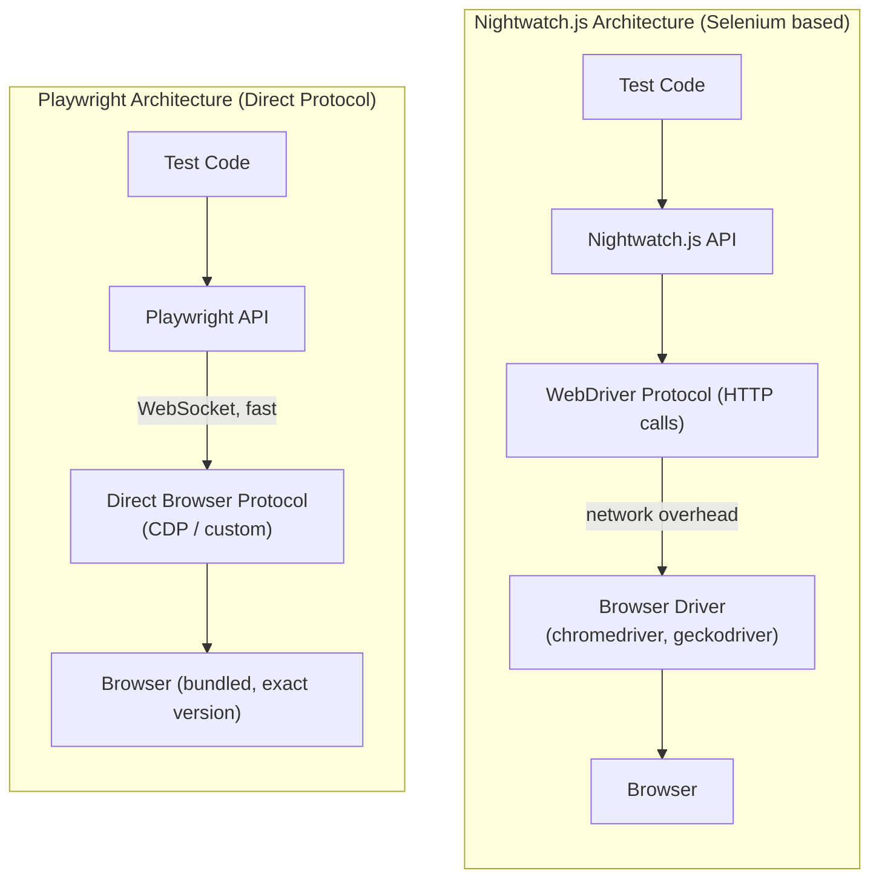

# Appendix A: Why Playwright Won -- The Journey from Nightwatch.js

---

I need to be honest with you about something. webship-js did not start with Playwright. The first version -- webship-js 1.0.x -- was built on top of Nightwatch.js. And for a while, it worked. It got the job done. Teams used it, tests ran, bugs got caught.

But as web applications grew more complex -- SPAs, dynamic content, client-side routing, WebSocket connections, lazy loading, iframes inside modals inside iframes -- Nightwatch.js started showing cracks. Not because it was a bad tool. It was a good tool for its time. But the web evolved, and the testing tools needed to evolve with it.

This appendix is the story of that evolution. If you are coming from Nightwatch.js, Selenium, or Cypress, this will help you understand why Playwright is the foundation of webship-js 2.0 -- and why it matters for your test suite.

---

## The Testing Tool Landscape

Let me lay it out. Here is the landscape as it stands today:

```
┌──────────────────────────────────────────────────────────────────┐
│ The Testing Tool Landscape (2024-2025)                           │
│                                                                  │
│  Generation 1: Selenium-Based                                    │
│  ├── Selenium WebDriver (2004)     The pioneer. Still alive.     │
│  ├── Nightwatch.js (2014)          Node.js + Selenium. Simple.   │
│  ├── WebdriverIO (2012)            Full-featured Selenium wrap.  │
│  └── Protractor (2013)             Angular-focused. Deprecated.  │
│                                                                  │
│  Generation 2: Non-Selenium                                      │
│  ├── Cypress (2017)                In-browser execution. Fast.   │
│  ├── TestCafe (2016)               Proxy-based. No WebDriver.    │
│  └── Puppeteer (2017)              Chrome DevTools Protocol.     │
│                                                                  │
│  Generation 3: Modern Multi-Browser                              │
│  └── Playwright (2020)             CDP + Firefox + WebKit.       │
│      Built by the team who made Puppeteer.                       │
│      This is where the industry is heading.                      │
│                                                                  │
└──────────────────────────────────────────────────────────────────┘
```

Each generation solved problems the previous one could not. Selenium gave us browser automation. Nightwatch.js made Selenium accessible to Node.js developers. Cypress made tests fast and developer-friendly. Playwright took everything that worked and fixed everything that did not.

---

## Nightwatch.js: What It Did Well

I do not want to bash Nightwatch.js. That would be unfair. Let me give credit where it is due.

Nightwatch.js made browser testing approachable for Node.js developers at a time when Selenium felt like configuring a spaceship. You installed it, pointed it at a browser, and wrote tests in JavaScript. The API was clean:

```javascript
// Nightwatch.js style
module.exports = {
  'Login test': function (browser) {
    browser
      .url('http://localhost:3000/login')
      .waitForElementVisible('#email', 5000)
      .setValue('#email', 'user@example.com')
      .setValue('#password', 'secret123')
      .click('#login-button')
      .waitForElementVisible('.dashboard', 5000)
      .assert.containsText('.welcome', 'Welcome')
      .end();
  }
};
```

That is readable. That is straightforward. For a traditional multi-page application with server-rendered HTML, this worked perfectly fine.

Nightwatch.js strengths:
- **Simple setup** for its era -- npm install and go
- **Clean chaining API** -- fluent, readable test code
- **Built-in assertions** -- .assert and .verify out of the box
- **Page Objects** -- first-class support for the Page Object pattern
- **Selenium ecosystem** -- access to the entire Selenium Grid infrastructure

For webship-js 1.0.x, Nightwatch.js was the right choice at the right time.

---

## Where Nightwatch.js Hit the Wall

But then the web changed. And the problems started piling up.

### Problem 1: The Selenium Bottleneck

Nightwatch.js talks to browsers through Selenium WebDriver. That means every command goes through an HTTP protocol layer:



Every single command in the Nightwatch.js stack is an HTTP request/response. Click a button? HTTP request. Read text? HTTP request. Check visibility? HTTP request. That adds up.

The Playwright stack keeps a persistent connection, so there is no HTTP overhead per command. Playwright controls the browser like a puppet master controls a puppet, directly, with no middleman.

The difference in speed is not marginal. It is dramatic. A test suite that takes 8 minutes on Nightwatch.js can run in 3 minutes on Playwright. When you are running tests on every push in CI, that difference is the difference between developers waiting and developers shipping.

### Problem 2: Flaky Waits

This is the one that hurt the most. Nightwatch.js uses `waitForElementVisible` with a timeout:

```javascript
// Nightwatch.js: hope-based waiting
browser.waitForElementVisible('#result', 10000);
// What if it takes 10001ms? Failure.
// What if it takes 50ms? You still configured for 10000ms.
// What if the element appears but the text hasn't loaded yet? Race condition.
```

Playwright's approach is fundamentally different:

```javascript
// Playwright: auto-waiting, built into every action
await page.click('#submit');
// Playwright automatically waits for the element to be:
// 1. Attached to the DOM
// 2. Visible
// 3. Stable (not animating)
// 4. Enabled (not disabled)
// 5. Not obscured by another element
// All of this happens automatically. No waitFor calls needed.
```

This is not a convenience feature. This is the single biggest reason Playwright tests are more reliable than Nightwatch.js tests. Every action in Playwright has auto-waiting built in. You do not sprinkle `waitForElementVisible` throughout your code and pray that the timeout is long enough. Playwright waits for exactly the right conditions, automatically.

In webship-js 2.0, this translates directly to the `wait for AJAX to finish` step that uses Playwright's `networkidle` wait state -- something that was never reliable in the Selenium world.

### Problem 3: Multi-Browser Reality

Nightwatch.js can run tests in Chrome, Firefox, and Edge through Selenium. But Safari? Only through Selenium Grid with specific configuration. And even then, the WebDriver implementations for each browser have different quirks, different timing, different bugs.

```
┌──────────────────────────────────────────────────────────────────┐
│ Multi-Browser Support Comparison                                 │
│                                                                  │
│                    Nightwatch.js          Playwright             │
│                                                                  │
│  Chromium          Via chromedriver       Bundled, exact version │
│  Firefox           Via geckodriver        Bundled, exact version │
│  WebKit/Safari     Painful / limited     Bundled, exact version │
│  Mobile Safari     Not practical          WebKit engine included │
│  Mobile Chrome     Via Appium (complex)   Chromium emulation     │
│                                                                  │
│  Driver management Manual / webdriver-    Automatic. One command:│
│                    manager setup          npx playwright install  │
│                                                                  │
│  Browser versions  Whatever is installed  Bundled. Pinned.       │
│                    on the machine         Reproducible.           │
│                                                                  │
│  "Works on my      Common problem.        Rare. Same browser     │
│   machine"         Different driver        binary in dev and CI.  │
│                    versions cause chaos.                          │
│                                                                  │
└──────────────────────────────────────────────────────────────────┘
```

Playwright bundles the browsers. You run `npx playwright install` and you get Chromium, Firefox, and WebKit -- the exact versions that Playwright was tested against. No driver version mismatches. No "it works in Chrome 120 but breaks in Chrome 121." No fighting with geckodriver versions.

For webship-js 2.0, this means `BROWSER=webkit npx cucumber-js` just works. No extra setup. No extra configuration. No extra headaches.

### Problem 4: Modern Web Features

Here is where Nightwatch.js really fell behind. The modern web has features that Selenium was never designed to handle:

```
┌──────────────────────────────────────────────────────────────────┐
│ Modern Web Features                                              │
│                                                                  │
│  Feature               Nightwatch.js       Playwright            │
│                                                                  │
│  Network interception  Not built-in        route() API           │
│  Request mocking       Third-party libs    Built-in              │
│  File downloads        Workarounds         Built-in              │
│  File uploads          Basic support       Full support + drag   │
│  Multiple tabs         Difficult           context.newPage()     │
│  iframes               Switchable          frameLocator()        │
│  Shadow DOM             Limited             Built-in support     │
│  Web Workers           No access            evaluate() access    │
│  Geolocation mock      Not supported       context.setGeoloc()  │
│  Permissions           Not supported       context.grantPerms()  │
│  Timezone override     Not supported       Built-in              │
│  Color scheme          Not supported       Built-in              │
│  Console log capture   Not built-in        page.on('console')   │
│  Network monitoring    Not built-in        page.on('request')   │
│  Video recording       Not built-in        Built-in              │
│  Tracing               Not built-in        Built-in              │
│                                                                  │
└──────────────────────────────────────────────────────────────────┘
```

Every one of these features exists in Playwright as a first-class API. No plugins. No workarounds. No "install this additional package and hope it works with your browser version."

### Problem 5: Debugging Experience

When a Nightwatch.js test fails, you get an error message and maybe a screenshot if you configured it. When a Playwright test fails, you can:

- Watch the test in headed mode with `HEADLESS=false`
- Slow it down with `SLOW_MO=500`
- Record a video of the entire test run
- Generate a trace file that lets you step through every action, see the DOM at each point, inspect network requests, and view console logs
- Use `page.pause()` to freeze execution and inspect the browser manually

The debugging experience alone would justify the switch.

---

## The Migration: webship-js 1.0 to 2.0

When I decided to move webship-js from Nightwatch.js to Playwright, the goal was clear: keep the same Gherkin steps that teams already knew, but make them faster, more reliable, and more capable underneath.

```
┌──────────────────────────────────────────────────────────────────┐
│ The webship-js Migration                                         │
│                                                                  │
│  What STAYED the same:                                           │
│  ├── Gherkin syntax (Given/When/Then)                            │
│  ├── Step text ("I fill in", "I press", "I should see")         │
│  ├── Cucumber-js as the BDD runner                               │
│  ├── Feature file structure                                      │
│  └── The testing philosophy (behavior over implementation)       │
│                                                                  │
│  What CHANGED:                                                   │
│  ├── Browser engine: Selenium → Playwright                       │
│  ├── World class: NightwatchWorld → PlaywrightWorld              │
│  ├── Selectors: CSS/XPath via WebDriver → Playwright locators   │
│  ├── Waits: explicit timeouts → auto-waiting                     │
│  ├── Speed: 2-3x faster execution                               │
│  └── Reliability: dramatically fewer flaky tests                 │
│                                                                  │
│  What teams experienced:                                         │
│  "We changed zero feature files. The Gherkin was identical.      │
│   But our CI pipeline went from 12 minutes to 4 minutes,         │
│   and our flaky test rate dropped from 8% to under 1%."          │
│                                                                  │
└──────────────────────────────────────────────────────────────────┘
```

That last point is critical. Because webship-js abstracts the browser automation behind Gherkin steps, the migration was invisible to anyone who only wrote feature files. The step definitions changed. The plumbing changed. But the language of the tests -- the business language -- stayed exactly the same.

This is the power of BDD done right. Your tests are not coupled to a tool. They are coupled to behavior. When the tool changes, the tests survive.

---

## Side-by-Side: The Same Test, Two Engines

Let me show you the same test scenario, implemented with both engines:

### The Feature File (Identical for Both)

```gherkin
Feature: Product Search
  Scenario: Search returns matching products
    Given I am on homepage
    When I fill in "Search" with "laptop"
    And wait for AJAX to finish
    Then I should see "Laptop Pro"
    And I should see "$999.99"
    And I should not see "Wireless Mouse"
```

### Under the Hood: Nightwatch.js (webship-js 1.0)

```javascript
// How the steps executed in webship-js 1.0 (Nightwatch.js)

// "I am on homepage"
browser.url(launchUrl);
browser.waitForElementVisible('body', 10000);

// "I fill in 'Search' with 'laptop'"
browser.waitForElementVisible('[name="Search"], #Search, .Search', 5000);
browser.setValue('[name="Search"]', 'laptop');

// "wait for AJAX to finish"
browser.pause(3000);  // <-- Yes, a hardcoded pause. Ugly but necessary.
// Nightwatch.js had no reliable "wait for all XHR to complete" mechanism.

// "I should see 'Laptop Pro'"
browser.assert.containsText('body', 'Laptop Pro');

// "I should not see 'Wireless Mouse'"
browser.expect.element('body').text.to.not.contain('Wireless Mouse');
```

### Under the Hood: Playwright (webship-js 2.0)

```javascript
// How the steps execute in webship-js 2.0 (Playwright)

// "I am on homepage"
await page.goto(launchUrl, { waitUntil: 'networkidle' });

// "I fill in 'Search' with 'laptop'"
const field = page.locator(buildSelector('Search'));
await field.fill('laptop');
// Playwright auto-waits for the field to be visible, enabled, and editable

// "wait for AJAX to finish"
await page.waitForLoadState('networkidle');
// Waits until there are no network requests for 500ms. Not a guess. A fact.

// "I should see 'Laptop Pro'"
await expect(page.locator('body')).toContainText('Laptop Pro');
// Playwright auto-retries this assertion until it passes or times out

// "I should not see 'Wireless Mouse'"
await expect(page.locator('body')).not.toContainText('Wireless Mouse');
```

See the difference? The Nightwatch.js version has a `pause(3000)` -- a prayer that 3 seconds is enough for the AJAX call to complete. The Playwright version has `waitForLoadState('networkidle')` -- a deterministic wait that resolves when the network is actually idle.

That `pause(3000)` is the root cause of more flaky tests than any other single line of code in the history of web testing. Sometimes the API responds in 200ms. Sometimes it takes 4 seconds because the database is under load. The pause does not care. It waits 3 seconds regardless, and when it is not enough, the test fails -- not because the feature is broken, but because the wait was wrong.

Playwright eliminates this entire class of bugs.

---

## What About Cypress?

People always ask me: "Why not Cypress?"

Cypress is an excellent tool. It has a beautiful developer experience, a time-travel debugger, and it made frontend testing fun for a generation of developers. I have respect for what the Cypress team built.

But Cypress has fundamental architectural limitations that make it wrong for webship-js:

```
┌──────────────────────────────────────────────────────────────────┐
│ Cypress vs Playwright for BDD Testing                            │
│                                                                  │
│  Limitation                  Cypress           Playwright        │
│                                                                  │
│  Multi-browser               Chrome-focused    Chromium+FF+WK   │
│  Multiple tabs               Not supported     Full support      │
│  Multiple domains            Workarounds       No restrictions   │
│  iframe support              Limited           frameLocator()    │
│  File download               Workarounds       Built-in          │
│  Hover actions               cy.trigger only   Native hover      │
│  Network layer               In-browser proxy  True interception │
│  Execution model             In-browser JS     Out-of-process    │
│  Language                    JavaScript only   JS, TS, Python,   │
│                                                Java, C#          │
│  BDD/Cucumber integration    Third-party       First-class with  │
│                              plugin            Cucumber-js        │
│                                                                  │
│  The deal-breaker for webship-js:                                │
│  Cypress runs INSIDE the browser. This means it cannot           │
│  control things outside the browser tab -- new tabs, downloads,  │
│  native dialogs, or cross-origin navigation.                     │
│                                                                  │
│  Playwright runs OUTSIDE the browser. It controls the browser    │
│  like a user would -- including everything the browser can do.   │
│                                                                  │
└──────────────────────────────────────────────────────────────────┘
```

For unit-style component testing in a React or Vue project, Cypress is fantastic. For full end-to-end functional acceptance testing of a real application with logins, file uploads, multiple roles, modals, and AJAX calls -- Playwright is the right tool.

---

## The Numbers

Here are real-world numbers from a mid-sized web application (Drupal CMS with 45 feature files, 180 scenarios):

```
┌──────────────────────────────────────────────────────────────────┐
│ Before and After: Nightwatch.js → Playwright                     │
│                                                                  │
│  Metric                    Nightwatch.js    Playwright           │
│                                                                  │
│  Full suite runtime        14 min 22 sec    5 min 08 sec        │
│  Flaky test rate           ~6-8%            < 1%                 │
│  Browser setup time        45 sec           12 sec               │
│  Failed due to timeouts    ~15/month        ~1/month             │
│  CI cost (compute time)    $340/month       $120/month           │
│  Browsers tested           Chrome, Firefox  Chromium, FF, WebKit │
│  Debugging experience      Screenshots      Traces + Video       │
│                                                                  │
│  Feature files changed     0 out of 45                           │
│  Step definitions changed  All (rewritten for Playwright)        │
│  Time to migrate           3 days                                │
│                                                                  │
│  ROI: Migration paid for itself in 2 months of saved CI costs.   │
│                                                                  │
└──────────────────────────────────────────────────────────────────┘
```

The 3x speed improvement is not magic. It comes from:
1. No HTTP overhead per command (direct protocol)
2. No hardcoded pauses (auto-waiting)
3. Faster browser launch (bundled, optimized)
4. Better parallelization (isolated browser contexts)

---

## If You Are Migrating from Nightwatch.js

Here is the practical advice:

### Step 1: Do Not Rewrite Your Feature Files

Your Gherkin is your specification. It does not change. If you are using webship-js, the feature files are identical between 1.0 and 2.0.

### Step 2: Update Your Dependencies

```bash
# Remove Nightwatch.js dependencies
npm uninstall nightwatch chromedriver geckodriver selenium-server

# Install Playwright
npm install playwright
npx playwright install

# Update webship-js
npm install webship-js@latest
```

### Step 3: Update Custom Step Definitions

If you wrote custom steps for Nightwatch.js, you need to rewrite them for Playwright:

```javascript
// Nightwatch.js custom step (OLD)
When('I hover over the menu', function () {
  this.browser.moveToElement('#main-menu', 10, 10);
});

// Playwright custom step (NEW)
When('I hover over the menu', async function () {
  await this.page.hover('#main-menu');
});
```

The pattern is consistent:
- `this.browser` becomes `this.page`
- Callbacks become async/await
- Explicit waits become unnecessary (Playwright auto-waits)
- `setValue` becomes `fill`
- `click` becomes `click` (but with auto-waiting)

### Step 4: Run Your Suite and Fix What Breaks

Most tests will pass immediately. The ones that fail are usually:
- Tests that relied on specific timing (remove hardcoded waits)
- Tests that used Nightwatch-specific APIs in custom steps
- Tests that assumed Selenium-specific behavior

Fix these one by one. It is a cleanup, not a rewrite.

---

## The Verdict

I am not going to pretend this is a balanced comparison. It is not. Playwright is better than Nightwatch.js for automated functional acceptance testing in almost every dimension that matters:

- **Faster** (direct protocol, no Selenium overhead)
- **More reliable** (auto-waiting eliminates flaky tests)
- **Better multi-browser** (Chromium + Firefox + WebKit, bundled)
- **More capable** (network interception, video, tracing, geolocation, permissions)
- **Better debugging** (traces, headed mode, video recording)
- **Better maintained** (Microsoft backs it, monthly releases, growing ecosystem)
- **Future-proof** (the industry is moving toward Playwright)

Nightwatch.js served us well. It was the bridge that got us from "no automated testing" to "tests run on every push." But the bridge has been crossed. Playwright is the destination.

If you are still on Nightwatch.js, you are not doing anything wrong. Your tests still run. Your bugs still get caught. But you are leaving speed, reliability, and capability on the table. The migration is measured in days, not months. And once you make it, you will wonder why you waited.

That is the story. webship-js 1.0 walked so webship-js 2.0 could run.

---
