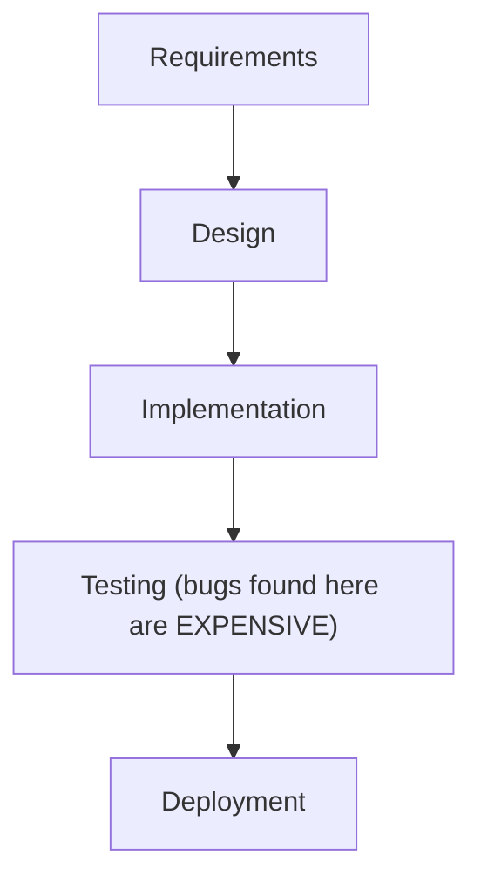
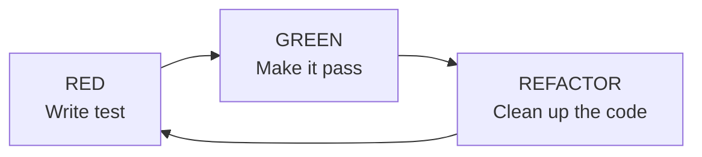
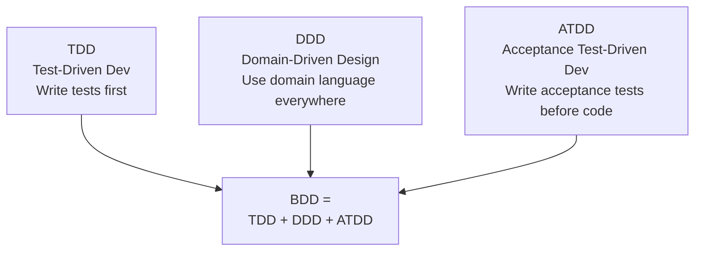
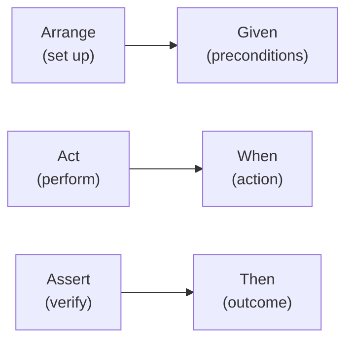
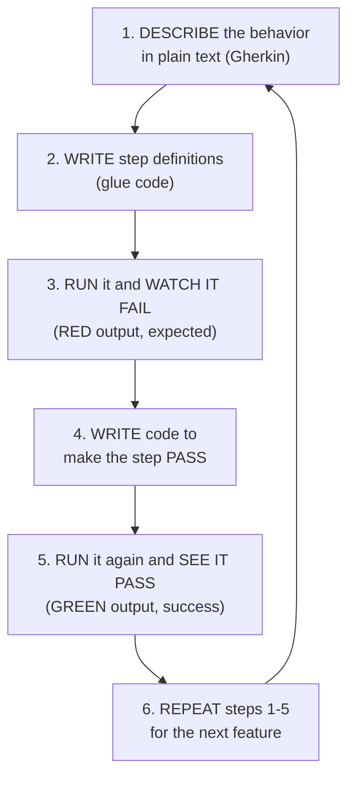

# Chapter 1: The World of BDD

---

## 1.1 The Problem with Traditional Testing

Let me paint a picture you have probably lived through.

A product manager writes a specification. It is 40 pages long, written in corporate language, and includes phrases like "the system shall provide seamless integration with downstream consumer-facing touchpoints." Nobody reads the whole thing. The developer skims it, makes assumptions, and starts building.

Three weeks later, the developer ships the feature. QA gets it. They find 14 bugs. The developer says "that is not a bug, it is working as designed." The PM says "that is not what I asked for." QA says "it crashes on Firefox." Everyone is frustrated. The deadline has passed.

This is not a failure of talent. Everyone on this team is capable. It is a failure of **communication**. The specification was ambiguous. The developer interpreted it one way. QA interpreted it another. The PM had a third mental model. Nobody realized they were talking about different things until the code was already written.

Now multiply this by every feature, every sprint, every team. The cost is staggering. Studies show that bugs found in production cost **30x more** to fix than bugs caught during requirements gathering. Not 30%. Thirty times.

The testing world tried to solve this with more testing. More unit tests. More integration tests. More manual QA cycles. More regression suites that take 8 hours to run. And it helped -- to a point. But it never fixed the root cause: the gap between what someone wanted and what someone built.

And if you are the QA lead who owns testing across ten or twenty projects -- not one -- the gap compounds. Each project has its own PM with their own vocabulary, its own developers with their own assumptions, and its own pile of test cases written in whatever style the last contractor preferred. The Tuesday before a release, someone asks you "is project X safe to ship?" and the honest answer is "I can tell you which tests passed, but I cannot tell you what they actually prove." That is the problem this book keeps coming back to: one team, many projects, and no shared definition of "correct." I lived this while maintaining the test suites for the Varbase distribution at Vardot, where the same features had to be verified across dozens of sites. The fix was never more tests. It was a shared language for what the tests mean.

### The Waterfall Testing Model

In the traditional waterfall model, testing happens at the end:



The problem is obvious: testing happens too late. By the time QA finds that the login page does not handle Unicode characters, the backend has been built, the frontend has been styled, the API has been deployed, and changing it requires touching five different systems.

### The Agile Shift

Agile methodologies moved testing earlier. Instead of one big test phase, you test in every sprint. But the fundamental problem remained: **who decides what "correct" means?** The developer writes tests based on their understanding. QA writes test cases based on their understanding. Neither might match what the product owner actually wanted.

What if there was a way to define "correct" before anyone writes a single line of code? What if that definition was so clear that a developer, a tester, and a product manager could all look at it and agree: "yes, that is exactly what we want"?

That is BDD.

---

## 1.2 A Brief History: From TDD to BDD

### Kent Beck and the Testing Revolution

In the late 1990s, Kent Beck was working on the Chrysler Comprehensive Compensation System (C3) project. He was practicing what would become known as Extreme Programming (XP), and at its core was an idea that seemed radical at the time: **write the test before you write the code.**

Test-Driven Development (TDD) was born from a simple observation. When you write tests first:

1. You think about what the code should do before you think about how
2. You end up with better-designed code (because testable code is well-structured code)
3. You have a regression safety net from day one
4. You know exactly when you are done (all tests pass)

TDD follows a tight cycle:



**RED**: Write a test that fails. This proves the test is actually testing something.
**GREEN**: Write the minimum code to make the test pass. No more.
**REFACTOR**: Clean up the code without changing behavior. The tests prove it still works.

TDD was a revolution. Teams that adopted it saw dramatic improvements in code quality. Kent Beck articulated four criteria for simple design:

1. **Passes all the tests** (correctness)
2. **Reveals all the intention** (readability)
3. **Contains no duplication** (maintainability)
4. **Uses fewest classes and methods** (simplicity)

But TDD had a limitation. It was a developer-centric practice. Tests were written in programming languages. They tested functions, classes, and methods. A product manager could not look at a JUnit test and understand what feature it was verifying. Tests were organized around technical components, not business features.

### Dan North's Revelation

In the mid-2000s, Dan North was teaching TDD to developers and kept running into the same questions:

- "Where do I start?"
- "What do I test?"
- "What do I NOT test?"
- "How much testing is enough?"

North realized that the problem was not with TDD itself but with how developers thought about tests. They were writing tests for classes and methods. They should have been writing tests for **behaviors**.

He described BDD as:

> "A second-generation, outside-in, pull-based, multiple-stakeholder, multiple-scale, high-automation, agile methodology."

Let me unpack that:

- **Second-generation**: Built on TDD's foundation
- **Outside-in**: Start from the user's perspective, work inward
- **Pull-based**: Features are pulled by business need, not pushed by developer curiosity
- **Multiple-stakeholder**: Everyone participates, not just developers
- **Multiple-scale**: Works for units, features, and systems
- **High-automation**: Everything that can be automated, is automated

But you do not need to memorize that definition. Here is the practical version:

**BDD is writing executable specifications in a language everyone on the team understands.**

### The Evolution Timeline

```
1999 ─── Kent Beck publishes "Extreme Programming Explained"
         TDD becomes a defined practice
         │
2003 ─── Dan North starts exploring "behavior" as an alternative
         to "test" in naming and thinking
         │
2006 ─── Dan North publishes "Introducing BDD"
         JBehave created (first BDD tool, Java)
         │
2008 ─── Aslak Hellesøy creates Cucumber (Ruby)
         Gherkin syntax introduced
         │
2011 ─── SpecFlow brings Cucumber to .NET
         Cucumber-JVM brings it to Java
         │
2012 ─── Cucumber official release (March 2012)
         Gherkin translated to 37+ languages
         │
2015 ─── Cucumber-js brings BDD to JavaScript/Node.js
         │
2020 ─── Playwright released (Microsoft)
         Modern browser automation
         │
2024 ─── webship-js 2.0 combines Playwright + Cucumber-js
         Pre-built steps for instant productivity
         │
2026 ─── AI-assisted BDD becomes mainstream
         Test-Drive-Develop framework
```

---

## 1.3 What Is Behaviour-Driven Development?

At its core, BDD is a collaboration methodology. Yes, it involves tools and tests, but the real value is in the **conversations** that happen while writing features.

Here is what the Cucumber Book says, and I agree completely: "Cucumber is really a **collaboration tool**, not just a testing tool."

Let me explain with an example.

### A Real Conversation

Imagine a Three Amigos session for an e-commerce checkout feature:

**Product Owner**: "When the user checks out, we charge their credit card and send a confirmation email."

**Developer**: "What happens if the credit card is declined?"

**Product Owner**: "Show an error message."

**Tester**: "What if the card is charged but the email server is down? Do we still confirm the order?"

**Product Owner**: "...yes. The order is confirmed even if the email fails. We will retry the email."

**Tester**: "What about partial failures? The card is charged $50 but the item costs $45 after a coupon is applied?"

**Product Owner**: "Wait, where does the coupon get applied? Before or after tax?"

**Developer**: "That depends on the state. Some states require tax on the pre-coupon amount."

That five-minute conversation just prevented three bugs, clarified a business rule, and identified a tax compliance requirement that would have cost thousands to fix in production.

Now let us write the scenarios:

```gherkin
Feature: Checkout
  As a customer with items in my cart
  I want to complete my purchase
  So that I receive my products

  Scenario: Successful checkout with valid credit card
    Given I have items totaling "$45.00" in my cart
    And I am on the checkout page
    When I fill in my credit card information
    And I press "Complete Purchase"
    And wait for AJAX to finish
    Then I should see "Order Confirmed"
    And I should see "A confirmation email has been sent"

  Scenario: Checkout with declined credit card
    Given I have items totaling "$45.00" in my cart
    And I am on the checkout page
    When I fill in an invalid credit card
    And I press "Complete Purchase"
    And wait for AJAX to finish
    Then I should see "Your card was declined"
    And I should not see "Order Confirmed"

  Scenario: Order confirmed even when email fails
    Given I have items totaling "$45.00" in my cart
    And I am on the checkout page
    When I fill in my credit card information
    And I press "Complete Purchase"
    And wait for AJAX to finish
    Then I should see "Order Confirmed"
```

Every person in that meeting can read these scenarios. Every person agrees on what "correct" looks like. And now these scenarios are **executable** -- they run against the real application and verify it works.

A note on that `wait for AJAX to finish` line, because it will appear throughout this book: it is a real webship-js step, and under the hood it calls smartSettle -- a routine that watches the page's live counters (`window.__webshipAjaxCount` for in-flight fetch/XHR calls, `window.__webshipPendingTimers` for pending timeouts, and a MutationObserver timestamp for DOM changes) and returns only when the page has genuinely gone quiet. The point for this chapter is simpler: there is no `sleep 5` anywhere. The scenario says what the user waits for, not how many seconds to guess. That discipline -- wait for events, never for time -- is what separates a suite people trust from a suite people rerun until it passes.

**At scale:** Here is what the product owner gets out of this. When these three scenarios pass on staging, the PO does not need to take engineering's word that checkout works -- they can read the green report themselves, line by line, in the same words they used in the meeting. Across many projects, that turns sign-off from a trust exercise into a reading exercise. The acceptance criteria the PO wrote ARE the tests; QA never rewrites them from scratch in a separate tool.

### The Formal Definition

BDD combines three established practices:



- **TDD** gives us the test-first discipline
- **DDD** gives us the shared language (ubiquitous language)
- **ATDD** gives us the outside-in perspective (start from user acceptance)

### KISS and YAGNI

BDD embraces two principles from agile development:

**KISS (Keep It Simple, Stupid)**: Write the simplest test that could fail. Write the simplest code that makes it pass. Do not over-engineer.

**YAGNI (You Ain't Gonna Need It)**: Do not write tests for features nobody asked for. Do not add functionality "just in case." Every scenario should trace back to a real business need.

### Minimum Marketable Feature (MMF)

BDD focuses on the **Minimum Marketable Feature** -- the smallest piece of functionality that delivers value to the user. Instead of planning a 6-month release with 200 features, BDD teams deliver a single feature that works perfectly, then add the next one.

Each MMF gets its own feature file with scenarios. When all scenarios pass, the feature is done. Ship it.

---

## 1.4 BDD vs TDD: Features vs Components

This distinction is critical. Let me make it concrete.

### What TDD Tests

TDD tests **components** -- classes, functions, methods. A TDD test for a calculator might look like:

```javascript
// TDD: Testing a component
describe('Calculator', () => {
  it('should add two numbers', () => {
    const calc = new Calculator();
    calc.push(50);
    calc.push(70);
    expect(calc.add()).toBe(120);
  });

  it('should throw on division by zero', () => {
    const calc = new Calculator();
    calc.push(10);
    calc.push(0);
    expect(() => calc.divide()).toThrow('Division by zero');
  });
});
```

If this test fails, you know the **Calculator class** is broken. But you do not know which **feature** is affected. Maybe the calculator is used in the checkout flow, the reporting dashboard, and the admin panel. Which user-facing feature broke?

### What BDD Tests

BDD tests **features** -- user actions and business behaviors:

```gherkin
Feature: Addition
  In order to avoid silly mistakes
  As a math idiot
  I want to be told the sum of two numbers

  Scenario: Add two numbers
    Given I have entered 50 into the calculator
    And I have entered 70 into the calculator
    When I press add
    Then the result should be 120 on the screen
```

If this test fails, you know the **addition feature** is broken. Any user who needs to add numbers is affected. The business impact is clear immediately.

### Comparison Table

```
┌──────────────────┬──────────────────────┬──────────────────────┐
│                  │       TDD            │       BDD            │
├──────────────────┼──────────────────────┼──────────────────────┤
│ Tests what?      │ Components           │ Features             │
│ Written by?      │ Developers           │ Team (3 Amigos)      │
│ Language?        │ Programming language │ Gherkin (plain text) │
│ Audience?        │ Developers           │ Everyone             │
│ Granularity?     │ Function/class       │ User story/feature   │
│ On failure?      │ Know which component │ Know which feature   │
│ Maintenance?     │ Devs maintain        │ Team maintains       │
│ Documentation?   │ Code comments        │ Living specification │
│ Speed?           │ Very fast (ms)       │ Slower (seconds)     │
│ When to run?     │ Every save           │ Every commit/push    │
└──────────────────┴──────────────────────┴──────────────────────┘
```

### When to Use Each

- **Small project, one developer**: TDD alone might suffice
- **Larger project, multiple stakeholders**: BDD for features, TDD for components
- **API-heavy project**: BDD for endpoints, TDD for business logic
- **Frontend-heavy project**: BDD for user flows, TDD for utilities

For most real-world projects, **combine both**. BDD at the feature level. TDD at the component level. They complement each other perfectly.

**At scale:** The "on failure" row in that table matters more than it looks. When you run nightly suites across 20 projects, the morning triage question is never "which class broke?" -- it is "which user-facing feature broke, on which product, and does it block the release?" Feature-level failures answer that directly: `login.feature` failed on project X means login is broken on project X, and the delivery manager can read that sentence without an engineer translating. Component-level failures need a developer from that specific project to interpret them, and across 20 projects you do not have 20 spare developers at 9 a.m.

---

## 1.5 The Three Amigos Pattern

The Three Amigos is not a meeting. It is a **conversation format**. Three perspectives come together before a single line of code is written:

### The Three Perspectives

<!-- diagram: bdd-flow -->

```
                    ┌─────────────────┐
                    │ Product Owner   │
                    │                 │
                    │ "What should    │
                    │  we build?"     │
                    │                 │
                    │ Cares about:    │
                    │ - Scope         │
                    │ - Business value│
                    │ - Edge cases    │
                    │   to SKIP       │
                    └────────┬────────┘
                             │
              ┌──────────────┼──────────────┐
              │              │              │
    ┌─────────▼──────┐      │     ┌────────▼─────────┐
    │   Developer    │      │     │     Tester       │
    │                │      │     │                  │
    │ "How do we     │      │     │ "How do we       │
    │  build it?"    │      │     │  break it?"      │
    │                │      │     │                  │
    │ Cares about:   │      │     │ Cares about:     │
    │ - Feasibility  │      │     │ - Edge cases     │
    │ - Architecture │      │     │ - Error states   │
    │ - Technical    │      │     │ - Security       │
    │   constraints  │      │     │ - Performance    │
    └────────────────┘      │     └──────────────────┘
                            │
                   ┌────────▼────────┐
                   │                 │
                   │    Scenarios    │
                   │  (the output)   │
                   │                 │
                   └─────────────────┘
```

### Running a Three Amigos Session

**Duration**: 15-30 minutes per user story. No longer.

**Input**: A user story or requirement. Even a one-liner is fine.

**Process**:
1. Product Owner describes the feature in their words
2. Developer asks "how" questions (technical constraints)
3. Tester asks "what if" questions (edge cases)
4. Together, they write the scenarios in Gherkin
5. Everyone agrees: "if these scenarios pass, this feature is done"

**Output**: A set of Gherkin scenarios that everyone understands and agrees on.

### Example: Three Amigos for a Search Feature

**PM**: "Users should be able to search for products."

**Dev**: "Full-text search or just exact match? Do we search titles only or descriptions too?"

**PM**: "Start with titles. We can add descriptions later."

**Tester**: "What happens when there are no results?"

**PM**: "Show a helpful message. Maybe suggest similar products."

**Tester**: "What about special characters? SQL injection?"

**Dev**: "We parameterize all queries, but good point -- let us test that it does not crash."

**Tester**: "What about very long search terms?"

**PM**: "Truncate to 200 characters."

Result:

```gherkin
Feature: Product Search
  As a customer
  I want to search for products by title
  So that I can find what I am looking for

  Scenario: Search with matching results
    Given I am on homepage
    When I fill in "Search" with "laptop"
    And I press "Search"
    And wait for AJAX to finish
    Then I should see "Search results for: laptop"
    And I should see "MacBook Pro"

  Scenario: Search with no results
    Given I am on homepage
    When I fill in "Search" with "xyznonexistent"
    And I press "Search"
    And wait for AJAX to finish
    Then I should see "No products found"
    And I should see "Try a different search term"

  Scenario: Search with special characters
    Given I am on homepage
    When I fill in "Search" with "laptop'; DROP TABLE products;--"
    And I press "Search"
    And wait for AJAX to finish
    Then I should see "No products found"
    And I should not see "error"
```

Notice: the security test is right there alongside the happy path. The tester's perspective caught it. The PM agreed it mattered. The developer knows to parameterize queries. All from a 15-minute conversation.

**At scale:** When one QA team supports many product teams, you cannot sit in every Three Amigos session -- and you should not try. What works instead: run the session with the first two or three features of each new project, write those scenarios together, and leave them in the repository as the house style. The next PO who writes acceptance criteria copies the shape of what is already there. The scenarios become the onboarding document, the writing template, and the quality bar, all at once. The third project you onboard goes faster than the first because the conversation format travels with the files.

---

## 1.6 Given-When-Then: The Universal Language

The Given-When-Then format was inspired by the Arrange-Act-Assert pattern from TDD:



But there is a critical difference. Arrange-Act-Assert is for developers. Given-When-Then is for everyone.

### The Keywords in Detail

**Given** -- Set up the world. Put the system in a known state.

```gherkin
Given I am on homepage
Given I am a logged in user with the "admin" user
Given I am on "/products"
```

Givens are preconditions. They describe the state **before** the interesting thing happens. They should not trigger the behavior being tested -- they just set the stage.

**When** -- The action. The thing the user does.

```gherkin
When I fill in "Email" with "user@example.com"
When I press "Submit"
When I click "Delete"
When I go to "/dashboard"
```

Each scenario should have one key **When** action. The When is the trigger -- the event that causes the behavior being tested. You might have multiple When steps to describe a sequence of actions, but they should all serve the same behavior.

**Then** -- The assertion. What should be true after the action.

```gherkin
Then I should see "Welcome back"
Then I should not see "Error"
Then the API response code should be 200
Then ".cart-badge" should be visible
```

Then steps verify the outcome. They check the observable result. Importantly, they check what the **user** can see, not what the database contains or what internal state changed.

One detail worth knowing early: in webship-js, Then steps are not one-shot checks. The web-first assertions (like `should be visible`) poll the live page every 100ms for up to 5 seconds before giving up. The assertion IS the wait. That single design decision eliminates the largest source of flaky tests -- asserting a millisecond before the page finished rendering.

**And / But** -- Continue the previous keyword type.

```gherkin
Given I am on homepage
  And I am a logged in user with the "admin" user   # This is a Given

When I fill in "Title" with "My Post"
  And I press "Publish"                               # This is a When

Then I should see "Post published"
  And I should not see "Draft"                        # This is a Then
  But I should not see "Error"                        # Also a Then
```

`And` and `But` are syntactic sugar. Cucumber treats them identically to whatever keyword came before. They exist purely for readability.

### The Golden Rules

1. **Given steps should not trigger the behavior being tested.** If your test is about login, the Given should set up the preconditions (navigate to login page), not perform the login itself.

2. **When steps should describe user actions, not system actions.** "When the system processes the payment" is wrong. "When I press 'Pay Now'" is right.

3. **Then steps should check observable outcomes.** "Then the database should have a new user record" is wrong. "Then I should see 'Registration successful'" is right.

4. **Keep each scenario focused on one behavior.** If you are testing login AND dashboard display AND notification count, split them into three scenarios.

---

## 1.7 Living Documentation

This is one of the most undervalued benefits of BDD.

### The Documentation Problem

Every software project has documentation. And every software project has documentation that is wrong.

Requirements documents become outdated the moment development starts. Wiki pages describe features that were redesigned months ago. API docs reference endpoints that no longer exist. README files have installation instructions that have not worked since 2023.

The root cause is simple: documentation and code are maintained separately. They drift apart over time. Nobody notices until someone follows the docs and gets lost.

### Features as Specification

BDD feature files solve this problem because they are **both** documentation and tests:

```
┌─────────────────────────────────────────────────┐
│                                                 │
│   Traditional:                                  │
│                                                 │
│   ┌──────────────┐    ┌──────────────┐         │
│   │Documentation │    │    Code      │         │
│   │              │    │              │         │
│   │ (gets stale) │    │ (evolves)    │         │
│   └──────────────┘    └──────────────┘         │
│         ↑                    ↑                   │
│         │   They drift apart │                   │
│         └────────────────────┘                   │
│                                                 │
│   BDD:                                          │
│                                                 │
│   ┌──────────────────────────────────┐         │
│   │  Feature Files                   │         │
│   │                                  │         │
│   │  = Documentation + Tests         │         │
│   │                                  │         │
│   │  If the doc says X and the app   │         │
│   │  does Y, the TEST FAILS.        │         │
│   │  The team notices. It gets fixed.│         │
│   └──────────────────────────────────┘         │
│                                                 │
└─────────────────────────────────────────────────┘
```

When a feature file says:

```gherkin
Scenario: Successful login
  Given I am on homepage
  When I go to "/login"
  And I fill in "Email" with "user@example.com"
  And I fill in "Password" with "ValidPass123"
  And I press "Sign In"
  Then I should see "Dashboard"
```

If someone redesigns the login page and changes "Sign In" to "Log In", the test fails. The team updates the feature file. The documentation stays current. Automatically. Without anyone having to "remember to update the docs."

### The Regression Safety Net

Living documentation gives you something else for free: **regression testing**.

Every feature file is a specification of how the system should behave. Every time you run the test suite, you verify that every specified behavior still works. If a code change breaks something, you know immediately -- and you know exactly which feature is broken.

This is far more valuable than a test suite organized by class or module. When the `UserController.test.js` fails, you have to figure out which feature is affected. When `login.feature` fails, the feature that is broken is right there in the filename.

**At scale:** Living documentation pays out twice when you run many projects. First, for the delivery manager: a feature file that passed last night is evidence, not opinion -- "is release X safe?" becomes "here are the 84 behaviors we verified at 2 a.m., read any of them." Second, for the team itself: when a QA engineer rotates from project A to project B, the feature files are the spec for project B. Nobody has to schedule a knowledge-transfer meeting for documentation that executes itself nightly. The catch is consistency -- this only works if all your projects write features in the same style, which is exactly why the conventions in Chapter 3 matter more than any individual scenario.

---

## 1.8 The BDD Workflow Cycle

BDD follows a cycle similar to TDD but at a higher level:



"Repeat until green like a Cuke."

### Step by Step

1. **Describe the behavior in plain text.** Write a Gherkin feature file with one or more scenarios. This is the specification.

2. **Write step definitions.** Connect the plain-text steps to code. With webship-js, most steps are already written for you -- 411 built-in steps across 36 step files cover navigation, forms, web-first assertions, API calls, cookies, accessibility audits, network mocking, and more. For a typical web project, you reach for custom step definitions only when your domain demands it.

3. **Run it and watch it fail.** The test should fail because the feature does not exist yet. This is the "RED" state. If it passes without any code, either the test is wrong or the feature already exists.

4. **Write code to make the step pass.** Implement the minimum code needed. Do not over-engineer. Do not add features nobody asked for.

5. **Run it again and see it pass.** The test should now be "GREEN." If it is not, debug and fix.

6. **Repeat.** Pick up the next scenario or the next feature. Keep going "until the money runs out" (as the jf13 presentation humorously puts it).

### The Cucumber Execution Flow

When Cucumber runs, each step results in one of four outcomes:

```
┌──────────────┬──────────┬──────────────────────────────────────┐
│ Outcome      │ Color    │ Meaning                              │
├──────────────┼──────────┼──────────────────────────────────────┤
│ Passed       │ GREEN    │ Step ran and assertion succeeded      │
│ Failed       │ RED      │ Step ran but assertion failed         │
│ Pending      │ YELLOW   │ Step definition exists but incomplete │
│ Undefined    │ YELLOW   │ No step definition found              │
│ Skipped      │ CYAN     │ Step after a failure (not executed)   │
└──────────────┴──────────┴──────────────────────────────────────┘
```

When a step fails, all subsequent steps in that scenario are **skipped**. Cucumber does not try to run steps after a failure because the system is in an unknown state.

One more thing happens between your steps that you never see in the output. After every state-changing step, webship-js runs an AfterStep hook that calls smartSettle with a 1500ms budget -- it waits for in-flight AJAX to reach zero, pending timers to drain, and the DOM to stay quiet for at least 250ms before the next step runs. This is why a scenario that clicks, fills, and asserts in quick succession does not trip over its own speed. The repo rule behind it is blunt and worth adopting everywhere: no static sleeps, anywhere. Wait for events, not for time.

---

## 1.9 Cucumber: The Right Tool

### The Tools Landscape

There are many BDD and testing tools available. They fall on a spectrum from "very technical" to "very accessible":

```
Technical ◄─────────────────────────────────────────► Non-technical

JUnit    Tumbler   Concordion   FitNesse   Robot    JBehave   Cucumber
  │                                        Framework            │
  │                                                              │
  │ Requires deep                    Gherkin: readable by       │
  │ programming knowledge            anyone on the team         │
  │                                                              │
  └──────────────────────────────────────────────────────────────┘
```

Cucumber sits at the far right of this spectrum. It is the **least technical** BDD tool, which means it is the most accessible. Non-developers can read, write, and maintain Gherkin scenarios. That is its superpower.

### Why Cucumber (and by extension, webship-js)?

1. **It descends from RSpec.** It has a mature, battle-tested lineage in the testing world.

2. **It is actively maintained.** Cucumber has been an active open-source project since 2008 with regular releases.

3. **It supports multiple languages.** Gherkin can be written in 47 human languages. Step definitions can be written in Ruby, Java, JavaScript, Python, .NET, and more.

4. **The audience is everyone.** Feature files are read by customers and developers. They are maintained by product owners and developers. They serve both as specification and as tests.

```
┌─────────────────────────────────────────────────┐
│                 Audience                         │
│                                                 │
│  Readers:              Maintainers:             │
│  ├── Customers         ├── Product Owners       │
│  ├── Developers        ├── Developers           │
│  ├── Managers          └── Testers              │
│  └── QA Team                                    │
│                                                 │
│  Everyone reads.       The team maintains.      │
│  Everyone understands. Tests keep them honest.  │
│                                                 │
└─────────────────────────────────────────────────┘
```

### The Cucumber Architecture Pattern

Cucumber operates in three layers:

```
┌─────────────────────────────────────────────────┐
│                                                 │
│  Layer 1: SPECIFICATION (Gherkin)               │
│  ┌───────────────────────────────────────────┐  │
│  │ Feature: Login                            │  │
│  │   Scenario: Successful login              │  │
│  │     Given I am on "/login"                │  │
│  │     When I fill in "Email" with "x@y.z"   │  │
│  │     When I press "Login"                  │  │
│  │     Then I should see "Dashboard"         │  │
│  └───────────────────┬───────────────────────┘  │
│                      │ Execute Specification     │
│                      ▼                           │
│  Layer 2: STEPS - GLUE CODE (JavaScript)        │
│  ┌───────────────────────────────────────────┐  │
│  │ Given('I am on {string}', async (url) => {│  │
│  │   await page.goto(url);                   │  │
│  │ });                                       │  │
│  └───────────┬──────────────┬────────────────┘  │
│    Execute SUT │              │ Assert SUT        │
│              ▼              ▼                    │
│  Layer 3: SYSTEM UNDER TEST                     │
│  ┌───────────────────────────────────────────┐  │
│  │                                           │  │
│  │        Your Web Application               │  │
│  │                                           │  │
│  └───────────────────────────────────────────┘  │
│                                                 │
└─────────────────────────────────────────────────┘
```

The specification (Gherkin) drives the glue code (step definitions), which drives the system under test (your application). The step definitions both **execute** the SUT (navigate, click, fill) and **assert** against it (check content, verify state).

---

## 1.10 The Skills Pyramid

Building effective BDD tests requires skills from both the testing world and the software development world:

```
                    ┌───────────────────┐
                    │                   │
                    │  Gherkin Features │  Testing Skill
                    │  (plain text)     │  
                    │                   │  ← Product Owners,
                    ├───────────────────┤    Testers, Developers
                    │                   │
                    │ Step Definitions  │  Both Skills
                    │ (glue code)       │  
                    │                   │  ← Developers + Testers
                    ├───────────────────┤
                    │                   │
                    │  Support Code     │  Software Design Skill
                    │  (helpers, hooks) │  
                    │                   │  ← Developers
                    ├───────────────────┤
                    │                   │
                    │ Automation Libs   │  Software Design Skill
                    │ (Playwright, etc) │  
                    │                   │  ← Developers
                    └───────────────────┘
```

**Gherkin features** are at the top. They require testing skill -- knowing what to test, what edge cases matter, and how to express requirements clearly. Product owners and testers excel here.

**Step definitions** are in the middle. They bridge the human-readable Gherkin and the technical automation. Both testing and development skills are needed.

**Support code and automation libraries** are at the bottom. They require software design skill -- clean architecture, good abstractions, maintainable code. Developers own this layer.

**webship-js dramatically simplifies this pyramid** by providing the middle and bottom layers out of the box. The 411 built-in step definitions are the middle layer, written once and battle-tested; Playwright 1.58 plus the PlaywrightWorld support code is the bottom. Your team only needs to focus on the top: writing great Gherkin features.

**At scale:** This pyramid is also a staffing model. If every project carries its own middle and bottom layers, every project needs a developer who maintains glue code -- multiply that by 20 projects and you have a hidden engineering team doing nothing but step-definition upkeep. When the layers below Gherkin are shared (one framework version, one selector convention, one upgrade path), a QA engineer who learns the step vocabulary on one project is productive on all of them the same day. That is the real argument for a common framework across your portfolio: not elegance, headcount.

---

## Chapter Summary

- Testing after development is expensive. BDD moves testing to the beginning.
- BDD = TDD + DDD. It combines test-first discipline with shared domain language.
- Given-When-Then maps to Arrange-Act-Assert but is readable by everyone.
- The Three Amigos (PO + Dev + Tester) collaborate on scenarios before coding.
- Feature files serve as living documentation that cannot go stale.
- The BDD cycle: Describe → Step Definition → Fail → Implement → Pass → Repeat.
- Cucumber is the most accessible BDD tool, readable by non-developers.
- webship-js provides the full BDD stack: Gherkin + Playwright + pre-built steps.

In the next chapter, we will set up webship-js and write our first real tests.
