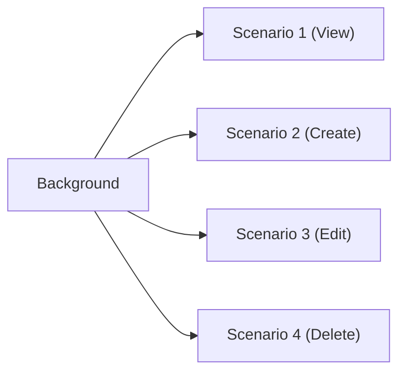

# Chapter 3: Gherkin Deep Dive

---

Gherkin is the language that makes BDD accessible to everyone. It is small, structured, and designed to be read by humans first, parsed by machines second. In this chapter, we will explore every feature of Gherkin with practical examples.

---

## 3.1 The Gherkin Language

Gherkin is not a programming language. It is a **specification language**. Its purpose is to describe software behavior in a way that is simultaneously:

- Readable by business people
- Writable by testers and product owners
- Executable by Cucumber

### The Complete Keyword Reference

```
┌──────────────────┬─────────────────────────────────────────────────┐
│ Keyword          │ Purpose                                         │
├──────────────────┼─────────────────────────────────────────────────┤
│ Feature          │ Groups related scenarios, describes the feature │
│ Rule             │ Groups scenarios under a business rule          │
│ Background       │ Shared setup steps for all scenarios            │
│ Scenario         │ A single concrete example (test case)           │
│ Scenario Outline │ A template with placeholders for data           │
│ Examples         │ Data table for Scenario Outline                 │
│ Given            │ A precondition (setup the system state)         │
│ When             │ An action (the trigger being tested)            │
│ Then             │ An expected outcome (assertion)                 │
│ And              │ Continues the previous Given/When/Then          │
│ But              │ Continues with a contrast (still same type)     │
│ *                │ Wildcard step (matches any keyword)             │
│ @tag             │ Metadata for filtering and hooks                │
│ #                │ Comment (ignored by Cucumber)                   │
│ """              │ Doc String delimiter (multiline text)           │
│ |                │ Data Table column separator                     │
└──────────────────┴─────────────────────────────────────────────────┘
```

### Feature File Anatomy

```gherkin
@tag1 @tag2                          # Tags (optional)
Feature: Feature Title               # Required
  As a <role>                        # Description (optional)
  I want to <action>                 #   - free-form text
  So that <business value>           #   - not parsed by Cucumber

  Background:                        # Shared setup (optional)
    Given some common precondition   #   - runs before EACH scenario

  @tag3                              # Scenario-level tags
  Scenario: Scenario Title           # A concrete example
    Given a precondition             # Setup
    When I do something              # Action
    Then something should happen     # Expected outcome

  Scenario Outline: Template         # Parameterized scenario
    Given a <thing>                  # Placeholders in angle brackets
    When I do <action>
    Then I should see <result>

    Examples:                        # Data table
      | thing  | action | result  |  # Header row
      | apple  | eat    | eaten   |  # Each row = one scenario run
      | banana | peel   | peeled  |
```

---

## 3.2 Features and Scenarios

### Recipe 1: Writing a Complete Feature

**Problem:** The shopping cart breaks for the second sprint in a row, and the post-mortem reveals there was exactly one cart test -- the happy path someone wrote on day one. Nobody ever sat down and asked "what are ALL the behaviors this cart promises?" You need a feature file that covers the promises, not just the demo, and you need its shape to be something the next person can extend without inventing their own structure.

**Solution:**

```gherkin
Feature: Shopping Cart
  As a customer browsing the online store
  I want to add products to my shopping cart
  So that I can purchase multiple items at once

  Scenario: Add a single item to empty cart
    Given I am on homepage
    When I go to "/products/laptop"
    And I press "Add to Cart"
    And wait for AJAX to finish
    Then I should see "1 item in cart"

  Scenario: Add multiple different items
    Given I am on homepage
    When I go to "/products/laptop"
    And I press "Add to Cart"
    And wait for AJAX to finish
    When I go to "/products/mouse"
    And I press "Add to Cart"
    And wait for AJAX to finish
    Then I should see "2 items in cart"

  Scenario: Remove item from cart
    Given I am on homepage
    When I go to "/products/laptop"
    And I press "Add to Cart"
    And wait for AJAX to finish
    When I go to "/cart"
    And I press "Remove"
    And wait for AJAX to finish
    Then I should see "Your cart is empty"

  Scenario: Cart shows total price
    Given I am on homepage
    When I go to "/products/laptop"
    And I press "Add to Cart"
    And wait for AJAX to finish
    When I go to "/cart"
    Then I should see "Total:"
    And I should see "$"
```

**How It Works:**

Each scenario is completely independent. Scenario 2 does not depend on scenario 1. Scenario 3 adds an item and then removes it within the same scenario. This independence is critical for reliable tests -- and webship-js enforces it physically: every scenario gets a fresh browser context, so cookies, localStorage, and the cart itself start empty each time. A scenario that "worked because the previous one left an item in the cart" is impossible by construction.

The `wait for AJAX to finish` step is an explicit call to smartSettle with a 10-second budget -- it watches the page's in-flight request counter (`window.__webshipAjaxCount`), pending timers, and DOM mutations, and returns the moment all three go quiet. Strictly speaking you often do not need it, because webship-js already auto-settles after every state-changing step; keeping it after a click that triggers a cart update is a readable way to say "this action is asynchronous, and we know it."

The Feature description (As a / I want / So that) is free-form text that Cucumber ignores during execution. It serves as documentation for humans -- and it shows up in generated reports, where a manager scanning results reads it as the answer to "what does this feature do?"

**At scale:** One behavior per scenario is the rule that keeps this maintainable -- it is a hard rule in the webship-js repo itself. The temptation on a deadline is one mega-scenario that adds, removes, and checks totals in 30 steps. Resist it: when the mega-scenario fails, the report says "cart is broken" and someone still has to debug which of five behaviors died. Four small scenarios fail precisely, and across 20 projects, precise failures are what make a 7 a.m. triage of overnight runs take minutes instead of hours.

### Recipe 2: The User Story Format

**Problem:** Six months from now, someone will open this feature file during an incident and need to know in ten seconds what it protects and why it matters. If the file starts with `Feature: test_login_v2_final`, they get nothing. The three description lines under the Feature title are where you buy that future reader their ten seconds -- and where the product owner's intent survives after the PO has moved to another project.

**Solution:**

The standard format is:

```gherkin
Feature: <Title>
  As a <role>
  I want to <capability>
  So that <business benefit>
```

Real examples:

```gherkin
Feature: Password Reset
  As a forgetful user
  I want to reset my password via email
  So that I can regain access to my account

Feature: Order Tracking
  As a customer who placed an order
  I want to track my shipment in real time
  So that I know when to expect delivery

Feature: Admin User Management
  As a system administrator
  I want to create and manage user accounts
  So that I can control who has access to the system

Feature: Product Search
  As a shopper looking for specific products
  I want to search by keyword and filter by category
  So that I can find what I need quickly
```

**Pro Tip:** If you cannot articulate the "So that" (business benefit), question whether the feature needs to exist. Every feature should deliver measurable value.

**At scale:** The description block is also your prioritization metadata. When the CI budget forces a choice about which suites run on every commit versus nightly, "As a customer / So that I can purchase" outranks "As an admin / So that reports are sorted" -- and the ranking is readable by the delivery manager making the call, not just the engineer who wrote the test. Write the business value down once, in the file, and you never have to re-litigate it in a meeting.

### Recipe 3: Multiple Scenarios -- The Happy Path and Beyond

**Problem:** Your suite is green for months, then a user pastes `<script>` into the newsletter box, or submits the form empty, and production throws a 500. The happy path was tested; nothing else was. The hard part is not writing failure scenarios -- it is remembering to ask for them, systematically, for every feature, before the incident does the asking.

**Solution:**

Always start with the **happy path** (the expected, successful flow), then add failure scenarios and edge cases:

```gherkin
Feature: Newsletter Subscription
  As a visitor
  I want to subscribe to the newsletter
  So that I receive updates about new products

  # Happy path -- the expected flow
  Scenario: Successful subscription with valid email
    Given I am on homepage
    When I fill in "Email" with "reader@example.com"
    And I press "Subscribe"
    And wait for AJAX to finish
    Then I should see "Thank you for subscribing!"

  # Failure: invalid input
  Scenario: Subscription with invalid email
    Given I am on homepage
    When I fill in "Email" with "not-an-email"
    And I press "Subscribe"
    Then I should see "Please enter a valid email address"

  # Failure: empty input
  Scenario: Subscription with empty email
    Given I am on homepage
    When I press "Subscribe"
    Then I should see "Email is required"

  # Edge case: already subscribed
  Scenario: Subscription with already subscribed email
    Given I am on homepage
    When I fill in "Email" with "existing@example.com"
    And I press "Subscribe"
    And wait for AJAX to finish
    Then I should see "This email is already subscribed"

  # Edge case: XSS attempt
  Scenario: Subscription with script injection
    Given I am on homepage
    When I fill in "Email" with "<script>alert('xss')</script>"
    And I press "Subscribe"
    Then I should see "Please enter a valid email address"
    And I should not see "alert"
```

**How It Works:**

The order is deliberate: happy path first, failures second, edge cases last. The happy path documents the feature's purpose; the failure scenarios document its contract under bad input; the edge cases document the conversations your Three Amigos session surfaced. Notice which scenarios keep the `wait for AJAX to finish` step -- only the ones where the server round-trip happens. Client-side validation ("not-an-email") fires instantly, so the scenario asserts immediately and the web-first text check does any remaining waiting itself.

**At scale:** Make the five-scenario shape (happy, invalid, empty, duplicate, injection) a house pattern for every input form across your projects. Reviewers stop checking "are there enough tests?" and start checking "which of the five is missing, and is that omission deliberate?" That question fits in a PR comment. The new hire's first feature file gets reviewed against a pattern instead of a feeling.

---

## 3.3 Background: Shared Setup

### Recipe 4: Using Background for Common Steps

**Problem:** Your admin feature file has nine scenarios and every single one opens with the same three lines: log in, navigate, wait. Then the login flow changes, and you edit nine copies -- and miss one, and spend an afternoon on a "failure" that was just a stale setup line. Repeated setup is not only noise; it is nine chances for the copies to drift apart.

**Solution:**

```gherkin
Feature: Blog Post Management
  As an admin
  I want to manage blog posts
  So that I can keep the website content fresh

  Background:
    Given I am a logged in user with the "admin" user
    And I go to "/admin/posts"
    And wait for AJAX to finish

  Scenario: View list of posts
    Then I should see "All Posts"
    And I should see "Create New Post"

  Scenario: Create a new blog post
    When I press "Create New Post"
    And wait for AJAX to finish
    And I fill in "Title" with "Testing with webship-js"
    And I fill in the WYSIWYG field "Body" with the "<p>This is a great tool for BDD.</p>"
    And I press "Save"
    And wait for AJAX to finish
    Then I should see "Post created successfully"

  Scenario: Edit an existing post
    When I click "Edit" in "First Post" row
    And wait for AJAX to finish
    And I fill in "Title" with "Updated Title"
    And I press "Save"
    And wait for AJAX to finish
    Then I should see "Post updated successfully"

  Scenario: Delete a post
    Given I will accept the next dialog
    When I click "Delete" in "Old Post" row
    And wait for AJAX to finish
    Then I should not see "Old Post"
```

**How It Works:**

The Background runs before **every** scenario. In this example, every scenario starts logged in and on the admin posts page. Without Background, each scenario would repeat those three lines.

Three steps here deserve a closer look. `I am a logged in user with the "admin" user` is a custom step -- the kind you will build yourself in Chapter 17 (the built-in route is the auth-state steps, which save a logged-in session once and restore it per scenario). The WYSIWYG step targets CKEditor and contenteditable fields, which ordinary fill steps cannot reach because the editable area is not a normal input. And the dialog step comes **before** the click on purpose: Playwright dialogs must be armed in advance. `Given I will accept the next dialog` registers a one-shot handler; when the Delete button fires `confirm()`, the handler accepts it. Put the step after the click and the dialog has already appeared with nobody listening -- the scenario hangs until the 45-second step timeout kills it.



**At scale:** Background runs are multiplication you pay for in CI minutes. A 10-second login Background in front of 15 scenarios is 2.5 minutes per feature, per project, per nightly run. This is exactly what the built-in auth-state steps exist for: log in once, `save the auth state` to a JSON file, and let Background `restore the auth state` -- a storageState restore takes milliseconds instead of a full login round-trip. Across 40 nightly suites, this one change is usually the single largest runtime saving available.

### Recipe 5: When Background Gets Too Long

**Problem:** A teammate opens your feature file and has to scroll past eight Background lines before reaching the first scenario -- and by then they have forgotten what the feature was about. Worse, every scenario now implicitly depends on all eight lines, so any scenario that does not need the full setup still pays for it on every run. A long Background is the Gherkin equivalent of a function with too many side effects.

**Solution:**

If Background exceeds 4-5 lines, it is a sign you should either:

**Option A: Use a declarative step that hides the details:**

```gherkin
# Instead of this:
Background:
  Given I am on homepage
  When I go to "/login"
  And I fill in "Email" with "admin@example.com"
  And I fill in "Password" with "AdminPass123"
  And I press "Sign In"
  And wait for AJAX to finish
  And I go to "/admin/posts"
  And wait for AJAX to finish

# Use this:
Background:
  Given I am a logged in user with the "admin" user
  And I go to "/admin/posts"
  And wait for AJAX to finish
```

**Option B: Split the feature into smaller, focused files:**

```
# Instead of one large feature:
tests/features/admin/posts.feature (15 scenarios)

# Split into focused features:
tests/features/admin/posts-create.feature (4 scenarios)
tests/features/admin/posts-edit.feature (4 scenarios)
tests/features/admin/posts-delete.feature (3 scenarios)
tests/features/admin/posts-list.feature (4 scenarios)
```

Each smaller feature can have a shorter, more specific Background.

**How It Works:**

Option A trades step count for vocabulary: one declarative step hides six imperative ones behind a name everyone understands. The detail does not disappear -- it moves into a step definition where it is written once and fixed once. Option B trades file size for focus: smaller files mean smaller Backgrounds, faster targeted runs (`npx cucumber-js tests/features/admin/posts-create.feature`), and cleaner failure reports. Use both. The signal to act is the day you catch yourself scrolling to find a scenario.

---

## 3.4 Scenario Outline and Examples

Scenario Outline is one of the most powerful Gherkin features. It lets you write one template and run it with many data sets.

### Recipe 6: Data-Driven Tests with Scenario Outline

**Problem:** The validation spec lists six input cases. The first instinct is copy-paste: six nearly identical scenarios where only the numbers differ. Then the form's button label changes and you fix six copies; then a reviewer cannot tell whether scenario four differs from scenario five on purpose or by accident. Duplicated scenarios are where feature files go to rot.

**Solution:**

```gherkin
Feature: Calculator
  As a user
  I want to perform calculations
  So that I get accurate results

  Scenario Outline: Addition of two numbers
    Given I am on homepage
    When I go to "/calculator"
    And I fill in "First Number" with "<num1>"
    And I fill in "Second Number" with "<num2>"
    And I press "Add"
    Then I should see "<result>"

    Examples:
      | num1 | num2 | result |
      | 1    | 1    | 2      |
      | 5    | 3    | 8      |
      | 10   | 20   | 30     |
      | 0    | 0    | 0      |
      | -5   | 5    | 0      |
      | 100  | 200  | 300    |
```

**How It Works:**

Cucumber generates one scenario per row in the Examples table. The `<num1>`, `<num2>`, and `<result>` placeholders are replaced with the actual values. This example generates **6 scenarios** from a single template.

Each generated scenario is a full, independent run -- fresh browser context, fresh navigation, fresh smartSettle cycle. That honesty has a price: 6 rows cost 6 browser sessions. Keep outline rows for cases that genuinely differ in behavior (zero, negatives, boundaries), not for bulk -- if you want to hammer an algorithm with 500 inputs, that is a unit test's job, not an acceptance suite's.

Without Scenario Outline, you would need to write 6 separate scenarios -- each identical except for the numbers. That is exactly the kind of duplication that BDD was designed to eliminate.

**Pro Tip:** When a row fails, Cucumber reports it with the row's values inlined, so the failure reads "Addition of two numbers, Examples row `| -5 | 5 | 0 |`" -- you know instantly which input broke without re-running anything.

### Recipe 7: Multiple Examples Tables

**Problem:** Your validation outline has a dozen rows, and when row eight fails at 2 a.m., the on-call engineer stares at `| user+tag@example.com | Registration successful |` with no idea whether that row tests a valid input or an invalid one. A flat wall of data rows hides the intent that made each row worth testing.

**Solution:**

```gherkin
Feature: User Registration Validation
  As a new user
  I want clear error messages during registration
  So that I can correct my information

  Scenario Outline: Email validation
    Given I am on homepage
    When I go to "/register"
    And I fill in "Email" with "<email>"
    And I press "Register"
    Then I should see "<message>"

    Examples: Invalid emails
      | email              | message                    |
      | not-an-email       | Please enter a valid email |
      | missing@           | Please enter a valid email |
      | @no-local-part.com | Please enter a valid email |
      | spaces in@email.com| Please enter a valid email |

    Examples: Valid emails
      | email                  | message                    |
      | user@example.com       | Registration successful    |
      | user+tag@example.com   | Registration successful    |
      | user@subdomain.example.com | Registration successful |
```

**How It Works:**

You can have multiple Examples sections with different labels. The labels ("Invalid emails", "Valid emails") are just documentation -- they appear in test output and in generated HTML reports, so a failure identifies its group without anyone opening the file. The grouping also keeps reviews honest: when a developer adds a new accepted email format, the PR diff shows a row landing in "Valid emails," which is exactly the kind of behavioral change a product owner should see and approve.

**Pro Tip:** You can also tag individual Examples blocks (`@valid` above one table, `@invalid` above another) and run just one group with `--tags`. Useful when the invalid-input rows are fast client-side checks and the valid rows hit the real registration backend you only want to exercise nightly.

### Recipe 8: Complex Data Combinations

**Problem:** Three roles, four protected areas -- and the access rules live in a wiki table nobody has compared to the actual application since the security review last year. Then an editor reports they can suddenly see the user-management page. Permission matrices are the classic silent-regression zone: one changed default in an upgrade flips a cell, and no single feature "looks" broken.

**Solution:**

```gherkin
Feature: Role-Based Access Control
  As an admin
  I want different pages to be accessible by different roles
  So that sensitive data is protected

  Scenario Outline: Access control per role
    Given I am a logged in user with the "<role>" user
    When I go to "<page>"
    Then I should see "<expected>"

    Examples: Admin can access everything
      | role  | page            | expected           |
      | admin | /admin/users    | User Management    |
      | admin | /admin/settings | System Settings    |
      | admin | /admin/reports  | Reports Dashboard  |
      | admin | /dashboard      | Dashboard          |

    Examples: Editor has limited access
      | role   | page            | expected           |
      | editor | /admin/users    | Access Denied      |
      | editor | /admin/settings | Access Denied      |
      | editor | /dashboard      | Dashboard          |

    Examples: Viewer has minimal access
      | role   | page            | expected           |
      | viewer | /admin/users    | Access Denied      |
      | viewer | /admin/settings | Access Denied      |
      | viewer | /admin/reports  | Access Denied      |
      | viewer | /dashboard      | Dashboard          |
```

This single Scenario Outline generates **10 test cases** covering the entire access control matrix. Without Scenario Outline, that would be 10 separate scenarios with nearly identical text.

---

## 3.5 Data Tables

Data Tables allow you to pass structured data to steps.

### Recipe 9: Passing Tabular Data to Steps

**Problem:** The admin bulk-import feature takes a CSV of users, and the first attempt at testing it is a scenario with twelve fill steps and three submits -- unreadable to the product owner who defined the import rules, and unreviewable in a PR diff. What you actually want is the test data laid out the way the PO already thinks about it: as a table, three users, four columns, one step. The day the import silently drops the Role column, you want the failing scenario to show the table that proves it.

**Solution:**

```gherkin
Feature: Bulk User Import
  Scenario: Import users from a table
    Given I am a logged in user with the "admin" user
    When I go to "/admin/users/import"
    And I fill in the form with the following data:
      | First Name | Last Name | Email              | Role   |
      | Rajab      | Natshah   | rajab@example.com  | admin  |
      | Ahmad      | Ali       | ahmad@example.com  | editor |
      | Sara       | Hassan    | sara@example.com   | viewer |
    And I press "Import Users"
    And wait for AJAX to finish
    Then I should see "3 users imported successfully"
```

**How It Works:**

The table rows after the step are not parsed by Cucumber into anything magical -- they arrive in the step definition as a DataTable object, and calling `.hashes()` on it gives you an array of plain objects keyed by the header row (`{ 'First Name': 'Rajab', 'Last Name': 'Natshah', ... }`). That is the whole mechanism. Which means multi-column tables like this one need a custom step definition to consume them: `I fill in the form with the following data:` is exactly that kind of step, and Chapter 17 shows you how to write it in a few lines. For the simpler two-column case -- field name and value -- you do not need custom code at all: the built-in `When I fill in the following:` step takes a key-value table and runs each row through the same label-first field resolution as a normal fill step.

The payoff is in the failure report. When the import drops a column, the failed scenario prints the table exactly as written -- the product owner reads the same three rows they specified and sees which user came out wrong. No log spelunking required.

**At scale:** Write the table-consuming step once and share it across projects, because bulk-import features reappear everywhere -- users, products, redirects, taxonomy terms. The table format becomes a portable contract: the PO on any project fills in rows, the step already knows what to do with them. The alternative -- each project inventing its own import-test phrasing -- is how you end up with five steps that do the same thing and none that anyone remembers.

### Recipe 10: Key-Value Data Tables

**Problem:** The profile form has seven fields, and the scenario that fills them is a wall of near-identical lines -- the reviewer's eye slides right past the one that matters. When the PR changes "which fields does this test set?", nobody can tell at a glance. You want the form data to read like a form: field on the left, value on the right, one row each, so the diff shows exactly which field changed and the product owner can review test data without reading step syntax.

**Solution:**

```gherkin
Feature: User Profile
  Scenario: Update profile information
    Given I am a logged in user with the "admin" user
    When I go to "/profile/edit"
    And I fill in "First Name" with "Rajab"
    And I fill in "Last Name" with "Natshah"
    And I fill in "Email" with "rajab@example.com"
    And I fill in "Phone" with "+962-79-1234567"
    And I select "Canada" from "Country"
    And I fill in "Bio" with "Software engineer and BDD enthusiast"
    And I press "Save Profile"
    And wait for AJAX to finish
    Then I should see "Profile updated"
```

That version works, and each `And I fill in` step is explicit. But webship-js 2.0 also ships a built-in table form that says the same thing in one step:

```gherkin
  Scenario: Update profile information with a table
    Given I am a logged in user with the "admin" user
    When I go to "/profile/edit"
    And I fill in the following:
      | First Name | Rajab                                |
      | Last Name  | Natshah                              |
      | Email      | rajab@example.com                    |
      | Phone      | +962-79-1234567                      |
      | Bio        | Software engineer and BDD enthusiast |
    And I select "Canada" from "Country"
    And I press "Save Profile"
    And wait for AJAX to finish
    Then I should see "Profile updated"
```

**How It Works:**

`When I fill in the following:` walks the table row by row and runs each pair through the exact same field resolution as a single fill step: it looks for a label matching the left column first, then falls back to id, name, and placeholder. So the table is not a different mechanism -- it is the same mechanism, batched. That matters for debugging: if "Phone" cannot be found, the failure points at that row, and the fix is the same fix you would make for a standalone fill step.

Two practical notes. The select stays outside the table because dropdowns go through `I select ... from ...`, not the fill logic. And the table form earns its keep at around four fields or more -- below that, individual fill steps read just as well and produce more precise step-level timing in reports.

### Recipe 11: Multi-Column Data Tables for Verification

**Problem:** The user list shows the right names and the right roles, the test passes, and the page is still wrong -- because "Ahmad" is on the row that says "admin" and "Rajab" is the one marked "editor". Plain text assertions check that words exist somewhere on the page; they say nothing about which row a word sits in. The day this bites is the day someone clicks "Delete" next to the wrong account because the table rendered shifted by one row -- and your green suite swore everything was fine.

**Solution:**

```gherkin
Feature: User List
  Scenario: Verify user table contents
    Given I am a logged in user with the "admin" user
    When I go to "/admin/users"
    And wait for AJAX to finish
    Then I should see "Rajab"
    And I should see "admin"
    And I should see "Ahmad"
    And I should see "editor"
```

For row-specific verification:

```gherkin
  Scenario: Verify specific row content
    Given I am a logged in user with the "admin" user
    When I go to "/admin/users"
    And wait for AJAX to finish
    Then I should see "Edit" in "Rajab" row
    And I should see "Delete" in "Rajab" row
```

**How It Works:**

The two solutions test different claims. The first scenario's `I should see` steps assert presence: each piece of text exists somewhere in the visible page. Four passing assertions there still cannot tell you that "Rajab" and "admin" share a row. The row-scoped step closes that gap: `I should see "Edit" in "Rajab" row` first locates the table row whose text contains "Rajab", then runs the assertion inside that row only. You are no longer testing that two strings exist -- you are testing that they are associated, which is what a table actually promises.

Use presence checks for "did the data load at all" and row-scoped checks for "is the data attached to the right record". Most table bugs that reach production are the second kind, and they are invisible to the first kind of assertion. Chapter 9 goes deep on table testing, including cell-level and column-level checks.

**At scale:** Admin tables are where multi-project portfolios quietly rot -- every CMS-based product has a user list, a content list, an orders list, and they all change shape during upgrades. Standardize on row-scoped assertions for anything destructive (Delete, Unpublish, Revoke) as a house rule. When the platform team rolls a framework upgrade across 20 sites, the suites that assert row association catch the shifted-column regressions; the suites that assert bare text wave them through.

Doc Strings let you pass multiline text to a step.

### Recipe 12: Multiline Text with Doc Strings

**Problem:** The support-ticket form needs a realistic description -- multiple paragraphs, a pasted error message, blank lines between them -- and the only test anyone wrote fills it with "test test test". Then a release breaks line-break handling, every ticket arrives as one run-on paragraph, and the support team finds out before the test suite does. You cannot cram a realistic block of text into a one-line quoted string; the escaping alone makes the scenario unreadable, so people simply do not test it.

**Solution:**

```gherkin
Feature: Support Ticket
  Scenario: Submit a detailed support ticket
    Given I am on homepage
    When I go to "/support/new-ticket"
    And I fill in "Subject" with "Installation issue"
    And I fill in "Description" with:
      """
      I am trying to install webship-js on Ubuntu 22.04.
      
      I ran 'npm install webship-js' and got the following error:
      
      Error: EACCES: permission denied, mkdir '/usr/local/lib/node_modules'
      
      I have Node.js v20.11.0 installed.
      
      Please help.
      """
    And I press "Submit Ticket"
    And wait for AJAX to finish
    Then I should see "Ticket submitted"
```

**How It Works:**

Everything between the `"""` delimiters is passed to the step definition as one string argument -- the last argument, after any quoted parameters in the step text. Line breaks survive exactly as written, including the blank lines between paragraphs, which is the whole point: the scenario above genuinely tests that the application preserves formatting, because the input genuinely has formatting. One detail that trips people up: Gherkin strips the indentation, using the column of the opening `"""` as the left margin. Indent the text content relative to the delimiter and it arrives flush-left in your step; indent it further and the extra spaces are kept. That lets the feature file stay visually nested without polluting the data.

Doc Strings are the right tool whenever the content IS the test:
- Long form field content (does the field preserve what users actually type?)
- JSON payloads (Recipe 13)
- HTML content for rich text editors
- Code blocks pasted into technical forms
- Exact error message text you expect the app to display

**Pro Tip:** Make the Doc String content realistic, not lorem ipsum. The ticket above includes a real-looking npm error because that is what users paste into support forms -- and special characters in pasted errors (quotes, slashes, angle brackets) are exactly what breaks naive form handling.

### Recipe 13: JSON Payloads in Doc Strings

**Problem:** The mobile app broke on Thursday because the backend deploy changed a response field, and nobody noticed -- the browser suite was green, because the browser never talks to that endpoint the way the mobile app does. The API contract needs its own tests, and an API test needs to send a real JSON body: nested objects, arrays, numbers that must stay numbers. Building that payload out of individual form-style steps is impossible. This is where Doc Strings and the API steps meet.

**Solution:**

```gherkin
Feature: API - Create Product
  Scenario: Create a product via API
    Given the API base URL is "https://api.example.com"
    And I set header "Content-Type" with value "application/json"
    And I set header "Authorization" with value "Bearer test-token-123"
    When I send a POST request to "/products" with body:
      """
      {
        "name": "webship-js Pro License",
        "price": 99.99,
        "currency": "USD",
        "description": "Professional license for webship-js testing framework",
        "category": "software",
        "tags": ["testing", "bdd", "automation"],
        "metadata": {
          "version": "2.0",
          "platform": "nodejs"
        }
      }
      """
    Then the API response code should be 201
    And the API response should contain "webship-js Pro License"
```

**How It Works:**

The API steps run on axios, not on the browser -- no page, no Playwright, no rendering. `Given the API base URL is` sets the root every request in the scenario resolves against, and each `I set header` accumulates a header that rides along on every subsequent request in that scenario, which is exactly what you want for auth tokens. The Doc String body is sent verbatim: `99.99` stays a number and the nested `metadata` object stays nested, because nothing re-parses or re-serializes your payload on the way out. `Then the API response code should be 201` asserts the status, and `the API response should contain` does a substring check against the response body. When you need to assert structure rather than presence -- "the `name` field specifically, not just the string anywhere" -- the JSON-pointer step (`Then the JSON response should have "/name" equal to ...`) does that, and Chapter 11 covers it along with `{{key}}` placeholders for chaining values from one response into the next request.

While you are debugging a contract, `Then print API response` dumps the full response body to the test output -- crude and perfect.

**At scale:** API scenarios are the cheapest tests you own: no browser launch, no page settle, just an HTTP round-trip. Across a portfolio, that changes where they live in the pipeline -- browser suites run nightly because they cost minutes, but API contract suites can run on every commit of every project because they cost seconds. When a backend team shares one API across four frontend products, put the contract tests in their own suite that all four pipelines trigger: one failing contract test then blocks the deploy that would have broken four products.

---

## 3.7 Tags: Organizing and Filtering

Tags are one of the most practical features of Gherkin. They let you categorize, filter, and control test execution.

### Recipe 14: Tag Strategies for Large Projects

**Problem:** A hotfix is ready at 4 p.m. and the question is "can we get a quick confidence check before it ships?" -- and the honest answer is no, because the suite is 200 scenarios with no way to ask for "just the fast, critical ones". Or the opposite failure: every developer invented their own tags, so `@smoke` on this project means five scenarios and on the next project it means ninety. Tags are cheap to add and expensive to retrofit; the time to pick a taxonomy is before the suite grows, not after.

**Solution:**

Use a consistent tagging strategy:

```gherkin
# PURPOSE TAGS: Why does this test exist?
@smoke         # Quick health check
@regression    # Full regression coverage
@acceptance    # User acceptance criteria
@exploratory   # Edge cases and unusual flows

# SPEED TAGS: How long does it take?
@fast          # Under 5 seconds
@slow          # Over 30 seconds
@nightly       # Run only in nightly builds

# TECHNOLOGY TAGS: What technology is needed?
@javascript    # Requires browser automation
@api           # API-only test (no browser)
@no-javascript # Can run without a browser

# ENVIRONMENT TAGS: Where can it run?
@local         # Only works in local dev
@staging       # Only works on staging
@production    # Safe to run on production
@any           # Works anywhere

# STATUS TAGS: What is the test's state?
@wip           # Work in progress (skip in CI)
@flaky         # Known flaky (investigate)
@skip          # Temporarily disabled

# DOMAIN TAGS: What business area?
@auth          # Authentication
@checkout      # Checkout flow
@admin         # Admin functionality
@content       # Content management
@search        # Search functionality
```

Apply them:

```gherkin
@javascript @auth
Feature: User Login

  @smoke @fast
  Scenario: Login with valid credentials
    ...

  @regression @slow
  Scenario: Login with locked account
    ...

  @wip
  Scenario: Login with two-factor authentication
    ...
```

**How It Works:**

Tags inherit downward: a tag on the Feature line applies to every scenario in the file, and a scenario's effective tag set is the union of feature-level and scenario-level tags. In the example, the "Login with locked account" scenario carries `@javascript @auth @regression @slow` -- all four are filterable.

One thing to know before you invent names: some tags already mean something to webship-js. `@javascript` (and `@js-fail`) switches JavaScript error capture into fail mode -- a console error fails the scenario instead of warning. `@screenshots` turns on a screenshot after every step of that scenario. `@video` forces video recording on and `@no-video` suppresses it, regardless of the `WEBSHIP_VIDEO` setting. These doubled meanings are usually a feature, not a bug -- tagging a feature `@javascript` because it is JS-heavy AND having console errors fail it is a sensible pairing -- but you should choose them deliberately, not collide with them by accident.

**At scale:** The tag taxonomy is the single highest-return standard you can set across a portfolio, because tags are the API between your suites and everything that runs them. When `@smoke` is defined the same way on all 20 projects -- say, "read-only, under 5 seconds, safe on production" -- then one CI template runs `--tags @smoke` everywhere, one dashboard can compare smoke health across products, and "run the smoke suite on project X" is an instruction anyone can execute. Write the taxonomy down in a one-page document, link it from every repo, and review new tags in PRs the way you review new dependencies.

### Recipe 15: Boolean Tag Expressions

**Problem:** Friday afternoon, a payment hotfix is ready, and what you actually want to run is a sentence: everything tagged smoke or regression, but skipping the two scenarios marked flaky and anything still work-in-progress. With single-tag runs you would fire four commands and merge the results in your head -- or worse, comment scenarios out and forget to put them back. Tag expressions let you say the whole sentence in one filter.

**Solution:**

Cucumber supports AND, OR, and NOT expressions:

```bash
# Run tests tagged @smoke
npx cucumber-js --tags "@smoke"

# Run tests tagged @smoke AND @auth
npx cucumber-js --tags "@smoke and @auth"

# Run tests tagged @smoke OR @fast
npx cucumber-js --tags "@smoke or @fast"

# Run tests NOT tagged @wip
npx cucumber-js --tags "not @wip"

# Run tests tagged @smoke but NOT @slow
npx cucumber-js --tags "@smoke and not @slow"

# Complex: (smoke OR regression) AND NOT wip AND NOT flaky
npx cucumber-js --tags "(@smoke or @regression) and not @wip and not @flaky"
```

**How It Works:**

The expression is evaluated per scenario against its full effective tag set -- feature-level tags, scenario-level tags, and (for Scenario Outlines) tags on the specific Examples block, all merged. `and`, `or`, `not`, and parentheses compose exactly like boolean logic, and the keywords are lowercase. Always quote the whole expression: the parentheses and spaces mean something to your shell too, and an unquoted expression that "mostly works" is a classic source of CI runs that silently execute the wrong subset.

Filtering happens before execution, not during -- excluded scenarios are never started, no browser launches for them, and they appear in no report. That makes `not @wip` fundamentally different from skipping: a `@wip` scenario excluded from CI costs nothing and fails nothing, which is exactly how half-written scenarios should behave until they are ready.

**At scale:** Raw tag expressions typed by hand are where consistency dies -- one engineer types `not @wip`, another forgets, and the two runs are not comparable. Freeze the canonical expressions into npm scripts (`test:ci` = `"not @wip and not @flaky"`, `test:hotfix` = `"(@smoke or @regression) and not @wip and not @flaky"`) and make the scripts, not the expressions, the interface everyone uses. Then roll the same script names across every project: the pipeline templates call `npm run test:ci` and never need to know what the expression underneath says.

### Recipe 16: Environment Tags

**Problem:** Someone pointed the full suite at production "just to be sure before the demo", and the payment scenarios dutifully hit the real gateway. Finance noticed before engineering did. The root cause was not carelessness -- it was that nothing in the suite distinguished "safe anywhere" from "test gateway only". `LAUNCH_URL` controls where the suite runs; you also need tags that declare which scenarios are safe to run there, because a scenario that writes data is a different animal on production than on staging.

**Solution:**

```gherkin
@javascript
Feature: Payment Processing

  @staging @production
  Scenario: Process credit card payment
    # This uses real payment gateway - only run on staging/prod
    Given I am a logged in user with the "customer" user
    When I go to "/checkout"
    And I fill in "Card Number" with "4242424242424242"
    And I press "Pay Now"
    Then I should see "Payment successful"

  @local @staging
  Scenario: Process test payment
    # This uses test payment gateway - safe for local/staging
    Given I am a logged in user with the "customer" user
    When I go to "/checkout"
    And I fill in "Card Number" with "4000000000000002"
    And I press "Pay Now"
    Then I should see "Card declined"
```

Run per environment:

```bash
# Local development
npx cucumber-js --tags "@local"

# Staging
npx cucumber-js --tags "@staging"

# Production (only safe tests)
npx cucumber-js --tags "@production"
```

**How It Works:**

The tags carry no enforcement by themselves -- `@production` does not stop anyone from running a scenario against production; it only makes the intent filterable. The mechanism is the pairing: every run combines a `LAUNCH_URL` (where) with a `--tags` filter (what is safe there), and the scenario's tag set declares which pairings its author considered. Notice the two scenarios above differ in exactly two things: the card number and the tag line. The 4242 card goes to the real gateway, so it is tagged for environments where that gateway is wired up; the decline-test card is harmless, so it runs everywhere except production. The tag line is the risk assessment, written down where the next person can see it.

Because the tags are advisory, the discipline lives in how runs are launched. Pair URL and tags in npm scripts -- `"test:prod": "LAUNCH_URL=https://www.example.com cucumber-js --tags @production"` -- so the safe combination is one command and the dangerous combination requires deliberately typing something nobody has aliased.

**At scale:** Across many projects this pairing belongs in the pipeline template, not in human hands at all. Each CI environment (staging deploy job, production post-deploy check) hard-codes its own URL-plus-tags pair, and no job exists that runs unfiltered tests against production -- the dangerous combination is not just discouraged, it is unexpressible in your CI. That is also your audit answer: when someone asks "what do we run against production?", the reply is a tag expression in a versioned template, not a recollection.

---

## 3.8 Comments and Descriptions

### Recipe 17: Documenting Features Effectively

**Problem:** Two years after this feature file was written, an auditor asks why faceted filtering is not covered, and the engineer who knew the answer left last spring. Or it is 2 a.m. during an incident and the on-call engineer opens `search.feature` needing the related ticket number and the scope decisions -- fast. Feature files outlive their authors. The context that made the scenarios make sense has to live in the file itself, or it dies with the team that wrote it.

**Solution:**

```gherkin
# This feature tests the search functionality.
# Related ticket: PROJ-1234
# Last reviewed: 2026-03-15

Feature: Product Search
  As a customer browsing the online store
  I want to search for products by keyword
  So that I can quickly find what I need

  The search should support:
  - Keyword matching in product titles
  - Partial word matching (e.g., "lap" matches "laptop")
  - Special character handling (no SQL injection)
  
  Out of scope for this feature:
  - Full-text search in descriptions (PROJ-1567)
  - Faceted filtering (PROJ-1568)

  # This description block is free text.
  # Cucumber ignores everything between the Feature line
  # and the first Scenario/Background/Scenario Outline.

  Scenario: Search by exact product name
    Given I am on homepage
    When I fill in "Search" with "MacBook Pro"
    And I press "Search"
    And wait for AJAX to finish
    Then I should see "MacBook Pro"
```

**How It Works:**

The two annotation channels behave differently, and the difference decides where each piece of context belongs. Comments (lines starting with `#`) are invisible everywhere except the source file -- Cucumber skips them entirely, and they never reach the JSON report. Use them for maintainer-only notes: ticket references, review dates, "do not reorder these scenarios because...". The free-text description between the Feature line and the first scenario is also ignored at runtime, but it IS captured into the JSON report and rendered by the HTML report generator -- which means everything in that block is read by people who never open the repository. That is where the scope statement belongs: what the search supports, what is explicitly out of scope, and which tickets own the deferred parts. The auditor's question above is answered by the report itself: "out of scope: faceted filtering (PROJ-1568)" -- a decision, recorded, with a pointer.

One habit worth building: when a Three Amigos session decides NOT to test something, write that down in the description. Untested-by-decision and untested-by-oversight look identical in a coverage gap analysis unless the decision is recorded. Across a portfolio, a consistent header shape -- ticket link, last-reviewed date, in-scope list, out-of-scope list -- turns your feature files into the audit trail nobody has to reconstruct later.

---

## 3.9 Internationalization

### Recipe 18: Writing Gherkin in Other Languages

**Problem:** Your product owner writes flawless acceptance criteria -- in Arabic. Forcing the criteria through English-only Gherkin means someone translates them, and every translation is a chance for the criteria and the test to quietly diverge; the PO also stops reading the feature files, which defeats the reason you adopted BDD. I have sat in exactly this meeting. The good news: Gherkin's keywords speak more languages than your team does, and you can keep the PO reading.

**Solution:**

Gherkin supports 70+ languages. Add a language header to your feature file:

**Arabic:**
```gherkin
# language: ar
خاصية: تسجيل الدخول
  بصفتي مستخدم مسجل
  أريد تسجيل الدخول إلى حسابي
  حتى أتمكن من الوصول إلى لوحة التحكم

  سيناريو: تسجيل دخول ناجح
    بفرض I am on homepage
    عندما I go to "/login"
    و I fill in "Email" with "user@example.com"
    و I press "Sign In"
    اذاً I should see "Dashboard"
```

**French:**
```gherkin
# language: fr
Fonctionnalité: Connexion
  En tant que utilisateur enregistré
  Je veux me connecter à mon compte
  Afin que je puisse accéder à mon tableau de bord

  Scénario: Connexion réussie
    Soit I am on homepage
    Quand I go to "/login"
    Et I fill in "Email" with "user@example.com"
    Et I press "Sign In"
    Alors I should see "Dashboard"
```

**How It Works:**

The `# language: XX` header must be the first line of the file -- it switches the parser's keyword dictionary before parsing begins, so `سيناريو` and `Scénario` are recognized exactly like `Scenario`. Crucially, the keyword is the only thing being translated. Step matching ignores the keyword entirely and matches on the text after it, which is why the examples above mix Arabic keywords with English step text: `عندما I go to "/login"` resolves to the same built-in step definition as `When I go to "/login"`. That mixed mode is not a hack; it is the pragmatic sweet spot. The 411 built-in webship-js steps match English patterns, so keeping step text in English means the whole built-in library keeps working while the structure -- Feature title, scenario names, descriptions -- speaks the team's language.

If you want fully localized step text too, that is possible: step definitions match regular expressions, and nothing stops you writing custom steps with Arabic patterns that delegate to the same helpers. The cost is that you now maintain a translation layer of step definitions, so reserve it for teams where stakeholders truly cannot work with mixed text. Chapter 32 covers testing international and RTL sites in depth -- a different problem (the SITE is multilingual) from this one (the TEAM is).

The decision that matters across a portfolio: pick one convention and apply it everywhere. Mixed-mode files (local keywords, English steps) stay portable -- any QA engineer in the organization can read the executable lines of any project's suite, and the suites all share one step library. Twenty projects where three are fully localized and seventeen are not is the worst of both worlds.

---

## 3.10 Imperative vs Declarative Style

This is arguably the most important section in this entire chapter. Getting this right determines whether your test suite is maintainable or a burden.

### The Spectrum

```
Imperative                                              Declarative
(HOW)                                                   (WHAT)
   │                                                       │
   │  "Click the login button     "I am logged in          │
   │   with id='btn-login'"        as admin"                │
   │                                                       │
   │  UI mechanics                 Business behavior       │
   │  Fragile                      Resilient               │
   │  Long scenarios               Short scenarios         │
   │  Technical audience           Universal audience      │
   │                                                       │
   ▼                                                       ▼
```

### Recipe 19: Converting Imperative to Declarative

**Problem:** The design team ships a UI refresh -- same behavior, new markup -- and forty scenarios go red, none of them because anything users care about broke. The post-mortem finds the scenarios were written by copying element ids out of devtools: `email-input`, `login-button`, `save-user-btn`. Every scenario that knows HOW the page is built breaks when the page is rebuilt. The new hire who wrote them did nothing unusual; imperative style is what scenarios drift into when nobody shows the team the alternative.

**Solution:**

**Before (Imperative -- 12 steps, fragile):**

```gherkin
Scenario: Admin creates a new user
  Given I am on homepage
  When I go to "/login"
  And I fill in "email-input" with "admin@example.com"
  And I fill in "password-input" with "AdminPass123!"
  And I press "login-button"
  And wait for AJAX to finish
  And I go to "/admin/users"
  And wait for AJAX to finish
  And I press "create-new-user-btn"
  And I fill in "new-user-email" with "newguy@example.com"
  And I fill in "new-user-role" with "editor"
  And I press "save-user-btn"
  And wait for AJAX to finish
  Then I should see "User created"
```

**After (Declarative -- 5 steps, resilient):**

```gherkin
Scenario: Admin creates a new user
  Given I am a logged in user with the "admin" user
  When I go to "/admin/users"
  And I press "Create New User"
  And I fill in "Email" with "newguy@example.com"
  And I select "Editor" from "Role"
  And I press "Save"
  And wait for AJAX to finish
  Then I should see "User created"
```

**What Changed:**

1. Login details moved to a single declarative step (`I am a logged in user`)
2. Technical IDs (`email-input`, `login-button`) replaced with human-readable labels
3. Intermediate waits removed where webship-js handles them automatically
4. The scenario now reads like a story, not a test script

**How It Works:**

Two pieces of webship-js machinery make the declarative version practical. First, field resolution is label-first: `I fill in "Email" with ...` looks for a form label reading "Email" before falling back to id, name, and placeholder. The label is what the user sees, and it is the most stable thing on the page -- redesigns change ids and class names constantly, but renaming "Email" to something else is a product decision someone would notice in review. Writing scenarios against labels means writing them against the same contract the user relies on. Second, the auto-settle hook removes the wait bookkeeping: after every state-changing step, webship-js runs smartSettle with a 1500ms budget, waiting for in-flight requests and pending timers to drain. The imperative version's scattered `wait for AJAX to finish` lines were mostly doing that job by hand; the declarative version keeps only the one after the final submit, where a slow server round-trip deserves an explicit, readable marker.

This is the repo rule "test behaviour, not implementation" applied at the Gherkin layer. The before-version tests the implementation (these ids, this page flow); the after-version tests the behavior (an admin can create a user). Only the second survives contact with a redesign.

**At scale:** Multiply the UI refresh by a portfolio. When a shared design system rolls out across 20 sites, imperative suites generate weeks of test repair -- I have watched that bill arrive at Vardot when a distribution-wide theme update landed. Declarative suites built on labels and shared steps mostly do not notice: labels rarely change, and when one does, the fix is one line in one step or one selector entry, not forty scenarios. The conversion in this recipe is not a style preference; it is the difference between a portfolio that absorbs redesigns and one that bills for them.

### Recipe 20: When Imperative Is Appropriate

**Problem:** After Recipe 19, someone on the team will swing too far and declare all detail forbidden -- and then the UX regression slips through: the inline validation message stopped appearing as you type, users submit the form blind, and the declarative test ("a user can register") still passes because registration ultimately works. When the interaction itself is the requirement -- this message, at this moment, in response to this input -- hiding the detail behind a declarative step would delete the very thing you are testing.

**Solution:**

Sometimes you WANT imperative steps -- when the UI behavior IS the thing being tested:

```gherkin
Feature: Form Validation UX
  As a UX designer
  I want validation messages to appear correctly
  So that users know how to fix their input

  Scenario: Email validation shows inline error
    Given I am on homepage
    When I go to "/register"
    And I fill in "Email" with "not-valid"
    And I press "Register"
    Then I should see "Please enter a valid email"

  Scenario: Password strength indicator
    Given I am on homepage
    When I go to "/register"
    And I fill in "Password" with "weak"
    Then I should see "Weak"
    When I fill in "Password" with "StrongerPass123!"
    Then I should see "Strong"
```

**How It Works:**

Here the imperative details ARE the specification. "weak" and "StrongerPass123!" are not arbitrary test data -- they are the boundary inputs the UX team chose, and the exact words "Weak" and "Strong" are the feedback contract. Replace any of that with a declarative abstraction and the scenario stops testing what it exists to test.

Notice the password-strength scenario asserts twice in one scenario, between actions. That works because of what happens between steps: strength indicators are typically wired to a debounced input handler, and after each fill step webship-js's auto-settle hook waits for pending timers (`window.__webshipPendingTimers`) to drain and the DOM to go quiet before the next step runs. The assertion fires after the debounce has done its work, not in the race window before it. This is the kind of scenario that is miserably flaky in frameworks that need hand-tuned sleeps, and boringly stable here.

**The Rule:** Use declarative steps for setup and verification of business outcomes. Use imperative steps when the UI interaction itself is what you are testing. In practice most feature files are declarative with a small, deliberate imperative section -- and it helps reviewers when the imperative ones live in a clearly named file like `form-validation-ux.feature`, so nobody "fixes" their detail away.

---

## 3.11 Advanced Gherkin Patterns

### Pattern: The Narrative Scenario

Write scenarios that read like a story:

```gherkin
Feature: First-Time User Experience
  As a new user
  I want a smooth onboarding experience
  So that I understand how to use the application

  Scenario: New user signs up and completes onboarding
    Given I am on homepage
    When I click "Get Started"
    Then I should see "Create Your Account"

    When I fill in "Email" with "newuser@example.com"
    And I fill in "Password" with "SecurePass123"
    And I press "Create Account"
    And wait for AJAX to finish
    Then I should see "Welcome!"

    When I press "Take the Tour"
    And wait for AJAX to finish
    Then I should see "Step 1 of 3"

    When I press "Next"
    Then I should see "Step 2 of 3"

    When I press "Next"
    Then I should see "Step 3 of 3"

    When I press "Finish"
    Then I should see "You are all set!"
    And I should see "Dashboard"
```

Yes, this scenario asserts seven times -- a deliberate exception to "one behavior per scenario". The behavior under test here is the journey itself: onboarding is a sequence, and a user stranded at step 2 of 3 is the failure mode that matters. Use this pattern sparingly (one or two journey scenarios per product, tagged `@slow`), and keep each individual screen's edge cases in their own small scenarios. When a journey scenario fails, the failing step tells you which leg of the trip broke -- that is the pattern earning its length.

### Pattern: The Constraint Scenario

Test what should NOT happen:

```gherkin
Feature: Security Constraints
  Scenario: Non-admin cannot access admin pages
    Given I am a logged in user with the "viewer" user
    When I go to "/admin/settings"
    Then I should see "Access Denied"
    And I should not see "System Settings"

  Scenario: Logged out user cannot access dashboard
    Given I am on homepage
    When I go to "/dashboard"
    Then I should not see "Dashboard"
    And I should see "Login"
```

Negative assertions alone are weak evidence -- "I should not see 'Dashboard'" also passes on a blank error page, a 404, or a half-rendered shell. That is why each scenario pairs the negative with a positive: "Access Denied" or "Login" proves the application responded with the page you expected, and THEN the absence check means something. Make the pair a habit; constraint scenarios are the ones auditors and security reviews read first, and they should hold up.

### Pattern: The Before-After Scenario

Verify state change:

```gherkin
Feature: Profile Update
  Scenario: User updates their display name
    Given I am a logged in user with the "admin" user
    
    # Before: verify current state
    When I go to "/profile"
    Then I should see "admin"
    
    # Action: make the change
    When I go to "/profile/edit"
    And I fill in "Display Name" with "Super Admin"
    And I press "Save"
    And wait for AJAX to finish
    
    # After: verify new state
    When I go to "/profile"
    Then I should see "Super Admin"
```

The before-check earns its two extra steps by ruling out a false pass: without it, "I should see 'Super Admin'" could succeed because the display name was ALREADY "Super Admin" -- leftover state from manual testing on a shared environment, a seeded fixture, a previous run that did not clean up. Verifying the starting state first means the final assertion proves a transition, not a coincidence. Reach for this pattern whenever the suite runs against environments you do not fully reset between runs -- which, on shared staging servers, is most of them.

---

## Chapter Summary

- Gherkin has a small keyword set: Feature, Scenario, Given/When/Then, Background, Scenario Outline, Examples, Tags
- Background runs before every scenario -- keep it short (4-5 lines max)
- Scenario Outline eliminates duplication with parameterized data tables
- Doc Strings handle multiline text (descriptions, JSON, HTML)
- Tags organize, filter, and control execution: use purpose, speed, environment, and domain tags
- Gherkin supports 70+ human languages for keywords
- Prefer declarative style (WHAT) over imperative (HOW), except when testing UI behavior
- Every scenario should tell a story that makes sense to non-technical readers

In the next chapter, we will build your first real test suite from scratch.
