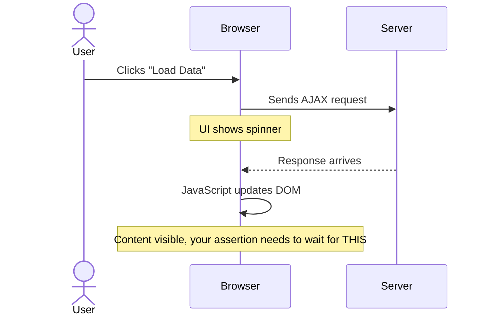
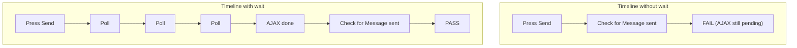
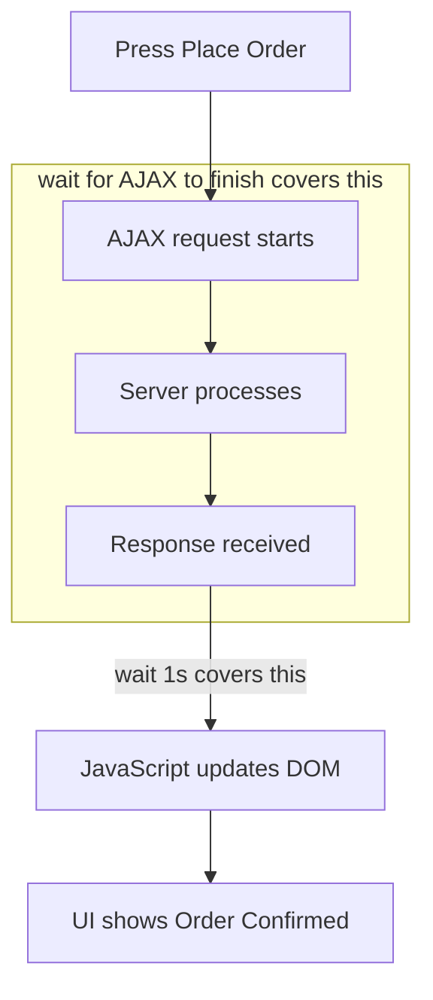
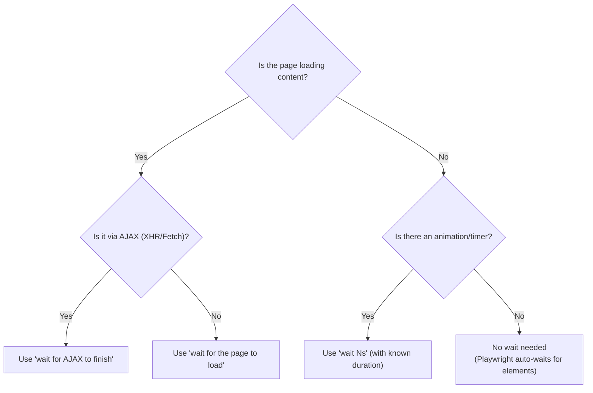

# Chapter 7: Waiting and Dynamic Content

---

If there is one thing that separates reliable tests from flaky tests, it is how you handle timing. Modern web applications are asynchronous by nature. Content loads via AJAX. Animations play. WebSocket connections deliver real-time updates. If your test checks the page before the content arrives, it fails. Run it again, the server is faster, it passes. That is a flickering test, and it will destroy your team's confidence in the test suite.

This chapter teaches you how to handle every timing scenario you will encounter.

---

## The BBR Smart-Wait Philosophy

Webship-js 2.0 follows a **Behaviour-Based Robotics** philosophy: **react to the environment, not the clock.** A test never sleeps for a fixed N seconds. Instead, every wait step returns as soon as the page is at the **edge** of activity -- DOM ready, no in-flight network, no pending timers, no live mutations.

The runtime installs a small init script in every browser context. It exposes four signals:

| Signal | Counter / time | Source |
|--------|----------------|--------|
| Fetch / XHR in flight | `window.__webshipAjaxCount` | wraps `window.fetch` and `XMLHttpRequest.send` |
| Pending `setTimeout` | `window.__webshipPendingTimers` | wraps `window.setTimeout` / `clearTimeout` |
| Last DOM mutation | `window.__webshipLastMutation` | `MutationObserver` on `<html>` |
| Network idle | (Playwright internal) | `page.waitForLoadState('networkidle')` |

`smartSettle(page, budget)` polls all four atomically and returns when:

```
__webshipAjaxCount === 0
  && __webshipPendingTimers === 0
  && (Date.now() - __webshipLastMutation) >= 250 ms
```

…or when `budget` elapses, whichever comes first. **After every state-changing step** (click, press, fill, submit, select, check, uncheck, choose, attach, reload, navigate), webship-js silently runs `smartSettle(page, 1500)`. Tests rarely need an explicit wait between an action and its follow-up assertion. Disable per-run with `WEBSHIP_AUTO_SETTLE=off`.

The consequence: `wait 3s` no longer means "sleep three seconds." It means "wait up to three seconds for the page to become quiet." If the page quiets in 200ms, the wait exits in 200ms.

---

## Understanding Asynchronous Web Applications

<!-- diagram: page-lifecycle -->

Before diving into recipes, let us understand what happens when a user clicks a button in a modern web app:



The entire cycle from click to visible content can take anywhere from 50ms to 10 seconds depending on the server, network, and client-side rendering. Your test needs to wait for the right moment.

### Two Synchronization Strategies

There are two fundamental approaches to synchronization:

```
┌─────────────────────────────────────────────────────────────────┐
│                                                                 │
│  LISTENING (Event-Driven)          SAMPLING (Polling)           │
│                                                                 │
│  Subscribe to an event.            Check repeatedly until       │
│  Wait until notified.              the condition is true.       │
│                                                                 │
│  ┌──────┐                          ┌───────┐                   │
│  │ Wait │──► Event fires!          │ Check │──► Not yet         │
│  └──────┘    Continue.             └───┬───┘                    │
│                                        ▼                        │
│  Example:                          ┌───────┐                   │
│  Playwright's auto-wait            │ Check │──► Not yet         │
│  waits for an element to be        └───┬───┘                    │
│  actionable before clicking.           ▼                        │
│                                    ┌───────┐                   │
│  Pros: Fast, efficient             │ Check │──► Done           │
│  Cons: Must know which             └───────┘                    │
│        event to wait for                                        │
│                                    Example:                     │
│                                    "wait for AJAX" polls        │
│                                    until requests finish.       │
│                                                                 │
│                                    Pros: Works with any system  │
│                                    Cons: Slower (polling)        │
└─────────────────────────────────────────────────────────────────┘
```

webship-js uses both strategies:
- **Playwright's auto-wait** (listening): automatically waits for elements to be visible and actionable before interacting
- **`wait for AJAX to finish`** (sampling): polls the browser to check if any network requests are still pending

---

## Recipe 67: Wait for AJAX

**Problem:** The dashboard suite passes on your laptop every single time, then fails in CI on a different scenario every night. The pattern is always the same when you read the failure: the test pressed "Send", the staging server needed 800ms to answer, and the assertion ran at 300ms. Nobody broke the contact form -- the test simply looked at the page before the response arrived. This is the single most common cause of flaky tests, and it has a one-line cure.

**Solution:**

```gherkin
Feature: AJAX Content Loading
  Scenario: Dashboard loads data asynchronously
    Given I am a logged in user with the "admin" user
    When I go to "/dashboard"
    And wait for AJAX to finish
    Then I should see "Statistics"
    And I should see "Recent Activity"

  Scenario: Form submission with AJAX
    Given I am on homepage
    When I go to "/contact"
    And I fill in "Name" with "Rajab"
    And I fill in "Message" with "Hello"
    And I press "Send"
    And wait for AJAX to finish
    Then I should see "Message sent"

  Scenario: Multiple AJAX calls in sequence
    Given I am a logged in user with the "admin" user
    When I go to "/admin/reports"
    And wait for AJAX to finish
    And I select "Last 30 days" from "Date Range"
    And wait for AJAX to finish
    And I press "Generate Report"
    And wait for AJAX to finish
    Then I should see "Report generated"
```

**How It Works:**

`And wait for AJAX to finish` implements the **sampling** strategy, but it samples something better than the network tab. webship-js wraps `window.fetch` and `XMLHttpRequest.send` on every page via `addInitScript`, keeping a live counter in `window.__webshipAjaxCount` -- incremented when a request starts, decremented when it completes or fails. The wait step polls every 50ms until that counter reads zero **and** no wrapped `setTimeout` timers are pending (`window.__webshipPendingTimers`) **and** the DOM has been quiet for at least 250ms (`window.__webshipLastMutation`). So the step does not just wait for the response to come back -- it waits for the JavaScript that *handles* the response, and the DOM updates that handler triggers, to finish too. That last part is what naive "wait for the response" approaches miss, and it is why your assertion finds "Message sent" actually rendered instead of merely fetched.



**When to use it:**

Use `wait for AJAX to finish` after any action that triggers a server request:
- Form submissions
- Button clicks that load data
- Dropdown changes that fetch dependent data
- Navigation in SPAs
- Auto-save triggers
- Infinite scroll triggers

In practice you can often skip the explicit step, because webship-js runs `smartSettle(page, 1500)` automatically after every state-changing step -- click, press, fill, select, the lot. Keep the explicit wait where the round trip matters: the AfterStep settle has a 1500ms budget, while the explicit step gets the full window, so a slow staging API outlasts the first but not the second. The explicit line also documents intent -- six months from now, the reader of this scenario knows a server round trip happens here.

**At scale:** The duration-free design is what makes one feature file portable across twenty projects. The same `wait for AJAX to finish` absorbs a 50ms dev API and a 3-second staging API without edits -- no per-project timeout tuning, no `wait 2s` "because project B is slow" creeping into a shared suite. When someone proposes adding a sleep to fix a flaky scenario, point them here first; if the scenario still flakes behind this step, the finding is real and belongs in a bug ticket, not a longer sleep.

---

## Recipe 68: Wait for Page Load

**Problem:** The analytics page pulls in two chart libraries, a map widget, and forty thumbnails. On your machine it renders in under a second; on the shared CI runner -- throttled, cold cache, three other suites competing for bandwidth -- the chart script is still downloading when your assertion fires. `wait for AJAX to finish` does not help here, because nothing is an XHR yet: it is plain old resources arriving slowly, before the page's JavaScript even gets a chance to run.

**Solution:**

```gherkin
Feature: Heavy Page Loading
  Scenario: Report page with many charts
    Given I am a logged in user with the "admin" user
    When I go to "/admin/analytics"
    And wait for the page to load
    Then I should see "Analytics Dashboard"
    And I should see "Traffic Chart"
    And I should see "Revenue Chart"
```

**How It Works:**

`And wait for the page to load` checks `document.readyState` until it equals `"complete"`. This means:
- The HTML document has been fully parsed
- All sub-resources (images, stylesheets, scripts) have finished loading
- The `load` event has fired

This is more thorough than `wait for AJAX` because it waits for ALL resources, not just XHR/Fetch requests.

Know what it does *not* cover, though: anything the page's JavaScript starts **after** the `load` event. A dashboard that fires its data requests on load will be "complete" by this step's definition while the charts are still empty. That is why the two waits pair so well -- `wait for the page to load` for the resource phase, `wait for AJAX to finish` for the data phase. Also worth knowing: every navigation step already probes `domcontentloaded` and `networkidle` inside its `smartSettle` budget, so ordinary pages rarely need this step at all. Reach for it on the genuinely heavy ones -- report pages, media galleries, anything where the resources themselves are the slow part.

---

## Recipe 69: Explicit Timed Waits

**Problem:** A carousel advances every three seconds. A toast dismisses itself after five. These are the rare cases where time *is* the behaviour -- the acceptance criterion literally says "the message disappears after 5 seconds", and the only honest way to test it is to let those seconds pass. The danger is that timed waits are habit-forming: the same step that legitimately tests a slideshow becomes the duct tape a tired engineer reaches for at 6 p.m. when a flaky scenario needed an AJAX wait instead. Know exactly when this step is the right tool, and say no the rest of the time.

**Solution:**

```gherkin
Feature: Timed Waits
  Scenario: Wait for slideshow transition
    Given I am on homepage
    And wait 3s
    Then I should see "Slide 2"
    And wait 3s
    Then I should see "Slide 3"

  Scenario: Wait for notification to auto-dismiss
    Given I am a logged in user with the "admin" user
    When I go to "/settings"
    And I press "Save"
    And wait for AJAX to finish
    Then I should see "Settings saved"
    # Wait for the toast notification to auto-dismiss
    And wait 5s
    Then I should not see "Settings saved"

  Scenario: Default wait
    Given I am on homepage
    When I press "Process"
    And wait
    Then I should see "Done"
```

**How It Works:**

- `And wait 2s` -- waits **up to** 2 seconds for the page to settle
- `And wait 3s` -- waits up to 3 seconds
- `And wait 5s` -- waits up to 5 seconds
- `And wait` -- uses the default budget configured in `minWaitTime`

Notice the "up to". In webship-js 2.0 these are not raw sleeps -- remember, there are no static sleeps anywhere in the framework. Each duration becomes a `smartSettle` budget. If the page is already quiet, the wait exits early instead of burning your CI minutes. If a timer is pending -- the carousel's next-slide callback, the toast's dismiss timer, both ordinary `setTimeout` calls counted in `window.__webshipPendingTimers` -- the settle condition cannot be met, so the wait holds for its full budget. That gives you exactly the behaviour each scenario above needs: sleep-like patience while the animation timer runs, zero wasted time when there is nothing to wait for.

**When timed waits are appropriate:**

```
┌──────────────────────────────────────────────────────────────────┐
│ USE timed waits for:              AVOID timed waits for:        │
│                                                                  │
│ ✓ CSS animations with known      ✗ AJAX responses (use         │
│   duration                          "wait for AJAX" instead)    │
│ ✓ Auto-dismiss notifications     ✗ Page loads (use "wait for   │
│ ✓ Slideshow transitions             the page to load" instead)  │
│ ✓ Debounced input events         ✗ "Just in case" waits        │
│ ✓ Rate-limited operations        ✗ Replacing actual sync       │
│                                                                  │
│ RULE: If the wait time is part   RULE: If you are waiting for   │
│ of the FEATURE (animation is     an operation to complete, use  │
│ 3 seconds), test with a          event-based waiting instead.   │
│ timed wait.                                                      │
└──────────────────────────────────────────────────────────────────┘
```

**At scale:** Do the multiplication before you approve a timed wait in review. A `wait 5s` in a Background runs once per scenario -- two hundred scenarios in the suite, forty suites in the nightly farm, and that single line is buying minutes of runner time per night, every night. A convention that has paid for itself on every portfolio I have worked with: every `wait Ns` carries a comment naming the timer or animation it covers (`# toast auto-dismisses after 5s`). If nobody can name the thing being waited for, the wait gets deleted -- it was a sleep wearing a costume.

---

## Recipe 70: Handling Race Conditions

**Problem:** "Place Order" is never one operation. The server validates, charges the card, creates the order, queues the email -- and the client repaints two or three times along the way. Your assertion fires in the gap between the response arriving and the confirmation actually rendering, and the failure only reproduces under CI load, never on your laptop while you sit there watching it pass. These between-the-operations failures are the ones that teach teams to distrust their own suite.

**Solution:**

```gherkin
Feature: Complex Operations
  Scenario: Order processing with multiple steps
    Given I am a logged in user with the "customer" user
    When I go to "/cart"
    And I press "Place Order"
    And wait for AJAX to finish
    # Server processes: validate → charge → create order → send email
    # The AJAX response comes back, but the page might still be updating
    And wait 1s
    Then I should see "Order Confirmed"
    And I should see "Order #"
```

**How It Works:**

In older frameworks the double wait was mandatory: the AJAX wait covered the network, and a sleep covered the rendering. webship-js 2.0 closes most of that gap on its own -- `wait for AJAX to finish` already refuses to return until the DOM has been quiet for 250ms and no timers are pending, so the response *handler's* work is normally covered. What the trailing `wait 1s` buys you is the work that starts **after** a quiet window: a confirmation screen that fires a follow-up request once it mounts, a staged animation that kicks off a beat later. Because `wait 1s` is itself a bounded settle (Recipe 69), it costs almost nothing when the page stays quiet -- and if late work does show up, it holds until that work finishes or the budget runs out. The "double wait" pattern handles:



One honest rule to go with it: if a scenario needs more than one of these trailing waits, stop adding waits. A page that takes multiple settle budgets to reach its final state after one click has a real responsiveness problem -- the kind your users feel as "did my order go through?" -- and that belongs in a bug ticket, not in a longer test.

---

## Recipe 71: Testing Infinite Scroll

**Problem:** Infinite scroll always works for the first batch -- that is the batch everyone looks at. The bugs live further down: batch two renders the same ten posts as batch one, loading silently stops after the third fetch, or a fast scroll fires the load trigger twice and duplicates appear. Your manual testers rarely scroll past the second batch, and your users find out on the train, on a phone, three weeks after the release. The test suite should be the one reader who always scrolls.

**Solution:**

```gherkin
Feature: Infinite Scroll
  As a user browsing a long feed
  I want content to load as I scroll
  So that I can browse without clicking "next page"

  Scenario: Initial page shows first batch
    Given I am on homepage
    When I go to "/feed"
    And wait for AJAX to finish
    Then I should see "Post 1"

  Scenario: Scrolling loads more content
    Given I am on homepage
    When I go to "/feed"
    And wait for AJAX to finish
    Then I should see "Post 1"

    When I scroll to bottom
    And wait for AJAX to finish
    Then I should see "Post 11"

    When I scroll to bottom
    And wait for AJAX to finish
    Then I should see "Post 21"
```

**How It Works:**

`When I scroll to bottom` scrolls the window to the very bottom of the document -- which carries it past whatever sentinel the application watches, whether that is a scroll-position listener or an `IntersectionObserver` on a "load more" marker. The fetch that fires gets counted in `window.__webshipAjaxCount`, so the `wait for AJAX to finish` that follows holds until the new posts are not just downloaded but rendered (DOM quiet for 250ms).

The assertions are doing careful work here. "Post 11" and "Post 21" can only exist in the second and third batches, so each scroll proves a *new* batch arrived -- asserting "Post 1" again would pass even if scrolling did nothing. If your feed has a duplicate-batch bug to guard against, add a count assertion: `Then ".post" should have a count of 20` after the first scroll pins down that batch two added exactly ten items rather than re-appending batch one.

**At scale:** Two assumptions are baked into this scenario, and both break when the feature file travels. First, "ten posts per batch" is seed data -- on the project with seven posts total there is no Post 11, so pair scroll scenarios with seeded fixtures or keep the batch size in one shared place. Second, the trigger depends on viewport height: a 1920x1080 runner shows more posts up front than a laptop window, and on a short content set the "second batch" may already be loaded before anyone scrolls. Pin the viewport for feed suites, or assert structurally (the count step) instead of on specific item names.

---

## Recipe 72: Testing Loading Spinners

**Problem:** The support ticket reads "it just spins forever." A failed request left the spinner up with no error message, and the user stared at it until they gave up. Your suite never noticed, because every scenario asserted the data and nobody ever asserted that the *loading state* resolves. A spinner that never leaves is an outage the page hides from your monitoring -- the HTTP responses look fine, the page "loaded", and the user sees an animation going nowhere.

**Solution:**

```gherkin
Feature: Loading States
  Scenario: Loading spinner appears and disappears
    Given I am a logged in user with the "admin" user
    When I go to "/dashboard"
    # The spinner might be visible briefly
    And wait for AJAX to finish
    # After AJAX completes, spinner should be gone and content should be visible
    Then I should see "Dashboard"
    And I should not see "Loading..."
```

**How It Works:**

The two assertions together pin the end state: the content arrived **and** the loading indicator left. Either one alone is weaker than it looks -- "Dashboard" can render in a header while a panel spinner sits stuck below it, and "no spinner" is trivially true on a page that failed before showing one.

Notice what the recipe does *not* assert: that the spinner appeared. That check is inherently racy -- on a fast response the spinner mounts and unmounts in under 100ms, so a `Then I should see "Loading..."` placed after the navigation fails precisely when your app is healthy and quick. Assert the destination, not the journey. If the spinner is an element rather than text, the web-first form is sharper: `Then ".spinner" should be hidden` polls every 100ms for up to 5 seconds, so it tolerates a spinner that lingers through a fade-out animation.

When the stuck-spinner bug does ship, this scenario fails with "Loading..." still on the page -- and because webship-js captures a screenshot on failure by default (`WEBSHIP_SCREENSHOT_ON_FAILED` is true out of the box), the report shows the frozen spinner. That artifact turns "works for me" into a two-minute diagnosis: the reviewer sees the spinner, checks which request never resolved, done.

---

## Recipe 73: Testing Auto-Refresh Content

**Problem:** The monitoring dashboard refreshes itself every ten seconds -- until a deploy quietly breaks the refresh loop, and the operations team spends a day staring at numbers from 9:14 a.m. without knowing it. Auto-refresh is the feature whose failure looks exactly like success: the page renders, the data is plausible, and nothing on screen admits it stopped updating. A test has to do what no human does deliberately -- load the page, wait out a full refresh interval, and check that the page is still alive afterwards.

**Solution:**

```gherkin
Feature: Auto-Refresh
  Scenario: Dashboard data refreshes automatically
    Given I am a logged in user with the "admin" user
    When I go to "/monitoring"
    And wait for AJAX to finish
    Then I should see "Server Status"

    # Wait for the auto-refresh interval (e.g., 10 seconds)
    And wait 10s
    And wait for AJAX to finish
    # Content should still be present (and potentially updated)
    Then I should see "Server Status"
    And I should see "Last Updated"
```

**How It Works:**

The `wait 10s` gives the refresh interval room to elapse. Because the dashboard's pending refresh keeps the page from ever settling fully, the wait holds for its whole budget -- which is the point: you want the interval to fire *during* the wait. The `wait for AJAX to finish` that follows catches the refresh request if it is still mid-flight, so the assertions run against the post-refresh page, not a half-painted one.

Be honest about what this scenario proves, though. `I should see "Server Status"` would also pass if the refresh never fired -- the original render says the same thing. To prove the refresh actually *happened*, assert on something only the refresh produces: a "Last Updated" timestamp that the page rewrites on every cycle, a counter that increments, a request you can observe. The strongest version pairs this with network recording -- `Given I start recording network requests` before the wait, then assert the refresh endpoint was called -- so the evidence is the request itself, not a lookalike pixel.

And for long intervals, stop paying for real time at all: webship-js ships clock steps that install and advance Playwright's `page.clock`. A dashboard that refreshes every five minutes becomes testable in milliseconds -- install the fake clock, advance it five minutes, assert the refresh fired. Chapter 38's clock recipes cover the pattern.

**At scale:** Real-time dashboards are where nightly CI bills quietly grow. Every literal `wait 10s` runs on every project, every night, forever -- forty suites with three refresh scenarios each is twenty minutes of runners doing nothing but letting intervals tick. Across a portfolio, make the clock steps the default for anything with an interval longer than a couple of seconds, and reserve real-time waits for one smoke scenario per dashboard that proves the production timer is actually wired up.

---

## The Anti-Pattern: Sleep-Driven Testing

This is what NOT to do:

```gherkin
# BAD: Sleep everywhere
Scenario: The slow test
  Given I am on homepage
  And wait 3s                    # Why?
  When I go to "/login"
  And wait 2s                    # Why?
  And I fill in "Email" with "a@b.c"
  And wait 1s                    # Why?
  And I press "Login"
  And wait 5s                    # Why?
  Then I should see "Dashboard"
```

Every one of those waits answers "why?" with "just in case." Under webship-js 2.0 they are settle budgets rather than raw sleeps, so a quiet page lets them exit early -- but the moment the page has any pending timer (an animation library, an analytics retry loop, a carousel), each one burns its full budget. That is up to 11 seconds per run for zero added confidence, and worse: the waits paper over whatever timing problem prompted them, so the underlying flake is still in there, waiting for a slower runner. The correct version:

```gherkin
# GOOD: Wait only when needed
Scenario: The fast test
  Given I am on homepage
  When I go to "/login"
  And I fill in "Email" with "a@b.c"
  And I press "Login"
  And wait for AJAX to finish
  Then I should see "Dashboard"
```

Same test. Fraction of the time. More reliable because it waits for the actual event (AJAX completion) instead of an arbitrary duration.

**At scale:** Sleep-driven style spreads by copy-paste. The first padded scenario becomes the template for the next fifty, then the suite gets cloned to the next project with the padding intact -- and a year later the nightly farm spends more wall-clock time sleeping than testing. Make "every wait names its reason" a review rule across all projects, and audit periodically: search the portfolio's feature files for `wait \d` and challenge each hit. On one distribution we maintained across dozens of sites, that single audit recovered more CI time than any parallelization work we did.

---

## Wait Strategy Decision Tree



---

## Chapter Summary

- Timing is the #1 cause of flaky tests
- Two strategies: **Listening** (event-driven, fast) and **Sampling** (polling, simple)
- `wait for AJAX to finish` handles most dynamic content scenarios
- `wait for the page to load` handles resource-heavy pages
- `wait Ns` is for animations and timers with known durations -- and in 2.0 it is a settle *budget*, not a raw sleep: quiet pages exit early
- `wait` (no duration) uses the configured `minWaitTime` default
- Avoid arbitrary sleeps -- they waste time and do not actually fix timing issues
- The "double wait" pattern (AJAX + short timed wait) handles complex operations
- Playwright auto-waits for elements to be actionable -- you do not need waits before `fill in` or `press`

Next: Modal and dialog testing recipes.
