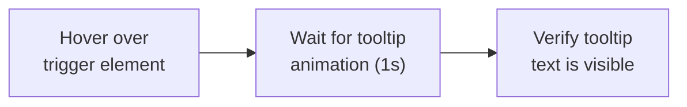

# Chapter 8: Modal and Dialog Testing

---

Modal dialogs are everywhere in modern web applications. Confirmation prompts before deleting a record. Login forms that slide down from the top. Cookie consent banners. GDPR notifications. Product quick-view overlays. Every one of these presents a unique challenge for automated tests because modals exist as a layer on top of the page -- they appear, they capture focus, they block interaction with the content behind them, and they disappear.

If your test does not account for the modal lifecycle -- waiting for it to appear, interacting with it, and waiting for it to close -- you will get race conditions, missed clicks, and tests that pass locally but fail in CI.

This chapter gives you recipes for every modal pattern you will encounter.

---

## Understanding Modal Architecture

Before we dive into recipes, it helps to understand how modal dialogs work at the HTML level:

```
┌──────────────────────────────────────────────────────────────────┐
│ Browser Viewport                                                  │
│                                                                    │
│  ┌──────────────────────────────────────────────────────────────┐ │
│  │ Page Content (z-index: 1)                                    │ │
│  │                                                              │ │
│  │  ┌────────────────────────────────────────────────────────┐  │ │
│  │  │ Overlay / Backdrop (z-index: 1040)                     │  │ │
│  │  │ Semi-transparent dark background                       │  │ │
│  │  │                                                        │  │ │
│  │  │  ┌──────────────────────────────────────────────────┐  │  │ │
│  │  │  │ Modal Dialog (z-index: 1050)                     │  │  │ │
│  │  │  │                                                  │  │  │ │
│  │  │  │  ┌──────────────────────────────────────────┐   │  │  │ │
│  │  │  │  │ Modal Header (.modal-title)              │   │  │  │ │
│  │  │  │  │ "Confirm Delete"              [X Close]  │   │  │  │ │
│  │  │  │  └──────────────────────────────────────────┘   │  │  │ │
│  │  │  │  ┌──────────────────────────────────────────┐   │  │  │ │
│  │  │  │  │ Modal Body                               │   │  │  │ │
│  │  │  │  │ "Are you sure you want to delete?"       │   │  │  │ │
│  │  │  │  └──────────────────────────────────────────┘   │  │  │ │
│  │  │  │  ┌──────────────────────────────────────────┐   │  │  │ │
│  │  │  │  │ Modal Footer                             │   │  │  │ │
│  │  │  │  │         [Cancel]  [Delete]               │   │  │  │ │
│  │  │  │  └──────────────────────────────────────────┘   │  │  │ │
│  │  │  │                                                  │  │  │ │
│  │  │  └──────────────────────────────────────────────────┘  │  │ │
│  │  │                                                        │  │ │
│  │  └────────────────────────────────────────────────────────┘  │ │
│  │                                                              │ │
│  └──────────────────────────────────────────────────────────────┘ │
│                                                                    │
└──────────────────────────────────────────────────────────────────┘
```

There are two fundamentally different kinds of dialogs:

```
┌────────────────────────────────┐  ┌────────────────────────────────┐
│ NATIVE BROWSER DIALOGS         │  │ CUSTOM MODAL DIALOGS           │
│                                │  │                                │
│ Created by JavaScript:         │  │ Created by HTML/CSS/JS:        │
│ • alert("message")            │  │ • Bootstrap .modal             │
│ • confirm("question?")        │  │ • Material UI Dialog           │
│ • prompt("enter value:")      │  │ • Custom [role="dialog"]       │
│                                │  │ • Any <div> styled as modal   │
│ Behavior:                      │  │                                │
│ • Blocks ALL JavaScript       │  │ Behavior:                      │
│ • Cannot be styled            │  │ • Does NOT block JS            │
│ • Cannot be inspected in DOM  │  │ • Fully styleable              │
│ • Handled via Playwright's    │  │ • Part of the DOM              │
│   page.on('dialog') event     │  │ • Found with CSS selectors     │
│                                │  │                                │
│ Testing approach:              │  │ Testing approach:              │
│ Set up listener BEFORE the    │  │ Wait for modal to appear,      │
│ action that triggers it.      │  │ interact with it, wait for     │
│                                │  │ it to close.                   │
└────────────────────────────────┘  └────────────────────────────────┘
```

webship-js provides built-in steps for **custom modal dialogs** (the second type). For native browser dialogs, you would write custom step definitions using Playwright's dialog event API. Most modern applications use custom modals rather than native dialogs.

---

## Recipe 74: Testing Modal Open and Close

**Problem:** The delete-confirmation modal takes 300ms to fade in. Your test presses "Delete Product" and asserts on the modal text immediately -- and on your laptop it passes, because your laptop is fast. On the CI runner the assertion fires mid-fade and the scenario goes red, with a failure screenshot showing the modal sitting there, perfectly open, mocking you. This is usually a team's first encounter with modal timing, and the new hire who hits it on their first PR will conclude the suite is haunted unless someone hands them the lifecycle steps.

**Solution:**

```gherkin
Feature: Modal Dialog Open/Close
  As a user
  I want modal dialogs to open and close correctly
  So that I can interact with overlaid content

  Scenario: Modal opens when button is clicked
    Given I am on homepage
    When I go to "/products"
    And I press "Delete Product"
    And wait for the modal to appear
    Then I should see a modal dialog
    And I should see "Confirm Delete" in the modal

  Scenario: Modal closes with close button
    Given I am on homepage
    When I go to "/products"
    And I press "Delete Product"
    And wait for the modal to appear
    Then I should see a modal dialog
    When I close the modal
    And wait for the modal to disappear
    Then I should not see a modal dialog

  Scenario: Modal closes with Escape key
    Given I am on homepage
    When I go to "/products"
    And I press "Delete Product"
    And wait for the modal to appear
    Then I should see a modal dialog
    When I dismiss the modal
    And wait for the modal to disappear
    Then I should not see a modal dialog
```

**How It Works:**

The modal lifecycle in webship-js follows this pattern:

```
┌─────────────────────┐     ┌──────────────────────┐     ┌──────────────────────┐
│ 1. TRIGGER          │     │ 2. WAIT              │     │ 3. VERIFY            │
│                     │     │                      │     │                      │
│ Press button or     │────►│ wait for the modal   │────►│ should see a modal   │
│ click link that     │     │ to appear            │     │ dialog               │
│ opens the modal     │     │                      │     │                      │
└─────────────────────┘     └──────────────────────┘     └──────────────────────┘
         │
         ▼
┌─────────────────────┐     ┌──────────────────────┐     ┌──────────────────────┐
│ 4. INTERACT         │     │ 5. CLOSE             │     │ 6. VERIFY CLOSED     │
│                     │     │                      │     │                      │
│ Click buttons in    │────►│ close the modal      │────►│ should not see a     │
│ the modal, fill     │     │ OR                   │     │ modal dialog         │
│ forms, read text    │     │ dismiss the modal    │     │                      │
└─────────────────────┘     └──────────────────────┘     └──────────────────────┘
```

webship-js detects modals using a broad CSS selector that covers popular frameworks:

```
.modal, .modal.show, .modal.in, [role="dialog"], .dialog, .popup
```

This means it works with Bootstrap, Material UI, Foundation, custom dialogs, and any element with `role="dialog"`.

The `close the modal` step first looks for a close button (`.close`, `.btn-close`, `[aria-label="Close"]`). If no close button is found, it sends the Escape key as a fallback. `dismiss the modal` goes straight to Escape -- which is why the third scenario exists: Escape-to-close is what keyboard users rely on, and a modal that traps them is both a bug and an accessibility failure.

Why a dedicated wait instead of `wait for AJAX to finish`? Because opening a modal usually involves zero network traffic -- it is a class flip plus a CSS transition, and a transition is compositor work that the AJAX counter and timer wrapper never see. The mutation observer registers the class change as a single blip, so `smartSettle` can declare the page quiet while the modal is still fading in. The modal wait polls for a *visible* match of the modal selector instead, which is the one signal that actually means "the user can see this now." The same logic applies in reverse on close: `wait for the modal to disappear` holds until no visible modal remains, so your next click cannot land on a dying backdrop.

**At scale:** The broad selector is what lets one set of modal steps serve an entire portfolio -- the Bootstrap project, the Material UI project, and the hand-rolled design system all match, as long as they use standard classes or `role="dialog"`. The project that breaks the pattern is the one with a bare `<div class="overlay">` and no role attribute. Resist the urge to fork the suite for it: file the missing `role="dialog"` as an accessibility bug instead. The fix makes the shared steps work, makes screen readers work, and costs the frontend team one attribute.

---

## Recipe 75: Verifying Modal Content

**Problem:** An admin clicks Delete on row three, the modal asks "Are you sure you want to delete this user?", they click Yes -- and row *five's* account dies, because a stale index bound the modal to the wrong record. "A modal appeared" was never the test. The test is: the modal is talking about the right record, by name, with the right consequences spelled out. Generic confirmation modals that never mention what they are about to destroy are how wrong-row deletions reach production.

**Solution:**

```gherkin
Feature: Modal Content Verification
  Scenario: Modal shows correct title
    Given I am a logged in user with the "admin" user
    When I go to "/users"
    And I press "Add User"
    And wait for the modal to appear
    Then I should see a modal with title "Add New User"

  Scenario: Modal shows correct body text
    Given I am a logged in user with the "admin" user
    When I go to "/users"
    And I click "Delete" in the "john@example.com" row
    And wait for the modal to appear
    Then I should see "Are you sure you want to delete this user?" in the modal
    And I should see "john@example.com" in the modal
    And I should see "This action cannot be undone" in the modal

  Scenario: Modal shows dynamic data
    Given I am a logged in user with the "admin" user
    When I go to "/orders"
    And I click "View Details" in the "ORD-12345" row
    And wait for the modal to appear
    Then I should see "Order Details" in the modal
    And I should see "ORD-12345" in the modal
    And I should see "Total: $149.99" in the modal
```

**How It Works:**

webship-js provides three distinct modal content assertions:

```
┌─────────────────────────────────────────────────────────────────────────┐
│ Step                                          │ What It Checks          │
├─────────────────────────────────────────────────────────────────────────┤
│ I should see a modal dialog                   │ Any modal is visible    │
│ I should see a modal with title "X"           │ Modal title heading     │
│ I should see "X" in the modal                 │ Text anywhere in modal  │
│ I should see the "login" modal                │ Modal by ID/class/data  │
│ I should not see a modal dialog               │ No modal is visible     │
│ I should not see "X" in the modal             │ Text NOT in modal       │
└─────────────────────────────────────────────────────────────────────────┘
```

The title check (`modal with title "X"`) searches for text in `.modal-title`, `.dialog-title`, `h1`, `h2`, `h3`, `[title]`, and `[aria-label]` elements within the modal. This covers virtually every framework's title pattern.

The scoping is the part that earns its keep. A plain `Then I should see "john@example.com"` searches the whole page -- and john@example.com is sitting right there in the user table *behind* the modal, so the page-level assertion passes even if the modal bound to nothing at all. `in the modal` restricts the search to the visible modal element, which means the assertion can only pass if the modal itself carries the record's identity. That one scoped line is the difference between testing "a dialog opened" and testing "the dialog knows which user it is about to delete." The same applies to the order-details scenario: "ORD-12345" appears in the orders list too; only the scoped check proves the modal fetched the right order.

---

## Recipe 76: Clicking Buttons Inside Modals

**Problem:** The products table has a Delete button on every row -- twenty of them -- and the confirmation modal adds a twenty-first. An unscoped click step now has twenty-one candidates: it can pick a row button that the backdrop blocks and time out, or worse, find one that is still clickable and delete something you never asked about. The Tuesday before release is not the day to discover your test has been confirming the wrong Delete. Inside a modal, every click needs to stay inside the modal.

**Solution:**

```gherkin
Feature: Modal Button Interactions
  Scenario: Confirm a delete action
    Given I am a logged in user with the "admin" user
    When I go to "/products"
    And I click "Delete" in the "Laptop Pro" row
    And wait for the modal to appear
    Then I should see "Are you sure?" in the modal
    When I click "Delete" in the modal
    And wait for AJAX to finish
    Then I should not see a modal dialog
    And I should see "Product deleted"
    And I should not see "Laptop Pro"

  Scenario: Cancel a delete action
    Given I am a logged in user with the "admin" user
    When I go to "/products"
    And I click "Delete" in the "Laptop Pro" row
    And wait for the modal to appear
    Then I should see "Are you sure?" in the modal
    When I click "Cancel" in the modal
    And wait for the modal to disappear
    Then I should not see a modal dialog
    And I should see "Laptop Pro"

  Scenario: Save form inside modal
    Given I am a logged in user with the "admin" user
    When I go to "/categories"
    And I press "Add Category"
    And wait for the modal to appear
    And I fill in "Category Name" with "Electronics"
    And I fill in "Description" with "Electronic devices and accessories"
    When I click "Save" in the modal
    And wait for AJAX to finish
    Then I should not see a modal dialog
    And I should see "Category created"
    And I should see "Electronics"
```

**How It Works:**

`When I click "Delete" in the modal` does the following:

1. Waits for a modal to become visible (up to 10 seconds)
2. Finds the first visible modal using the `MODAL_SELECTOR`
3. Within that modal, looks for buttons, links, or elements with `role="button"` that match the text
4. Clicks the matching element

```
Modal DOM Search:
┌─────────────────────────────────────────────────┐
│ Visible Modal Element                           │
│   └─ Search for: button, a, [role="button"],   │
│      input[type="button"],                      │
│      input[type="submit"], .btn                 │
│        └─ Filter by text: "Delete"             │
│            └─ Click first match                │
└─────────────────────────────────────────────────┘
```

**Important:** The step says `click "X" in the modal`, not `press "X"`. This is because the step searches for any clickable element (buttons AND links) within the modal context. Outside of modals, `click` is for links and `press` is for buttons -- but inside modals, `click "X" in the modal` handles both.

The scoping solves the twenty-one-Delete-buttons problem by construction: the search never leaves the visible modal's subtree, so the row buttons behind the backdrop are not candidates at all. And because the step waits up to 10 seconds for a visible modal before searching, it absorbs the fade-in race from Recipe 74 on its own -- though keeping the explicit `wait for the modal to appear` line makes the scenario read in the order things actually happen, which your reviewers will thank you for.

Look at what the first two scenarios assert *after* the click, too. Confirm-then-deleted and cancel-then-still-there are assertions on the **data outcome**, not just on the modal closing. A modal can close politely and still have done the wrong thing; "I should not see Laptop Pro" is what catches that.

**At scale:** Make it a written convention: inside a modal, only the scoped step -- never a bare `click` or `press`, even when it happens to work today. It happens to work right up until a project adds one more button with the same caption somewhere on the page, and then a suite that passed for a year starts failing in a way that looks random. On a portfolio of suites maintained by rotating engineers, this is exactly the class of rule that belongs in the team's conventions doc and in code review, because the failure it prevents is expensive to diagnose and trivial to avoid.

---

## Recipe 77: Modal Form Submission

**Problem:** Admin UIs love modal forms -- add a user without ever leaving the list. The bug that slips through looks like this: the admin clicks Create User, the modal closes, the toast says nothing, and the list never gains a row, because the POST failed and the modal closed anyway. Or its mirror image: validation errors render inside the modal while your test asserted on page-level text and called it a pass. Modal forms need the form checks from Chapter 6 *and* the modal lifecycle from this chapter, in the same scenario.

**Solution:**

```gherkin
Feature: Modal Forms
  As an admin
  I want to add and edit records using modal forms
  So that I can manage content without leaving the page

  Scenario: Add a new user via modal form
    Given I am a logged in user with the "admin" user
    When I go to "/admin/users"
    And I press "Add User"
    And wait for the modal to appear
    Then I should see a modal with title "Add New User"
    When I fill in "First Name" with "Jane"
    And I fill in "Last Name" with "Doe"
    And I fill in "Email" with "jane@example.com"
    And I select "Editor" from "Role"
    And I click "Create User" in the modal
    And wait for AJAX to finish
    Then I should not see a modal dialog
    And I should see "User created successfully"
    And I should see "jane@example.com"

  Scenario: Edit a record via modal form
    Given I am a logged in user with the "admin" user
    When I go to "/admin/users"
    And I click "Edit" in the "jane@example.com" row
    And wait for the modal to appear
    Then I should see a modal with title "Edit User"
    When I fill in "First Name" with "Janet"
    And I click "Save Changes" in the modal
    And wait for AJAX to finish
    Then I should not see a modal dialog
    And I should see "User updated"
    And I should see "Janet"

  Scenario: Modal form validation
    Given I am a logged in user with the "admin" user
    When I go to "/admin/users"
    And I press "Add User"
    And wait for the modal to appear
    When I click "Create User" in the modal
    # Form should show validation errors inside the modal
    Then I should see "First Name is required" in the modal
    And I should see "Email is required" in the modal
    # Modal should stay open
    And I should see a modal dialog
```

**How It Works:**

Modal forms work seamlessly with webship-js because form steps (`fill in`, `select from`, `check`) operate on the entire page DOM. Since the modal is part of the DOM and its form fields are visible, the standard form steps find and fill them.

```
Page DOM:
├── <div class="page-content"> (behind overlay)
│   └── ... (not interactable while modal is open)
│
├── <div class="modal-backdrop"> (overlay)
│
└── <div class="modal show" role="dialog">
    ├── <h5 class="modal-title">Add New User</h5>
    ├── <input name="firstName" placeholder="First Name">  ← fill in finds this
    ├── <input name="lastName" placeholder="Last Name">    ← fill in finds this
    ├── <input name="email" placeholder="Email">           ← fill in finds this
    ├── <select name="role">                               ← select from finds this
    └── <button>Create User</button>                       ← click in modal finds this
```

**Note:** If the page behind the modal has fields with the same labels, Playwright will interact with the **visible, interactable** one -- which is the modal's field since the backdrop blocks the page fields. This is correct behavior.

The field resolution is the same label-first strategy from Chapter 6 -- label, then id, name, placeholder -- so a modal form scenario reads exactly like a page form scenario plus the lifecycle steps. Two assertions carry most of the weight here. In the happy-path scenarios, `Then I should not see a modal dialog` followed by the new record's email proves the full round trip: submitted, accepted, closed, *and* the list refreshed with real data. In the validation scenario, the closing `And I should see a modal dialog` is the one teams forget -- it pins that the modal **stayed open** on invalid input. A modal that closes on a failed submit throws away everything the user typed, which is the kind of bug that never shows in a happy-path-only suite.

**At scale:** Add-edit-via-modal is the same workflow on every admin UI you will ever test, which makes this scenario shape a template worth standardizing across projects: open, assert title, fill, submit, assert closed, assert the record. The validation variant doubles as an acceptance criterion product owners write naturally -- "if required fields are empty, the dialog stays open and says what is missing" -- and when the scenario in the suite is that sentence verbatim, sign-off stops being an act of trust and becomes reading a green report.

---

## Recipe 78: Testing Confirmation Dialogs

**Problem:** Every destructive action in your app is one click away from a support escalation, and the confirmation modal is the seatbelt. The failure modes are nastier than "no modal": there is the modal that deletes even when you click Cancel, the X button that confirms instead of closing, and the bulk dialog that says "Delete 5 posts?" while 7 are selected. Teams reliably test the confirm path and skip the cancel path -- and the cancel path is the one protecting data someone cares about. Production records pay for that gap.

**Solution:**

```gherkin
Feature: Confirmation Dialogs
  As a user
  I want to confirm before destructive actions
  So that I do not accidentally lose data

  Background:
    Given I am a logged in user with the "admin" user

  Scenario: Confirm and proceed with deletion
    When I go to "/admin/posts"
    And I click "Delete" in the "Draft Post" row
    And wait for the modal to appear
    Then I should see "Confirm Delete" in the modal
    And I should see "Are you sure you want to delete" in the modal
    When I click "Yes, Delete" in the modal
    And wait for AJAX to finish
    Then I should not see a modal dialog
    And I should not see "Draft Post"

  Scenario: Cancel the deletion
    When I go to "/admin/posts"
    And I click "Delete" in the "Important Post" row
    And wait for the modal to appear
    Then I should see "Confirm Delete" in the modal
    When I click "Cancel" in the modal
    And wait for the modal to disappear
    Then I should not see a modal dialog
    And I should see "Important Post"

  Scenario: Close confirmation with X button
    When I go to "/admin/posts"
    And I click "Delete" in the "Important Post" row
    And wait for the modal to appear
    When I close the modal
    And wait for the modal to disappear
    Then I should see "Important Post"

  Scenario: Bulk delete with confirmation
    When I go to "/admin/posts"
    And I check "Select All"
    And I press "Delete Selected"
    And wait for the modal to appear
    Then I should see "Delete 5 posts?" in the modal
    When I click "Delete All" in the modal
    And wait for AJAX to finish
    Then I should not see a modal dialog
    And I should see "5 posts deleted"
```

**The Confirmation Dialog Pattern:**

```
User Action (Delete, Cancel, Revoke)
        │
        ▼
┌───────────────────────┐
│ Confirmation Modal    │
│                       │
│ "Are you sure?"       │
│                       │
│  [Cancel]  [Confirm]  │
└───────┬───────┬───────┘
        │       │
   Cancel    Confirm
        │       │
        ▼       ▼
  No change   Action executes
  Modal closes  Modal closes
  Item remains  Item removed
```

This is one of the most common modal patterns. The key to testing it is:
1. Trigger the action
2. Wait for the modal to appear
3. Verify the warning message is correct
4. Click the appropriate button
5. Verify the outcome

Step 5 is where these scenarios get their teeth. The cancel and X-button scenarios end with `And I should see "Important Post"` -- an assertion that the record **survived**, not merely that the modal left the screen. A dialog can close gracefully and still have fired the delete; only the data outcome tells you which path the code really took. The bulk scenario adds one more pin: "Delete 5 posts?" verifies the modal binds to the actual selection count, which catches the off-by-one and stale-selection bugs that make bulk operations the most feared button in any admin panel.

**At scale:** Destructive-action scenarios deserve their own tag across the portfolio -- `@destructive` works -- and a hard rule about where they run: seeded, disposable data only, never an environment whose contents anyone would miss. With the tag in place, your pipeline can run them on every project against fresh fixtures, and your delivery managers get a sentence they can actually use in a release review: every delete in every product asks first, and cancel means cancel. The cancel-path scenario is the cheapest data-loss insurance your team will ever write.

---

## Recipe 79: Testing Modal with Specific Identifier

**Problem:** One page, four possible modals: login, signup, password reset, session-expiry warning. "A modal appeared" is true even when the *wrong* one appears -- a routing mix-up shows the signup form to someone who pressed Sign In, and your generic assertion waves it through. The user lands somewhere confusing; your report stays green. When a page can produce more than one dialog, the test has to name the one it expects.

**Solution:**

```gherkin
Feature: Specific Modal Identification
  Scenario: Login modal appears
    Given I am on homepage
    When I press "Sign In"
    And wait for the modal to appear
    Then I should see the "login" modal
    And I should see "Email" in the modal
    And I should see "Password" in the modal

  Scenario: Settings modal appears
    Given I am a logged in user with the "admin" user
    When I go to "/dashboard"
    And I press "Quick Settings"
    And wait for the modal to appear
    Then I should see the "settings" modal
    And I should see "Theme" in the modal

  Scenario: Different modals on the same page
    Given I am a logged in user with the "admin" user
    When I go to "/admin/users"

    # First modal: Add user
    When I press "Add User"
    And wait for the modal to appear
    Then I should see a modal with title "Add New User"
    When I close the modal
    And wait for the modal to disappear

    # Second modal: Import users
    When I press "Import"
    And wait for the modal to appear
    Then I should see a modal with title "Import Users"
    When I close the modal
    And wait for the modal to disappear

    # Third modal: Delete confirmation
    When I click "Delete" in the "john@example.com" row
    And wait for the modal to appear
    Then I should see "Confirm Delete" in the modal
    When I click "Cancel" in the modal
    And wait for the modal to disappear
```

**How It Works:**

`Then I should see the "login" modal` searches for a modal by its identifier. It looks for:

```
#login         ← element with id="login"
.login         ← element with class="login"
[data-modal="login"]  ← element with data-modal attribute
```

This is useful when your page can trigger different modals and you need to verify which one appeared. The title check (`modal with title "X"`) is another way to distinguish between modals when identifiers are not available.

The third scenario hides a timing rule worth making explicit: between modals, **always wait for the previous one to disappear before triggering the next**. `wait for the modal to appear` is satisfied by *any* visible modal -- if the Add User modal is still fading out when you press Import, the wait matches the dying modal instantly, and the title assertion fails one step later pointing you at the wrong suspect. The disappear-wait between each pair is what keeps the three modals from contaminating each other's assertions. Field assertions inside the identified modal ("Email" and "Password" in the login modal) then confirm not just *which* modal opened but that it opened *complete*.

**At scale:** Treat modal identifiers the way Chapter 6 treats `data-test` attributes: a contract with the frontend team. A `data-modal="login"` attribute survives restyles, class renames, and framework migrations -- the three things guaranteed to happen across a portfolio's lifetime -- while `.login` classes come and go with every theme. Agree on the attribute convention once, document it where frontend developers will see it, and the same login-modal feature file ports between projects with nothing but the `LAUNCH_URL` changing.

---

## Recipe 80: Testing Native Browser Dialogs

**Problem:** The legacy admin section still calls `confirm("Delete everything?")` -- nobody has touched that code since 2019. Playwright's default is to dismiss any dialog it was not told about, so in your test the confirm silently returns `false`, the delete never runs, and the scenario fails with the least helpful evidence imaginable: no modal in the failure screenshot, nothing unusual in the DOM, because native dialogs live entirely outside it. Until you know that one default, debugging this costs an afternoon.

**Solution:**

Native browser dialogs require custom step definitions because they are not part of the DOM. They are handled through Playwright's `page.on('dialog')` event.

```gherkin
Feature: Native Browser Dialogs
  Scenario: Accept an alert dialog
    Given I am on homepage
    When I go to "/demo/alerts"
    And I press "Show Alert"
    # Native alert will be auto-accepted by Playwright
    Then I should see "Alert was closed"

  Scenario: Accept a confirm dialog
    Given I am on homepage
    When I go to "/demo/confirm"
    And I will accept the next browser dialog
    And I press "Delete Everything"
    Then I should see "Confirmed"

  Scenario: Dismiss a confirm dialog
    Given I am on homepage
    When I go to "/demo/confirm"
    And I will dismiss the next browser dialog
    And I press "Delete Everything"
    Then I should see "Cancelled"

  Scenario: Enter text in a prompt dialog
    Given I am on homepage
    When I go to "/demo/prompt"
    And I will enter "My Name" in the next browser dialog
    And I press "Ask Name"
    Then I should see "Hello, My Name"
```

**Custom Step Definitions:**

These steps are not built into webship-js, but you can add them to your project's step definitions:

```javascript
// tests/step-definitions/custom-dialogs.js
const { When } = require('@cucumber/cucumber');

When('I will accept the next browser dialog', async function () {
  this.page.once('dialog', async (dialog) => {
    await dialog.accept();
  });
});

When('I will dismiss the next browser dialog', async function () {
  this.page.once('dialog', async (dialog) => {
    await dialog.dismiss();
  });
});

When('I will enter {string} in the next browser dialog', async function (text) {
  this.page.once('dialog', async (dialog) => {
    await dialog.accept(text);
  });
});
```

**How It Works:**

```
Native Dialog Flow:
┌──────────────────────────────────────────────────────────────────┐
│                                                                  │
│  Step 1: Set up listener          Step 2: Trigger dialog         │
│  ┌─────────────────────────┐      ┌────────────────────────┐    │
│  │ page.once('dialog',     │      │ Press "Delete"         │    │
│  │   dialog => {           │      │                        │    │
│  │     dialog.accept()     │      │ JavaScript runs:       │    │
│  │   }                     │      │ confirm("Are you sure?")   │
│  │ )                       │      │                        │    │
│  └──────────┬──────────────┘      └───────────┬────────────┘    │
│             │                                  │                 │
│             │     Step 3: Dialog handled        │                 │
│             │     ┌──────────────────────┐     │                 │
│             └────►│ Listener fires       │◄────┘                 │
│                   │ Dialog accepted      │                       │
│                   │ JavaScript continues │                       │
│                   └──────────────────────┘                       │
│                                                                  │
│  IMPORTANT: The listener must be set BEFORE the action that      │
│  triggers the dialog. That is why the "I will accept" step       │
│  comes before "I press" in the Gherkin.                          │
│                                                                  │
└──────────────────────────────────────────────────────────────────┘
```

**Key points about native dialogs:**
- Playwright auto-dismisses unhandled `alert()` dialogs
- `confirm()` returns `true` (accepted) or `false` (dismissed)
- `prompt()` returns the entered text (accepted) or `null` (dismissed)
- You must set up the listener BEFORE the action that opens the dialog
- `page.once('dialog', ...)` handles exactly one dialog

That auto-dismiss default cuts both ways. It keeps a stray `alert()` from freezing your whole suite -- native dialogs block all JavaScript on the page, so an unhandled one would otherwise hang every step after it. But it also means a stray dialog is *invisible*: the suite sails past it and you never learn it fired. The "I will..." steps use `page.once` rather than `page.on` deliberately -- each step arms exactly one expectation for exactly one dialog, so a second unexpected dialog still surfaces as unusual behaviour instead of being quietly swallowed forever. When you write your own handler, log `dialog.message()` before accepting -- the text of the dialog in your test output is often the first hard evidence of which code path fired it.

**At scale:** These custom dialog steps are precisely the kind of code that gets copy-pasted into forty project repos and then drifts -- one project's version accepts, another's logs, a third has a typo'd phrasing. Put them in one shared step-definition package that every suite installs, and hold them to the webship-js house rule: every custom step documented with at least five example lines. The phrasing then becomes portfolio vocabulary -- any engineer dropped into any project knows `And I will accept the next browser dialog` means the same thing everywhere.

---

## Recipe 81: Testing Toast/Snackbar Notifications

**Problem:** The toast lives for five seconds. On your machine the assertion catches it with seconds to spare; on a loaded CI runner the suite arrives late and asserts on a message that has already faded out. So the save *worked* and the test *failed* -- the flake that makes developers stop reading red builds. The opposite bug ships too: a toast that never dismisses, stacking up over the Save button until the user cannot click it. Both directions need pinning down.

**Solution:**

```gherkin
Feature: Toast Notifications
  As a user
  I want to see feedback notifications after actions
  So that I know my actions succeeded or failed

  Scenario: Success toast after saving
    Given I am a logged in user with the "admin" user
    When I go to "/settings"
    And I fill in "Site Name" with "My Website"
    And I press "Save"
    And wait for AJAX to finish
    Then I should see "Settings saved successfully"

  Scenario: Error toast for invalid action
    Given I am a logged in user with the "admin" user
    When I go to "/admin/users"
    And I click "Delete" in the "admin@example.com" row
    And wait for the modal to appear
    And I click "Delete" in the modal
    And wait for AJAX to finish
    Then I should see "Cannot delete the last admin user"

  Scenario: Toast auto-dismisses
    Given I am a logged in user with the "admin" user
    When I go to "/settings"
    And I press "Save"
    And wait for AJAX to finish
    Then I should see "Settings saved"
    # Wait for toast to auto-dismiss (e.g., 5 seconds)
    And wait 5s
    Then I should not see "Settings saved"

  Scenario: Multiple toast messages
    Given I am a logged in user with the "admin" user
    When I go to "/admin/import"
    And I press "Import All"
    And wait for AJAX to finish
    Then I should see "3 records imported"
    And I should see "1 record skipped"
```

**How It Works:**

Toast notifications are regular DOM elements -- no special steps are needed. The standard `should see` and `should not see` assertions work perfectly. What makes the recipe reliable in webship-js 2.0 is how the timing machinery treats the toast's dismiss timer. That timer is an ordinary `setTimeout`, so it is counted in `window.__webshipPendingTimers` -- and the automatic settle after `I press "Save"` has a 1500ms budget, which elapses long before a 5-second timer fires. The settle returns, your `should see` runs while the toast is alive, and you are not left racing it. Then, in the auto-dismiss scenario, `wait 5s` holds for its *full* budget precisely because that pending timer keeps the page from settling -- landing your `should not see` after the dismissal. The same mechanism serves both assertions. The key is understanding the toast lifecycle:

```
Action triggers toast
        │
        ▼
┌───────────────────────┐
│ Toast appears          │  ← I should see "message"
│ (slides in, fades in)  │
│                        │
│ Timer starts (5s)      │
│                        │
│ Timer expires          │
│ (slides out, fades out)│  ← wait 5s
│                        │     I should not see "message"
└───────────────────────┘

Common toast CSS classes:
  .toast, .snackbar, .notification, .alert
  .toast-success, .toast-error, .toast-warning
```

**When to test auto-dismiss:**

Testing that a toast auto-dismisses is only necessary when the auto-dismiss duration is part of a business requirement. For most tests, verifying the toast appears is sufficient. Only add the timed wait + not-see check when:
- The auto-dismiss duration is a specific requirement
- A bug has been reported where toasts stay on screen permanently
- The toast blocks interaction with elements below it

**At scale:** Toast copy is one of the easiest things to standardize across a portfolio and one of the most valuable. When every product says "Settings saved successfully" -- not "Saved!", "Done", and "Your changes have been applied" in three different apps -- the same assertion lines port between suites unchanged, and the HTML report reads like a checklist a delivery manager can actually follow: action taken, confirmation shown, by name. Those message assertions are quiet release evidence; treat the copy like an API and put changes to it through review.

---

## Recipe 82: Testing Cookie Consent and Banner Modals

**Problem:** Marketing rolls a consent manager out to all your sites on a Thursday afternoon, and by Friday morning every nightly suite is red. Here is why it hits tests harder than users: each scenario starts a fresh browser context with no cookies, so to the consent manager *every test is a first visit* -- the banner appears every time, on every page, sitting on top of whatever the test wanted to click. A returning user sees it once; your suite sees it four hundred times a night until someone deals with it properly.

**Solution:**

```gherkin
Feature: Cookie Consent Banner
  Scenario: Accept cookies and continue browsing
    Given I am on homepage
    Then I should see "We use cookies"
    When I press "Accept All"
    Then I should not see "We use cookies"

    # Now continue with normal testing
    When I go to "/about"
    Then I should see "About Us"
    # Cookie banner should not reappear
    And I should not see "We use cookies"

  Scenario: Reject optional cookies
    Given I am on homepage
    Then I should see "We use cookies"
    When I press "Reject Optional"
    Then I should not see "We use cookies"
    # Essential functionality should still work
    When I go to "/products"
    Then I should see "Products"

  Scenario: Customize cookie preferences via modal
    Given I am on homepage
    Then I should see "We use cookies"
    When I press "Customize"
    And wait for the modal to appear
    Then I should see "Cookie Preferences" in the modal
    And I uncheck "Marketing Cookies"
    And I uncheck "Analytics Cookies"
    When I click "Save Preferences" in the modal
    And wait for the modal to disappear
    Then I should not see "We use cookies"
```

**How It Works:**

Cookie banners are a special case of modal/notification testing. They typically appear on first visit and must be handled before other interactions. You have two strategies:

```
Strategy 1: Handle in the test              Strategy 2: Handle in a hook
(Explicit, shown in recipe above)           (Automatic, for every test)

Feature file:                               Before hook:
  Given I am on homepage                      Before(async function() {
  When I press "Accept All"                     // Set cookie to skip banner
  ...continue testing...                        await this.context.addCookies([{
                                                 name: 'cookie_consent',
                                                 value: 'accepted',
                                                 domain: 'localhost',
                                                 path: '/'
                                                }]);
                                              });
```

Use Strategy 1 when you are specifically testing the cookie consent flow. Use Strategy 2 when the cookie banner is just in the way of other tests.

Strategy 2 works because consent managers decide whether to show the banner by reading a cookie before the page renders -- `context.addCookies()` in a Before hook plants that cookie ahead of the first navigation, so the banner never mounts at all. Strategy 1, meanwhile, can assert more than the banner's disappearance: after pressing "Accept All", webship-js's cookie steps let you pin the actual mechanism with `Then a cookie with the name "cookie_consent" should exist`. That upgrades the scenario from "the banner went away" to "the *choice was recorded*" -- which is the part a privacy audit cares about. The first scenario's final check, navigating to another page and asserting the banner stays gone, tests the same persistence from the user's side.

**At scale:** When the consent manager lands on twenty sites at once, the Before hook belongs in shared support code, with the cookie name and domain derived from configuration rather than hardcoded -- note the `domain: 'localhost'` in the example, which must follow `LAUNCH_URL` per environment or the hook silently plants a cookie no site reads. Then keep exactly one tagged scenario per site that runs Strategy 1 against the real banner, so the consent flow itself stays tested while the other four hundred scenarios skip it. One shared hook, one real test per site: the Thursday rollout becomes a one-line change instead of a portfolio-wide fire drill.

---

## Recipe 83: Testing Drawer and Sidebar Panels

**Problem:** On phones your navigation is a drawer; on desktop the same links live in a top bar. The drawer slides in over 300ms, and a test that asserts mid-slide sees half a menu -- or clicks a link that is still moving and watches the click land on yesterday's coordinates. Drawer tests are also where viewport assumptions hide: the scenario that passes on a desktop-sized CI runner may be testing a menu that does not even *render* as a drawer at that width.

**Solution:**

```gherkin
Feature: Drawer Panel
  As a user on a mobile-responsive site
  I want to access the navigation drawer
  So that I can navigate the application

  Scenario: Open and close navigation drawer
    Given I am on homepage
    When I press "Menu"
    And wait 1s
    Then I should see "Navigation"
    And I should see "Home"
    And I should see "Products"
    And I should see "Contact"

    When I click "Products"
    And wait for AJAX to finish
    Then I should see "Products"

  Scenario: Settings drawer panel
    Given I am a logged in user with the "admin" user
    When I go to "/dashboard"
    And I press "Settings"
    And wait 1s
    Then I should see "Dashboard Settings"
    And I should see "Theme"
    And I should see "Layout"
    When I select "Dark" from "Theme"
    And I press "Apply"
    And wait for AJAX to finish
    Then I should see "Settings applied"

  Scenario: Detail drawer in list view
    Given I am a logged in user with the "admin" user
    When I go to "/admin/orders"
    And I click "View" in the "ORD-001" row
    And wait 1s
    Then I should see "Order Details"
    And I should see "ORD-001"
    And I should see "Status: Processing"
```

**How It Works:**

Drawers are technically similar to modals but with different visual behavior. They slide in from the side rather than appearing in the center. From a testing perspective:

```
┌──────────────────────────────────────────────────────┐
│ Browser Viewport                                      │
│                                                       │
│  ┌───────────────┐  ┌────────────────────────────┐   │
│  │ DRAWER        │  │ Main Content               │   │
│  │ (slides in    │  │ (may be dimmed or pushed)   │   │
│  │  from left    │  │                            │   │
│  │  or right)    │  │                            │   │
│  │               │  │                            │   │
│  │ • Home        │  │                            │   │
│  │ • Products    │  │                            │   │
│  │ • Contact     │  │                            │   │
│  │               │  │                            │   │
│  │ [Close]       │  │                            │   │
│  └───────────────┘  └────────────────────────────┘   │
│                                                       │
└──────────────────────────────────────────────────────┘
```

If the drawer uses `role="dialog"` or `.modal` classes, webship-js modal steps work directly. If it uses custom classes (like `.drawer`, `.sidebar`, `.off-canvas`), use the standard `should see` / `should not see` text assertions instead.

The `wait 1s` after the trigger handles the slide-in animation, and it is worth understanding why an explicit wait is legitimate here when this book keeps telling you to avoid them. A CSS slide transition is compositor work: no AJAX fires, no `setTimeout` is scheduled, and the DOM mutates exactly once -- the class flip that starts the slide. All three of `smartSettle`'s signals go quiet while the panel is still visibly moving, so the automatic post-step settle can return mid-animation. The transition's duration is part of the UI, which puts this squarely in Recipe 69's "time is the behaviour" category; most slide transitions run 300-500ms, so a 1-second budget covers them with margin. If your drawer has a stable selector, the web-first form is tighter still: `Then ".drawer" should be visible` polls every 100ms for up to 5 seconds and returns the instant the panel reports visible.

**At scale:** Decide -- once, for the whole portfolio -- which viewport your shared suites run at. webship-js's selectors registry defines named breakpoints from `xs` at 375x667 up to `xxxl` at 1920x1080, defaulting to `xl` at 1200x900 (override via `WEBSHIP_SELECTORS_BREAKPOINTS`), and a drawer that exists at `xs` may be a top bar at `xl`. The pattern that holds up across many projects: a desktop suite as the default, plus a small mobile-tagged suite pinned to one phone-sized breakpoint for the drawer, the hamburger, and the touch flows. Twenty projects each improvising their own viewport is how you get twenty subtly different definitions of "the menu works."

---

## Recipe 84: Testing Nested Modals

**Problem:** The email-settings modal has an "Advanced Settings" button that opens a second modal on top of the first. The classic bug ships in the seam between them: Escape or Save closes *both* layers at once, eating the unsaved changes in the outer modal -- or the inner modal closes and leaves the outer one's backdrop frozen, locking the whole page. Nested modals are a UX smell, but enterprise admin screens grow them anyway, and somebody has to prove the layers open and close independently.

**Solution:**

```gherkin
Feature: Nested Modals
  Scenario: Modal opens a second modal
    Given I am a logged in user with the "admin" user
    When I go to "/admin/settings"
    And I press "Configure Email"
    And wait for the modal to appear
    Then I should see "Email Configuration" in the modal

    # Open nested modal
    When I click "Advanced Settings" in the modal
    And wait 1s
    Then I should see "Advanced Email Settings" in the modal
    And I should see "SMTP Host" in the modal
    When I fill in "SMTP Host" with "smtp.example.com"
    And I click "Save" in the modal
    And wait for AJAX to finish

    # Back to the first modal
    Then I should see "Email Configuration" in the modal
    When I click "Close" in the modal
    And wait for the modal to disappear
    Then I should not see a modal dialog
```

**How It Works:**

Nested modals are tricky because:
1. Multiple modal elements may be visible simultaneously
2. The "top" modal should capture all interactions
3. Closing the inner modal should return to the outer modal

```
Layer 0: Page Content
    │
Layer 1: ┌──────────────────────────────────┐
         │ First Modal (z-index: 1050)       │
         │ "Email Configuration"             │
         │                                   │
Layer 2: │ ┌──────────────────────────────┐ │
         │ │ Second Modal (z-index: 1060)  │ │
         │ │ "Advanced Email Settings"     │ │
         │ │                              │ │
         │ │ [Save]                       │ │
         │ └──────────────────────────────┘ │
         │                                   │
         │ [Close]                           │
         └──────────────────────────────────┘
```

webship-js `findVisibleModal()` returns the **first** visible modal it finds. When nested modals are present, browser frameworks typically give the topmost modal the highest z-index -- but "highest z-index" and "first in the DOM" are not the same element, so the safest scenarios disambiguate by *content*: the `click "X" in the modal` step interacts with whichever visible modal contains the matching button, which is why the scenario clicks button captions that exist in only one layer ("Save" lives in the inner modal, "Close" in the outer).

The load-bearing assertion comes after the inner save: `Then I should see "Email Configuration" in the modal`. That line proves the **outer modal survived** the inner one's close -- it is the direct test for the both-layers-collapse bug, and without it the scenario would pass right through that failure. The final disappear-wait then confirms the reverse: closing the outer modal really does end the stack, with no orphaned backdrop left blocking the page.

**Best Practice:** Avoid nested modals when possible. They create a confusing user experience and are harder to test. If your application uses them, test the complete flow: open outer → open inner → close inner → verify outer → close outer. And if a designer asks whether the sub-modal could just be a second *page* instead -- agree enthusiastically.

---

## Recipe 85: Testing Modal with Tab Navigation

**Problem:** A tabbed modal is three forms wearing one title, and the bugs live in the seams between the tabs. Switching from General to Security silently wipes the first name the user just typed; the Notifications tab lazy-loads and a fast click lands before its fields exist; Save only submits the tab you happen to be looking at. Users hit these daily in profile and settings dialogs -- and a test that only visits one tab certifies a third of the modal.

**Solution:**

```gherkin
Feature: Tabbed Modal
  Scenario: Navigate tabs inside a modal
    Given I am a logged in user with the "admin" user
    When I go to "/profile"
    And I press "Edit Profile"
    And wait for the modal to appear
    Then I should see "Edit Profile" in the modal

    # First tab (default)
    Then I should see "First Name" in the modal
    And I should see "Last Name" in the modal

    # Switch to second tab
    When I click "Security" in the modal
    And wait 1s
    Then I should see "Current Password" in the modal
    And I should see "New Password" in the modal

    # Switch to third tab
    When I click "Notifications" in the modal
    And wait 1s
    Then I should see "Email Notifications" in the modal
    And I should see "SMS Notifications" in the modal

    # Go back to first tab and make changes
    When I click "General" in the modal
    And wait 1s
    And I fill in "First Name" with "Rajab"
    And I click "Save" in the modal
    And wait for AJAX to finish
    Then I should not see a modal dialog
    And I should see "Profile updated"
```

**How It Works:**

The tab clicks are scoped (`click "Security" in the modal`), so a page that also has a "Security" link in its navigation cannot steal the click -- the search never leaves the visible modal. Each `wait 1s` covers the tab-pane transition, which is the same compositor-only animation as Recipe 83's drawer: a single class flip and a CSS fade that none of `smartSettle`'s counters can see, so a small explicit budget is the honest tool.

Two details make this scenario stronger than a simple tab walk. First, each tab switch is followed by assertions on fields that exist *only* in that pane -- "Current Password" can only mean the Security tab rendered, not merely highlighted its tab button. Second, inactive panes typically keep their fields in the DOM but hidden, and `fill in` targets the visible match -- which is why the scenario navigates back to General *before* typing the first name. Fill while the wrong tab is active and the step either finds nothing or, worse, a hidden duplicate.

The ending carries the real verdict: filling on tab one, after visiting tabs two and three, then saving and seeing "Profile updated" proves edits survive tab switches -- the exact thing the wipe-on-switch bug breaks. If your team has been bitten by that bug before, extend the pattern: type on General, visit Security, come back, and assert the value is still in the field with `Then I should see "Rajab" value in the "First Name" input element` before saving.

---

## Recipe 86: Testing Image Lightbox

**Problem:** Galleries break at their edges. The lightbox opens fine on every image -- then "Next" on the last photo shows an empty pane, the captions drift one image out of sync with the photos, or the X button stops closing after the library update nobody tested. These are the bugs your client notices during the demo of their own portfolio site, because the gallery is the one page they always show off.

**Solution:**

```gherkin
Feature: Image Lightbox
  Scenario: Open lightbox from gallery
    Given I am on homepage
    When I go to "/gallery"
    And wait for AJAX to finish
    Then I should see "Photo Gallery"

    # Click a thumbnail to open lightbox
    When I click "Beach Sunset"
    And wait 1s
    Then I should see a modal dialog
    And I should see "Beach Sunset" in the modal

    # Close lightbox
    When I close the modal
    And wait for the modal to disappear
    Then I should not see a modal dialog

  Scenario: Navigate lightbox gallery
    Given I am on homepage
    When I go to "/gallery"
    And I click "Beach Sunset"
    And wait 1s
    Then I should see a modal dialog
    And I should see "Beach Sunset" in the modal

    # Navigate to next image
    When I click "Next" in the modal
    And wait 1s
    Then I should see "Mountain View" in the modal

    # Navigate to previous image
    When I click "Previous" in the modal
    And wait 1s
    Then I should see "Beach Sunset" in the modal
```

**How It Works:**

Most lightbox libraries render as exactly the kind of element webship-js's modal selector already matches -- `.popup`, `.modal`, or a `[role="dialog"]` overlay -- so the standard modal steps work without any custom code: the appear/disappear waits, the scoped clicks for "Next" and "Previous", and `close the modal` for the X button.

The captions are doing the clever work. You cannot cheaply assert "the right *image* is showing" -- that would mean pixel comparison -- but a caption rendered alongside its image carries the image's identity as text, and `I should see "Mountain View" in the modal` becomes a precise statement about which photo is on screen. This is also why the second scenario goes forward *and then back*: "Next" landing on Mountain View proves navigation advances, but "Previous" returning to Beach Sunset is what catches the off-by-one index bugs and caption drift that one-direction clicking sails past. The `wait 1s` after each navigation covers the crossfade between images -- compositor animation again, invisible to the settle counters.

**Pro Tip:** If the gallery is content-managed, the captions in this scenario are seed data. Keep the test gallery's images and captions in your fixtures rather than relying on whatever the client uploaded last week, or the suite breaks every time marketing refreshes the photos.

---

## Recipe 87: Testing Tooltips

**Problem:** Icon-only toolbars put the entire explanation of a button into its tooltip -- and then a redesign swaps the tooltip library, the new one ignores the data attributes the old one read, and every hint on the site silently disappears. No error, no broken layout, just an interface that stopped explaining itself. Nobody hovers in automated tests by default, so the regression rides through three releases until a confused-user ticket finally names it.

**Solution:**

Tooltips require hover interaction. webship-js does not have a built-in hover step, but you can create one:

```gherkin
Feature: Tooltips
  Scenario: Tooltip shows on hover
    Given I am on homepage
    When I go to "/dashboard"
    And I hover over "Help Icon"
    And wait 1s
    Then I should see "Click here for help"

  Scenario: Tooltip on disabled button
    Given I am on homepage
    When I go to "/settings"
    And I hover over "Delete Account"
    And wait 1s
    Then I should see "Contact admin to delete your account"
```

**Custom Step Definition:**

```javascript
// tests/step-definitions/custom-hover.js
const { When } = require('@cucumber/cucumber');

When('I hover over {string}', async function (text) {
  const element = this.page.getByText(text).first();
  await element.hover();
});

When('I hover over the {string} element', async function (selector) {
  const builtSelector = buildSelector(selector);
  await this.page.locator(builtSelector).first().hover();
});
```

**How It Works:**



```
Common tooltip implementations:
┌──────────────────────────────────────────────────────┐
│ Type                │ How It Works                    │
├──────────────────────────────────────────────────────┤
│ CSS-only tooltip    │ Uses :hover pseudo-class        │
│ title attribute     │ Browser renders native tooltip  │
│ Bootstrap tooltip   │ JS inserts <div class="tooltip">│
│ aria-describedby    │ Shows linked element on focus   │
│ Custom JS tooltip   │ JS positions element on hover   │
└──────────────────────────────────────────────────────┘
```

**Note:** Native `title` attribute tooltips cannot be reliably tested with Playwright because browsers render them outside the DOM. If your application uses `title` attributes, consider switching to JavaScript-based tooltips that are part of the DOM and can be asserted against. You *can* still pin the attribute itself -- `Then "#help-icon" should have attribute "title" with value "Click here for help"` verifies the text is wired up, even though no browser-drawn bubble will ever appear in a screenshot.

The custom step itself is small because Playwright's `element.hover()` does the hard part: it scrolls the element into view, moves the virtual pointer to it, and fires the real `mouseenter`/`mouseover` chain -- so CSS `:hover` rules and JavaScript hover listeners both trigger exactly as they would for a human hand on a mouse. The `wait 1s` that follows covers the show-delay most tooltip libraries add (typically 200-500ms, deliberately, so tooltips do not flicker as the pointer crosses the screen). The disabled-button scenario earns its place: explaining *why* an action is unavailable is the tooltip pattern with the most user-experience weight, and the one support tickets quote back at you.

**At scale:** The hover steps belong in your shared custom-step package, not copied into each project -- same rule as the dialog steps in Recipe 80, same five-example documentation standard. And remember that hover does not exist on touch screens: if your portfolio includes mobile-web suites, any information that lives only in a tooltip is information a phone user never gets. That is an accessibility and design finding, not just a testing inconvenience -- raise it once at the design-system level and every project inherits the fix.

---

## Recipe 88: Testing Popovers

**Problem:** Admin tables tuck their row actions into click-triggered popovers -- the little "Actions" menu with Edit, Duplicate, Archive, Delete. The recurring bug: the popover opens but click-away never closes it, so it hangs there overlapping the next row's menu, and the second action the user takes lands on the wrong record. The open half of a popover gets tested because it has to be opened to be used; the *close* half is the part that quietly rots.

**Solution:**

```gherkin
Feature: Popovers
  Scenario: Popover shows on click
    Given I am on homepage
    When I go to "/contacts"
    And I click "John Doe"
    And wait 1s
    Then I should see "Contact Details"
    And I should see "john@example.com"
    And I should see "555-0123"

    # Click elsewhere to close popover
    When I press "Contacts"
    And wait 1s
    Then I should not see "Contact Details"

  Scenario: Action popover menu
    Given I am a logged in user with the "admin" user
    When I go to "/admin/posts"
    And I press "Actions"
    And wait 1s
    Then I should see "Edit"
    And I should see "Duplicate"
    And I should see "Archive"
    And I should see "Delete"
    When I click "Edit"
    And wait for AJAX to finish
    Then I should see "Edit Post"
```

**How It Works:**

Popovers are similar to tooltips but triggered by click instead of hover and contain richer content. From a testing perspective, they are just DOM elements that appear and disappear:

```
Popover vs Tooltip vs Modal:
┌──────────────────────────────────────────────────────────────┐
│ Feature          │ Tooltip    │ Popover    │ Modal           │
├──────────────────────────────────────────────────────────────┤
│ Trigger          │ Hover      │ Click      │ Click           │
│ Content          │ Text only  │ Rich HTML  │ Full forms      │
│ Backdrop         │ No         │ No         │ Yes (usually)   │
│ Blocks page      │ No         │ No         │ Yes             │
│ Position         │ Near elem  │ Near elem  │ Center screen   │
│ Close trigger    │ Mouse out  │ Click away │ Close button/ESC│
│ Testing approach │ hover+see  │ click+see  │ modal steps     │
└──────────────────────────────────────────────────────────────┘
```

The "Click away" row in that table is the one the first scenario exercises deliberately. Popovers have no backdrop and no close button -- dismissal *is* clicking somewhere else, which the scenario does with `When I press "Contacts"`, and the `Then I should not see "Contact Details"` that follows is the actual test of the close behaviour users depend on. Skip that negative assertion and the stuck-popover bug from the problem statement passes clean. The action-menu scenario then covers the other contract: every item in the menu is present before you commit to one, so a permissions change that drops "Delete" from the menu fails loudly instead of silently shrinking the UI.

---

## The Complete Modal Testing Pattern

Here is a comprehensive example that combines many modal patterns into a realistic admin workflow:

```gherkin
Feature: Product Management with Modals
  As an admin managing an e-commerce store
  I want to use modals for quick product operations
  So that I can manage products without navigating away from the list

  Background:
    Given I am a logged in user with the "admin" user
    And I go to "/admin/products"
    And wait for AJAX to finish

  Scenario: Complete modal CRUD workflow
    # CREATE via modal
    When I press "Add Product"
    And wait for the modal to appear
    Then I should see a modal with title "Add Product"
    When I fill in "Product Name" with "Wireless Mouse"
    And I fill in "Price" with "29.99"
    And I fill in "SKU" with "WM-001"
    And I select "Electronics" from "Category"
    And I fill in "Description" with "Ergonomic wireless mouse"
    And I click "Save" in the modal
    And wait for AJAX to finish
    Then I should not see a modal dialog
    And I should see "Product created"
    And I should see "Wireless Mouse"

    # READ/VIEW via modal
    When I click "View" in the "Wireless Mouse" row
    And wait for the modal to appear
    Then I should see "Wireless Mouse" in the modal
    And I should see "$29.99" in the modal
    And I should see "WM-001" in the modal
    When I close the modal
    And wait for the modal to disappear

    # UPDATE via modal
    When I click "Edit" in the "Wireless Mouse" row
    And wait for the modal to appear
    Then I should see a modal with title "Edit Product"
    When I fill in "Price" with "24.99"
    And I click "Save Changes" in the modal
    And wait for AJAX to finish
    Then I should not see a modal dialog
    And I should see "Product updated"

    # DELETE via confirmation modal
    When I click "Delete" in the "Wireless Mouse" row
    And wait for the modal to appear
    Then I should see "Are you sure you want to delete" in the modal
    And I should see "Wireless Mouse" in the modal
    When I click "Yes, Delete" in the modal
    And wait for AJAX to finish
    Then I should not see a modal dialog
    And I should see "Product deleted"
    And I should not see "Wireless Mouse"
```

A fair question: does one scenario doing create, view, update, *and* delete violate the one-behaviour-per-scenario rule? Here, no -- and the reason is worth internalizing. Each stage consumes the previous stage's data: you can only view, edit, and delete the Wireless Mouse because the first block created it. Splitting this into four scenarios would force each one to re-create its own product (quadrupling runtime) or to depend on leftover state from a previous scenario (the cardinal sin of test design). The behaviour under test is the full life of one record through the modal UI, and the scenario ends having cleaned up after itself -- the delete is both the last test and the teardown.

**At scale:** This workflow is the same on every admin UI in your portfolio -- only the nouns change. Keep it as the template scenario for "entity managed through modals": copy it, swap the field names and button captions, and a new project has its core CRUD coverage in an afternoon. Because it creates and deletes its own record, it is safe to run against any environment, repeatedly, in parallel with other suites -- which is exactly the property you need when forty pipelines share a staging farm.

---

## Modal Testing Quick Reference

```
┌───────────────────────────────────────────────────────────────────┐
│ What You Want                    │ Step to Use                    │
├───────────────────────────────────────────────────────────────────┤
│ Wait for modal to open           │ And wait for the modal to      │
│                                  │   appear                       │
│ Wait for modal to close          │ And wait for the modal to      │
│                                  │   disappear                    │
│ Verify any modal is visible      │ Then I should see a modal      │
│                                  │   dialog                       │
│ Verify no modal is visible       │ Then I should not see a modal  │
│                                  │   dialog                       │
│ Verify modal title               │ Then I should see a modal with │
│                                  │   title "X"                    │
│ Verify text in modal             │ Then I should see "X" in the   │
│                                  │   modal                        │
│ Verify specific modal by ID      │ Then I should see the "X"      │
│                                  │   modal                        │
│ Click button in modal            │ When I click "X" in the modal  │
│ Close modal (close button/ESC)   │ When I close the modal         │
│ Dismiss modal (same as close)    │ When I dismiss the modal       │
│ Fill form fields in modal        │ Standard form steps (they work │
│                                  │   on visible elements)         │
│ Handle native alert              │ Custom step + page.on('dialog')│
│ Handle native confirm            │ Custom step + dialog.accept()  │
│                                  │   or dialog.dismiss()          │
│ Handle native prompt             │ Custom step + dialog.accept    │
│                                  │   (text)                       │
└───────────────────────────────────────────────────────────────────┘
```

---

## Chapter Summary

- Two types of dialogs: **native browser** (alert/confirm/prompt) and **custom modals** (DOM elements)
- webship-js has built-in steps for custom modals; native dialogs need custom step definitions
- Always **wait for the modal to appear** before interacting with it
- Always **wait for the modal to disappear** after closing it
- Modal detection covers: `.modal`, `.modal.show`, `[role="dialog"]`, `.dialog`, `.popup`
- `click "X" in the modal` works for both buttons and links inside modals
- `close the modal` tries the close button first, then falls back to Escape key
- Form steps work inside modals because they target visible DOM elements
- Toast/snackbar notifications are just regular DOM elements -- use `should see` / `should not see`
- Cookie consent banners can be handled in tests or bypassed with cookies in hooks
- Drawers and sidebars follow the same open/interact/close pattern
- Avoid nested modals when possible -- they complicate both UX and testing
- Native `title` attribute tooltips cannot be reliably tested -- use JS-based tooltips

Next: Table and List Testing recipes.
