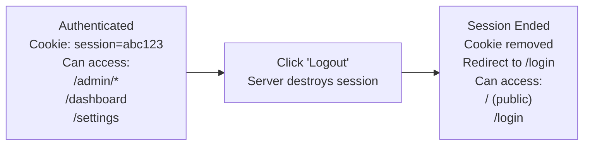

# Chapter 10: Authentication and Authorization Testing

---

Almost every web application has a login page. And behind that login page sits an entire authorization system that determines what each user can see, click, and modify. A user with the "admin" role sees a different dashboard than a user with the "viewer" role. An unauthenticated visitor gets redirected to the login page. A session expires after 30 minutes of inactivity.

These are not edge cases. They are the core of your application's security model. A missing permission check can expose sensitive data. A broken session handler can lock users out. A redirect loop after login can make your application unusable.

This chapter teaches you how to test every authentication and authorization pattern you will encounter.

---

## Understanding Auth in Web Applications

```
┌──────────────────────────────────────────────────────────────────┐
│                                                                  │
│  AUTHENTICATION                    AUTHORIZATION                 │
│  "Who are you?"                    "What can you do?"            │
│                                                                  │
│  ┌──────────────────┐              ┌──────────────────────┐     │
│  │ Login Form       │              │ Permission Checks    │     │
│  │                  │              │                      │     │
│  │ Email: ________  │              │ Admin: CRUD all      │     │
│  │ Pass:  ________  │              │ Editor: CRUD content │     │
│  │                  │              │ Viewer: Read only    │     │
│  │ [Sign In]        │              │ Guest: Public pages  │     │
│  └──────────────────┘              └──────────────────────┘     │
│                                                                  │
│  Proves identity via:              Controls access to:           │
│  • Username/password               • Pages/routes                │
│  • OAuth (Google, GitHub)          • UI elements (buttons)       │
│  • API keys                        • CRUD operations             │
│  • Session tokens                  • Admin sections              │
│                                                                  │
└──────────────────────────────────────────────────────────────────┘
```

The testing approach differs for browser-based UI tests and API tests:

```
┌─────────────────────────────────────────────────────────────────┐
│ UI Testing (Playwright)            │ API Testing (axios)        │
├─────────────────────────────────────────────────────────────────┤
│ Fill login form + press submit     │ Basic Auth header          │
│ Browser stores session cookie      │ Bearer token header        │
│ Subsequent pages are authenticated │ Each request needs auth    │
│                                    │                            │
│ Given I am a logged in user with   │ Given I am authenticating  │
│   the "admin" user                 │   as "admin" with          │
│                                    │   "password" password      │
│                                    │                            │
│ Given I am on homepage             │ Given I set header         │
│ When I go to "/login"              │   "Authorization"          │
│ And I fill in "Email" with "..."   │   with value "Bearer ..." │
│ And I fill in "Password" with ".." │                            │
│ And I press "Sign In"              │ When I send a GET request  │
│ And wait for AJAX to finish        │   to "/api/users"          │
└─────────────────────────────────────────────────────────────────┘
```

---

## Recipe 103: Testing Successful Login

**Problem:** Login is the one page every user crosses and the one your team stopped looking at months ago. Then a frontend dependency upgrade renames a form field, or an SSO change breaks the redirect, and on Monday morning nobody can get in -- the whole application is down as far as your users can tell, while every other test in your suite still passes because they bypass the form. The login form needs its own test, run on every build, before anything else.

**Solution:**

```gherkin
Feature: User Login
  As a registered user
  I want to log in to my account
  So that I can access my personal dashboard

  Scenario: Login with valid credentials
    Given I am on homepage
    When I go to "/login"
    Then I should see "Sign In"
    When I fill in "Email" with "admin@example.com"
    And I fill in "Password" with "AdminPass123"
    And I press "Sign In"
    And wait for AJAX to finish
    Then I should see "Dashboard"
    And I should see "Welcome, Admin"
    And I should not see "Sign In"

  Scenario: Login with username instead of email
    Given I am on homepage
    When I go to "/login"
    And I fill in "Username" with "admin"
    And I fill in "Password" with "AdminPass123"
    And I press "Sign In"
    And wait for AJAX to finish
    Then I should see "Dashboard"
```

**How It Works:**

This is a straightforward form submission test. The flow is:

```
Navigate to /login
       │
       ▼
Fill in credentials
       │
       ▼
Press "Sign In"
       │
       ▼
wait for AJAX  ◄── Server validates credentials,
       │            creates session, redirects
       ▼
Verify dashboard content
(proves login worked AND redirect worked)
```

`I fill in "Email" with "..."` resolves the field label-first -- it tries the `<label>` text, then id, name, and placeholder attributes. That is why the same scenario survives a markup refactor: as long as the field is still labeled "Email" for humans, the step finds it. After pressing "Sign In", the submit triggers a navigation or an XHR depending on how the app is built; webship-js's settle logic covers both, waiting until in-flight requests drain and the DOM stops mutating before the dashboard assertions run. There is one deliberate redundancy in the assertions: `I should not see "Sign In"` catches the nasty failure mode where the server re-renders the login form with no error message -- "Dashboard" might appear in a nav link even on the login page, but the absence check cannot be fooled that way.

**Pro Tip:** Do not assert the URL after login. Assert the content. If you see "Dashboard" and "Welcome, Admin," you know:
1. Login succeeded
2. Session was created
3. Redirect happened
4. Dashboard rendered with user-specific content

That is four assertions in one `should see` check. URL checking adds fragility without value.

**At scale:** This scenario belongs in every project's smoke tag (`@smoke` or `@critical`), and the credentials belong in environment variables, never in the feature file of a real project. When you run dozens of suites against dev, staging, and production-like environments, each environment has its own test account -- wire the credentials through CI secrets and a custom login step (Recipe 105), and the same feature file runs unchanged everywhere. A login scenario that needs editing per environment is a login scenario that eventually tests the wrong environment.

---

## Recipe 104: Testing Login Failures

**Problem:** A security review flags your login page: it says "User not found" for unknown emails and "Wrong password" for known ones, which means anyone can enumerate your customer list one email at a time. The developers fix it -- and six months later a helpful refactor brings the friendly messages back, because nothing was guarding the behavior. Rejection paths are security requirements, and security requirements that are not pinned by a test do not stay fixed.

**Solution:**

```gherkin
Feature: Login Failure Handling
  As a security-conscious application
  I want to reject invalid credentials
  So that unauthorized users cannot access accounts

  Scenario: Wrong password
    Given I am on homepage
    When I go to "/login"
    And I fill in "Email" with "admin@example.com"
    And I fill in "Password" with "WrongPassword"
    And I press "Sign In"
    And wait for AJAX to finish
    Then I should see "Invalid credentials"
    And I should not see "Dashboard"
    And I should see "Sign In"

  Scenario: Non-existent user
    Given I am on homepage
    When I go to "/login"
    And I fill in "Email" with "nobody@example.com"
    And I fill in "Password" with "AnyPassword"
    And I press "Sign In"
    And wait for AJAX to finish
    Then I should see "Invalid credentials"
    # Security: same message whether email exists or not
    And I should not see "User not found"

  Scenario: Empty credentials
    Given I am on homepage
    When I go to "/login"
    And I press "Sign In"
    Then I should see "Email is required"
    And I should see "Password is required"

  Scenario: SQL injection attempt is blocked
    Given I am on homepage
    When I go to "/login"
    And I fill in "Email" with "admin' OR '1'='1"
    And I fill in "Password" with "anything"
    And I press "Sign In"
    And wait for AJAX to finish
    Then I should see "Invalid credentials"
    And I should not see "Dashboard"
```

**How It Works:**

Security-sensitive applications should:
1. Show the same error message for wrong password AND non-existent user (prevents email enumeration)
2. Never reveal whether an email exists in the system
3. Handle injection attempts gracefully

```
Security Best Practice:
┌────────────────────────────────────────────────────┐
│                                                    │
│  BAD (reveals information):                        │
│  "User not found"        ← Attacker knows email   │
│                             does not exist         │
│  "Wrong password"        ← Attacker knows email   │
│                             DOES exist             │
│                                                    │
│  GOOD (reveals nothing):                           │
│  "Invalid credentials"   ← Attacker learns nothing │
│  "Invalid credentials"   ← Same message either way │
│                                                    │
└────────────────────────────────────────────────────┘
```

Look closely at the non-existent-user scenario: it asserts the generic message *and* asserts `I should not see "User not found"`. The pair is what encodes the security requirement -- the positive check alone would pass even if the page showed both messages. The empty-credentials scenario also skips `wait for AJAX to finish` on purpose: required-field validation usually fires client-side before any request leaves the browser, so there is nothing to wait for. And the SQL injection scenario is not really testing your test suite's cleverness -- it is a cheap regression tripwire. It will never replace a real security audit, but it costs four lines and fails loudly if someone swaps the ORM call for string concatenation.

**At scale:** Failure-path scenarios are the ones a PMO can actually point to during a security questionnaire -- "email enumeration is covered by an automated check on every build" is a sentence auditors like. Tag these `@security` across all your projects so one CI job can produce a portfolio-wide answer, and so the report for any single project shows the security scenarios as their own line instead of buried among UI checks.

---

## Recipe 105: Using the "Logged In" Step

**Problem:** Do the math on your suite: 120 scenarios, 90 of them need a logged-in user, and each form login costs eight seconds. That is twelve minutes per run spent typing the same email and password -- and worse, 90 scenarios that all fail together the day someone restyles the login page, burying the one real regression in a wall of red. Login should be one reusable step that every scenario shares and only one test (Recipe 103) actually exercises through the form.

**Solution:**

In your project's custom step definitions, create a reusable login step:

```gherkin
Feature: Admin Dashboard
  Scenario: Admin can view dashboard
    Given I am a logged in user with the "admin" user
    When I go to "/admin/dashboard"
    And wait for AJAX to finish
    Then I should see "Admin Dashboard"
    And I should see "System Statistics"

  Scenario: Editor can view content
    Given I am a logged in user with the "editor" user
    When I go to "/admin/content"
    And wait for AJAX to finish
    Then I should see "Content Management"
```

**Custom Step Definition:**

```javascript
// tests/step-definitions/custom-auth.js
const { Given } = require('@cucumber/cucumber');

// User credentials map
const users = {
  admin: { email: 'admin@example.com', password: 'AdminPass123', path: '/login' },
  editor: { email: 'editor@example.com', password: 'EditorPass123', path: '/login' },
  customer: { email: 'customer@example.com', password: 'CustPass123', path: '/login' },
  newuser: { email: 'newuser@example.com', password: 'NewPass123', path: '/login' },
};

Given('I am a logged in user with the {string} user', async function (role) {
  const user = users[role];
  if (!user) throw new Error(`Unknown user role: ${role}`);

  // Navigate to login page
  await this.page.goto(this.launchUrl + user.path);
  await this.page.waitForLoadState('networkidle');

  // Fill in and submit
  await this.page.getByLabel('Email').fill(user.email);
  await this.page.getByLabel('Password').fill(user.password);
  await this.page.getByRole('button', { name: 'Sign In' }).click();
  await this.page.waitForLoadState('networkidle');
});
```

**How It Works:**

```
Without reusable step:              With reusable step:

Given I am on homepage              Given I am a logged in user
When I go to "/login"                 with the "admin" user
And I fill in "Email"               When I go to "/admin/dashboard"
  with "admin@example.com"          Then I should see "Dashboard"
And I fill in "Password"
  with "AdminPass123"               ← 1 line instead of 7
And I press "Sign In"
And wait for AJAX to finish
When I go to "/admin/dashboard"
Then I should see "Dashboard"
```

This step:
1. Looks up credentials by role name
2. Navigates to the login page
3. Fills in the form
4. Submits the login
5. Waits for the page to settle

Every test that needs authentication starts with this single step. Two design choices matter here. First, scenarios speak in roles ("admin", "editor"), not credentials -- the email and password live in exactly one place, so rotating a test password is a one-line change instead of a find-and-replace across forty feature files. Second, the step throws on an unknown role rather than failing later with a cryptic "element not found"; when a new hire types `"administrator"` instead of `"admin"`, the error tells them exactly what went wrong. In a real multi-environment setup, read the credentials map from environment variables rather than hardcoding them, so the same step works against every environment your CI targets.

webship-js 2.0 also ships auth-state steps (in auth.steps.js) that save and restore the browser's storageState -- cookies plus localStorage. The pattern: log in through the form once, save the state, and have every later scenario restore it instead of logging in again. It is the same idea as the cookie injection below, but using Playwright's own persistence machinery and no custom code.

**Advanced: Cookie-Based Login (Faster)**

For even faster tests, you can inject an authentication cookie directly:

```javascript
Given('I am a logged in user with the {string} user (fast)', async function (role) {
  const user = users[role];
  // Make API call to get session token
  const response = await fetch(this.launchUrl + '/api/login', {
    method: 'POST',
    headers: { 'Content-Type': 'application/json' },
    body: JSON.stringify({ email: user.email, password: user.password }),
  });
  const data = await response.json();

  // Inject session cookie directly
  await this.context.addCookies([{
    name: 'session_id',
    value: data.sessionId,
    domain: new URL(this.launchUrl).hostname,
    path: '/',
  }]);
});
```

This skips the form entirely and injects the cookie directly. Use this approach when you have many tests that need authentication and the login form itself is not what you are testing. The cookie goes through `this.context.addCookies()`, which sets it at the browser-context level -- every page opened in that context carries it, exactly as if the browser had received a Set-Cookie header.

**At scale:** This step is the single best candidate for a shared step-definition package across your projects. Every product has a login; every product's login differs slightly; and if each suite implements its own version, you will maintain twenty divergent copies. Ship one step that reads per-project configuration (login path, field labels, credentials from env vars) and your QA team learns it once. The runtime saving compounds too -- shaving six seconds off ninety scenarios across forty nightly suites is hours of CI time per night, which your DevOps team will notice on the invoice.

---

## Recipe 106: Testing Logout

**Problem:** A shared kiosk in a clinic, a borrowed laptop in a classroom: a user clicks Logout, sees the login page, and walks away -- but the session is still alive on the server, and the next person who presses Back is inside their account. "The login page appeared" and "the session ended" are two different facts, and most logout tests only check the first one. The second is the one that ends up in an incident report.

**Solution:**

```gherkin
Feature: User Logout
  Scenario: Logout ends session
    Given I am a logged in user with the "admin" user
    When I go to "/admin/dashboard"
    Then I should see "Dashboard"

    When I click "Logout"
    And wait for AJAX to finish
    Then I should see "Sign In"
    And I should not see "Dashboard"

  Scenario: Cannot access protected pages after logout
    Given I am a logged in user with the "admin" user
    When I go to "/admin/dashboard"
    Then I should see "Dashboard"

    When I click "Logout"
    And wait for AJAX to finish
    Then I should see "Sign In"

    # Try to access protected page
    When I go to "/admin/dashboard"
    And wait for AJAX to finish
    Then I should see "Sign In"
    And I should not see "Dashboard"

  Scenario: Logout from any page
    Given I am a logged in user with the "admin" user
    When I go to "/admin/users"
    And wait for AJAX to finish
    When I click "Logout"
    And wait for AJAX to finish
    Then I should see "Sign In"
```

**How It Works:**



The critical assertion after logout is navigating back to a protected page and verifying you are redirected to login. Just checking that the login page appears after clicking "Logout" is not sufficient -- the redirect after logout could work while the session is still alive on the server. The second scenario's `When I go to "/admin/dashboard"` after logout is the step that actually proves the session died: the browser still sends whatever cookies it holds, and only a server that has destroyed the session will bounce the request back to login.

If you want belt-and-braces evidence, webship-js's cookie steps can assert the cookie state directly -- `Then a cookie with the name "session" should not exist` (the steps read the live cookie jar through the browser context). That distinguishes "cookie cleared but server session alive" from "both properly ended" when you are debugging a logout bug rather than just guarding against one.

**At scale:** The third scenario -- logout from an arbitrary page -- earns its place because logout links live in shared layout components, and layout components are exactly what get swapped during redesigns. When a portfolio of sites shares a design system, one broken logout component breaks logout everywhere at once; a per-project scenario that costs five seconds is cheap insurance against a portfolio-wide security regression.

---

## Recipe 107: Testing Password Reset Flow

**Problem:** Password reset is the feature nobody on the team has used since it was built -- everyone logs in with saved credentials. Meanwhile it is the single most-used recovery path your real users have, and the day it silently breaks (a mail template rename, a changed route, a validation regression) your support inbox fills up while every dashboard stays green. You cannot click the emailed link from a browser test, but you can test everything up to the inbox -- and that covers most of the ways the flow actually breaks.

**Solution:**

```gherkin
Feature: Password Reset
  As a user who forgot their password
  I want to reset my password
  So that I can regain access to my account

  Scenario: Request password reset
    Given I am on homepage
    When I go to "/login"
    And I click "Forgot Password"
    Then I should see "Reset Password"
    And I should see "Enter your email"
    When I fill in "Email" with "admin@example.com"
    And I press "Send Reset Link"
    And wait for AJAX to finish
    Then I should see "Reset link sent"
    And I should see "Check your email"

  Scenario: Reset with non-existent email
    Given I am on homepage
    When I go to "/login"
    And I click "Forgot Password"
    And I fill in "Email" with "nobody@example.com"
    And I press "Send Reset Link"
    And wait for AJAX to finish
    # Security: same message whether email exists or not
    Then I should see "Reset link sent"

  Scenario: Reset with invalid email format
    Given I am on homepage
    When I go to "/login"
    And I click "Forgot Password"
    And I fill in "Email" with "not-an-email"
    And I press "Send Reset Link"
    Then I should see "Please enter a valid email"
```

**How It Works:**

The password reset flow typically involves email, so you cannot test the entire flow end-to-end in a browser test. What you CAN test:
- The reset request form works
- Validation on the email field
- Success/error messages
- The security requirement (same message for existent and non-existent emails)

For complete end-to-end reset testing (clicking the link in the email), you would need either:
- A test email server that your test can query via API
- A backdoor endpoint that generates the reset token directly (test environments only)

Note the same enumeration defense from Recipe 104 appears here: the non-existent-email scenario expects "Reset link sent" anyway. A reset form that admits "no account with that email" is an enumeration oracle, and this is the test that keeps the fix fixed. The invalid-format scenario, by contrast, *should* show an error -- format validation reveals nothing about which accounts exist.

If you do add a test mail server (MailHog and Mailpit are the usual picks), the rest of the flow becomes testable with the API steps from Chapter 11: the mail server exposes a REST endpoint, so `When I send a GET request to` its messages API retrieves the email, and the reset URL inside it can be visited with a navigation step. That closes the loop without touching a real inbox.

**At scale:** Decide once, as a team, which tier each project tests to -- "form and validation only" or "full loop via test mail server" -- and record it in the test plan. The worst position is the accidental one: three projects test the full loop, seventeen test nothing past the button, and nobody knows which is which until the day a delivery manager asks "is password recovery covered?" and gets twenty different answers.

---

## Recipe 108: Testing Session Persistence

**Problem:** A user fills a long form, hits F5 by reflex, and lands on the login page with their work gone. Or your SPA keeps the session in memory instead of a cookie, so every full page load logs everyone out -- a bug class that demos never catch because demos never refresh. Sessions are supposed to be boring infrastructure; these scenarios make sure they stay boring across navigation, refresh, and the Back button.

**Solution:**

```gherkin
Feature: Session Persistence
  Scenario: Session survives page navigation
    Given I am a logged in user with the "admin" user
    When I go to "/admin/dashboard"
    Then I should see "Dashboard"

    When I go to "/admin/users"
    And wait for AJAX to finish
    Then I should see "User Management"
    And I should not see "Sign In"

    When I go to "/admin/settings"
    And wait for AJAX to finish
    Then I should see "Settings"
    And I should not see "Sign In"

    When I go to "/admin/dashboard"
    And wait for AJAX to finish
    Then I should see "Dashboard"
    And I should see "Welcome, Admin"

  Scenario: Session survives page refresh
    Given I am a logged in user with the "admin" user
    When I go to "/admin/dashboard"
    Then I should see "Dashboard"

    When I reload the page
    And wait for AJAX to finish
    Then I should see "Dashboard"
    And I should see "Welcome, Admin"
    And I should not see "Sign In"

  Scenario: Session survives browser back/forward
    Given I am a logged in user with the "admin" user
    When I go to "/admin/dashboard"
    Then I should see "Dashboard"

    When I go to "/admin/users"
    And wait for AJAX to finish
    Then I should see "User Management"

    When I move backward one page
    And wait for AJAX to finish
    Then I should see "Dashboard"
    And I should not see "Sign In"
```

**How It Works:**

Each scenario exercises a different way the browser re-establishes identity. Navigation between pages sends the session cookie on every request -- if any page drops the session, the cookie path or domain is probably scoped too narrowly. `When I reload the page` is the harshest test for SPAs: a full reload wipes all in-memory JavaScript state, so anything that survives it must live in a cookie, localStorage, or the server. And the back/forward scenario catches over-aggressive cache headers that serve a stale "please log in" page from the browser cache.

The repeated `I should not see "Sign In"` after every navigation is the actual assertion; the positive checks just confirm the right page loaded. Sessions rarely fail loudly -- they fail by quietly serving the anonymous version of a page, and only the absence check notices.

**Pro Tip:** If session persistence fails only on one environment, compare cookie attributes before blaming the code. A `Secure` cookie set on an HTTP-only staging environment never comes back; a `SameSite=Strict` cookie disappears on cross-site redirects. webship-js's cookie assertion steps (`Then a cookie with the name "session" should exist`) let you check what the browser actually holds at each step of the scenario.

---

## Recipe 109: Testing Role-Based Access Control

**Problem:** A new "Reports" section ships, and three sprints later someone notices that editors -- who were never supposed to see financial data -- have had a Reports link in their menu the whole time. Nobody broke anything; the developer simply forgot to add the permission check, and no test existed to miss it. Role-based access fails by omission, which means it can only be caught by tests that walk every role through the same pages and assert what each one must *not* see.

**Solution:**

```gherkin
Feature: Role-Based Access
  As a system administrator
  I want different roles to have different access levels
  So that sensitive operations are protected

  Scenario: Admin sees full admin menu
    Given I am a logged in user with the "admin" user
    When I go to "/admin"
    And wait for AJAX to finish
    Then I should see "Dashboard"
    And I should see "Users"
    And I should see "Content"
    And I should see "Settings"
    And I should see "System Logs"

  Scenario: Editor sees limited admin menu
    Given I am a logged in user with the "editor" user
    When I go to "/admin"
    And wait for AJAX to finish
    Then I should see "Dashboard"
    And I should see "Content"
    And I should not see "Users"
    And I should not see "Settings"
    And I should not see "System Logs"

  Scenario: Viewer has read-only access
    Given I am a logged in user with the "viewer" user
    When I go to "/admin/content"
    And wait for AJAX to finish
    Then I should see "Content"
    And I should not see "Add New"
    And I should not see "Delete"
    And I should not see "Edit"

  Scenario: Admin can manage users
    Given I am a logged in user with the "admin" user
    When I go to "/admin/users"
    And wait for AJAX to finish
    Then I should see "Add User"
    And I should see "Edit"
    And I should see "Delete"

  Scenario: Editor cannot manage users
    Given I am a logged in user with the "editor" user
    When I go to "/admin/users"
    And wait for AJAX to finish
    Then I should see "Access Denied"
    And I should not see "User Management"
```

**How It Works:**

Role-based testing follows a pattern: log in as each role, navigate to the same page, and verify different content:

```
Same Page, Different Roles:
┌────────────────────────────────────────────────────────────────┐
│                                                                │
│  Admin View:                     Editor View:                  │
│  ┌────────────────────────┐      ┌────────────────────────┐    │
│  │ Admin Panel            │      │ Admin Panel            │    │
│  │                        │      │                        │    │
│  │ ◆ Dashboard            │      │ ◆ Dashboard            │    │
│  │ ◆ Users                │      │   (Users hidden)       │    │
│  │ ◆ Content              │      │ ◆ Content              │    │
│  │ ◆ Settings             │      │   (Settings hidden)    │    │
│  │ ◆ System Logs          │      │   (Logs hidden)        │    │
│  │                        │      │                        │    │
│  │ [Add User]  [Delete]   │      │ (no action buttons)    │    │
│  └────────────────────────┘      └────────────────────────┘    │
│                                                                │
│  Viewer View:                    Guest (not logged in):        │
│  ┌────────────────────────┐      ┌────────────────────────┐    │
│  │ Content (Read Only)    │      │ Sign In                │    │
│  │                        │      │                        │    │
│  │ Article Title          │      │ Email: ___________     │    │
│  │ Article content...     │      │ Pass:  ___________     │    │
│  │                        │      │                        │    │
│  │ (no Edit/Delete btns)  │      │ [Sign In]              │    │
│  └────────────────────────┘      └────────────────────────┘    │
│                                                                │
└────────────────────────────────────────────────────────────────┘
```

One thing these UI checks deliberately measure: what each role can *see*. Hidden menu items are a usability and information-disclosure concern, and `should not see` covers them well. But a hidden button is not a permission check -- the editor who cannot see "Users" in the menu may still be able to open `/admin/users` directly. That is why the last scenario navigates straight to the URL and expects "Access Denied": it tests the server-side enforcement, not the menu rendering. Always pair the two; plenty of real-world privilege escalations were just unhidden URLs.

**Pro Tip:** Use `@admin`, `@editor`, `@viewer` tags on your scenarios to organize role-based tests:

```gherkin
@admin
Scenario: Admin can manage users
  Given I am a logged in user with the "admin" user
  ...

@editor
Scenario: Editor can manage content
  Given I am a logged in user with the "editor" user
  ...
```

This lets you run all admin tests with `--tags @admin` or all editor tests with `--tags @editor`.

**At scale:** A role-permission matrix is one of the few test artifacts a product owner can review directly -- "should editors see System Logs?" is a product question, not a technical one. Keep the matrix as a document the PO signs off, generate or hand-write the scenarios from it, and treat any diff between the two as a defect in one of them. Across multiple projects, you will also find the roles themselves drift ("editor" means different things on different products); the matrix-per-project forces that conversation early instead of during a security incident.

---

## Recipe 110: Testing Unauthorized Access Redirect

**Problem:** A new admin route ships in a Friday deploy -- `/admin/reports`, added in a hurry, missing the auth middleware that every other route gets. Nothing fails: the page works, the feature works, and anyone with the URL can read it without logging in. Holes like this are invisible to feature tests because feature tests log in first. You need a test that does the opposite: stays anonymous and knocks on every protected door.

**Solution:**

```gherkin
Feature: Unauthorized Access Protection
  Scenario: Unauthenticated user is redirected to login
    Given I am on homepage
    When I go to "/admin/dashboard"
    And wait for AJAX to finish
    Then I should see "Sign In"
    And I should not see "Dashboard"

  Scenario: Unauthenticated user cannot access settings
    Given I am on homepage
    When I go to "/admin/settings"
    And wait for AJAX to finish
    Then I should see "Sign In"

  Scenario: Unauthenticated user cannot access user list
    Given I am on homepage
    When I go to "/admin/users"
    And wait for AJAX to finish
    Then I should see "Sign In"

  Scenario Outline: All admin pages redirect to login
    Given I am on homepage
    When I go to "<path>"
    And wait for AJAX to finish
    Then I should see "Sign In"
    And I should not see "<protected_content>"

    Examples:
      | path              | protected_content   |
      | /admin/dashboard  | Dashboard           |
      | /admin/users      | User Management     |
      | /admin/settings   | Settings            |
      | /admin/content    | Content Management  |
      | /admin/reports    | Reports             |
      | /admin/logs       | System Logs         |

  Scenario: Low-privilege user cannot access admin pages
    Given I am a logged in user with the "viewer" user
    When I go to "/admin/users"
    And wait for AJAX to finish
    Then I should see "Access Denied"
    And I should not see "User Management"

  Scenario: Editor cannot access system settings
    Given I am a logged in user with the "editor" user
    When I go to "/admin/settings"
    And wait for AJAX to finish
    Then I should see "Access Denied"
    And I should not see "System Settings"
```

**How It Works:**

The Scenario Outline is particularly powerful here. It generates one test for every admin route, ensuring none of them are accidentally left unprotected:

```
Unauthorized Access Test Matrix:
┌──────────────────┬──────────────┬──────────────┬──────────────┐
│ Route            │ Guest        │ Viewer       │ Editor       │
├──────────────────┼──────────────┼──────────────┼──────────────┤
│ /admin/dashboard │ → Login      │ ✓ View       │ ✓ View       │
│ /admin/users     │ → Login      │ ✗ Denied    │ ✗ Denied    │
│ /admin/content   │ → Login      │ ✓ Read only  │ ✓ Full CRUD  │
│ /admin/settings  │ → Login      │ ✗ Denied    │ ✗ Denied    │
│ /admin/reports   │ → Login      │ ✓ View       │ ✓ View       │
│ /admin/logs      │ → Login      │ ✗ Denied    │ ✗ Denied    │
└──────────────────┴──────────────┴──────────────┴──────────────┘

✓ = Access granted    ✗ = Access denied    → Login = Redirected
```

The anonymous scenarios should start from `Given I am an anonymous user` territory -- the step clears all cookies before navigating, which matters in a suite where a previous scenario may have left a logged-in session behind. A "redirect to login" test that accidentally runs with a live admin cookie passes for the wrong reason and guards nothing.

The Examples table doubles as a route inventory. The Friday-deploy hole from the Problem statement is only caught if `/admin/reports` is *in* the table -- which makes "add the route to the unauthorized-access outline" a definition-of-done item for any new protected page, the same way developers add the route itself. One line of Gherkin per route is the entire cost.

**At scale:** This is the recipe to standardize hardest across a portfolio. Keep the protected-route list in a per-project data file next to the suite, reviewed whenever routes change, and have the same outline consume it in every project. When a penetration test or compliance review asks "how do you verify access control?", pointing at this outline -- present in all twenty projects, running nightly, with the route list in version control -- is a much better answer than describing a manual checklist.

---

## Recipe 111: Testing "Remember Me" Functionality

**Problem:** "Remember Me" is the kind of checkbox that breaks without anyone filing a bug. Users just notice they keep getting logged out, sigh, and type their password again -- you lose a little goodwill every day and never see it in a ticket. Worse is the inverse failure: the box is unchecked but the persistent cookie gets set anyway, which on a shared computer is a real security problem. Both failure modes hide behind a login that otherwise works perfectly.

**Solution:**

```gherkin
Feature: Remember Me
  Scenario: Login without Remember Me
    Given I am on homepage
    When I go to "/login"
    And I fill in "Email" with "admin@example.com"
    And I fill in "Password" with "AdminPass123"
    And I press "Sign In"
    And wait for AJAX to finish
    Then I should see "Dashboard"

  Scenario: Login with Remember Me checked
    Given I am on homepage
    When I go to "/login"
    And I fill in "Email" with "admin@example.com"
    And I fill in "Password" with "AdminPass123"
    And I check "Remember Me"
    And I press "Sign In"
    And wait for AJAX to finish
    Then I should see "Dashboard"

  Scenario: Remember Me keeps user logged in after closing browser
    Given I am on homepage
    When I go to "/login"
    And I fill in "Email" with "admin@example.com"
    And I fill in "Password" with "AdminPass123"
    And I check "Remember Me"
    And I press "Sign In"
    And wait for AJAX to finish
    Then I should see "Dashboard"
    # Note: True browser-close testing requires custom step definitions
    # that create a new browser context while preserving cookies
```

**How It Works:**

`When I check "Remember Me"` finds the checkbox by its label and checks it; the rest is the normal login flow. What the basic scenarios prove is that the checkbox does not *break* login -- a lower bar than it sounds, since a renamed field or a JavaScript handler error on the checkbox can take the whole form down with it.

To test what "Remember Me" actually promises, assert the cookie. A session-only cookie has no expiry and dies with the browser; a remembered session sets a far-future expiry. You cannot read the expiry through a Gherkin step, but you can verify the design that most apps use: a second, separate cookie (often named `remember_token` or similar) that only appears when the box was checked. `Then a cookie with the name "remember_token" should exist` after a checked login, and `should not exist` after an unchecked one, covers both failure modes from the Problem statement -- including the security-relevant one -- without any custom code.

**Note:** Testing that "Remember Me" persists across browser sessions requires creating a new browser context while preserving cookies. This is an advanced scenario that goes beyond basic Gherkin steps. For most projects, verifying that the checkbox works, login succeeds with it checked, and the persistent cookie appears only when requested is sufficient.

---

## Recipe 112: Testing OAuth/Social Login

**Problem:** Someone on the team writes a test that actually logs in through Google -- real account, real OAuth dance -- and it works beautifully for two weeks. Then Google ships a consent-screen redesign, then the test account trips a bot check and gets locked, then a CAPTCHA appears only on CI's IP range. The test spends the rest of its life flaky or skipped, eroding trust in the whole suite. Third-party login pages are not yours to test; the trick is knowing exactly where your responsibility starts and pointing your automation there.

**Solution:**

```gherkin
Feature: Social Login
  As a user
  I want to log in with my social accounts
  So that I do not need a separate password

  Scenario: Social login buttons are visible
    Given I am on homepage
    When I go to "/login"
    Then I should see "Sign in with Google"
    And I should see "Sign in with GitHub"
    And I should see "Or sign in with email"

  Scenario: Google login button redirects to Google
    Given I am on homepage
    When I go to "/login"
    When I click "Sign in with Google"
    # This will redirect to Google's OAuth page
    # Which we cannot fully test in automated tests
```

**How It Works:**

OAuth/social login is difficult to test end-to-end in automated tests because:
1. You would need to interact with Google/GitHub/Facebook login pages
2. Those pages may have CAPTCHAs, 2FA, or change their UI
3. Test accounts might get rate-limited or locked

```
What You CAN Test:            What You CANNOT Reliably Test:
┌─────────────────────────┐   ┌───────────────────────────────┐
│ ✓ Login buttons exist    │   │ ✗ Google/GitHub login flow    │
│ ✓ Buttons have correct   │   │ ✗ OAuth callback handling     │
│   links/actions          │   │   (requires real OAuth)       │
│ ✓ Post-OAuth landing     │   │ ✗ Third-party page            │
│   page works (if you     │   │   interaction                 │
│   can mock the callback) │   │                               │
│ ✓ Account linking UI     │   │ ✗ Token refresh flow          │
└─────────────────────────┘   └───────────────────────────────┘
```

**Strategy for testing OAuth:**
1. **Unit/integration tests** for the OAuth callback handler (server-side)
2. **UI tests** for button presence and the post-login landing page
3. **Mock the OAuth callback** in test environments to simulate a successful login
4. Test the full OAuth flow manually or in a dedicated E2E environment with test accounts

For option 3, webship-js's network mocking steps do the heavy lifting without any backend changes: `Given the URL "**/oauth/token" returns the JSON:` intercepts the token exchange at the browser level through Playwright's `page.route()`, so you can simulate a successful provider response and test your own callback page, account-creation logic, and post-login landing -- the parts that are actually your code. The glob pattern matches the provider's endpoint regardless of host, and the mock lives only inside the scenario that declares it.

**At scale:** Make "we do not automate third-party login pages" an explicit team policy, written into your testing guidelines, so the debate does not replay on every new project. Each project then carries the same three artifacts: a button-presence scenario, a mocked-callback scenario, and a quarterly manual check of the real flow with a dedicated test account. When the suite is green and a customer still cannot log in with Google, everyone knows immediately that the problem lives in the unmocked third of the flow -- which is itself useful triage information.

---

## Recipe 113: Testing Multi-User Workflows

**Problem:** The editorial workflow works when the developer tests it -- as an admin, with one account, end to end. In production, the editor and the approver are different people with different permissions, and the bugs live exactly in the handoff: the submitted draft that never appears in the approver's queue, the rejection reason the editor never sees, the state machine that lets an editor approve their own article. You cannot test a handoff without actually changing hands mid-scenario.

**Solution:**

```gherkin
Feature: Content Approval Workflow
  As a team
  We need content creators and approvers
  So that published content is reviewed

  Scenario: Editor creates content, Admin approves it
    # Step 1: Editor creates a draft
    Given I am a logged in user with the "editor" user
    When I go to "/admin/content"
    And I press "Add Article"
    And wait for AJAX to finish
    And I fill in "Title" with "New Feature Announcement"
    And I fill in "Body" with "We are excited to announce..."
    And I press "Save as Draft"
    And wait for AJAX to finish
    Then I should see "Draft saved"
    And I should see "Status: Draft" in the "New Feature Announcement" row

    # Step 2: Editor submits for review
    When I click "Submit for Review" in the "New Feature Announcement" row
    And wait for AJAX to finish
    Then I should see "Status: Pending Review" in the "New Feature Announcement" row

    # Step 3: Log out as editor
    When I click "Logout"
    And wait for AJAX to finish

    # Step 4: Log in as admin and approve
    Given I am a logged in user with the "admin" user
    When I go to "/admin/content"
    And wait for AJAX to finish
    Then I should see "Pending Review" in the "New Feature Announcement" row
    When I click "Approve" in the "New Feature Announcement" row
    And wait for AJAX to finish
    Then I should see "Status: Published" in the "New Feature Announcement" row

  Scenario: Admin rejects content
    Given I am a logged in user with the "editor" user
    When I go to "/admin/content"
    And I press "Add Article"
    And wait for AJAX to finish
    And I fill in "Title" with "Incomplete Article"
    And I press "Save as Draft"
    And wait for AJAX to finish
    When I click "Submit for Review" in the "Incomplete Article" row
    And wait for AJAX to finish
    When I click "Logout"
    And wait for AJAX to finish

    Given I am a logged in user with the "admin" user
    When I go to "/admin/content"
    And wait for AJAX to finish
    When I click "Reject" in the "Incomplete Article" row
    And wait for the modal to appear
    And I fill in "Reason" with "Article needs more detail"
    And I click "Submit" in the modal
    And wait for AJAX to finish
    Then I should see "Status: Rejected" in the "Incomplete Article" row
```

**How It Works:**

Multi-user workflow testing switches between users within a single scenario:

```
Workflow Timeline:
┌─────────────────────────────────────────────────────────────────┐
│                                                                 │
│  Editor                           Admin                         │
│  ──────                           ─────                         │
│    │                                                            │
│    ├─ Login                                                     │
│    ├─ Create draft                                              │
│    ├─ Submit for review                                         │
│    ├─ Logout                                                    │
│    │                                │                           │
│    │                                ├─ Login                    │
│    │                                ├─ See pending review       │
│    │                                ├─ Approve / Reject         │
│    │                                ├─ Status changes           │
│    │                                │                           │
│                                                                 │
└─────────────────────────────────────────────────────────────────┘
```

**Key points:**
- Log out between user switches to start a clean session
- Verify the state changes persist between sessions (editor's submission visible to admin)
- Test both the happy path (approve) and the sad path (reject)

The explicit `When I click "Logout"` before switching users is not ceremony -- it is the only thing standing between you and a test that "approves" content while still authenticated as the editor. If your custom login step (Recipe 105) does not clear cookies before logging in, a forgotten logout means the second login silently piggybacks on the first session in some apps. Make the login step defensive: clear cookies first (the same thing `Given I am an anonymous user` does), so a missed logout becomes harmless.

These scenarios are also where the `in the "..." row` steps from Chapter 9 prove their worth outside pure table testing -- the article title is the row identifier, and the status assertions (`"Status: Pending Review" in the "New Feature Announcement" row`) track one piece of content through the entire state machine across two user sessions.

**At scale:** Multi-user scenarios are your longest and most expensive tests -- two logins, multiple state transitions, modal interactions. Do not multiply them; pick the one workflow per project that moves money or publishes content, automate that, and cover the permission variations with the cheaper single-role tests of Recipe 109. When a workflow scenario fails on CI, the failure screenshot (captured automatically on failure) plus the step name usually tells you which side of the handoff broke -- name your steps so the report reads like the workflow: "editor submits", "admin approves".

---

## Recipe 114: Testing User Profile Management

**Problem:** A user changes their password, the app says "Password changed" -- and the new password does not work, because the success message fires before the save that failed. Or the display-name update saves but the old name keeps showing in the header for a week thanks to a cached fragment. Profile pages are low-glamour CRUD that every user touches and no sprint prioritizes, which is exactly the profile of a feature that rots quietly.

**Solution:**

```gherkin
Feature: User Profile
  As a logged in user
  I want to manage my profile
  So that my information is up to date

  Scenario: View profile information
    Given I am a logged in user with the "admin" user
    When I go to "/profile"
    And wait for AJAX to finish
    Then I should see "My Profile"
    And I should see "admin@example.com"
    And I should see "Admin"

  Scenario: Update display name
    Given I am a logged in user with the "admin" user
    When I go to "/profile/edit"
    And wait for AJAX to finish
    And I fill in "Display Name" with "Tester Demo"
    And I press "Save Profile"
    And wait for AJAX to finish
    Then I should see "Profile updated"
    And I should see "Tester Demo"

  Scenario: Change password
    Given I am a logged in user with the "admin" user
    When I go to "/profile/change-password"
    And wait for AJAX to finish
    And I fill in "Current Password" with "AdminPass123"
    And I fill in "New Password" with "NewAdminPass456"
    And I fill in "Confirm Password" with "NewAdminPass456"
    And I press "Change Password"
    And wait for AJAX to finish
    Then I should see "Password changed"

  Scenario: Password mismatch validation
    Given I am a logged in user with the "admin" user
    When I go to "/profile/change-password"
    And wait for AJAX to finish
    And I fill in "Current Password" with "AdminPass123"
    And I fill in "New Password" with "NewPass1"
    And I fill in "Confirm Password" with "NewPass2"
    And I press "Change Password"
    Then I should see "Passwords do not match"
```

**How It Works:**

The display-name scenario asserts the success message *and* the new name -- the second assertion is the one that catches the caching bug from the Problem statement, because it checks the rendered result, not the server's claim. For the full proof, follow the update with `When I reload the page` and assert "Tester Demo" again; a value that survives a reload came from the backend, not from optimistic JavaScript.

The password-change scenario as written trusts the success message. The stronger version logs out and logs back in with the *new* password -- that is the only assertion that proves the credential actually changed. One warning if you add it: the scenario mutates shared test data. Every later scenario that logs in as "admin" now needs the new password, so either change it back at the end of the scenario, or give password-change tests their own dedicated user that nothing else depends on. The second option is the one that will not bite you during parallel runs.

**At scale:** A dedicated `password-change-user` in the seed data, per project, is the kind of convention worth writing into your shared fixtures standard. Suites that mutate the main admin account's password are the source of some of the most confusing cross-scenario failures you will ever debug -- the failure appears in whatever scenario happens to run next, not in the one that caused it.

---

## Recipe 115: Testing API Authentication

**Problem:** Your UI tests prove the web login works, but half your traffic never touches the UI -- mobile apps, integrations, and partner systems all hit the API directly with tokens and keys. When the API's 401 handling regresses, no browser test notices; the first report comes from a partner whose integration broke overnight. API auth needs its own scenarios, and they are cheaper than UI tests: no browser, no rendering, just request and response.

**Solution:**

```gherkin
Feature: API Authentication
  Scenario: Basic Authentication
    Given I am authenticating as "admin" with "password123" password
    When I send a GET request to "/api/users"
    Then the API response code should be 200
    And the API response should contain "users"

  Scenario: Bearer Token Authentication
    Given I set header "Authorization" with value "Bearer eyJhbGciOiJIUzI1NiJ9..."
    When I send a GET request to "/api/users"
    Then the API response code should be 200

  Scenario: API Key Authentication
    Given I set header "X-API-Key" with value "test-api-key-12345"
    When I send a GET request to "/api/users"
    Then the API response code should be 200

  Scenario: Unauthenticated API request fails
    When I send a GET request to "/api/users"
    Then the API response code should be 401
    And the API response should contain "Unauthorized"

  Scenario: Invalid credentials fail
    Given I am authenticating as "admin" with "wrongpassword" password
    When I send a GET request to "/api/users"
    Then the API response code should be 401

  Scenario: Expired token fails
    Given I set header "Authorization" with value "Bearer expired-token"
    When I send a GET request to "/api/users"
    Then the API response code should be 401
    And the API response should contain "Token expired"
```

**How It Works:**

webship-js API steps use axios for HTTP requests. The authentication steps set headers on the internal axios configuration:

```
Basic Auth Flow:
┌───────────────────────────────────┐
│ Given I am authenticating as      │
│   "admin" with "password123"      │
│                                   │
│ Internally:                       │
│ Authorization: Basic              │
│   YWRtaW46cGFzc3dvcmQxMjM=      │
│                                   │
│ (base64 of "admin:password123")   │
└──────────────┬────────────────────┘
               │
               ▼
┌───────────────────────────────────┐
│ When I send a GET request         │
│   to "/api/users"                 │
│                                   │
│ axios.get("/api/users", {         │
│   headers: {                      │
│     Authorization: "Basic ..."    │
│   }                               │
│ })                                │
└──────────────┬────────────────────┘
               │
               ▼
┌───────────────────────────────────┐
│ Then the API response code        │
│   should be 200                   │
│                                   │
│ assert(response.status === 200)   │
└───────────────────────────────────┘
```

Two details worth knowing. First, the headers you set with `Given I set header` accumulate on the axios configuration for the scenario -- they ride along on every request that follows, which is exactly what you want for a token but also why a stray header from an earlier step can change a later request's behavior. Each scenario starts clean. Second, these API steps run alongside your browser steps in the same suite -- same Cucumber run, same report -- but they do not share authentication with the browser. Logging in through the UI does not set an API token, and vice versa; the browser holds cookies, axios holds headers.

The unauthenticated and expired-token scenarios are the ones to never skip. The happy paths get exercised implicitly by every other API test you write; the 401 paths only run when you write them deliberately, and they are where partners and mobile clients feel regressions first.

**At scale:** Keep tokens and API keys out of feature files in real projects -- the docstring values here are illustrations. Wire credentials through CI secrets and a setup step, and tag API auth scenarios (`@api`) so your pipeline can run them as a fast pre-stage before the browser suites: a few seconds of API checks that fail in thirty seconds beat a browser suite that fails after ten minutes on the same broken auth service.

---

## Authentication Testing Strategy

```
┌──────────────────────────────────────────────────────────────────┐
│ Authentication Testing Priority                                  │
│                                                                  │
│ Priority 1 (Must Have):                                          │
│   ✓ Valid login succeeds                                        │
│   ✓ Invalid login fails with correct message                    │
│   ✓ Logout works                                                │
│   ✓ Protected pages redirect unauthenticated users              │
│                                                                  │
│ Priority 2 (Should Have):                                        │
│   ✓ Role-based access (admin vs editor vs viewer)               │
│   ✓ Session persists across navigation and refresh              │
│   ✓ Password change works                                       │
│   ✓ API authentication (Basic Auth, Bearer Token)               │
│                                                                  │
│ Priority 3 (Nice to Have):                                       │
│   ○ Password reset flow                                         │
│   ○ Remember Me functionality                                    │
│   ○ OAuth/social login button presence                          │
│   ○ Multi-user workflows                                         │
│   ○ Session timeout testing                                      │
│                                                                  │
│ Priority 4 (Manual or Integration Tests):                        │
│   ○ Full OAuth flow (involves third-party pages)                 │
│   ○ Email-based workflows (password reset link)                  │
│   ○ Two-factor authentication                                    │
│   ○ Rate limiting / account lockout                              │
│                                                                  │
└──────────────────────────────────────────────────────────────────┘
```

---

## Chapter Summary

- Authentication = "Who are you?" / Authorization = "What can you do?"
- Test both successful login AND failure cases
- Security: use the same error message for wrong password and non-existent user
- Create a reusable `Given I am a logged in user with the "X" user` step
- For fast tests, consider cookie injection instead of form-based login
- Always verify that protected pages redirect unauthenticated users
- Test every role against every page/feature to catch missing permission checks
- Multi-user workflows: log out between user switches
- OAuth can only be partially tested in automated UI tests
- API authentication: test Basic Auth, Bearer Token, and API Key patterns
- Password reset: test the request form; full email flow needs a test mail server
- Use Scenario Outline + Examples for comprehensive access control testing
- Tag scenarios by role (`@admin`, `@editor`) for organized test runs

Next: API Testing Recipes -- deep-dive into REST API testing with webship-js.
