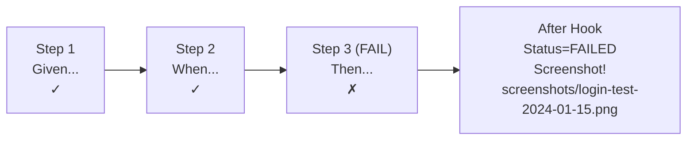

# Chapter 14: Screenshot and Visual Testing

---

Sometimes a test can pass every assertion and still miss a bug. The login button works, but it is hidden behind a misaligned div. The table data is correct, but the columns overlap. The modal opens, but the text is invisible because white text is on a white background.

These are visual bugs, and they slip through functional assertions because `I should see "Login"` checks the DOM, not the pixels. Screenshot testing catches what assertions cannot.

This chapter covers capturing screenshots, organizing them as evidence, and using them to detect visual regressions.

---

## Understanding Visual Testing

```
┌──────────────────────────────────────────────────────────────────┐
│ Functional Testing vs Visual Testing                             │
│                                                                  │
│  Functional:                     Visual:                         │
│  "Does the button exist?"        "Can the user see the button?"  │
│                                                                  │
│  ┌────────────────────────┐     ┌────────────────────────┐      │
│  │ should see "Login"     │     │ Screenshot shows Login │      │
│  │                        │     │ button is centered,    │      │
│  │ ✓ PASS                │     │ readable, and not      │      │
│  │ (element exists in DOM)│     │ overlapped by other    │      │
│  │                        │     │ elements               │      │
│  │ But... button is behind│     │                        │      │
│  │ an overlay and not     │     │ ✓ PASS or ✗ FAIL     │      │
│  │ actually visible!      │     │ (visual comparison)    │      │
│  └────────────────────────┘     └────────────────────────┘      │
│                                                                  │
│  Functional tests answer: "Is it there?"                         │
│  Visual tests answer: "Does it look right?"                      │
└──────────────────────────────────────────────────────────────────┘
```

---

## Recipe 148: Capturing Screenshots on Test Failure

**Problem:** The nightly run fails at 2 a.m. on a scenario that passes every time you run it locally. The error says "expected to see Dashboard" -- but what was actually on screen? A login error? A maintenance page? A cookie banner covering the button? Without a picture of that moment you are debugging blind, and the usual outcome is the worst one: someone re-runs the job, it goes green, and the real bug ships.

**Solution:**

Add an After hook that captures a screenshot on failure:

```javascript
// tests/step-definitions/custom-screenshots.js
const { After, Status } = require('@cucumber/cucumber');
const path = require('path');
const fs = require('fs');

After(async function (scenario) {
  if (scenario.result.status === Status.FAILED) {
    // Create screenshots directory if needed
    const screenshotDir = path.join(process.cwd(), 'screenshots');
    if (!fs.existsSync(screenshotDir)) {
      fs.mkdirSync(screenshotDir, { recursive: true });
    }

    // Generate filename from scenario name
    const name = scenario.pickle.name
      .replace(/[^a-zA-Z0-9]/g, '-')
      .replace(/-+/g, '-')
      .toLowerCase();
    const timestamp = new Date().toISOString().replace(/[:.]/g, '-');
    const filename = `${name}-${timestamp}.png`;

    // Capture screenshot
    await this.page.screenshot({
      path: path.join(screenshotDir, filename),
      fullPage: true,
    });

    // Attach screenshot to Cucumber report
    const screenshot = await this.page.screenshot({ fullPage: true });
    this.attach(screenshot, 'image/png');
  }
});
```

```gherkin
Feature: Screenshot on Failure
  Scenario: This test will produce a screenshot if it fails
    Given I am on homepage
    When I go to "/login"
    And I fill in "Email" with "admin@example.com"
    And I fill in "Password" with "WrongPassword"
    And I press "Sign In"
    And wait for AJAX to finish
    # If this fails, a screenshot is automatically captured
    Then I should see "Dashboard"
```

**How It Works:**



The After hook checks the scenario result status. If it is `FAILED`, it:
1. Creates a `screenshots/` directory if it does not exist
2. Captures a full-page screenshot
3. Saves it with a descriptive filename
4. Attaches it to the Cucumber report (visible in HTML reports)

Here is the part that saves you work: webship-js 2.0 ships this behavior built in. WEBSHIP_SCREENSHOT_ON_FAILED defaults to true, captures land in WEBSHIP_SCREENSHOT_DIR (./screenshots by default) with the failed_ prefix from WEBSHIP_SCREENSHOT_FAILED_PREFIX, and filenames follow WEBSHIP_SCREENSHOT_PATTERN -- '{datetime}.{feature_file}.feature_{step_line}.{ext}' -- so the filename alone tells you which feature and which step line died. Write a custom hook like the one above only when you need behavior the env vars cannot express; otherwise you are maintaining code the framework already gives you. Two related switches worth knowing: WEBSHIP_SCREENSHOT_ON_EVERY_STEP for full step-by-step capture (or the @screenshots tag to get the same for a single scenario), and WEBSHIP_SCREENSHOT_PURGE to clear the directory at the start of each run.

**At scale:** Failure screenshots only help if people can find them. Publish the screenshots directory as a CI artifact on every failed job, and keep the filename pattern identical across all your projects -- when 40 suites run nightly, a triager who sees `failed_2026-06-10...login.feature_12.png` knows the feature and step before opening anything. The QA lead's first question on a red run changes from "can anyone reproduce this?" to "look at the picture: real bug or environment hiccup?" That one change is worth more than any flaky-test policy you will ever write.

---

## Recipe 149: Full-Page Screenshots

**Problem:** A stakeholder asks what the new pricing page actually looks like on staging, and the only honest answer is "run the suite and watch." Worse: a failure screenshot shows a perfectly fine viewport while the broken section sits 2000 pixels below the fold. Default screenshots capture only what a user would see without scrolling -- which is often exactly the part of the page that was fine.

**Solution:**

```javascript
// Custom step definition for on-demand screenshots
const { When } = require('@cucumber/cucumber');
const path = require('path');

When('I take a screenshot', async function () {
  const screenshotDir = path.join(process.cwd(), 'screenshots');
  const timestamp = new Date().toISOString().replace(/[:.]/g, '-');
  await this.page.screenshot({
    path: path.join(screenshotDir, `screenshot-${timestamp}.png`),
    fullPage: true,
  });
});

When('I take a screenshot named {string}', async function (name) {
  const screenshotDir = path.join(process.cwd(), 'screenshots');
  const safeName = name.replace(/[^a-zA-Z0-9]/g, '-').toLowerCase();
  await this.page.screenshot({
    path: path.join(screenshotDir, `${safeName}.png`),
    fullPage: true,
  });
});
```

```gherkin
Feature: Page Screenshots
  Scenario: Capture dashboard for review
    Given I am a logged in user with the "admin" user
    When I go to "/admin/dashboard"
    And wait for AJAX to finish
    And I take a screenshot named "admin-dashboard"
    Then I should see "Dashboard"

  Scenario: Capture full product listing page
    Given I am on homepage
    When I go to "/products"
    And wait for AJAX to finish
    And wait for the page to load
    And I take a screenshot named "product-listing"
    Then I should see "Products"
```

**Full Page vs Viewport:**

```
fullPage: false (default)          fullPage: true
┌──────────────────────┐          ┌──────────────────────┐
│ Only what is visible │          │ Everything, even     │
│ in the viewport      │          │ content below the    │
│                      │          │ fold                 │
│ Header              │          │ Header              │
│ Content             │          │ Content             │
│ ...                  │          │ More content        │
│                      │          │ More content        │
│ (cut off here)       │          │ ...                  │
│                      │          │ Footer              │
└──────────────────────┘          └──────────────────────┘
  Captures: viewport only          Captures: entire page
  File size: smaller               File size: larger
```

**How It Works:**

With `fullPage: true`, Playwright scrolls the page internally, stitches the result into a single PNG, and restores the scroll position -- the page under test does not stay scrolled. The built-in capture system has the same switch: set WEBSHIP_SCREENSHOT_FULLSCREEN and every automatic screenshot, failure shots included, becomes full-page. Two caveats are worth knowing before you flip it everywhere. `position: fixed` elements (sticky headers, chat widgets) repeat or stretch in stitched captures, and lazy-loaded images can appear as placeholders because the stitching scroll outruns the loader. For evidence shots of long pages both are usually acceptable; for visual regression baselines (Recipe 152) they are noise you have to plan around -- which is one more argument for element-level baselines.

---

## Recipe 150: Element-Specific Screenshots

**Problem:** The full-page capture of your analytics dashboard is 14,000 pixels tall, and the one chart you care about is somewhere in the middle of it. When the design team asks "send me how the revenue chart renders with real data," you want a tight crop of that component -- not a scavenger hunt through a giant PNG that is mostly navigation and footer.

**Solution:**

```javascript
// Custom step definition for element screenshots
const { When } = require('@cucumber/cucumber');
const path = require('path');

When('I take a screenshot of the {string} element named {string}', async function (selector, name) {
  const screenshotDir = path.join(process.cwd(), 'screenshots');
  const safeName = name.replace(/[^a-zA-Z0-9]/g, '-').toLowerCase();
  const element = this.page.locator(selector).first();
  await element.screenshot({
    path: path.join(screenshotDir, `${safeName}.png`),
  });
});
```

```gherkin
Feature: Element Screenshots
  Scenario: Capture only the login form
    Given I am on homepage
    When I go to "/login"
    And I take a screenshot of the ".login-form" element named "login-form"

  Scenario: Capture a specific chart
    Given I am a logged in user with the "admin" user
    When I go to "/admin/analytics"
    And wait for AJAX to finish
    And I take a screenshot of the "#revenue-chart" element named "revenue-chart"
```

**How It Works:**

`element.screenshot()` waits for the element to reach a stable state (visible, done animating), scrolls it into view, then clips the capture to the element's bounding box. The result is deterministic in a way full-page shots are not: a tight crop of one component does not change when an unrelated banner above it grows by 20 pixels. That stability pays off later -- element shots make far better visual-regression baselines than full pages, because the diff only covers pixels the component actually owns. Note the `.first()` in the step: if your selector matches several elements, you capture the first match silently, so prefer ids or specific data attributes for capture targets.

---

## Recipe 151: Organizing Screenshot Archives

**Problem:** Three months into a project, your screenshots folder holds four thousand files with timestamps for names. A developer asks for "the screenshot from when the checkout test broke last Tuesday" and you genuinely cannot find it. Flat directories work for a week; after that, screenshots without structure are write-only data -- captured at real cost, never looked at again.

**Solution:**

```javascript
// Organized screenshot directory structure
const { After, Before, Status } = require('@cucumber/cucumber');
const path = require('path');
const fs = require('fs');

// Create run-specific directory before all tests
const runTimestamp = new Date().toISOString().replace(/[:.]/g, '-').slice(0, 19);
const runDir = path.join(process.cwd(), 'screenshots', runTimestamp);

Before(function () {
  if (!fs.existsSync(runDir)) {
    fs.mkdirSync(runDir, { recursive: true });
  }
});

After(async function (scenario) {
  if (scenario.result.status === Status.FAILED) {
    const featureName = scenario.pickle.uri
      .split('/').pop()
      .replace('.feature', '');
    const scenarioName = scenario.pickle.name
      .replace(/[^a-zA-Z0-9]/g, '-')
      .toLowerCase();

    const featureDir = path.join(runDir, featureName);
    if (!fs.existsSync(featureDir)) {
      fs.mkdirSync(featureDir, { recursive: true });
    }

    await this.page.screenshot({
      path: path.join(featureDir, `${scenarioName}.png`),
      fullPage: true,
    });
  }
});
```

**Resulting directory structure:**

```
screenshots/
├── 2024-01-15T10-30-45/
│   ├── login/
│   │   ├── login-with-wrong-password.png
│   │   └── login-with-expired-session.png
│   ├── dashboard/
│   │   └── admin-widget-loading-error.png
│   └── forms/
│       └── file-upload-too-large.png
├── 2024-01-16T09-15-22/
│   └── login/
│       └── login-with-wrong-password.png
└── latest -> 2024-01-16T09-15-22/
```

**How It Works:**

The Before hook computes one run-level directory per execution, so every scenario in a run files its captures under the same timestamp -- exactly what you want when comparing "last night" against "tonight". Inside it, failures group by feature file, mirroring how your team already thinks about the suite. Before building this by hand, check whether the built-in naming gets you there: WEBSHIP_SCREENSHOT_PATTERN supports {datetime}, {feature_file}, and {step_line} tokens, WEBSHIP_SCREENSHOT_INFO_TYPES controls which details (url, feature, step, datetime) are recorded alongside captures, and WEBSHIP_SCREENSHOT_PURGE handles cleanup at run start. The custom hook earns its keep when you need real directories -- per-run, per-feature -- rather than structured filenames.

**At scale:** Storage is the silent bill. Forty suites times nightly runs times full-page PNGs adds up to gigabytes a week, and nobody ever deletes screenshots by hand. Decide retention in the pipeline, not in test code: keep failure screenshots for 30 days as CI artifacts, purge passing-run captures with WEBSHIP_SCREENSHOT_PURGE, and let the run-timestamp directory name double as the key your cleanup job sorts by. Your platform team will find the unbounded screenshots bucket eventually -- better they find a policy.

---

## Recipe 152: Visual Regression with Screenshot Comparison

**Problem:** A CSS refactor ships, every functional test passes, and the next morning the product owner asks why the homepage hero is purple. Functional assertions check that elements exist and contain the right text; none of them noticed that a shared variable changed and restyled half the site. You need a test that fails when pixels change -- on purpose, against a baseline somebody approved.

**Solution:**

```javascript
// tests/step-definitions/custom-visual-regression.js
const { Then } = require('@cucumber/cucumber');
const path = require('path');
const fs = require('fs');
const assert = require('assert');
const { PNG } = require('pngjs');
const pixelmatch = require('pixelmatch');

Then('the page should match the {string} baseline', async function (baselineName) {
  const baselineDir = path.join(process.cwd(), 'screenshots', 'baselines');
  const diffDir = path.join(process.cwd(), 'screenshots', 'diffs');
  const currentDir = path.join(process.cwd(), 'screenshots', 'current');

  for (const dir of [baselineDir, diffDir, currentDir]) {
    if (!fs.existsSync(dir)) fs.mkdirSync(dir, { recursive: true });
  }

  const safeName = baselineName.replace(/[^a-zA-Z0-9]/g, '-').toLowerCase();
  const baselinePath = path.join(baselineDir, `${safeName}.png`);
  const currentPath = path.join(currentDir, `${safeName}.png`);

  // Capture current screenshot
  await this.page.screenshot({ path: currentPath, fullPage: true });

  // If no baseline exists, create it
  if (!fs.existsSync(baselinePath)) {
    fs.copyFileSync(currentPath, baselinePath);
    return; // First run establishes baseline
  }

  // Compare images
  const baseline = PNG.sync.read(fs.readFileSync(baselinePath));
  const current = PNG.sync.read(fs.readFileSync(currentPath));
  const { width, height } = baseline;
  const diff = new PNG({ width, height });

  const mismatchedPixels = pixelmatch(
    baseline.data, current.data, diff.data,
    width, height,
    { threshold: 0.1 } // Tolerance for anti-aliasing
  );

  // Save diff image
  const diffPath = path.join(diffDir, `${safeName}-diff.png`);
  fs.writeFileSync(diffPath, PNG.sync.write(diff));

  const mismatchPercentage = (mismatchedPixels / (width * height)) * 100;

  assert(mismatchPercentage < 1,
    `Visual regression detected: ${mismatchPercentage.toFixed(2)}% pixels differ. ` +
    `See diff: ${diffPath}`);
});
```

```gherkin
Feature: Visual Regression
  @visual
  Scenario: Homepage looks correct
    Given I am on homepage
    And wait for the page to load
    Then the page should match the "homepage" baseline

  @visual
  Scenario: Login page looks correct
    Given I am on homepage
    When I go to "/login"
    And wait for the page to load
    Then the page should match the "login-page" baseline

  @visual
  Scenario: Dashboard looks correct
    Given I am a logged in user with the "admin" user
    When I go to "/admin/dashboard"
    And wait for AJAX to finish
    And wait for the page to load
    Then the page should match the "admin-dashboard" baseline
```

**How It Works:**

```
Visual Regression Flow:
┌──────────────────────────────────────────────────────────────────┐
│                                                                  │
│  First Run (No Baseline):                                        │
│  ┌─────────────┐     ┌──────────────────┐                      │
│  │ Take        │────►│ Save as baseline │                      │
│  │ screenshot  │     │ (golden image)   │                      │
│  └─────────────┘     └──────────────────┘                      │
│                                                                  │
│  Subsequent Runs:                                                │
│  ┌─────────────┐     ┌──────────────────┐     ┌──────────────┐ │
│  │ Take        │────►│ Compare with     │────►│ < 1% diff?   │ │
│  │ screenshot  │     │ baseline         │     │              │ │
│  └─────────────┘     └──────────────────┘     │ Yes → PASS   │ │
│                             │                  │ No  → FAIL   │ │
│                             │                  └──────────────┘ │
│                             ▼                                    │
│                      ┌──────────────────┐                      │
│                      │ Save diff image  │                      │
│                      │ (highlights      │                      │
│                      │  changed pixels) │                      │
│                      └──────────────────┘                      │
│                                                                  │
└──────────────────────────────────────────────────────────────────┘
```

The `pixelmatch` library compares two PNG images pixel by pixel and generates a diff image highlighting the differences in red. A threshold of 0.1 allows for minor anti-aliasing differences.

The comparison is brutally literal, which is both the power and the trap. Font hinting, anti-aliasing, and GPU rasterization differ between machines -- a baseline captured on a developer's laptop will "fail" against a CI runner's capture even though nothing changed. The fix is a rule, not code: baselines are generated in the same environment that compares against them. In practice, CI generates and CI compares, on a pinned browser image; the moment your platform team bumps that image, expect to re-baseline.

webship-js's smart-wait does quiet work for you here. A screenshot taken while a spinner is mid-rotation or an AJAX call is in flight produces a different image every run -- but because smartSettle waits for window.__webshipAjaxCount to hit zero and the DOM to stay quiet for 250ms after each step, your capture lands on a settled page. For regions that are genuinely dynamic (dates, ads, "5,231 users online"), either screenshot stable components instead (Recipe 150) or mask the dynamic region before comparing. And treat the 1% threshold in the assert as a starting point, not a law: tighten it for marketing pages where a stray pixel matters, loosen it for data-heavy admin screens.

**At scale:** Visual regression across many projects lives or dies on baseline logistics. Keep baselines per browser and per viewport (a chromium-1280 baseline will never match a webkit capture), store them in the repo or an artifact bucket keyed by branch, and make "update baselines" a deliberate, reviewed step -- a CI job someone triggers after a design change, never an automatic overwrite. When a shared design system bumps a color token, every consuming project's visual suite goes red at once. That is not noise; that is the system telling you exactly which products the change reached, before any customer does.

**Updating Baselines:**

When your design intentionally changes, update the baselines:

```bash
# Delete old baselines to regenerate
rm -rf screenshots/baselines/
# Run tests -- new baselines will be created
npx cucumber-js --tags "@visual"
```

---

## Recipe 153: Attaching Screenshots to Reports

**Problem:** Your screenshots live on the CI runner's disk; your test report lives in the browser of whoever opens it. A delivery manager reading the HTML report sees "Then I should see Dashboard -- failed" and has to file a ticket asking what the screen showed, because the picture that answers her question sits in a job artifact she does not know exists. Evidence that is not in the report might as well not exist.

**Solution:**

```javascript
// In your After hook or custom step
const { After, Status } = require('@cucumber/cucumber');

After(async function (scenario) {
  // Always attach a screenshot to the report (pass or fail)
  const screenshot = await this.page.screenshot({ fullPage: true });
  this.attach(screenshot, 'image/png');

  // Or conditionally on failure
  if (scenario.result.status === Status.FAILED) {
    const screenshot = await this.page.screenshot({ fullPage: true });
    this.attach(screenshot, 'image/png');
  }
});
```

**How It Works:**

`this.attach(buffer, mimeType)` is a Cucumber built-in method that attaches binary data to the current scenario's report output. When using `cucumber-html-reporter`, the screenshot appears inline in the HTML report alongside the scenario steps.

Under the hood, the attachment is base64-encoded into the message stream and lands inside tests/reports/cucumber_report.json -- the same file webship-js's bin/generate-reports.js reads to build the HTML and PDF reports. That has a practical consequence: attach-on-every-step across a 400-scenario suite produces a JSON file in the hundreds of megabytes and an HTML report browsers struggle to open. Attach on failure by default; attach on success only for the handful of scenarios where a passing picture is itself the deliverable.

**At scale:** This is the recipe that turns a test run into evidence a non-engineer can read. Generate the report with metadata that answers a manager's first three questions -- `bin/generate-reports.js` takes `--app-version`, `--env`, `--browser`, `--platform`, and arbitrary `--metadata Key=Value` flags -- and the failed scenario with its inline screenshot becomes a self-contained artifact: what ran, where, against which build, and what the screen showed. When the PMO asks "is release X safe?", a PDF report (`--format pdf`) with embedded failure screenshots is an answer. A green checkbox in CI is not.

```
HTML Report:
┌──────────────────────────────────────────────────────┐
│ Scenario: Login with wrong password          ✗ FAIL │
│                                                      │
│ Given I am on homepage                        ✓     │
│ When I go to "/login"                         ✓     │
│ And I fill in "Email" with "admin@e.c"        ✓     │
│ And I fill in "Password" with "wrong"         ✓     │
│ And I press "Sign In"                         ✓     │
│ Then I should see "Dashboard"                 ✗     │
│                                                      │
│ ┌──────────────────────────────────────────────┐    │
│ │ [Screenshot: shows login page with error     │    │
│ │  message "Invalid credentials"]              │    │
│ └──────────────────────────────────────────────┘    │
│                                                      │
└──────────────────────────────────────────────────────┘
```

---

## Screenshot Testing Quick Reference

```
┌───────────────────────────────────────────────────────────────────┐
│ What You Want                    │ Approach                       │
├───────────────────────────────────────────────────────────────────┤
│ Screenshot on failure            │ After hook with Status.FAILED  │
│ Full-page screenshot             │ page.screenshot({fullPage:true})│
│ Element screenshot               │ element.screenshot()           │
│ Attach to report                 │ this.attach(buffer, 'image/png')│
│ Visual regression                │ pixelmatch baseline comparison │
│ Organize by date                 │ Timestamped subdirectories     │
│ Organize by feature              │ Feature-name subdirectories    │
│ Update baselines                 │ Delete baselines/ and rerun    │
└───────────────────────────────────────────────────────────────────┘
```

---

## Chapter Summary

- Functional assertions miss visual bugs (overlaps, invisible text, broken layouts)
- Capture screenshots automatically on test failure via After hooks
- Use `fullPage: true` to capture content below the fold
- Element screenshots capture specific components (charts, forms, tables)
- Organize screenshots by run date and feature name
- Visual regression testing compares current screenshots against saved baselines
- `pixelmatch` provides pixel-by-pixel comparison with configurable tolerance
- `this.attach()` embeds screenshots in Cucumber HTML reports
- First run creates baselines; subsequent runs compare against them
- Update baselines when design intentionally changes

Next: Accessibility Testing -- ensuring your application is usable by everyone.
