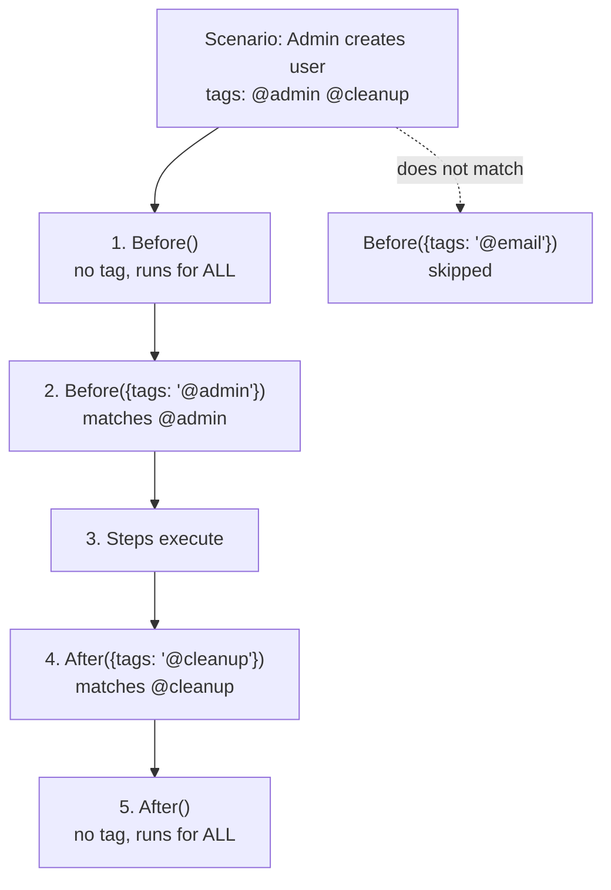

# Chapter 18: Hooks and Lifecycle

---

Hooks are the invisible machinery that runs before and after your scenarios, steps, and the entire test suite. They set up the browser, clean up after failures, capture screenshots, seed test data, and tear down environments. Without hooks, you would need to repeat the same setup and cleanup code in every scenario.

This chapter covers every hook type and shows you how to use them effectively.

---

## Hook Execution Order

```
┌──────────────────────────────────────────────────────────────────┐
│ Complete Hook Execution Order                                    │
│                                                                  │
│  BeforeAll (once, before any scenario)                           │
│    │                                                             │
│    ├─ Scenario 1:                                                │
│    │   Before ──► BeforeStep ──► Step 1 ──► AfterStep           │
│    │              BeforeStep ──► Step 2 ──► AfterStep           │
│    │              BeforeStep ──► Step 3 ──► AfterStep           │
│    │   After                                                     │
│    │                                                             │
│    ├─ Scenario 2:                                                │
│    │   Before ──► BeforeStep ──► Step 1 ──► AfterStep           │
│    │              BeforeStep ──► Step 2 ──► AfterStep           │
│    │   After                                                     │
│    │                                                             │
│    └─ Scenario 3:                                                │
│        Before ──► BeforeStep ──► Step 1 ──► AfterStep           │
│                   BeforeStep ──► Step 2 ──► AfterStep           │
│        After                                                     │
│    │                                                             │
│  AfterAll (once, after all scenarios)                            │
│                                                                  │
└──────────────────────────────────────────────────────────────────┘
```

---

## Recipe 171: Before Hook -- Browser Setup

**Problem:** A new team member clones the repo, runs the suite, and asks the question everyone asks in their first week: "where does `this.page` come from? Nobody opens a browser in any scenario." If you cannot answer that, you cannot debug the day the browser *fails* to open -- a bad `BROWSER` env value, a missing Playwright binary in CI, a context that leaks state between scenarios. The setup is built in, but you still need to understand it.

**Solution:**

This is already built into webship-js:

```javascript
const { Before } = require('@cucumber/cucumber');

Before(async function () {
  await this.openBrowser();
  if (this.minWaitTime.before_scenario > 0) {
    await this.page.waitForTimeout(this.minWaitTime.before_scenario);
  }
});
```

This runs before every scenario:
1. Opens a new browser instance
2. Creates a new browser context (like incognito mode)
3. Creates a new page/tab
4. Optionally waits the configured `before_scenario` time

**How It Works:** The hook reads its launch options from `playwright.config.ts`: `BROWSER` picks chromium, firefox, or webkit; `HEADLESS=false` gives you a visible window; `SLOW_MO` throttles every action (default 0 in CI, 300ms headless, 800ms headed -- slow enough to watch). The fresh context per scenario is the part worth internalizing: cookies, localStorage, and sessions from the previous scenario are gone, which is what makes scenario order irrelevant. This is also where webship-js plants its smart-wait instrumentation -- `addInitScript` installs `window.__webshipAjaxCount`, `window.__webshipPendingTimers`, and `window.__webshipLastMutation` into every page before your app's first line of JavaScript runs. Every smartSettle call for the rest of the scenario reads those three globals.

**At scale:** Resist the urge to copy this hook into your project and modify it -- that fork is how twenty projects end up on twenty slightly different lifecycles. Configure instead: `BROWSER`, `HEADLESS`, and `LAUNCH_URL` as environment variables in CI mean the identical test code runs against chromium on the staging URL tonight and webkit on production tomorrow, with the pipeline -- not the repo -- deciding which.

---

## Recipe 172: After Hook -- Browser Cleanup

**Problem:** Your nightly run dies halfway through with an out-of-memory error, and when DevOps checks the runner there are sixty zombie Chromium processes eating 12 GB of RAM. That is what happens when cleanup only runs on success -- every failed scenario leaves a browser behind, and on a bad night the failures are exactly when you have the most of them.

**Solution:**

Built into webship-js:

```javascript
const { After } = require('@cucumber/cucumber');

After(async function () {
  if (this.minWaitTime.after_scenario > 0) {
    await this.page.waitForTimeout(this.minWaitTime.after_scenario);
  }
  await this.closeBrowser();
});
```

The After hook ALWAYS runs, even if the scenario fails. This prevents browser instances from accumulating.

**How It Works:** Cucumber treats After hooks like a `finally` block: a step can throw, an assertion can fail, the scenario can be marked failed -- the After hook still executes. `closeBrowser()` tears down page, context, and browser in order, releasing the OS process. This ordering also explains why failure screenshots (Recipe 173) must be captured in an After hook *before* this one runs -- once the browser closes, the page you want to photograph no longer exists. Remember the reverse-execution rule from the end of this chapter: After hooks run last-defined-first, and webship-js defines its cleanup hook early, so your custom After hooks get the still-open browser.

**At scale:** On shared CI runners, leaked browsers are not just your problem -- they starve the next project's job on the same machine. If you ever bypass the built-in lifecycle (custom worlds, experimental hooks), add a belt-and-suspenders `pkill -f chromium` or a container-per-job policy in the pipeline. A container that dies with the job is the only cleanup that never has a bug.

---

## Recipe 173: Screenshot on Failure

**Problem:** The nightly run failed at 2 a.m., the morning standup wants to know if the release is safe, and all the log says is "expected 'Order Confirmed' to be visible". Was it a broken deploy? A cookie banner covering the button? A half-rendered page? Without a picture of the moment of failure, someone has to reproduce the run locally -- and the failures that matter most are the ones that only happen in CI.

**Solution:**

```javascript
const { After, Status } = require('@cucumber/cucumber');
const path = require('path');
const fs = require('fs');

After(async function (scenario) {
  if (scenario.result.status === Status.FAILED && this.page) {
    const dir = path.join(process.cwd(), 'screenshots');
    if (!fs.existsSync(dir)) fs.mkdirSync(dir, { recursive: true });

    const name = scenario.pickle.name.replace(/[^a-zA-Z0-9]/g, '-').toLowerCase();
    const timestamp = Date.now();

    // Save to file
    await this.page.screenshot({
      path: path.join(dir, `${name}-${timestamp}.png`),
      fullPage: true,
    });

    // Attach to Cucumber report
    const buffer = await this.page.screenshot({ fullPage: true });
    this.attach(buffer, 'image/png');
  }
});
```

**How It Works:**

```
Scenario result:
  PASSED → After hook does nothing special → close browser
  FAILED → After hook captures screenshot → attach to report → close browser

The scenario.result.status can be:
  Status.PASSED    → All steps succeeded
  Status.FAILED    → A step threw an error or assertion failed
  Status.PENDING   → A step is marked as pending
  Status.UNDEFINED → A step has no matching definition
  Status.SKIPPED   → A step was skipped (after a failure)
```

The `this.attach(buffer, 'image/png')` call is the half people forget: it embeds the image into the Cucumber JSON report, so the generated HTML report shows the failure picture inline, right under the red step. A screenshot file on a CI runner's disk disappears with the runner; a screenshot inside the report travels with it.

**Pro Tip:** webship-js already does this out of the box -- `WEBSHIP_SCREENSHOT_ON_FAILED` defaults to true, failures land in `WEBSHIP_SCREENSHOT_DIR` (default `./screenshots`) with the `failed_` prefix, and the filename pattern (`{datetime}.{feature_file}.feature_{step_line}.{ext}`) encodes which feature and line failed. Write a custom hook like this only when you need something the built-in does not give you, such as attaching extra context or pushing the image to external storage.

**At scale:** Filenames are metadata. When forty suites upload screenshots as CI artifacts, `failed_2026-06-10.checkout.feature_42.png` is searchable and groupable; `screenshot-1718000000.png` is noise. Keep the webship-js pattern (or extend it with `WEBSHIP_SCREENSHOT_PATTERN`), have CI upload the screenshots directory plus the HTML report on failure only, and your delivery managers can answer "what exactly broke on project X last night" from the artifact browser -- no engineer required.

---

## Recipe 174: BeforeStep / AfterStep Hooks

**Problem:** You are watching a headed run to figure out why a scenario misbehaves, but the steps fly past faster than your eyes can follow. Or the opposite: a scenario fails in CI and the log gives you a wall of Gherkin with no indication of *which* step was running when things went sideways. Per-step hooks are the lever for both -- slow it down when a human is watching, narrate it when a machine is.

**Solution:**

Built into webship-js:

```javascript
const { BeforeStep, AfterStep } = require('@cucumber/cucumber');

BeforeStep(async function () {
  if (this.page && this.minWaitTime.before_step > 0) {
    await this.page.waitForTimeout(this.minWaitTime.before_step);
  }
});

AfterStep(async function () {
  if (this.page && this.minWaitTime.after_step > 0) {
    await this.page.waitForTimeout(this.minWaitTime.after_step);
  }
});
```

**Custom AfterStep: Log every step:**

```javascript
AfterStep(async function (step) {
  const text = step.pickle?.step?.text || step.pickleStep?.text || '';
  const status = step.result?.status || 'unknown';
  console.log(`  [${status}] ${text}`);
});
```

**How It Works:** `BeforeStep` and `AfterStep` wrap every single step in every scenario, with full World access. The most important AfterStep hook in webship-js is one you never see: after every state-changing step, it calls `smartSettle(page, 1500)` -- waiting for in-flight fetch/XHR to reach zero, pending timers to drain, and the DOM to stay quiet for at least 250ms, polled every 50ms. That hidden hook is the reason webship-js suites do not need "wait for AJAX" steps sprinkled everywhere, and the reason the `minWaitTime` delays above should stay at zero in normal runs: smartSettle waits for *events*, a delay waits for *time*, and the repo rule is wait for events, not time. The logging variant costs nothing and pays for itself the first time a CI log shows you exactly which step was last alive. Note the defensive `step.pickle?.step?.text || step.pickleStep?.text` -- the hook payload shape has shifted between Cucumber versions, and this handles both.

**At scale:** Keep step delays out of committed config. If one slow legacy environment needs breathing room, gate it behind an environment variable in that project's pipeline rather than slowing all 40 suites -- a 500ms per-step delay across a 2,000-step nightly farm is over 16 minutes of paid CI time spent sleeping.

---

## Recipe 175: Tagged Hooks (Conditional Setup)

**Problem:** Five of your eighty scenarios need a seeded admin dataset. Put the seeding in a global Before hook and every scenario pays the cost -- the suite slows down for everyone because of five scenarios. Put it inside each scenario as Given steps and you have five copies to keep in sync. The third option is the right one: setup that attaches itself to a tag, so scenarios opt in with one word.

**Solution:**

```javascript
const { Before, After } = require('@cucumber/cucumber');

// Only runs before scenarios tagged @admin
Before({ tags: '@admin' }, async function () {
  // Seed admin-specific test data
  await this.page.goto(this.launchUrl + '/api/test/seed-admin-data');
});

// Only runs before scenarios tagged @email
Before({ tags: '@email' }, async function () {
  // Clear the test email inbox
  await this.page.goto(this.launchUrl + '/api/test/clear-emails');
});

// Only runs after scenarios tagged @cleanup
After({ tags: '@cleanup' }, async function () {
  // Clean up test data
  await this.page.goto(this.launchUrl + '/api/test/cleanup');
});

// Runs for scenarios with BOTH tags
Before({ tags: '@admin and @staging' }, async function () {
  // Special staging admin setup
});

// Runs for scenarios with EITHER tag
Before({ tags: '@smoke or @regression' }, async function () {
  // Common setup for test suites
});
```

```gherkin
@admin
Feature: Admin Management
  @cleanup
  Scenario: Admin creates and deletes a user
    Given I am a logged in user with the "admin" user
    When I go to "/admin/users"
    And I press "Add User"
    ...

@email
Feature: Email Notifications
  Scenario: User receives welcome email
    Given I am on homepage
    When I go to "/register"
    ...
```

**How It Works:**



Tag expressions support `and`, `or`, and `not`, and tags inherit downward -- a tag on the `Feature:` line applies to every scenario in the file, which is why `@admin` above covers both scenarios without repeating it. This is the same tag machinery webship-js's own behavior switches ride on: `@screenshots` turns on every-step capture, `@video` forces recording, `@js-fail` promotes console errors to failures. Your custom tagged hooks and the built-in ones coexist on the same scenario.

**At scale:** Tagged hooks only stay manageable if the tag vocabulary is shared. Agree on one list across all projects -- `@smoke`, `@critical`, `@db-cleanup`, `@email` mean the same thing everywhere -- and document it in one place. The payoff is compound: CI pipelines can run `--tags @smoke` identically on every project, dashboards can compare `@critical` pass rates across products, and an engineer rotating onto a new project already knows what every tag does. The failure mode is real too: we have seen teams where `@slow` triggered cleanup on one project and skipped CI on another. Nobody trusted tags after that.

---

## Recipe 176: BeforeAll / AfterAll (Global Setup/Teardown)

**Problem:** Your mock server takes eight seconds to boot. Started per scenario, that is eight seconds times two hundred scenarios -- nearly half an hour of pure startup. Some work belongs to the *run*, not to any scenario: booting services, seeding shared fixtures, warming the application cache, and -- at the other end -- tearing it all down and announcing the result.

**Solution:**

```javascript
const { BeforeAll, AfterAll } = require('@cucumber/cucumber');

BeforeAll(async function () {
  console.log('Test suite starting...');
  // Start a test database
  // Seed global fixtures
  // Start a mock server
  // Warm up the application
});

AfterAll(async function () {
  console.log('Test suite complete.');
  // Generate HTML report
  // Clean up test database
  // Stop mock server
  // Send notification to Slack
});
```

**Important:** `BeforeAll` and `AfterAll` do NOT have access to the World object (`this` is not available). They run in a global context, not per-scenario. Use them for infrastructure setup, not for browser operations.

```
BeforeAll vs Before:
┌──────────────────────────────────────────────────────────────┐
│                                                              │
│  BeforeAll: Runs ONCE before all scenarios                   │
│    • No World access (no this.page, this.launchUrl)         │
│    • Global setup: databases, servers, reports               │
│    • Cannot interact with the browser                        │
│                                                              │
│  Before: Runs ONCE per scenario                              │
│    • HAS World access (this.page, this.launchUrl)           │
│    • Scenario setup: open browser, seed data, log in         │
│    • Can interact with the browser                           │
│                                                              │
└──────────────────────────────────────────────────────────────┘
```

**How It Works:** The "no World" rule is not arbitrary -- the World is created fresh per scenario, and `BeforeAll` runs before the first one exists. So `this.page` is undefined there by design. Share data from `BeforeAll` through module-level variables or environment variables, never through the World. Two more traps worth knowing: when you run with `--parallel`, each worker process runs its *own* `BeforeAll`/`AfterAll`, so "once" really means "once per worker" -- global setup that must truly happen once belongs in the CI pipeline, before Cucumber starts. And an `AfterAll` is skipped if the process is killed mid-run (timeout, runner eviction), so anything that *must* be cleaned up needs a pipeline-level fallback too. Report generation, by the way, is already handled: webship-js writes the Cucumber JSON to `tests/reports/cucumber_report.json` and `bin/generate-reports.js` turns it into HTML and PDF -- no AfterAll needed for that.

---

## Recipe 177: Database Cleanup in After Hook

**Problem:** Monday's run creates `test-user@example.com`. Tuesday's run tries to create the same user, gets "email already exists", and fails -- not because the app broke, but because Monday's leftovers are still in the database. Leftover test data is one of the most common sources of "flaky" failures that are not flaky at all: the test is deterministic, the *environment* is not. Cleanup has to run even when the scenario fails, which is exactly what After hooks guarantee.

**Solution:**

```javascript
const { After } = require('@cucumber/cucumber');
const axios = require('axios');

After({ tags: '@db-cleanup' }, async function () {
  // Call a test-only API endpoint that resets the database
  await axios.post(this.launchUrl + '/api/test/reset-db', {}, {
    headers: { 'X-Test-Key': 'test-secret-key' },
  });
});
```

```gherkin
@db-cleanup
Feature: User Management
  Scenario: Create a user
    Given I am a logged in user with the "admin" user
    When I go to "/admin/users"
    And I press "Add User"
    And I fill in "Email" with "test-user@example.com"
    And I press "Save"
    And wait for AJAX to finish
    Then I should see "test-user@example.com"
    # After hook will clean up the created user
```

**How It Works:** The hook calls a test-only reset endpoint with axios -- the same HTTP client behind webship-js's built-in API steps -- instead of clicking through admin delete screens, because cleanup through the UI is slow and can itself fail. Because the hook is tagged `@db-cleanup`, only scenarios that create data pay the reset cost. Three rules keep this safe. First, the endpoint must exist only in test environments -- guard it behind the `X-Test-Key` header *and* an environment check on the server, because a reset endpoint reachable in production is a career-defining incident. Second, make the reset idempotent: it must succeed whether the scenario created one record or crashed before creating any. Third, prefer deleting by a recognizable marker (everything matching `test-*@example.com`) over truncating tables, so two suites sharing a staging database cannot wipe each other's fixtures. One more note on the scenario itself: the explicit AJAX wait is belt-and-suspenders here -- in webship-js 2.0 the AfterStep hook already settles after "Save" via smartSettle, so the assertion never races the request.

**At scale:** Per-scenario cleanup keeps shared environments healthy, but defense in depth wins: pair it with a nightly environment reset job owned by DevOps, so a crashed runner that skipped its After hooks cannot poison Wednesday's runs for every project pointed at that database. And standardize the test-data marker convention (`test-` prefix, reserved email domain) across all projects -- it makes the nightly sweep one query instead of forty.

---

## Hook Priority and Ordering

When you have multiple hooks of the same type, they run in the order they are defined:

```javascript
// These run in order: first defined = first executed
Before(async function () {
  console.log('Hook 1: Open browser');
  await this.openBrowser();
});

Before(async function () {
  console.log('Hook 2: Set cookie consent');
  await this.context.addCookies([{
    name: 'cookie_consent', value: 'accepted',
    domain: 'localhost', path: '/',
  }]);
});

// After hooks run in REVERSE order: last defined = first executed
After(async function () {
  console.log('Hook A: Close browser');
  await this.closeBrowser();
});

After(async function () {
  console.log('Hook B: Capture screenshot');
  // This runs BEFORE Hook A
});
```

```
Before hooks: defined order (1 → 2 → 3)
After hooks:  reverse order (3 → 2 → 1)
```

---

## Chapter Summary

- Hooks run code before/after scenarios, steps, and the test suite
- `Before` / `After` run per scenario with World access
- `BeforeStep` / `AfterStep` run per step (useful for delays, logging)
- `BeforeAll` / `AfterAll` run once for the entire suite (no World access)
- Tagged hooks run only for scenarios with matching tags
- After hooks always run, even if the scenario fails (critical for cleanup)
- Screenshot on failure uses `After` with `Status.FAILED` check
- Database cleanup should use tagged After hooks
- Multiple Before hooks run in definition order; After hooks run in reverse

Next: Organizing a Large Test Suite -- file structure, tag strategies, and scaling.
