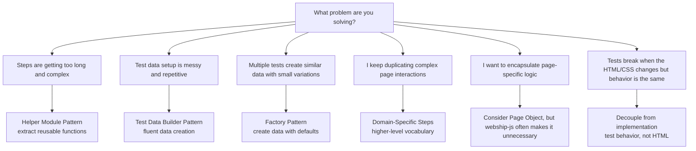

# Chapter 20: Design Patterns for Tests

---

Bad test code is worse than no test code. It gives a false sense of security while being so brittle and unmaintainable that the team eventually abandons it. Good test design means your tests survive refactors, communicate intent clearly, and run reliably.

This chapter covers the design patterns that make test suites maintainable at scale.

---

## Pattern Decision Tree



---

## Recipe 186: Helper Module Pattern

**Problem:** Your app's date picker takes four careful operations to drive -- open, wait for the popup, click the date, wait for it to close. That sequence now lives copy-pasted in five step definitions, and four of the copies got the fix when someone added the close-wait; the fifth is your newest flaky test. Logic that exists in more than one place ages at different rates in each.

**Solution:**

```javascript
// tests/support/helpers.js
module.exports = {
  async waitForTableToLoad(page) {
    await page.locator('table tbody tr').first().waitFor({ timeout: 10000 });
  },

  async getTableRowCount(page) {
    return await page.locator('table tbody tr').count();
  },

  async selectDateInPicker(page, dateString) {
    await page.locator('.date-picker-trigger').click();
    await page.locator('.date-picker-popup').waitFor({ state: 'visible' });
    await page.locator(`[data-date="${dateString}"]`).click();
    await page.locator('.date-picker-popup').waitFor({ state: 'hidden' });
  },

  async dismissAllNotifications(page) {
    const notifications = page.locator('.notification .close');
    const count = await notifications.count();
    for (let i = 0; i < count; i++) {
      await notifications.nth(i).click();
    }
  },
};
```

```javascript
// tests/step-definitions/admin-steps.js
const { When, Then } = require('@cucumber/cucumber');
const assert = require('assert');
const { waitForTableToLoad, getTableRowCount, selectDateInPicker } = require('../support/helpers');

When('I filter by date {string}', async function (date) {
  await selectDateInPicker(this.page, date);
});

Then('the table should have {int} rows', async function (expected) {
  await waitForTableToLoad(this.page);
  const count = await getTableRowCount(this.page);
  assert.strictEqual(count, expected);
});
```

**When to use helpers:**
- Same logic appears in 3+ step definitions
- The logic is complex enough to benefit from a descriptive function name
- The function is reusable across different step definition files

**How It Works:** Helpers are plain functions that receive `page` as an argument instead of reading `this` -- a deliberate choice. Step definitions need Cucumber's World binding; helpers that take explicit parameters can be called from any step file, any hook, even a one-off script, and they are unit-testable in isolation. Notice `selectDateInPicker` waits for the popup to be *hidden* before returning -- it encodes the widget's full lifecycle so callers cannot race it, which is exactly the knowledge that was rotting in five copies. Keep the layering straight: Gherkin says *what* the business does, the step definition translates, the helper knows *how the widget works*. When a helper starts containing assertions or business decisions, it has climbed a layer too high.

**At scale:** The helpers file is your portfolio's pressure gauge. When `dismissAllNotifications` shows up in the third project, that is the signal to move it -- and its friends -- into a shared internal npm package versioned like any other dependency. One fix to the date-picker lifecycle then reaches twenty suites through a version bump instead of twenty pull requests. The discipline that makes this work: helpers take everything through parameters, never reach into project-specific config.

---

## Recipe 187: Test Data Builder Pattern

**Problem:** A scenario about blocked users needs one thing to be true -- the user is blocked -- but the object literal that creates the user spells out seven fields, six of which are noise. Multiply that across forty scenarios and two problems compound: nobody can tell which field a test actually cares about, and the day the user model gains a required `department` field, all forty literals need editing by hand.

**Solution:**

```javascript
// tests/support/builders.js

class UserBuilder {
  constructor() {
    this.data = {
      firstName: 'Test',
      lastName: 'User',
      email: `test-${Date.now()}@example.com`,
      role: 'viewer',
      status: 'active',
    };
  }

  withName(first, last) {
    this.data.firstName = first;
    this.data.lastName = last;
    return this;
  }

  withEmail(email) {
    this.data.email = email;
    return this;
  }

  asAdmin() {
    this.data.role = 'admin';
    return this;
  }

  asEditor() {
    this.data.role = 'editor';
    return this;
  }

  blocked() {
    this.data.status = 'blocked';
    return this;
  }

  build() {
    return { ...this.data };
  }
}

class ProductBuilder {
  constructor() {
    this.data = {
      name: 'Test Product',
      price: 9.99,
      sku: `SKU-${Date.now()}`,
      category: 'General',
      stock: 100,
    };
  }

  withName(name) { this.data.name = name; return this; }
  withPrice(price) { this.data.price = price; return this; }
  inCategory(cat) { this.data.category = cat; return this; }
  outOfStock() { this.data.stock = 0; return this; }
  build() { return { ...this.data }; }
}

module.exports = { UserBuilder, ProductBuilder };
```

```javascript
// Usage in step definitions
const { Given } = require('@cucumber/cucumber');
const { UserBuilder } = require('../support/builders');
const axios = require('axios');

Given('there is an admin user named {string}', async function (name) {
  const [first, last] = name.split(' ');
  const user = new UserBuilder()
    .withName(first, last)
    .asAdmin()
    .build();

  await axios.post(this.launchUrl + '/api/test/create-user', user);
  this.createdUser = user;
});

Given('there is a blocked user', async function () {
  const user = new UserBuilder().blocked().build();
  await axios.post(this.launchUrl + '/api/test/create-user', user);
  this.createdUser = user;
});
```

**Builder vs Object Literal:**

```
Object Literal (fragile):            Builder (flexible):
const user = {                       const user = new UserBuilder()
  firstName: 'John',                   .withName('John', 'Doe')
  lastName: 'Doe',                     .asAdmin()
  email: 'john@e.com',                .build();
  role: 'admin',
  status: 'active',                  // Only specify what matters
  // Must specify ALL fields         // Defaults handle the rest
};                                   // Fluent, readable API
```

**How It Works:** Three details carry the pattern. Every setter ends with `return this`, which is all "fluent" means -- each call hands back the builder so the next call can chain. The constructor owns the defaults, so a new required field is added in exactly one place and every existing test keeps passing. And `build()` returns `{ ...this.data }`, a copy, so a builder can be reused without two tests mutating the same object behind each other's backs. The `Date.now()` in the default email is quietly the most important line: unique-by-default data is what makes scenarios safe to run under `--parallel` (Recipe 183) and immune to Monday's leftovers (Recipe 177). Note the usage steps stash the result in `this.createdUser` -- the World carries it to later steps and to a tagged After hook that knows what to delete.

**Pro Tip:** Name builder methods in business language -- `asAdmin()`, `blocked()` -- not `setRole('admin')`, `setStatus('blocked')`. The chain then reads like the scenario it serves, and a reviewer can verify intent without checking what role string "blocked" maps to.

---

## Recipe 188: Factory Pattern for Test Data

**Problem:** Builders are great, but for simple objects they are ceremony -- a class, six methods, and a `build()` call to express "a user who is an admin". When a scenario needs three users and two products as supporting cast, you want test data the way you want coffee on a release morning: fast, with sensible defaults, no ritual.

**Solution:**

```javascript
// tests/support/factories.js

let counter = 0;

const factories = {
  user(overrides = {}) {
    counter++;
    return {
      firstName: 'Test',
      lastName: `User${counter}`,
      email: `test-user-${counter}-${Date.now()}@example.com`,
      role: 'viewer',
      status: 'active',
      ...overrides,
    };
  },

  product(overrides = {}) {
    counter++;
    return {
      name: `Product ${counter}`,
      price: 19.99,
      sku: `SKU-${counter}-${Date.now()}`,
      category: 'General',
      stock: 100,
      ...overrides,
    };
  },

  order(overrides = {}) {
    counter++;
    return {
      orderId: `ORD-${counter}`,
      status: 'pending',
      total: 0,
      items: [],
      ...overrides,
    };
  },
};

module.exports = factories;
```

```javascript
// Usage
const { user, product } = require('../support/factories');

// Default user
const viewer = user();
// { firstName: 'Test', lastName: 'User1', email: 'test-user-1-...', role: 'viewer' }

// Admin user
const admin = user({ role: 'admin', firstName: 'Rajab' });
// { firstName: 'Rajab', lastName: 'User2', email: 'test-user-2-...', role: 'admin' }

// Expensive product
const laptop = product({ name: 'Laptop Pro', price: 999.99 });
```

**How It Works:** The whole pattern is one line of JavaScript: `{ ...defaults, ...overrides }`. Spread the defaults first, spread the overrides second, and later keys win -- so `user({ role: 'admin' })` replaces only the role and inherits everything else. Uniqueness comes from two sources stacked together: the module-level `counter` guarantees no collisions within one worker process, and `Date.now()` in the email keeps two parallel workers (each with its own module instance, so each with its own counter starting at zero) from minting the same address. Choose by axis of variation: factories shine when tests differ in *field values* (override and go), builders earn their ceremony when tests differ in *kinds of setup* and named methods like `blocked()` document the business meaning. Most suites end up with factories for the supporting cast and builders for the protagonist.

**At scale:** Factories quietly define your team's "default user" and "default product". Standardize those defaults across projects -- same shape, same `test-` email convention -- and every engineer reads every suite's data setup at a glance, while the nightly cleanup job (Recipe 177) can sweep all projects with one marker query. Keep factories *thin*: they return plain objects and never call the API themselves, so the same factory feeds an API-seeding step on one project and a form-filling step on another.

---

## Recipe 189: The Page Object Pattern (When to Use with webship-js)

**Problem:** A new teammate arrives from a Selenium shop and their first PR wraps every page in a Page Object class -- including the login form that webship-js's built-in steps already handle in three Gherkin lines. Now there are two ways to fill a field in the same suite, and every future test author has to choose. The question is not whether Page Objects are good; it is where they still earn their keep in a stack that already abstracts selectors twice.

**Solution:**

The Page Object pattern is common in Selenium-based testing. In webship-js, it is **less necessary** because:
1. webship-js steps already abstract selectors (you write "fill in 'Email'" not `page.locator('#email')`)
2. Gherkin already provides a domain-language layer
3. Playwright's `getByLabel`, `getByRole`, `getByText` are resilient to HTML changes

However, for complex pages with custom widgets, Page Objects can help:

```javascript
// tests/support/pages/checkout-page.js
class CheckoutPage {
  constructor(page) {
    this.page = page;
  }

  async fillShippingAddress(address) {
    await this.page.getByLabel('Street').fill(address.street);
    await this.page.getByLabel('City').fill(address.city);
    await this.page.getByLabel('State').fill(address.state);
    await this.page.getByLabel('ZIP').fill(address.zip);
  }

  async selectShippingMethod(method) {
    await this.page.getByLabel(method).check();
  }

  async getOrderTotal() {
    return await this.page.locator('.order-total').textContent();
  }

  async placeOrder() {
    await this.page.getByRole('button', { name: 'Place Order' }).click();
    await this.page.waitForLoadState('networkidle');
  }
}

module.exports = CheckoutPage;
```

```javascript
// tests/step-definitions/checkout-steps.js
const { When, Then } = require('@cucumber/cucumber');
const CheckoutPage = require('../support/pages/checkout-page');

When('I complete the checkout with standard shipping', async function () {
  const checkout = new CheckoutPage(this.page);
  await checkout.fillShippingAddress({
    street: '123 Test St',
    city: 'Austin',
    state: 'TX',
    zip: '78701',
  });
  await checkout.selectShippingMethod('Standard Shipping');
  await checkout.placeOrder();
});
```

**When Page Objects help:**

```
┌─────────────────────────────────────────────────────────────────┐
│ USE Page Objects when:           SKIP Page Objects when:         │
│                                                                  │
│ • Complex custom widgets         • Standard forms (use webship-  │
│   (date pickers, rich editors)     js built-in steps)            │
│ • Page has many selectors        • Simple pages                  │
│   that change frequently         • webship-js steps already     │
│ • Multiple step definitions       cover the interaction          │
│   interact with the same page    • You are adding complexity    │
│ • Team has Selenium experience    without benefit                │
│                                                                  │
└─────────────────────────────────────────────────────────────────┘
```

**How It Works:** Page Objects were invented to solve a Selenium-era problem: raw `driver.findElement` calls scattered through tests, so selectors needed a home. webship-js already gives selectors two homes. The built-in steps resolve fields label-first (`When I fill in "Email"` finds the input by its label, then falls back to id, name, placeholder), and the named-selectors registry maps stable names to selectors in JSON files under `tests/selectors/` -- auto-loaded, referenced by name in any step, changeable without touching code. That covers most of what a Page Object class used to do, with less machinery. What remains is genuinely multi-step *choreography*: a checkout page where address, shipping method, and order placement always travel together. The `CheckoutPage` class bundles that choreography behind methods, and the step definition stays one readable paragraph. The honest test for whether you need one: if the class would only rename Playwright calls one-to-one, it is indirection, not abstraction -- skip it.

**At scale:** Whatever you decide, decide it once and write it down. The expensive outcome across twenty projects is not "Page Objects" or "no Page Objects" -- it is ten projects that wrap everything and ten that wrap nothing, so no engineer's instincts transfer between them. A two-paragraph convention ("built-in steps and named selectors by default; a page class only for widgets with multi-step lifecycles") in your shared testing guide settles every future PR debate before it starts.

---

## Recipe 190: The Fixture Antipattern (and What to Do Instead)

**Problem:** Someone seeds a `fixtures.sql` with "the standard test data" and for a month life is good. Then test A deletes user 2, test B still expects user 2, and the suite starts failing only when both run -- in that order. Soon there is an unwritten law that scenarios must run alphabetically, a `users` table nobody dares add a column to, and a Slack thread titled "why does checkout.feature fail on Thursdays?". The fixture became a load-bearing wall everyone is afraid to touch.

**Why it is dangerous:**

```
The Fixture Trap:
┌──────────────────────────────────────────────────────────────────┐
│                                                                  │
│  Shared fixtures.sql:                                            │
│  INSERT INTO users (id, name) VALUES (1, 'Admin');              │
│  INSERT INTO users (id, name) VALUES (2, 'Editor');             │
│  INSERT INTO products (id, name) VALUES (1, 'Laptop');          │
│                                                                  │
│  Problem 1: Test A deletes user 2                                │
│  Problem 2: Test B expects user 2 to exist                       │
│  Result: Tests pass individually, fail together                  │
│                                                                  │
│  Problem 3: Someone adds a field to the users table              │
│  Problem 4: Fixture SQL does not include the new field           │
│  Result: ALL tests using the fixture break                       │
│                                                                  │
│  Problem 5: Tests depend on specific IDs (user 1, product 1)    │
│  Problem 6: Adding a new fixture row shifts IDs                  │
│  Result: Cascading failures across the suite                     │
│                                                                  │
└──────────────────────────────────────────────────────────────────┘
```

**What to do instead:**

1. **Each test creates its own data** (via API, UI, or Builder pattern)
2. **Each test cleans up its own data** (via After hook or API call)
3. **Tests never assume existing data** (they create what they need)

```gherkin
# BAD: Assumes fixture data exists
Scenario: Edit user
  When I go to "/admin/users"
  And I click "Edit" in the "admin@example.com" row
  # What if fixture does not include this user?

# GOOD: Creates its own data
Scenario: Edit user
  Given I am a logged in user with the "admin" user
  And there is a user named "John Smith" with email "john@test.com"
  When I go to "/admin/users"
  And I click "Edit" in the "john@test.com" row
  # Test created its own data, guaranteed to exist
```

**How It Works:** The root failure is hidden coupling: the fixture is shared mutable state, and every test that reads or writes it is invisibly wired to every other. Self-created data cuts the wires -- each scenario builds exactly what it asserts on (a factory plus one API call, milliseconds of overhead), so scenarios become order-independent, which is precisely the property `--parallel` and CI sharding require. This is also the only model where a failure means something: when the "Edit user" scenario goes red, the user *was* created two lines earlier, so the bug is in editing -- not in some fixture drift three weeks old. One pragmatic boundary: reference data the application ships with (countries, roles, default config) is fine to assume, because the app owns it and migrates it. The rule is narrower and sharper -- never assume *records that some test or human put there*.

**At scale:** Shared staging environments make the fixture trap deadlier: now it is not two tests coupled through one database, it is two *projects*. Self-created, uniquely-named data (the `Date.now()` emails from Recipes 187-188) is the only pattern that survives twenty suites pointing at overlapping environments. And when DevOps rebuilds staging from scratch, fixture-dependent suites all break at once while self-seeding suites pass on the first run -- that one morning pays for the whole discipline.

---

## Recipe 191: DAMP Over DRY in Tests

**Problem:** A scenario fails in the nightly run and the engineer on triage duty opens the feature file to find: `Given the standard test setup`, `And the admin is ready`, `When I do the thing`. Three files later they finally know what the test was checking -- at 8 a.m., the Tuesday before release. The suite was refactored by someone who treated Gherkin like production code and extracted every repeated line, and in the process deleted the one thing a test must keep: the ability to be understood on its own.

**The DAMP principle:** Descriptive And Meaningful Phrases. In test code, clarity is more important than eliminating duplication.

```gherkin
# TOO DRY (hard to understand in isolation):
Background:
  Given the standard test setup
  And the admin is ready

Scenario: Test something
  When I do the thing
  Then it should work

# DAMP (clear, self-contained):
Scenario: Admin can create a product
  Given I am a logged in user with the "admin" user
  When I go to "/admin/products"
  And I press "Add Product"
  And I fill in "Name" with "Wireless Mouse"
  And I fill in "Price" with "29.99"
  And I press "Save"
  And wait for AJAX to finish
  Then I should see "Product created"
```

```
DRY vs DAMP:
┌─────────────────────────────┬──────────────────────────────────┐
│ DRY (Don't Repeat Yourself) │ DAMP (Descriptive And Meaningful)│
│                             │                                  │
│ Minimize duplication        │ Maximize readability             │
│ Abstract shared steps       │ Repeat for clarity               │
│ Short, referencing          │ Self-contained, standalone       │
│                             │                                  │
│ Good for production code    │ Good for test code               │
│ Bad for test readability    │ Tests are documentation          │
└─────────────────────────────┴──────────────────────────────────┘
```

A test should be understandable by reading ONLY that test. If you need to look at the Background, a helper, and three other files to understand what a test does, it is too DRY.

**How It Works:** Production code and test code optimize for different failure modes. Production code is *executed* constantly and *read* occasionally, so duplication is the enemy -- a bug fixed in one copy survives in the others. Test code is the mirror image: it is *read* at the worst moments (failures, audits, "do we cover this?" questions) by people who did not write it, so opacity is the enemy. The resolution is to put the DRY in the right layer. `Given I am a logged in user with the "admin" user` repeated across thirty scenarios is not duplication -- it is one step definition referenced thirty times, and renaming the login button is still a one-line fix. The Gherkin stays DAMP, the JavaScript underneath stays DRY, and both principles get what they want. The honest test: hand a failing scenario to someone who has never seen the repo, alone, and ask them what the application failed to do. If they can answer, the altitude is right.

**At scale:** DAMP scenarios are what make your suite legible to people who will never read JavaScript -- the product owner signing off on acceptance criteria, the delivery manager reading the HTML report after a red nightly, the auditor sampling your coverage. A scenario that says `Given the standard test setup` is engineering shorthand; a scenario that says exactly who logs in and what they do is *evidence*. Across a portfolio, that difference decides whether your test reports are something managers can read or something they have to take on trust -- and "a green run they can read themselves" is the entire point of writing these tests in Gherkin.

---

## Chapter Summary

- Use the Pattern Decision Tree to choose the right pattern for your problem
- Helper Modules extract reusable functions called by step definitions
- Test Data Builders provide fluent APIs for complex test data
- Factories create data with sensible defaults and optional overrides
- Page Objects are less necessary with webship-js but useful for complex widgets
- Avoid shared fixtures -- each test should create and clean up its own data
- DAMP (Descriptive And Meaningful Phrases) beats DRY in test code
- Tests are documentation -- optimize for readability, not code reuse

This concludes Part IV: Architecture and Organization.

Next: When Tests Go Bad -- diagnosing and fixing flickering, brittle, and slow tests.
