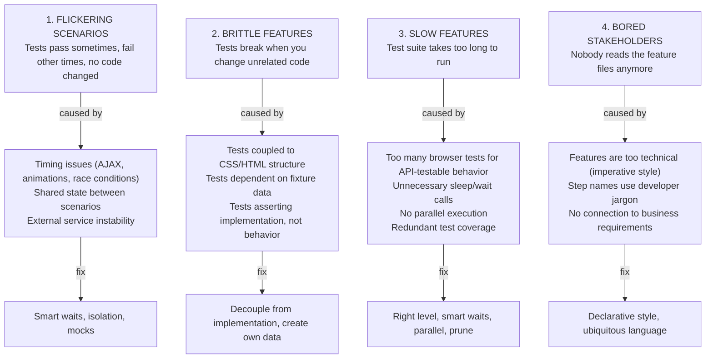
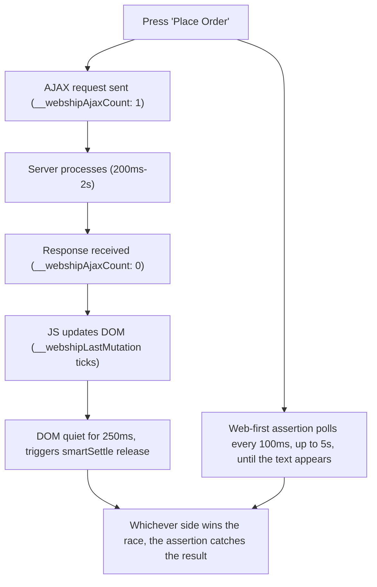

# Chapter 21: When Tests Go Bad

---

Your test suite was green. Every scenario passed. The team trusted it. Then, slowly, things started to rot. A test fails on Monday but passes on Tuesday. A tiny UI change breaks twenty scenarios. The suite takes forty-five minutes to run. Stakeholders stop reading the feature files. The team stops fixing failures, marking them as `@flaky` and moving on.

This is the natural lifecycle of an unmaintained test suite -- and on a multi-project team it never happens to just one suite. The habits that let one suite rot (rerun it, tag it, mute it) travel to the next project along with the copied step definitions, until the team spends its mornings triaging twenty red pipelines instead of testing anything. This chapter is the antidote. We will diagnose each symptom, identify the root cause, and apply the fix -- and for each fix, note what changes when you apply it across a portfolio instead of a single project.

---

## The Four Symptoms



---

## Flickering Scenarios

### Recipe 192: Diagnosing Timing Issues

**Problem:** It is the Tuesday before release. The login scenario that has been green for three months fails in CI, passes on retry, then fails again on a different project. Nobody changed the test. Your QA lead has twenty suites to watch and no time to babysit one, so the team starts muttering "just rerun it" -- which is how trust in the whole suite dies. Before you touch any code, you need to know which kind of timing problem you are looking at.

**Diagnosis checklist:**

```
Is the failure related to:
  □ Content not found ("should see X" fails)?
    → The update arrived through a channel smartSettle cannot count
      (WebSocket push, setInterval polling) -- assert with a web-first
      step that polls, instead of a one-shot check
  □ Element not clickable?
    → Element is behind an overlay, or animation not complete
  □ Stale element reference?
    → DOM changed between locating and interacting
  □ Different on CI than locally?
    → CI is slower; the work finished after the settle budget --
      extend the assertion window with "within N seconds"
```

**Solution:**

```gherkin
# BAD: one-shot assertion the instant the click returns
When I press "Save"
Then I should see "Saved"

# GOOD: web-first assertion -- polls every 100ms for up to 5 seconds
When I press "Save"
Then ".messages" should contain text "Saved"

# GOOD: when the server is genuinely slow, widen the window
When I press "Save"
Then ".messages" should contain text "Saved" within 15 seconds
```

**How It Works:** webship-js 2.0 has two layers of defense against timing flake, and diagnosing means figuring out which layer the failure escaped. The first layer is `smartSettle`. On every page load, an init script installs three counters in the browser: `window.__webshipAjaxCount` (wraps fetch and XHR), `window.__webshipPendingTimers` (wraps setTimeout), and `window.__webshipLastMutation` (a MutationObserver timestamp). After every state-changing step, an AfterStep hook runs `smartSettle(page, 1500)`: it polls those counters every 50ms and considers the page settled only when AJAX count is zero, pending timers are zero, AND the DOM has been quiet for at least 250ms. Navigations get a 3000ms budget. The second layer is web-first assertions: steps like `should contain text` re-check every 100ms for up to 5 seconds (or the `within N seconds` you specify). A test that flakes despite both layers usually means the update came through a channel the counters cannot see -- a WebSocket push, a long setInterval, a server-sent event -- or the work simply took longer than the budgets on a slow CI runner. The fix is never a sleep; it is a web-first assertion with a window wide enough for your slowest environment.

**At scale:** When you run twenty projects through the same CI farm, log every flaky failure with the project name and the failing step before you fix anything -- the `--metadata Key=Value` flags on `bin/generate-reports.js` let you stamp each report with project and environment. Within a month you will see the pattern: it is almost never twenty different timing bugs, it is two or three (one slow staging server, one WebSocket-heavy app) showing up everywhere. Fix the category, not the scenario.

### Recipe 193: Fixing Race Conditions

**Problem:** The checkout test clicks "Place Order" and immediately asserts "Order Confirmed". On your laptop the server answers in 80ms and the test passes every time. On the shared CI runner -- the one all your projects queue on at 2 a.m. -- the server takes 1.8 seconds, the assertion fires first, and the scenario fails. This is the classic race: the test and the application are running at different speeds, and the test assumed it would win.

**Solution:** older suites patched this with the "double-wait pattern" -- wait for AJAX, then sleep one more second for the DOM. webship-js 2.0 bans static sleeps outright, because the framework already closes both gaps:

```gherkin
# The 2.0 way: act, then assert with a web-first step
When I press "Place Order"
Then ".order-status" should contain text "Order Confirmed"
```



**How It Works:** the old "wait 1s" was a guess -- it covered the DOM-update gap on your machine and nobody else's. smartSettle removes the guess: the AfterStep hook after `I press` polls `window.__webshipAjaxCount`, `window.__webshipPendingTimers`, and `window.__webshipLastMutation` every 50ms and only releases the next step when requests are drained, timers are empty, and the DOM has been quiet for 250ms (budget 1500ms per step). The web-first assertion then covers whatever is left: it re-evaluates the locator every 100ms for up to 5 seconds. Between the two, there is no moment where "the response arrived but the DOM has not painted yet" can fail your test. If you ever feel tempted to add a sleep, that is the signal you are asserting on the wrong thing -- assert on the outcome the user sees, not on the moment you expect it.

**At scale:** race conditions are the number-one source of "passes locally, fails in CI" tickets across a multi-project portfolio, because every project's staging server has a different latency profile. Make "no static sleeps, assert the outcome" a written rule in your shared step-definition conventions and enforce it in PR review -- one team did this across the Varbase distribution's test suites and the cross-site flake rate dropped before anyone tuned a single timeout.

### Recipe 194: Eliminating Shared State

**Problem:** Every scenario passes when you run it alone. Run the full suite and three of them fail -- but only in a specific order, and only sometimes, because `--parallel` shuffles the order on every run. The new hire who wrote the third scenario gets blamed, even though the real culprit is a scenario written eight months ago that leaves a product behind in the database. Order-dependent failures are the hardest flake to spot because the failing test is innocent.

**Diagnosis:**

```bash
# Run the failing test alone
npx cucumber-js tests/features/specific.feature

# Run with the suspected polluter
npx cucumber-js tests/features/polluter.feature tests/features/specific.feature

# If it fails in the second case, polluter is creating shared state
```

**Solution:**
- Each scenario creates its own data
- After hooks clean up created data
- Each scenario gets a fresh browser (webship-js does this by default)
- Never write to global variables in step definitions

**How It Works:** webship-js isolates everything it controls: each scenario gets a fresh browser context, so cookies, localStorage, and sessions never leak between scenarios -- and `Given I am an anonymous user` explicitly clears cookies before navigating to the launch URL. What the framework cannot isolate is *your application's database*. If scenario A creates "Test Product" and never deletes it, scenario B's assertion `should have a count of 1` finds two. The bisect technique above works because shared state needs both a writer and a reader: run them together and the failure reproduces deterministically, which turns a flaky mystery into an ordinary bug. Also watch for module-level variables in step definition files -- step files are loaded once per worker, so a `let lastOrderId` at the top of a file silently couples every scenario that worker runs.

**At scale:** shared state is what kills parallel execution, and parallel execution is what keeps forty nightly suites affordable. Make data isolation a gate, not a guideline: every project's CI should run the suite with `--parallel` from day one, so order-dependence surfaces in week one of a project instead of month six. A scenario that only passes sequentially is a defect, even while it is green.

### Recipe 195: Handling External Service Flakiness

**Problem:** Your checkout suite went red at 3 a.m. -- not because checkout broke, but because the payment sandbox was down for maintenance. The next morning someone spends an hour confirming that nothing is wrong with your code. Multiply that across every project that touches a payment gateway, a map provider, or an email service, and you are burning a developer-day a week investigating other people's outages.

**Solution:**

```
Strategy 1: Mock the external service in test environment
Strategy 2: Add retry logic for known-flaky external calls
Strategy 3: Tag external-dependent tests and run separately
```

For the default run, mock the gateway at the network layer with the built-in routing steps -- the test verifies *your* checkout flow, not their uptime:

```gherkin
Scenario: Checkout succeeds when the gateway approves the payment
  Given the URL "**/api/payments" returns the JSON:
    """
    { "status": "approved", "transactionId": "TX-1001" }
    """
  Given I am a logged in user with the "customer" user
  When I go to "/checkout"
  And I fill in "Card Number" with "4111111111111111"
  And I press "Pay"
  Then I should see "Payment Successful"
```

Keep one real-call scenario, tagged so it runs on its own schedule and its failures are triaged separately:

```gherkin
@external @flaky-ok
Scenario: Payment gateway processes credit card (real integration)
  # Runs nightly, not on every PR. A failure here means
  # "check the gateway status page" before "check our code".
  Given I am a logged in user with the "customer" user
  When I go to "/checkout"
  And I fill in "Card Number" with "4111111111111111"
  And I press "Pay"
  Then I should see "Payment Successful"
```

**How It Works:** `Given the URL "**/api/payments" returns the JSON:` registers a `page.route()` interceptor with a glob pattern -- any request the browser makes that matches `**/api/payments` is answered from the docstring without ever leaving the machine. The same step family can return error statuses (`returns status 500 with body`), block the URL entirely, or delay it by N milliseconds, which means you can also test how checkout behaves when the gateway is down -- something you could never test reliably against the real sandbox. The mock removes the external dependency from the critical path; the tagged real-call scenario keeps one honest integration check so contract drift still gets caught.

**At scale:** agree on tag semantics once, across all projects: `@external` means "talks to a third party", and CI runs `--tags "not @external"` on every PR while a nightly job runs the externals alone. Your delivery managers get a clean separation in the reports -- "our code" failures versus "their service" failures -- which is exactly the distinction they need when someone asks whether a release is safe.

---

## Brittle Features

### Recipe 196: Removing Fixture Data Dependencies

**Problem:** The suite was written against a hand-crafted staging database where user #1 was "John Smith". Then the third project you onboard gets a fresh database, user #1 is somebody else, and forty scenarios fail on day one -- not because the application is broken, but because the tests memorized a database instead of describing behavior. Fixture-dependent tests only run in the one environment they were written against, which defeats the point of having them.

```gherkin
# BAD: Assumes user with id=1 exists
Scenario: View user profile
  When I go to "/users/1"
  Then I should see "John Smith"

# GOOD: Creates its own data
Scenario: View user profile
  Given there is a user named "John Smith"
  When I go to "/admin/users"
  And I click "View" in the "John Smith" row
  Then I should see "John Smith"
```

**How It Works:** the second scenario carries its own world with it. `Given there is a user named "John Smith"` creates the user -- ideally through the API steps (`When I send a POST request to "/api/users" with values:`), which is faster and more stable than clicking through an admin form -- and the rest of the scenario only ever references data it just created. That makes the scenario portable: it passes against a fresh database, a copy of production, a teammate's local DDEV site, and CI, without anyone preparing anything. The navigation step also matters: going through `/admin/users` and clicking the row exercises the real lookup path instead of hardcoding an ID that the test has no business knowing.

**At scale:** environment-independence is the single property that lets one team run twenty projects. The moment a suite needs "the staging database, in the right state", it can only run in one place, and your platform engineers cannot move it, parallelize it, or spin up review environments for it. Make "creates its own data" a checklist item in every test PR review (Recipe 215) -- it is much cheaper to enforce on the way in than to retrofit.

### Recipe 197: Making Assertions Resilient

**Problem:** Marketing rewrites the cart message from "There are 5 items in your shopping cart" to "Your cart: 5 items". Nothing about the behavior changed -- the count is right, the cart works -- but a copy edit just broke twelve scenarios across three projects, and a content editor is now afraid to touch microcopy because "it breaks the tests". When wording changes cause failures, the tests are asserting prose, not behavior.

```gherkin
# FRAGILE: Exact text match
Then I should see "There are 5 items in your shopping cart"

# RESILIENT: Key information only
Then I should see "5 items"
Then I should see "shopping cart"
```

**How It Works:** `I should see` is a substring match against the page, so assert the smallest fragment that proves the behavior: the number "5 items" proves the count logic, "shopping cart" proves you are on the right surface. Everything else in the sentence is copywriting, and copywriting belongs to the content team, not the test suite. When you need more precision than a page-wide substring, scope it with a web-first step instead: `Then ".cart-count" should contain text "5"` polls that one element for up to 5 seconds and ignores the rest of the page. The judgment call: if a stakeholder would say "the feature still works", a wording change should not fail the test.

**At scale:** this matters double on multilingual and multi-brand portfolios. A suite that asserts full English sentences cannot run against the Arabic or French build of the same product. Assert numbers, codes, and element states where you can, and keep the few full-text assertions in a place translators know about.

### Recipe 198: Decoupling from CSS/HTML Structure

**Problem:** The front-end team migrates from Bootstrap to Tailwind. Not one user-facing behavior changes -- every button still submits, every form still validates -- yet 200 scenarios fail because `.btn-primary` no longer exists. A refactor that should have been invisible to users was also supposed to be invisible to the tests. Tests coupled to CSS classes and DOM positions fail for reasons users would never notice.

```javascript
// BAD: Coupled to CSS class
await page.locator('.btn-primary.submit-form.large').click();

// GOOD: Semantic selector
await page.getByRole('button', { name: 'Submit' }).click();

// BAD: Coupled to DOM structure
await page.locator('div.container > form > div:nth-child(3) > input').fill('text');

// GOOD: Accessible selector
await page.getByLabel('Email').fill('text');
```

**How It Works:** webship-js already builds this resilience into its step definitions. `When I fill in "Email" with "..."` resolves the field label-first -- it looks for a `<label>` with that text, then falls back to id, name, and placeholder -- so the step survives any markup change that keeps the label intact. `When I click the "Submit" button` uses Playwright's `getByRole`, which reads the accessibility tree the same way a screen reader does: role plus accessible name. Both selectors only break when something a *user* would notice changes -- the label text or the button name -- which is exactly the property you want. As a bonus, suites written this way quietly enforce accessible markup: a button that `getByRole` cannot find is usually a button assistive technology cannot find either.

**At scale:** for the cases where you genuinely need a CSS or XPath selector (third-party widgets, canvas wrappers, legacy admin themes), do not scatter raw selectors through twenty projects' feature files. Put them in named-selector JSON files under `tests/selectors/` (`{"css": {...}, "xpath": {...}}`, auto-loaded via `worldParameters.selectors.files`) and reference them by name. When the markup changes, you edit one JSON entry per project -- or one shared file -- instead of grepping thirty repositories for `.btn-primary`.

---

## Slow Features

### Recipe 199: Replacing Sleeps with Smart Waits

**Problem:** You inherit a suite from a contractor and find `wait 5s` sprinkled through eighty scenarios -- each one a fossil of some flake that someone "fixed" by waiting longer. The suite now takes forty minutes, most of it spent staring at pages that finished loading four seconds ago. Worse, the sleeps still flake on the slowest CI runner, because no fixed number is both fast and safe.

```gherkin
# BAD: Arbitrary sleep (always waits 5 seconds, even if done in 0.5)
And wait 5s
Then I should see "Result"

# GOOD: Assert the outcome -- web-first polling waits exactly as
# long as needed, and not a millisecond longer
Then ".results" should contain text "Result"
```

**How It Works:** webship-js 2.0 has a hard rule -- no static sleeps anywhere -- and the machinery to make it stick. Every state-changing step is followed by `smartSettle(page, 1500)`: it watches `window.__webshipAjaxCount`, `window.__webshipPendingTimers`, and the MutationObserver timestamp, and releases the moment requests are drained, timers are empty, and the DOM has been quiet for 250ms. Navigations get a longer ladder under a 3000ms budget -- wait for the body to attach, then `domcontentloaded`, then a `networkidle` probe, then the same 50ms counter polling -- and every gate exits the instant it is satisfied. If the page settles in 300ms, you wait 300ms -- not 5 seconds. Web-first assertions cover the rest by polling every 100ms for up to 5 seconds. So deleting a `wait 5s` is not a trade of speed against stability; the event-based waits are *both* faster on the happy path and more reliable on the slow one, because they key off what actually happened instead of a guess about how long it takes.

**Impact calculation:**

```
10 unnecessary "wait 5s" calls × 5 seconds each = 50 seconds wasted per run
50 seconds × 100 runs per day = 83 minutes per day
83 minutes × 250 work days = 347 hours per year
```

**At scale:** now multiply that table by your project count. Forty suites with the same sleep habit waste hundreds of CI-hours a year -- real money on metered runners, and real waiting on self-hosted ones where suites queue behind each other. A one-day "delete the sleeps" sweep across the portfolio, enforced afterward by a grep in PR review, is one of the highest-return maintenance tasks a QA lead can schedule.

### Recipe 200: Reducing Browser Tests with API Tests

**Problem:** Your suite has eighty browser scenarios and most of them never needed a browser. Validation rules, CRUD round-trips, permission checks -- all driven through page loads, form fills, and renders, at twenty seconds apiece. The suite outgrew the PR pipeline months ago, so it got demoted to nightly, which means developers now learn about breakage the morning after they caused it.

```
Test Pyramid Optimization:
┌──────────────────────────────────────────────────────────────────┐
│                                                                  │
│  Before:                          After:                         │
│  ┌────────────┐                   ┌────────────┐                │
│  │ 80 Browser │ ← all E2E        │ 20 Browser │ ← UI flows    │
│  │   tests    │                   │   tests    │                │
│  │            │                   ├────────────┤                │
│  │            │                   │ 40 API     │ ← data/logic  │
│  │            │                   │   tests    │                │
│  └────────────┘                   ├────────────┤                │
│                                   │ Unit tests │ ← functions    │
│                                   └────────────┘                │
│                                                                  │
│  Total: 80 tests, 40 min          Total: 60+ tests, 12 min     │
│                                                                  │
└──────────────────────────────────────────────────────────────────┘
```

If a behavior can be tested via API (CRUD operations, validation, data transformations), test it via API. Reserve browser tests for:
- User workflows (login → navigate → interact → verify)
- Visual behavior (modals, animations, responsive layout)
- Interactions that require a real browser (file upload, drag-and-drop)

**How It Works:** the API steps stay in the same Gherkin suite -- `Given the API base URL is "..."`, `When I send a POST request to "/api/users" with values:`, `Then the API response code should be 422` -- so moving a test down the pyramid does not mean moving it to a different tool, a different report, or a different team. Under the hood the API steps go through axios, no browser launch, no rendering, no settle cycle: a validation check that took 20 seconds through the UI takes half a second as a request/response pair. The scenarios stay readable to the same product owners; they just stop paying the browser tax for behavior that never needed pixels.

**At scale:** the pyramid is also a triage policy. When an API scenario fails, the contract broke; when only the browser scenario fails, the UI broke. Reports that separate the two layers let a reviewer on another team localize a failure in seconds. And the runtime math compounds: moving half of each suite's scenarios to the API layer across forty projects often buys back more CI time than any parallelism budget you could approve.

### Recipe 201: Parallel Execution

**Problem:** Each suite is fine alone, but the nightly run executes them back to back and finishes at 7:40 a.m. -- after the team has started picking up tickets. The CI runners spend the night at 12% CPU, one scenario at a time, while everyone pays for the idle.

```bash
# Sequential: 20 minutes
npx cucumber-js

# 4 parallel workers: ~5 minutes
npx cucumber-js --parallel 4
```

**How It Works:** Cucumber's `--parallel N` starts N worker processes and deals scenarios out to them; each webship-js worker launches its own browser, so scenarios never share cookies, sessions, or pages. The speedup is close to linear until you saturate CPU or your application server -- browsers are memory-hungry, so on a typical CI runner 4-6 workers is the sweet spot before you trade flake for speed. The one precondition is Recipe 194: scenarios must not share database state, because parallel order is effectively random. If turning on `--parallel` breaks scenarios, you have found real isolation bugs, not a parallelism problem.

**At scale:** parallelize within suites first, then across them -- run multiple projects' suites simultaneously on separate runners or a CI matrix. Watch your application server while you tune: twenty workers hammering one shared staging site will produce timeouts that look like test flake but are really capacity. Your platform team would rather hear "we need a second staging instance" than chase phantom failures for a month.

---

## Bored Stakeholders

### Recipe 202: Writing Features Stakeholders Want to Read

**Problem:** Your product owner wrote the acceptance criteria for the catalog feature. Six weeks later she asks whether they are covered, and the QA engineer opens a feature file full of `#product_name` and "wait for the HTTP response". She cannot read it, so she cannot answer her own question -- and from that day, sign-off happens on trust instead of on a green run she can verify herself. The whole point of Gherkin was to avoid exactly this.

```gherkin
# DEVELOPER PERSPECTIVE (boring to stakeholders):
Scenario: Fill form and POST
  Given I navigate to /admin/products/new
  When I input "Widget" into #product_name
  And I input "9.99" into #product_price
  And I submit the form
  And I wait for the HTTP response
  Then the page should contain "created"

# BUSINESS PERSPECTIVE (stakeholders care about this):
Scenario: Store manager adds a new product to the catalog
  Given I am logged in as a store manager
  When I add a new product "Widget" priced at $9.99
  Then the product should appear in the catalog
  And the inventory count should be zero (awaiting stock)
```

**How It Works:** the two scenarios run the same clicks; the difference is altitude. The first narrates the *mechanism* -- selectors, HTTP, form internals -- which means it must change whenever the mechanism changes and it tells a business reader nothing. The second narrates the *behavior*: who does what, and what the business outcome is. The mechanism moves into custom step definitions, where it belongs, and the feature file becomes a document a store manager can confirm or correct. There is a discipline payoff too: declarative scenarios are naturally "one behaviour per scenario", which keeps failure messages meaningful -- "store manager cannot add a product" is a report headline; "could not find #product_price" is a debugging session.

**At scale:** readable features are how a PMO compares quality across projects without learning each codebase. When every project's report reads as business behavior, a delivery manager can scan twenty HTML reports and answer "is release X safe?" from the scenario names alone. That only works if the writing standard is shared -- which is the next recipe.

### Recipe 203: Using Ubiquitous Language

**Problem:** The business calls them "customers". The database calls them "users". Half the feature files say one, half say the other, and in the sprint review a stakeholder asks -- honestly -- whether "user can place an order" and "customer can place an order" are two different features. Every vocabulary fork costs you a stakeholder's confidence and a future maintainer's afternoon.

Use the same terms the business uses:
- If they say "customer," do not write "user"
- If they say "order," do not write "transaction"
- If they say "publish," do not write "set status to active"

**How It Works:** this is the "ubiquitous language" idea from domain-driven design applied to Gherkin: one vocabulary shared by the business, the code, and the tests. It pays off mechanically as well as socially. Step definitions match on text, so synonyms breed duplicate steps -- `Given there is a customer ...` and `Given there is a user ...` become two implementations of the same thing, drifting apart over time. One term means one step, fewer definitions, and feature files a product owner can review for *correctness*, not just style. The cheapest way to start: lift the nouns and verbs directly from the acceptance criteria your product owners already write.

**At scale:** keep a short glossary per product -- a page, not a wiki tree -- and check feature files against it in review. On a multi-project team this is also an onboarding accelerator: a QA engineer rotating onto their third project already speaks the pattern, and only needs to learn the nouns.

---

## Chapter Summary

- Four symptoms: flickering, brittle, slow, and boring tests
- Flickering: trust smartSettle plus web-first assertions, eliminate shared state, mock external services with the network routing steps
- Brittle: decouple from implementation, create test data per scenario, assert behavior not structure
- Slow: delete static sleeps, move tests to API level, run in parallel
- Bored stakeholders: write in business language, use declarative style, connect to requirements
- Every symptom has a diagnostic checklist and proven fixes
- webship-js already handles many common causes (per-scenario browser isolation, label-first and role-based selectors, automatic smartSettle waits)

Next: Debugging Techniques -- tools and methods for finding why tests fail.
