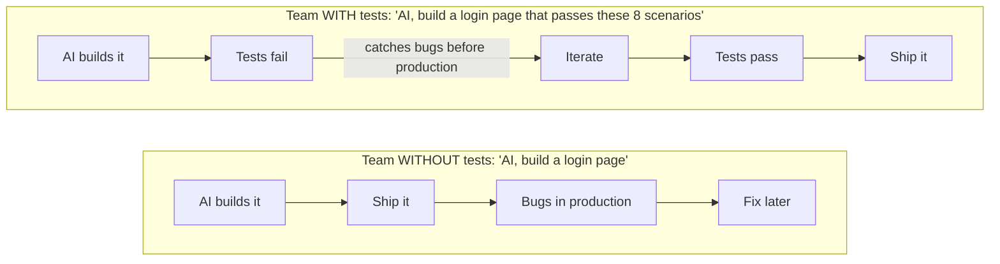

# Chapter 29: BDD in the Age of AI

---

Everything you have learned in this book is about to become ten times more powerful. AI does not replace testing -- it amplifies it. The developers who master BDD and automated testing will not be the ones replaced by AI. They will be the ones who direct AI to build higher-quality software, faster.

This is my vision for the future of software development, and it starts with a simple framework: **Test, Drive, Develop**.

---

## The AI-Development Revolution

We are living through the biggest shift in software development since the invention of high-level programming languages. AI can now:
- Generate code from natural language descriptions
- Write unit tests for existing code
- Suggest bug fixes from error messages
- Refactor code for readability and performance

But AI has a fundamental limitation: **it does not know what "correct" means for your business.** It can write code that compiles, runs, and looks reasonable -- but without tests, there is no way to verify that the code does what the business actually needs.

This is where BDD becomes the most valuable skill in the AI age.

```
┌──────────────────────────────────────────────────────────────────┐
│ The Value Equation in the AI Age                                 │
│                                                                  │
│  Code generation         → Commoditized (AI does it)            │
│  Test writing            → Amplified (AI assists, humans guide) │
│  Business understanding  → Premium (only humans have this)      │
│  Quality assurance       → Critical (AI output needs validation)│
│                                                                  │
│  The person who writes the tests controls the quality.           │
│  The person who controls the quality controls the product.       │
│                                                                  │
└──────────────────────────────────────────────────────────────────┘
```

Run that equation across a portfolio and it gets sharper. AI multiplies the amount of code a team can produce -- which means it multiplies the amount of unverified code a team can produce. One team shipping twenty projects with AI assistance does not need twenty times the reviewers. It needs executable specifications on every project, so that "does it still work?" is a question a pipeline answers, not a person.

---

## The Test-Drive-Develop Framework

<!-- diagram: tdd-ai-loop -->

Traditional TDD says: write a test, make it pass, refactor. I propose an evolution for the AI age:

```
┌──────────────────────────────────────────────────────────────────┐
│ TEST → DRIVE → DEVELOP                                           │
│                                                                  │
│  ┌─────────────┐                                                │
│  │   TEST      │  Human writes the feature file                 │
│  │             │  (what the software should do)                 │
│  │  Feature:   │                                                │
│  │  Scenario:  │  This is the specification.                    │
│  │  Given...   │  This is the contract.                         │
│  │  When...    │  This is what "done" means.                    │
│  │  Then...    │                                                │
│  └──────┬──────┘                                                │
│         │                                                        │
│         ▼                                                        │
│  ┌─────────────┐                                                │
│  │   DRIVE     │  Human guides AI to implement                  │
│  │             │  (AI generates code, human reviews)            │
│  │  "Write a   │                                                │
│  │   login     │  The feature file is the prompt.               │
│  │   endpoint  │  The tests are the acceptance criteria.        │
│  │   that      │  AI cannot cheat -- the tests verify.          │
│  │   passes    │                                                │
│  │   these     │                                                │
│  │   tests"    │                                                │
│  └──────┬──────┘                                                │
│         │                                                        │
│         ▼                                                        │
│  ┌─────────────┐                                                │
│  │  DEVELOP    │  AI writes the code                            │
│  │             │  (human verifies by running tests)             │
│  │  Code is    │                                                │
│  │  generated  │  Tests pass? Ship it.                          │
│  │  or written │  Tests fail? Iterate.                          │
│  │  by AI      │                                                │
│  │             │  The human never has to read every line.       │
│  │  Tests      │  The tests prove correctness.                  │
│  │  verify it  │                                                │
│  └─────────────┘                                                │
│                                                                  │
└──────────────────────────────────────────────────────────────────┘
```

Notice what this framework changes about your job. You stop being the person who types the code and become the person who defines "done" -- and "done" is written in Gherkin that runs. The feature file is simultaneously the prompt, the acceptance criteria, and the regression suite. Write it once and it keeps earning: first as the AI's instructions, then as the proof the AI delivered, then as the guard that next month's AI session does not quietly break this month's work.

---

## Recipe 235: Using AI to Generate Feature Files

**Problem:** A registration module lands in the sprint, and the acceptance criteria live in a ticket -- three bullet points and a screenshot. You need scenarios ready for Thursday's review session, and the engineer who would normally write them is already covering two other projects. This is exactly the moment to let AI draft the Gherkin -- and exactly the moment most teams get burned by merging the draft unread.

**Approach:**

Give AI the business requirements and ask it to generate Gherkin:

```
Prompt to AI:
"I have a user registration feature. Users need to provide
name, email, and password. Password must be at least 8 characters.
Email must be unique. On success, redirect to dashboard.
Generate BDD feature files using webship-js Gherkin style."
```

**AI generates:**

```gherkin
Feature: User Registration
  As a new user
  I want to create an account
  So that I can access the application

  Scenario: Successful registration
    Given I am on homepage
    When I go to "/register"
    And I fill in "Name" with "Jane Doe"
    And I fill in "Email" with "jane@example.com"
    And I fill in "Password" with "SecurePass123"
    And I fill in "Confirm Password" with "SecurePass123"
    And I press "Create Account"
    And wait for AJAX to finish
    Then I should see "Dashboard"

  Scenario: Password too short
    Given I am on homepage
    When I go to "/register"
    And I fill in "Name" with "Jane Doe"
    And I fill in "Email" with "jane@example.com"
    And I fill in "Password" with "short"
    And I fill in "Confirm Password" with "short"
    And I press "Create Account"
    Then I should see "Password must be at least 8 characters"

  Scenario: Duplicate email
    Given I am on homepage
    When I go to "/register"
    And I fill in "Name" with "Jane Doe"
    And I fill in "Email" with "admin@example.com"
    And I fill in "Password" with "SecurePass123"
    And I fill in "Confirm Password" with "SecurePass123"
    And I press "Create Account"
    And wait for AJAX to finish
    Then I should see "Email already registered"
```

**Human review checklist:**
- Do the scenarios match the business requirements?
- Are edge cases covered?
- Is the language correct for our application's UI labels?
- Are the step patterns compatible with our webship-js setup?

**How It Works:** The prompt does two jobs. The business half ("password must be at least 8 characters, email must be unique") gives the model rules to turn into scenarios -- including the unhappy paths a rushed human skips. The "webship-js Gherkin style" half anchors the output to step phrasings that actually exist: `I fill in "Email" with ...` resolves the field by its visible label first, then falls back to id, name, and placeholder; `I press` clicks the named button; `I should see` asserts visible text. Because every line maps to one of the 411 built-in steps, the generated file runs with zero step-definition work, and your review can focus on the one thing AI cannot verify -- whether these are the right scenarios for the business. One more detail worth knowing: in webship-js 2.0, the `wait for AJAX to finish` lines are belt and braces. After every state-changing step, an AfterStep hook runs smartSettle, which watches `window.__webshipAjaxCount`, pending timers, and DOM mutations until the page has been quiet for 250ms. The suite stays stable even where the model forgets a wait.

**At scale:** By the third project you onboard, the prompt itself becomes an asset. Keep a prompt template in the repo with your house rules baked in -- UI label conventions, your tag taxonomy, the `page--test-category.feature` naming scheme -- so every AI draft across the portfolio starts out consistent instead of drifting with whoever typed the prompt that day. One shared prompt is cheaper to maintain than twenty diverging suite styles.

---

## Recipe 236: Using AI to Generate Step Definitions

**Problem:** The review session produced a clean feature file, but one line -- `When I add {string} to the cart` -- matches nothing in the built-in steps. The teammate who knows the World object inside out is on leave, the PR is due tomorrow, and you would rather not reverse-engineer locator chaining from two-year-old code tonight. AI gets you 90% of a custom step in seconds; the skill is knowing which 10% to check.

**Approach:**

```
Prompt to AI:
"I have this Gherkin step: 'When I add {string} to the cart'
Write a Playwright step definition for a webship-js project.
The page has product cards with 'Add to Cart' buttons."
```

**AI generates:**

```javascript
When('I add {string} to the cart', async function (productName) {
  const card = this.page.locator('.product-card')
    .filter({ hasText: productName });
  await card.locator('button', { hasText: 'Add to Cart' }).click();
  await this.page.waitForLoadState('networkidle');
});
```

**Human review:** Does this selector match our actual HTML? Test it.

**How It Works:** The generated code is genuinely good Playwright. `this.page` is the live Page object webship-js exposes on the World, and `.filter({ hasText: productName })` narrows the locator to the one card containing the product name -- which keeps working when the page gains a second row of cards. The line to scrutinize is the last one. webship-js 2.0 already runs `smartSettle(page, 1500)` in an AfterStep hook after every state-changing step, so the explicit `waitForLoadState('networkidle')` is usually redundant -- and on pages with long-polling or analytics beacons, `networkidle` may never fire at all, quietly burning your 45-second step timeout. Models reproduce their training data, and the internet is full of pre-smartSettle code. Keep the locator, trim the wait.

**At scale:** Before accepting any AI-written step, grep your shared step library first. The ugliest portfolio smell is five projects each carrying a slightly different "add to cart" implementation because AI rewrote it five times. Keep custom steps in one shared package where you can, and hold AI output to the same repo rule as human output: every new step documented with at least five example lines.

---

## Recipe 237: AI-Assisted Test Maintenance

**Problem:** Design ships a rebrand on Monday: "Sign In" becomes "Log In", "Email" becomes "Username". Tuesday's nightly run is a wall of red -- 30 scenarios across six features, all dead on the same two strings. Fixing it by hand is thirty minutes of error-prone find-and-replace. Explaining to your delivery manager why the quality dashboard stays red all week is worse.

**Approach:**

1. Run the test suite -- collect all failures
2. Give AI the error messages and the old step text
3. AI suggests updated steps based on the new UI

```
Prompt to AI:
"These tests fail because the 'Sign In' button was renamed to 'Log In'
and the 'Email' field was renamed to 'Username'. Update these feature files."
```

AI performs a bulk find-and-replace that would take a human 30 minutes in 30 seconds.

**How It Works:** The failures all carry the same signature, and that is what makes this safe to delegate. Each web-first assertion polled for the old label every 100ms for its full five-second window before timing out, so the report hands you a precise list of which strings died and where. Feed AI that list plus the rename mapping, and the sweep is mechanical. The non-negotiable part is the re-run: AI will happily "fix" a scenario whose real problem was a behavior change hiding behind the rename. A green run after the sweep proves the fix; a human reading the diff proves nothing got papered over.

**At scale:** Rename storms hit every project that shares a design system. Fix one project, then reuse the exact same prompt on the other nineteen. Better still, this pain is the argument for named selectors: for volatile elements, keep the targeting in `tests/selectors/*.json` files -- webship-js auto-loads them through `worldParameters.selectors.files` -- so a rebrand becomes a one-line JSON edit per project instead of a 30-file sweep. It is a trade: you give up some plain-language readability for rename resilience. Spend it on navigation chrome and brand buttons; keep visible labels in the business-critical flows your product owner actually reads.

---

## The Pitfalls of AI-Generated Tests

```
┌──────────────────────────────────────────────────────────────────┐
│ AI Testing Pitfalls                                              │
│                                                                  │
│  1. OVER-TRUSTING AI OUTPUT                                      │
│     AI can generate tests that look correct but test the         │
│     wrong thing. Always review generated tests against           │
│     business requirements.                                       │
│                                                                  │
│  2. TESTING IMPLEMENTATION, NOT BEHAVIOR                         │
│     AI tends to test what the code does, not what the            │
│     business needs. Human oversight ensures tests stay           │
│     behavior-focused.                                            │
│                                                                  │
│  3. MISSING EDGE CASES                                           │
│     AI generates the happy path well but may miss                │
│     business-critical edge cases that only domain experts        │
│     know about.                                                  │
│                                                                  │
│  4. FALSE CONFIDENCE                                             │
│     "We have 500 AI-generated tests!" means nothing if           │
│     they do not cover the scenarios that actually matter.        │
│                                                                  │
│  THE RULE: AI generates, humans validate.                        │
│                                                                  │
└──────────────────────────────────────────────────────────────────┘
```

The fix for all four pitfalls is the same: treat "AI generates, humans validate" as a gate, not a slogan. Put AI-generated scenarios through the same review as human-written ones -- one behavior per scenario, wait for events not time, test behavior not implementation. The moment a team starts merging generated tests unread because "the AI knows the framework," the suite stops being a specification and becomes decoration.

---

## Structured Prompt-Driven Development (SPDD)

> **Note:** Coined by Thoughtworks, championed by Martin Fowler. SPDD turns AI prompts into versioned engineering artifacts.

The Test-Drive-Develop loop in this chapter is one half of the picture. The other half is what *kind of prompt* you hand the AI. Vibe coding -- "build me a login screen" -- works for prototypes. It collapses for production. **Structured Prompt-Driven Development (SPDD)** restores engineering discipline.

### The REASONS Canvas

<!-- diagram: reasons-canvas -->

```
R - Requirements    Problem & definition of done
E - Entities        Domain entities and relationships
A - Approach        Strategy to meet the requirements
S - Structure       Components and dependencies
─────────────
O - Operations      Concrete, testable steps (down to signatures)
─────────────
N - Norms           Cross-cutting engineering standards
S - Safeguards      Non-negotiable boundaries (security, performance)
```

The seven sections move from abstract intent to concrete execution. Webship-js feature files map directly:

| REASONS section | Webship-js artifact                                 |
|------------------|------------------------------------------------------|
| Requirements     | `Feature:` description + As/I want/So that         |
| Entities         | Domain nouns referenced in step text               |
| Approach         | Background section + scenario outlines              |
| Structure        | `tests/` layout + `cucumber.js` require:           |
| Operations       | Individual `Given / When / Then` steps             |
| Norms            | `worldParameters` + locale/a11y scenarios          |
| Safeguards       | Tags (`@critical`, `@security`) + assertion scenarios |

### The Cardinal Rule

> **Important:** When reality diverges from the prompt, **fix the prompt first** -- then update the code.

This single rule is what separates SPDD from spec-driven development. Specs drift once coding begins. SPDD prevents that decay by treating the prompt as the source of truth and regenerating code from it whenever the spec changes.

### Three Required Skills

<!-- diagram: spdd-skills -->

1. **Alignment** -- lock intent before you write code.
2. **Abstraction-First** -- design before you generate.
3. **Iterative Review** -- output is a controlled loop, not a one-shot.

Webship-js gives you the verification layer that SPDD demands. The Gherkin file is the structured prompt. The step definitions are the executable verification. Together they form a closed loop: AI generates code -> tests verify -> failures point at the prompt -> prompt or code gets refined -> regenerate.

Chapter 35 covers SPDD with webship-js in depth, including REASONS-canvas templates, AI agent prompts, and CI-level prompt-code sync gates.

---

## The Future of Testing

The developers who thrive in the AI age will not be the fastest coders. They will be the ones who:

1. **Understand the business** well enough to write correct specifications
2. **Write tests first** that define "done" before a single line of code exists
3. **Direct AI** to implement against those tests
4. **Validate** that the implementation actually meets the specification

This is the BDD workflow, supercharged by AI. The test is the specification. The specification is the prompt. The prompt produces the code. The test verifies the code.

The Testing Advantage:



Result: 40-80% fewer production bugs (industry research).

---

## Chapter Summary

- AI amplifies testing, it does not replace it
- The Test-Drive-Develop framework: humans write tests, AI writes code, tests verify correctness
- AI can generate feature files, step definitions, and test maintenance updates
- Always review AI-generated tests against business requirements
- The person who writes the tests controls the quality
- BDD skills are MORE valuable in the AI age, not less
- Tests are the specification that AI implements against
- The future belongs to developers who combine business understanding with testing discipline

Next: Best Practices and Pro Tips.
