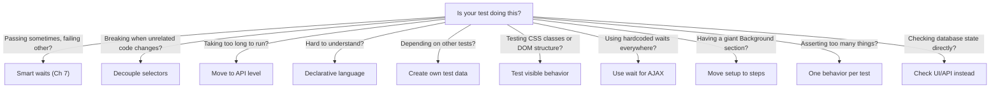

# Chapter 30: Best Practices and Pro Tips

---

This chapter distills everything so far into actionable rules. After more than two hundred recipes, here are the principles that decide whether a suite is still trusted -- and still readable -- three years and twenty projects later.

---

## Writing Great Scenarios

### Recipe 238: The DAMP Principle

**Problem:** A scenario named "Checkout works" fails, and the engineer on triage duty opens it to find helper steps calling other helpers, abbreviations only the original author understood, and setup hidden two files away. That author moved to another project six months ago. The new hire's first PR review takes an hour -- not because the change is hard, but because nobody can read the tests it touches.

**Solution:** DAMP -- Descriptive And Meaningful Phrases. Every scenario should be understandable without looking at anything else.

```gherkin
# DAMP: Self-contained, clear
Scenario: Customer completes checkout
  Given I am a logged in user with the "customer" user
  When I go to "/cart"
  And wait for AJAX to finish
  Then I should see "Laptop Pro"
  When I press "Checkout"
  And wait for AJAX to finish
  And I fill in "Address" with "123 Main St"
  And I press "Place Order"
  And wait for AJAX to finish
  Then I should see "Order Confirmed"
```

**How It Works:** DAMP is the deliberate counterweight to DRY. In production code, duplication is the enemy; in test code, opacity is. A scenario gets read far more often than it gets written -- usually during a failure, often by someone who did not write it -- so a little repetition that keeps the whole story on one screen is a good trade. Every line above can be taken at face value: log in, open the cart, see the product, check out, see the confirmation. When line seven fails, the report names the exact business action that broke, and the explicit `wait for AJAX to finish` lines double as synchronization points anyone can read -- no hidden magic to decode.

**At scale:** DAMP is what lets one QA lead review twenty projects. Self-contained scenarios are portable: a reviewer needs zero knowledge of each project's private helper vocabulary to judge whether a test is right. Make it a portfolio rule -- any scenario must read aloud as a sensible user story without opening another file -- and reviews stop depending on tribal knowledge.

### Recipe 239: One Scenario, One Behavior

**Problem:** A forty-step scenario called "Complete user journey" goes red in the 2 a.m. CI run. It failed at step 23 -- but was the bug in login, search, or checkout? Nobody knows without replaying the whole run, and the delivery manager is waiting to hear whether the release is blocked. One scenario, three behaviors, zero diagnosis.

**Solution:** Each scenario tests exactly one business rule. If a scenario fails, you should know exactly which behavior is broken.

```gherkin
# BAD: Tests three behaviors in one scenario
Scenario: Everything
  # Tests login, then product search, then checkout
  # If it fails, which behavior is broken?

# GOOD: One behavior per scenario
Scenario: Successful login
  ...

Scenario: Product search returns results
  ...

Scenario: Checkout processes payment
  ...
```

**How It Works:** When each scenario owns one behavior, the scenario name IS the diagnosis. "Product search returns results" red, everything else green -- triage is finished before you open a single screenshot. The cost is real but small: every scenario starts its own fresh browser context, so three scenarios launch three contexts instead of one. webship-js keeps that overhead low because there are no static sleeps anywhere -- smartSettle moves on the moment the page goes quiet -- and the seconds spent on extra setup repay themselves the first time you skip a twenty-minute replay.

**At scale:** Across 40 suites, scenario-name-as-diagnosis is what makes a cross-project dashboard readable. A delivery manager scanning red rows sees broken behaviors in plain language, not step traces. It also keeps your tags honest: `@critical` on a single behavior means something; `@critical` on a forty-step journey means everything and nothing.

### Recipe 240: Scenarios as Stories

**Problem:** The product owner writes acceptance criteria in a ticket. QA rewrites them as tests. Three weeks later the two have drifted apart, and nobody notices until UAT. Sign-off becomes "trust me, the suite is green" -- because the one person who knows what the feature should do cannot read the thing that supposedly proves it.

**Solution:** The best scenarios read like user stories:

```gherkin
Scenario: New customer discovers and purchases a product
  Given I am on homepage
  When I fill in "Search" with "wireless keyboard"
  And wait for AJAX to finish
  Then I should see "Wireless Keyboard Pro"
  When I click "Wireless Keyboard Pro"
  And wait for AJAX to finish
  Then I should see "$49.99"
  When I press "Add to Cart"
  And wait for AJAX to finish
  Then I should see "Added to cart"
```

**How It Works:** Every line is written in the user's vocabulary -- search, see the price, add to cart -- yet every line executes. `I fill in "Search"` finds the field by its visible label first, exactly the way the user does; `I should see "$49.99"` polls the page's visible text the way a human eyeballs it. There is no translation layer between the acceptance criteria and the test, so there is nothing to drift. A green run of this scenario is evidence a product owner can read without an engineer interpreting -- which is what turns sign-off from a trust exercise into a reading exercise. Write acceptance criteria in this shape from day one, and QA stops rewriting them from scratch.

---

## Common Anti-Patterns

### Recipe 241: Avoiding God Steps

**Problem:** Somewhere around the third project, someone writes `Given the system is fully set up with admin user and products and orders` -- one step, two hundred lines of JavaScript behind it. Project four needs nine products instead of ten, so the step grows a flag. Project five adds another. Eighteen months later it is four hundred lines, every suite in the portfolio depends on it, and an engineer whose setup is not quite "fully" spends a day debugging a framework instead of a test.

**Solution:** A "God Step" does too much in a single step definition. Break it into specific, composable steps:

```gherkin
# BAD: God step
Given the system is fully set up with admin user and products and orders

# GOOD: Specific, composable steps
Given I am a logged in user with the "admin" user
And I go to "/admin/products"
And wait for AJAX to finish
```

**How It Works:** A God step hides the test's preconditions inside code where no reader can see them -- the Gherkin says "fully set up" and only the implementation knows what that means this month. Composable steps keep the preconditions visible in the scenario itself: who is logged in, which page we are on, what data exists. When something breaks, the failing line names the exact precondition that did not hold. Small steps are also honest about scope: a step that does one thing can serve fifty scenarios without surprising any of them.

**At scale:** God steps are the number one reason teams cannot share a step library across projects -- every project's "fully set up" means something different, so every project forks the step, and now you maintain five versions. Small composable steps share cleanly: login is login everywhere. Keep framework-level steps in one shared package and let project-specific data setup live in project-specific steps, where it belongs.

### Recipe 242: Avoiding Coupled Scenarios

**Problem:** "Edit the product" has passed for eight months -- because "Create a product" happens to run first. Then you enable parallel workers to cut the nightly run from forty minutes to twelve, and it starts failing. Only in CI. Only sometimes. The team burns two days on browser versions and timeouts before anyone notices the test never created the product it edits.

**Solution:** Scenarios must be independent. Never rely on another scenario's side effects:

```gherkin
# BAD: Scenario 2 depends on Scenario 1
Scenario: Create a product
  ...product is created...

Scenario: Edit the product
  # ASSUMES the product from Scenario 1 exists!
  When I click "Edit" in the "New Product" row

# GOOD: Each scenario creates its own data
Scenario: Edit a product
  Given I am a logged in user with the "admin" user
  And there is a product named "Test Widget"
  When I click "Edit" in the "Test Widget" row
```

**How It Works:** webship-js already isolates the browser side for you -- every scenario starts in a fresh incognito context, so cookies, localStorage, and sessions cannot leak between tests. The coupling that survives lives in your application's data: rows one scenario creates and another silently assumes. The fix is for each scenario to declare its own world in its Given steps. And when login is the expensive part, that does not mean re-typing credentials in every scenario -- webship-js's auth steps can save the logged-in storage state once and restore it per scenario. Share the session mechanics; never share the test data.

**At scale:** Ordering bugs surface exactly when you need speed most -- parallel workers, sharded CI, selective re-runs of only the failed scenarios. Make independence a review gate with a one-line test: every scenario must pass when run alone, straight from its file and line number. If it cannot, it is not a test. It is a fragment of one.

### Recipe 243: Avoiding Implementation Testing

**Problem:** The team migrates auth from a JWT in localStorage to httpOnly session cookies. The behavior is identical -- users never notice. But sixty assertions about token contents go red, and the suite blocks a refactor that changed nothing a user could see. Two sprints of that, and developers learn the most dangerous lesson a suite can teach: red probably does not mean broken.

**Solution:** Test what the user experiences, not how the code works:

```gherkin
# BAD: Testing implementation
Then the database should have a record in the users table
And the session cookie should be set
And the JWT token should contain the user ID

# GOOD: Testing behavior
Then I should see "Dashboard"
And I should see "Welcome, Rajab"
```

**How It Works:** Behavior assertions survive refactors because they pin down the contract, not the mechanism. `I should see "Dashboard"` polls the page's visible text for up to five seconds -- the same check a human makes, indifferent to whether the session lives in a JWT, a cookie, or carrier pigeons. The flip side: when a requirement genuinely lives below the UI -- a compliance rule that a session cookie must exist, say -- assert it at that level deliberately. webship-js ships twelve cookie matchers (`Then a cookie with the name "session" should exist`) for exactly those cases. The rule is not "never look under the hood." It is "assert at the level where the requirement lives."

**At scale:** Implementation-coupled suites punish platform upgrades portfolio-wide: upgrade the framework under twenty sites and watch tests fail on markup no user ever sees. Behavior-level suites are how a small team re-validates dozens of sites after every core update -- the suites assert what visitors and editors experience, so they keep passing while the internals churn. That is the difference between an upgrade week and an upgrade quarter.

---

## Anti-Pattern Decision Tree



Pin this tree where the team can see it -- then go one step further and make it the order of questions in every flaky-test triage and every feature-file review. The answers all live in this book; the tree just stops the team from debating which question to ask first.

---

## Team Practices

### Recipe 244: Running Three Amigos Sessions

**Problem:** The product owner writes "user can log in" in a ticket. The developer builds OAuth with magic links. QA tests email-and-password. Everyone discovers the three different features they built during UAT, the Tuesday before release -- the most expensive possible moment to learn that "done" had three definitions.

**Solution:** Before writing tests, get three perspectives:

```
Three Amigos:
┌──────────────────────────────────────────────────────────────────┐
│                                                                  │
│  Product Owner          Developer          Tester               │
│  "What should it do?"   "How will it work?" "What could go      │
│                                              wrong?"             │
│                                                                  │
│  Together, they produce:                                         │
│  1. Feature description (user story)                             │
│  2. Acceptance criteria (scenarios)                              │
│  3. Edge cases and error scenarios                               │
│  4. Shared understanding of "done"                               │
│                                                                  │
│  Output: Feature file with scenarios that everyone agrees on     │
│                                                                  │
└──────────────────────────────────────────────────────────────────┘
```

**How It Works:** The output of a Three Amigos session is not meeting minutes -- it is the feature file. The product owner confirms the scenarios describe the right behavior in the right words. The developer confirms each step is automatable before anyone builds anything. The tester adds the failure modes the other two never think of: the duplicate email, the expired session, the double-click on Submit. Thirty minutes per feature, and the scenarios everyone agreed on become the scenarios the pipeline enforces -- "done" is now executable. And across many projects, this does not have to be a meeting: have the product owner draft scenarios in the PR and let dev and QA review them as code. The conversation moves into PR comments; the artifact stays exactly the same.

### Recipe 245: Code Review for Features

**Problem:** Feature-file PRs get rubber-stamped because reviewers are not sure what to look for -- "it's just Gherkin." Three months of LGTM later, the suite is slow, coupled, and flaky, and it got that way one approved PR at a time. The new hire's first PR is where your conventions get taught -- or lost.

**Solution:** When reviewing a PR with feature files:

```
Feature File Review Checklist:
  □ Scenarios describe behavior in business language
  □ Each scenario is independent (no shared state)
  □ Appropriate tags (@smoke, @regression, @wip)
  □ Background is short (3-5 lines max)
  □ No hardcoded wait times where smart waits work
  □ Assertions check both positive AND negative cases
  □ Step text is reusable (not too specific to one page)
  □ Feature description explains the "why"
```

**How It Works:** Each line of the checklist blocks a failure mode from this book. Independence (Recipe 242) gets checked with the run-alone test. Tags are not decoration -- they are what CI keys on, so a mistagged scenario silently skips your smoke gate. A long Background is a God step in disguise (Recipe 241). And in webship-js there is rarely a reason to see a hardcoded wait in a diff: smartSettle and the web-first assertions already wait for events, so any `wait N seconds` deserves a review comment asking what it is hiding.

**At scale:** One checklist across every repo is the cheapest cross-project quality control you will ever ship -- it turns reviewer judgment into team convention. Put it in the PR template so it shows up in every review, and rotate reviewers across projects: the fastest way to spread a convention is a reviewer who just saw it done right somewhere else.

---

## The Golden Rules

```
┌──────────────────────────────────────────────────────────────────┐
│ The 10 Golden Rules of BDD Testing                               │
│                                                                  │
│  1. Write tests BEFORE code (or at least before you ship)       │
│  2. One scenario = one behavior                                  │
│  3. Each scenario creates its own test data                      │
│  4. Wait for events, not time                                    │
│  5. Test behavior, not implementation                            │
│  6. Use business language, not developer jargon                  │
│  7. Keep scenarios independent                                   │
│  8. Run tests on every push                                      │
│  9. Fix failing tests immediately                                │
│  10. The test suite is a living document                          │
│                                                                  │
└──────────────────────────────────────────────────────────────────┘
```

Three of these are hard rules in the webship-js repository itself -- one scenario, one behavior; wait for events, not time; test behavior, not implementation. They are not style preferences. They were earned by maintaining the same suite pattern across dozens of sites and watching what survived.

---

## Final Words

You now have everything you need to build a world-class test suite with webship-js, Playwright, and Cucumber-js. The recipes in this book cover every pattern you will encounter: navigation, forms, modals, tables, APIs, authentication, multi-browser testing, accessibility, CI/CD, and more.

But recipes alone do not make a great test suite. What makes a great test suite is the discipline to:
- Write tests first
- Run them on every change
- Fix them when they break
- Keep them readable for the whole team

The test suite is not just a safety net. It is a living specification of your application. It documents what the software does, proves that it works, and catches regressions before they reach users.

In the age of AI, this discipline is not just good practice -- it is your competitive advantage. The teams that master BDD will ship faster, with fewer bugs, and with higher confidence than those who rely on manual testing or hope.

Start with one test. Make it pass. Write another. Build the habit. The compound interest of a growing, green test suite is one of the most powerful forces in software development.

The chapters ahead push all of this further -- AI agents that write and run webship-js tests for you, real-world walkthroughs of international sites, and the complete step reference. The principles in this chapter are what keep every bit of it honest.

---

Happy testing.
