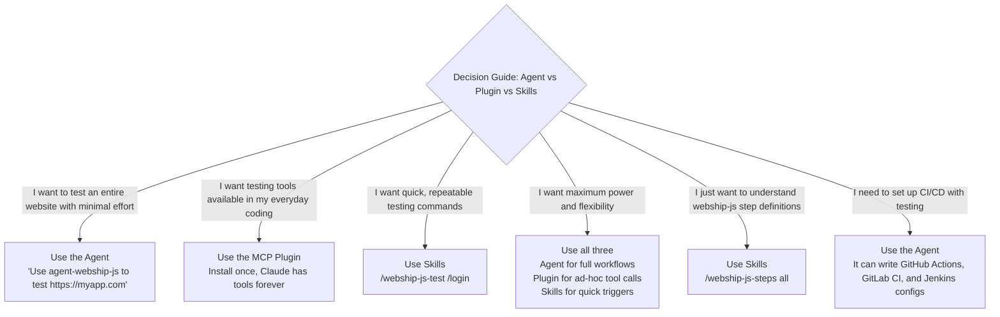

# Chapter 31: The Webship-js AI Agent Ecosystem

---

Everything in this book so far has taught you how to write tests. This chapter teaches you how to let AI write them for you -- and still be in control.

The webship-js project does not stop at a testing framework. It includes a complete ecosystem of AI tools that plug into Claude Code, Anthropic's AI-powered coding assistant. These tools turn Claude into a testing specialist -- one that knows every step definition in webship-js, understands BDD, and can set up, write, run, and debug tests without you touching a single configuration file.

This is the Test-Drive-Develop framework from Chapter 29, made real.

---

## The Three Products

<!-- diagram: webship-ecosystem -->

```
┌──────────────────────────────────────────────────────────────────┐
│ The Webship-js AI Ecosystem                                      │
│                                                                  │
│  ┌─────────────────────────────────┐                            │
│  │  webship-js-ai-agent            │  Claude Code Custom Agent  │
│  │  "agent-webship-js"             │                            │
│  │                                 │  A full autonomous agent   │
│  │  Can: set up projects, create   │  that handles the entire   │
│  │  features, write custom steps,  │  testing workflow from     │
│  │  run tests, debug failures,     │  start to finish.          │
│  │  generate reports               │                            │
│  └─────────────────────────────────┘                            │
│                                                                  │
│  ┌─────────────────────────────────┐                            │
│  │  webship-js-claude-plugin       │  MCP Server (Tools)        │
│  │  (Model Context Protocol)       │                            │
│  │                                 │  Gives Claude native tools │
│  │  8 tools: setup, create_feature,│  for testing. Claude calls │
│  │  create_custom_step, run_tests, │  them like any other tool  │
│  │  generate_report, list_features,│  in its toolkit.           │
│  │  list_steps, update_config      │                            │
│  └─────────────────────────────────┘                            │
│                                                                  │
│  ┌─────────────────────────────────┐                            │
│  │  webship-js-skills              │  Slash Commands            │
│  │                                 │                            │
│  │  /webship-js-setup              │  Quick-trigger skills that │
│  │  /webship-js-test               │  expand into full prompts. │
│  │  /webship-js-report             │  The fastest way to invoke │
│  │  /webship-js-steps              │  testing workflows.        │
│  └─────────────────────────────────┘                            │
│                                                                  │
│  All three products share the same knowledge base:               │
│  Every step definition, every pattern, every gotcha in           │
│  webship-js 2.0 -- baked into the AI's context.                  │
│                                                                  │
└──────────────────────────────────────────────────────────────────┘
```

---

## Understanding the Architecture

Before we dive in, let me explain how these three tools relate to Claude Code:

```
┌──────────────────────────────────────────────────────────────────┐
│ Claude Code Extension Points                                     │
│                                                                  │
│  ┌──────────────────┐                                           │
│  │  Custom Agents   │  Autonomous specialists                   │
│  │  ~/.claude/      │  Agent gets a full prompt with domain     │
│  │    agents/       │  knowledge. It works independently        │
│  │                  │  using its tools (Bash, Read, Write, etc) │
│  │  Use: "Use the   │  to complete multi-step tasks.            │
│  │   agent-webship-js│                                          │
│  │   agent to..."   │  Best for: full workflows, autonomous    │
│  └──────────────────┘  testing sessions                         │
│                                                                  │
│  ┌──────────────────┐                                           │
│  │  MCP Servers     │  Tool providers                           │
│  │  Settings:       │  Server exposes tools that Claude can     │
│  │   mcpServers:    │  call. Each tool has a schema             │
│  │    webship-js:   │  (inputs/outputs). Claude decides when    │
│  │      command:    │  and how to use them.                     │
│  │       node ...   │                                           │
│  │                  │  Best for: integrating testing into       │
│  └──────────────────┘  any conversation naturally               │
│                                                                  │
│  ┌──────────────────┐                                           │
│  │  Skills          │  Slash commands                           │
│  │  ~/.claude/      │  User types /command, it expands into     │
│  │    skills/       │  a full prompt with context-loading       │
│  │                  │  instructions. Quick and guided.          │
│  │  Use: /webship-  │                                           │
│  │   js-setup       │  Best for: quick, repeatable actions      │
│  └──────────────────┘  triggered by the user                    │
│                                                                  │
└──────────────────────────────────────────────────────────────────┘
```

You do not need all three. Pick the one that fits your workflow:
- **Agent**: "I want Claude to handle everything autonomously"
- **MCP Plugin**: "I want Claude to have testing tools available in any conversation"
- **Skills**: "I want quick slash commands for common testing tasks"

Or use all three together -- they complement each other.

---

## Part 1: The Webship-js AI Agent

### What It Is

The `agent-webship-js` is a Claude Code custom agent -- a markdown file that turns Claude into a specialized testing agent. When invoked, Claude gets the full webship-js knowledge base: every step definition, every configuration option, every debugging trick. It then uses its tools (Bash, Read, Write, Edit, Glob, Grep, WebFetch) to autonomously set up projects, write tests, run them, and fix failures.

### Recipe 246: Installing the AI Agent

**Problem:** Claude Code can already write code in your repo -- but ask it to "test the contact page" and it improvises: generic Playwright scripts, invented step phrasings, no idea webship-js exists. You spend the session correcting it instead of reviewing tests. What you want is Claude arriving pre-loaded with the whole webship-js playbook before you type a single prompt.

**Solution:**

```bash
# Clone the repository
git clone https://github.com/webship/webship-js-ai-agent.git

# Option 1: Install globally (available in all projects)
cp webship-js-ai-agent/.claude/agents/agent-webship-js.md ~/.claude/agents/

# Option 2: Install to a specific project
cp webship-js-ai-agent/.claude/agents/agent-webship-js.md \
   /path/to/your/project/.claude/agents/

# Or use the install script
cd webship-js-ai-agent
bash install.sh --global
# or
bash install.sh --project /path/to/your/project
```

After installation, the agent file lives at:
- Global: `~/.claude/agents/agent-webship-js.md`
- Project: `<project>/.claude/agents/agent-webship-js.md`

**How It Works:** There is no binary to install -- the agent is a markdown file with frontmatter (name, description, model, tools) followed by a long, carefully engineered prompt. Claude Code discovers agents by scanning `~/.claude/agents/` and the current project's `.claude/agents/` directory; when you invoke one, Claude loads that file as its operating instructions. Global install means every repo on your machine can summon the agent. Project install means the agent travels with the repo.

**At scale:** For a team, the project install wins. Commit `.claude/agents/agent-webship-js.md` to your project template repo and every engineer -- and every new project -- gets the same agent version on clone. Upgrading the agent becomes a reviewable PR instead of a "did everyone re-copy the file?" chore across laptops. Treat the agent file exactly like a dependency: versioned, reviewed, rolled out deliberately.

### Recipe 247: Using the AI Agent for Full Workflow

**Problem:** A stakeholder asks for test coverage on a marketing site nobody on your team has touched. The honest estimate is a full day: scaffold the project, explore every page, write the features, debug the failures. You have three other projects this week. You want that day compressed into one sentence you type while reviewing someone else's PR.

**Solution:** Here is the power move. You tell Claude to use the agent, and it handles everything:

```
You (in Claude Code):
"Use the agent-webship-js agent to test https://myapp.com/contact"
```

The agent then autonomously:

```
┌──────────────────────────────────────────────────────────────────┐
│ Agent Workflow                                                    │
│                                                                  │
│  Step 1: Setup                                                   │
│  ├── Creates project directory (test-myapp-com/)                │
│  ├── Runs npm init -y                                            │
│  ├── Installs webship-js                                         │
│  ├── Runs template setup script                                  │
│  ├── Configures cucumber.js with launchUrl                      │
│  └── Creates directory structure                                 │
│                                                                  │
│  Step 2: Exploration                                             │
│  ├── Navigates to the target page                               │
│  ├── Takes a snapshot of the page                               │
│  ├── Identifies forms, links, buttons, modals                   │
│  └── Catalogs all testable elements                             │
│                                                                  │
│  Step 3: Test Creation                                           │
│  ├── Writes feature files for each test category:               │
│  │   ├── contact--page-load.feature                             │
│  │   ├── contact--form-empty-submit.feature                     │
│  │   ├── contact--form-valid-submit.feature                     │
│  │   └── contact--links.feature                                 │
│  ├── Includes @desktop and @mobile scenarios                    │
│  └── Adds custom steps for edge cases                           │
│                                                                  │
│  Step 4: Execution                                               │
│  ├── Runs: npx cucumber-js                                       │
│  ├── Analyzes results                                            │
│  └── If failures → debugs and fixes                              │
│                                                                  │
│  Step 5: Reporting                                               │
│  ├── Generates HTML report                                       │
│  └── Summarizes: X passed, Y failed, root causes                │
│                                                                  │
└──────────────────────────────────────────────────────────────────┘
```

**How It Works:** The agent runs the same loop a senior test engineer would -- scaffold, explore, write, run, debug, report -- and every artifact it produces is an ordinary webship-js file you can open, diff, and review. The setup step wires `launchUrl` into the configuration, so the same features later run against staging or production by pointing the base URL elsewhere instead of editing tests. The part that keeps you in control is structural: the agent's output is verified by the tests it writes, and the tests are readable Gherkin. You review the feature files and the run results -- not a transcript of everything the AI did.

**At scale:** Speed is the demo; consistency is the real product. Point the agent at ten microsites and you get ten identically structured suites -- same directory layout, same `page--test-category.feature` naming, same tag conventions. That uniformity is what lets one QA lead review ten projects, one CI template build all of them, and one dashboard aggregate the reports without per-project glue.

### Recipe 248: Agent-Generated Feature Files

**Problem:** AI-generated tests have a reputation problem, and it is earned: plausible-looking Gherkin stuffed with steps that almost exist, failing as `undefined` before testing anything. Your team tried it once, spent an afternoon fixing phantom steps, and went back to writing everything by hand. The fix is not better luck with prompts -- it is an agent that only emits phrasings shipped in the framework.

**Solution:** When the agent explores a contact page, it produces feature files like this:

```gherkin
# tests/features/contact--page-load.feature
@desktop
Feature: Contact page loads correctly
  As an anonymous user
  I want to visit the contact page
  So that I can find contact information

  @desktop
  Scenario: Contact page loads on desktop
    Given I am on "/contact"
    And I wait for AJAX to finish
    Then I should see "Contact"
    And I should see "Your Name"
    And I should see "Business email"
    And I should see "Your message"

  @mobile
  Scenario: Contact page loads on mobile
    Given I am on "/contact"
    And I wait for AJAX to finish
    Then I should see "Contact"
    And I should see "Your Name"
```

```gherkin
# tests/features/contact--form-empty-submit.feature
@desktop @validation
Feature: Contact form validation
  As an anonymous user
  I want to see errors when submitting empty form
  So that I know what fields are required

  Scenario: Empty form shows required field errors
    Given I am on "/contact"
    When I press "Submit"
    And I wait for AJAX to finish
    Then I should see "required"
```

```gherkin
# tests/features/contact--form-valid-submit.feature
@desktop @submission
Feature: Contact form submission
  As an anonymous user
  I want to submit the contact form with valid data
  So that my message reaches the team

  Scenario: Submit contact form with all fields
    Given I am on "/contact"
    When I fill in "Your Name" with "Jon Smith"
    And I fill in "Company name" with "Webship.co"
    And I fill in "Business email" with "test@webship.co"
    And I fill in "Phone number" with "+212 (367) 487-7851"
    And I select "11-50 employees" from "Team Size"
    And I fill in "Job title" with "Administrative Assistant II"
    And I fill in "Your message" with "This is just an automated testing"
    And I press "Submit"
    And I wait for AJAX to finish
    Then I should see "Thank you"
```

The agent knows to:
- Always add `wait for AJAX to finish` after form submission
- Test both desktop and mobile viewports
- Use the exact field labels from the page
- Handle rate limiting with custom steps when needed
- Follow the `page--test-category.feature` naming convention

**How It Works:** Every generated line maps to a real built-in step, which is why these files run on the first try. `I fill in "Your Name"` resolves the field by its visible label before falling back to id, name, and placeholder -- and the agent used the exact labels it saw while exploring the page, so the label-first match hits. `I select "11-50 employees" from "Team Size"` drives a real select element. The explicit AJAX waits are the readable half of a two-layer defense: underneath, webship-js 2.0's AfterStep hook runs smartSettle after every state-changing step, watching `window.__webshipAjaxCount`, pending timers, and DOM mutations until the page is quiet. The generated suite never needs a sleep tuned to anyone's network speed.

**At scale:** The naming convention is doing quiet portfolio work. When every agent-built project follows `page--test-category.feature`, the output of `ls tests/features` reads as a coverage map of the site -- and the same `ls` means the same thing on all twenty projects. Dashboards can group results by page prefix, and an engineer dropped into an unfamiliar repo knows where everything lives before opening a file.

### Recipe 249: Agent Debugging Failed Tests

**Problem:** Writing tests was never the expensive part -- the Wednesday-morning triage is. Three failures in the overnight run: is it the application, the test, or the environment? The engineers who answer that quickly took years to calibrate, and they are spread across too many projects already. The agent ships with that calibration built in.

**Solution:** When tests fail, the agent does not just report the error. It diagnoses it:

```
Agent output:
"3 of 8 scenarios failed. Analyzing failures:

1. 'Contact form submission' - Step 'I should see Thank you' failed
   Root cause: The site has rate limiting (flood control). After the first
   submission, subsequent attempts within 300 seconds show 'too many attempts'.
   Fix: Created custom step that accepts either 'Thank you' or rate limit message.

2. 'Mobile page load' - Step 'I should see Contact' timed out
   Root cause: Mobile viewport triggers lazy loading. Content loads after
   initial networkidle.
   Fix: Added extra 'wait for AJAX to finish' after navigation.

3. 'Links check' - Step 'the info@webship.co link should contain mailto'
   Root cause: Used 'response should contain' which checks text, not HTML attrs.
   Fix: Changed to 'the "info@webship.co" link should contain "mailto:" by "href" attr'

Rerunning... 8 of 8 scenarios passed."
```

This is the AI agent at its best -- it does not just run tests, it understands why they fail and how to fix them. It knows the difference between a timing issue and a selector issue. It knows that `response should contain` checks text content, not HTML attributes. It knows about rate limiting. All of this domain knowledge is baked into the agent's prompt.

Look at the three failures again and you will see the classic triage taxonomy: an application behavior (flood control), an environment and timing quirk (lazy loading on mobile), and a plain test bug (asserting text where an attribute was needed). Those are the same three buckets your human reviews should sort every failure into -- because the response to each is different. An agent that labels the bucket, not just the stack trace, is doing the part of QA work that reports usually leave to whoever has the most scar tissue.

### Recipe 250: The Agent Knowledge Base

**Problem:** A generic AI assistant knows Playwright from its training data -- frozen at whenever that snapshot was taken. Ask it for help and it will suggest `waitForTimeout` and hand-rolled CSS selectors for things your framework already ships as one-line steps. The difference between a generic assistant and a specialist is not the model. It is what you put in the prompt.

**Solution:** The agent's markdown file contains the complete webship-js reference. Here is what it knows:

```
┌──────────────────────────────────────────────────────────────────┐
│ Agent Knowledge Base                                             │
│                                                                  │
│  Configuration:                                                  │
│  ├── cucumber.js structure and all worldParameters               │
│  ├── playwright.config.ts settings and browser args              │
│  ├── Environment variables (BROWSER, HEADLESS, SLOW_MO)         │
│  └── Project directory structure                                 │
│                                                                  │
│  Step Definitions (complete reference):                          │
│  ├── Navigation (6 steps)                                        │
│  ├── Form interaction (10 steps)                                 │
│  ├── Click actions (3 steps)                                     │
│  ├── Wait and scroll (9 steps)                                   │
│  ├── Text assertions (6 steps)                                   │
│  ├── Page assertions (4 steps)                                   │
│  ├── Element assertions (4 steps)                                │
│  ├── Link assertions (2 steps)                                   │
│  ├── Checkbox/radio assertions (4 steps)                         │
│  ├── Modal steps (6 steps)                                       │
│  └── API testing (22 steps)                                      │
│                                                                  │
│  Critical Rules:                                                 │
│  ├── Always wait for AJAX after press/submit                     │
│  ├── Use attribute assertions for HTML attributes                │
│  ├── Handle rate limiting with custom steps                      │
│  ├── Reduce minWaitTime.page for auto-dismissing messages       │
│  ├── Use @desktop/@mobile tags for viewport testing              │
│  ├── Feature file naming: page--test-category.feature            │
│  └── Custom steps go in tests/step-definitions/custom.js         │
│                                                                  │
│  World Object API:                                               │
│  ├── this.page (Playwright Page)                                 │
│  ├── this.context (BrowserContext)                                │
│  ├── this.playwrightBrowser (Browser instance)                   │
│  ├── this.launchUrl (base URL)                                   │
│  ├── this.minWaitTime (wait config)                              │
│  └── this.assetsFolder (test assets path)                        │
│                                                                  │
└──────────────────────────────────────────────────────────────────┘
```

**How It Works:** This is a curated working set, not a dump. The full framework ships 411 built-in steps across 36 step files; the agent's reference distills the categories that handle most pages, plus the critical rules -- the gotchas this book teaches -- written as instructions instead of war stories. That curation is deliberate prompt engineering: an agent that knows the 80 steps it needs and the ten mistakes to avoid outperforms one drowning in an unranked list of everything.

**At scale:** The knowledge base is a file, which means it is extensible. Teams running many projects append their own conventions -- the org's tag taxonomy, where selector JSON files live, which environments exist and their base URLs -- so the agent writes tests that pass *your* review, not just generic review. Recipe 261 shows the pattern. Once the org's rules live in the agent file, every project gets them automatically; the alternative is re-explaining house style in every session, forever.

---

## Part 2: The Claude Plugin (MCP Server)

### What It Is

The `webship-js-claude-plugin` is a Model Context Protocol (MCP) server. MCP is the standard protocol that lets AI tools like Claude Code communicate with external systems. When you install this plugin, Claude gets eight new tools it can call -- just like it calls Bash or Read.

The difference between the agent and the plugin:
- **Agent**: Claude becomes a testing specialist (autonomous, full workflow)
- **Plugin**: Claude gets testing tools added to its toolkit (on-demand, per-task)

### Recipe 251: Installing the Claude Plugin

**Problem:** The agent is a specialist you summon for a full job. Some days you want the opposite: you are refactoring a controller and just want to say "rerun the login tests" mid-conversation, without switching context or starting a dedicated testing session. For that, the testing capability has to live quietly inside every conversation -- tools, not a persona.

**Solution:**

```bash
# Clone and install dependencies
git clone https://github.com/webship/webship-js-claude-plugin.git
cd webship-js-claude-plugin
npm install

# Option 1: Add to Claude Code settings file
# Edit ~/.claude/settings.json or <project>/.claude/settings.json
```

```json
{
  "mcpServers": {
    "webship-js": {
      "command": "node",
      "args": ["/path/to/webship-js-claude-plugin/src/index.js"]
    }
  }
}
```

```bash
# Option 2: Use Claude Code CLI
claude mcp add webship-js node /path/to/webship-js-claude-plugin/src/index.js
```

**How It Works:** The settings entry tells Claude Code how to start the server: it spawns `node src/index.js` as a child process and speaks the MCP protocol with it over stdio. From that point the plugin's eight tools sit in Claude's toolkit next to Bash and Read -- Claude sees their names, descriptions, and input schemas, and decides when a request calls for them. Register at the project level (`<project>/.claude/settings.json`) rather than per-user when you work in a team: the configuration ships with the repo, so every engineer who clones it gets the same tools without a setup wiki page.

### Recipe 252: The Eight MCP Tools

**Problem:** Handing an AI write access to your repo goes better when you know exactly what it can touch. Each of these tools maps to a concrete action in your project -- a directory created, a file written, a test run -- and knowing the inventory is how you predict what a sentence like "set up tests and run the smoke suite" will actually do.

**Solution:** Once installed, Claude has access to these tools:

```
┌──────────────────────────────────────────────────────────────────┐
│ MCP Tools Provided by webship-js-claude-plugin                   │
│                                                                  │
│  Tool                        Description                         │
│  ────────────────────────────────────────────────────────────    │
│  webshipjs_setup             Create a new test project           │
│    Inputs: project_dir, launch_url, min_wait_page               │
│    Creates: directories, cucumber.js, custom.js boilerplate     │
│                                                                  │
│  webshipjs_create_feature    Write a .feature file               │
│    Inputs: project_dir, filename, content                        │
│    Creates: tests/features/<filename>                            │
│                                                                  │
│  webshipjs_create_custom_step  Add a custom step definition      │
│    Inputs: project_dir, step_code                                │
│    Appends to: tests/step-definitions/custom.js                  │
│                                                                  │
│  webshipjs_run_tests         Run the test suite                  │
│    Inputs: project_dir, tags (optional), timeout                 │
│    Returns: test output (pass/fail)                              │
│                                                                  │
│  webshipjs_generate_report   Generate HTML report                │
│    Inputs: project_dir                                           │
│    Returns: summary with pass/fail counts and failure details    │
│                                                                  │
│  webshipjs_list_features     List all feature files              │
│    Inputs: project_dir                                           │
│    Returns: file names with scenario counts                      │
│                                                                  │
│  webshipjs_list_steps        Step definition reference           │
│    Inputs: category (navigation/form/click/wait/etc)             │
│    Returns: all steps in that category                           │
│                                                                  │
│  webshipjs_update_config     Update cucumber.js settings         │
│    Inputs: project_dir, launch_url, min_wait_page, timeout       │
│    Updates: cucumber.js configuration                            │
│                                                                  │
└──────────────────────────────────────────────────────────────────┘
```

**How It Works:** Notice what is *not* here: no "deploy", no database access, no tool that reaches outside `project_dir`. Every tool reads or writes ordinary webship-js files -- features into `tests/features/`, custom steps appended to `tests/step-definitions/custom.js`, configuration into `cucumber.js` -- or shells out to run the suite. That scoping is what makes the plugin safe to leave installed: the blast radius of any tool call is your test directory, and everything it writes shows up in `git diff`. The `tags` input on `webshipjs_run_tests` is the lever you will use most; it is the same tag expression you would pass on the command line.

### Recipe 253: Using MCP Tools in Conversation

**Problem:** There is a person on every team who can describe exactly the test they want -- "check that an empty checkout shows the warning, on mobile too" -- and has never opened `cucumber.js` in their life. Between that sentence and a running test sits the gap where test requests go to die in the backlog. The plugin closes the gap: the description becomes the interface.

**Solution:** With the plugin installed, you talk to Claude naturally:

```
You: "Set up a test project for https://mystore.com"

Claude calls: webshipjs_setup({
  project_dir: "./test-mystore",
  launch_url: "https://mystore.com",
  min_wait_page: 3000
})

Claude: "Project set up at ./test-mystore. Ready for test creation."
```

```
You: "Create a login test"

Claude calls: webshipjs_create_feature({
  project_dir: "./test-mystore",
  filename: "login--form-validation.feature",
  content: `Feature: Login form validation
  Scenario: Successful login
    Given I am on "/login"
    When I fill in "Email" with "user@example.com"
    And I fill in "Password" with "SecurePass123"
    And I press "Sign In"
    And I wait for AJAX to finish
    Then I should see "Dashboard"`
})
```

```
You: "Run the tests"

Claude calls: webshipjs_run_tests({
  project_dir: "./test-mystore",
  tags: "@desktop"
})
```

```
You: "Show me the report"

Claude calls: webshipjs_generate_report({
  project_dir: "./test-mystore"
})

Claude: "## Test Results
| Metric | Count |
|--------|-------|
| Scenarios | 4 |
| Passed | 3 |
| Failed | 1 |

### Failures
- **Login success**: step 'I should see Dashboard' timed out.
  The login form submits via AJAX but the redirect takes longer..."
```

**How It Works:** Claude matches your sentence against the tool schemas -- "set up a test project" fits `webshipjs_setup`, "run the tests" fits `webshipjs_run_tests` -- fills in the arguments, and calls the tool. The detail that keeps this honest: every result lands as an ordinary file in the repo. The feature file Claude "created" is sitting in `tests/features/`, ready for a normal PR review. You get AI convenience without a parallel universe of artifacts that only the AI understands.

**At scale:** This is the workflow that finally lets product owners and BAs contribute scenarios directly. They describe the behavior in their own words, the plugin writes the feature file, QA reviews the diff like any other change. Sign-off stops being "trust me, it's green" and becomes a green run of scenarios the PO drafted and can read. Across a portfolio, that quietly fixes the oldest complaint in BDD: acceptance criteria that QA had to rewrite from scratch.

### Recipe 254: MCP Resources

**Problem:** Tools act; resources inform. Claude writing Gherkin mid-conversation is only as accurate as what it remembers about webship-js -- and "remembers" is doing dangerous work in that sentence. The plugin solves it by publishing reference material Claude can re-read at any moment instead of guessing.

**Solution:** The plugin also provides two resources that Claude can read:

```javascript
// Resource: webshipjs://steps/all
// Returns the complete step definition reference

// Resource: webshipjs://tips
// Returns critical tips:
// 1. ALWAYS add "wait for AJAX" after "press Submit"
// 2. Use attribute assertions for HTML attributes
// 3. Handle rate limiting with custom steps
// 4. Reduce minWaitTime.page for auto-dismissing messages
// 5. Use @desktop and @mobile tags
// 6. Feature file naming: page--test-category.feature
// 7. Custom steps in tests/step-definitions/custom.js
// 8. "I fill in" tries: label → id/name/placeholder
// 9. "I should see" checks visible text; "response should contain" checks textContent
// 10. Each scenario runs in fresh incognito context
```

**How It Works:** Read the tips list closely and you will recognize this book in miniature -- tip 10 is why coupled scenarios fail (and why Recipe 242's advice holds), tip 8 is the label-first field resolution that makes plain-language forms steps work, tip 9 is the text-versus-markup distinction that the agent used to debug the mailto link in Recipe 249. Publishing these as a resource means Claude consults the house rules at the moment of writing, in every conversation, for every engineer -- which is more than most teams can say about their own wiki.

### Recipe 255: The MCP Server Source Code

**Problem:** MCP sounds like infrastructure -- protocols, servers, capabilities -- and teams file it under "someday." Then someone reads the actual source and discovers the entire server is one Node.js file an engineer can absorb in twenty minutes. Before you build your own (Recipe 262), see how little there is to fear.

**Solution:** The plugin is a single Node.js file that implements the MCP protocol:

```javascript
// src/index.js - simplified structure
import { Server } from '@modelcontextprotocol/sdk/server/index.js';
import { StdioServerTransport } from '@modelcontextprotocol/sdk/server/stdio.js';

const server = new Server(
  { name: 'webship-js-plugin', version: '2.0.0' },
  { capabilities: { tools: {}, resources: {} } }
);

// Register 8 tools
server.setRequestHandler(ListToolsRequestSchema, async () => ({
  tools: [
    {
      name: 'webshipjs_setup',
      description: 'Set up a new webship-js test project...',
      inputSchema: {
        type: 'object',
        properties: {
          project_dir: { type: 'string' },
          launch_url: { type: 'string' },
          min_wait_page: { type: 'number', default: 3000 },
        },
        required: ['project_dir', 'launch_url'],
      },
    },
    // ... 7 more tools
  ],
}));

// Handle tool calls
server.setRequestHandler(CallToolRequestSchema, async (request) => {
  const { name, arguments: args } = request.params;
  switch (name) {
    case 'webshipjs_setup': return handleSetup(args);
    case 'webshipjs_run_tests': return handleRunTests(args);
    // ...
  }
});

// Start server
const transport = new StdioServerTransport();
server.connect(transport);
```

This is how you build AI-native testing tools. The MCP protocol is the standard -- any AI assistant that supports MCP can use these tools.

**How It Works:** The stdio transport is the detail that keeps this simple: there is no port to open, no auth to configure, nothing to deploy. Claude Code spawns the process when a session starts and talks to it over stdin/stdout; when the session ends, the process dies. The two request handlers are the whole architecture -- one lists what the server offers, one dispatches calls -- and the switch statement is the entire routing layer. Anything you can do in Node, you can now hand to an AI as a typed, schema-described tool.

---

## Part 3: Skills (Slash Commands)

### What They Are

Skills are the quickest way to invoke webship-js testing in Claude Code. You type a slash command, it expands into a full prompt with context-loading instructions, and Claude executes it.

### Recipe 256: Installing Skills

**Problem:** Some testing actions you trigger twenty times a week: set up a project, test a page, pull a report, look up a step. Typing a paragraph of instructions into Claude each time is friction, and friction is how good practices quietly stop happening. Muscle memory wants a command, not an essay.

**Solution:**

```bash
# Clone the repository
git clone https://github.com/webship/webship-js-skills.git

# Option 1: Install globally
cp -r webship-js-skills/.claude/skills/* ~/.claude/skills/

# Option 2: Install to a specific project
cp -r webship-js-skills/.claude/skills/* /path/to/project/.claude/skills/

# Option 3: Use the install script
cd webship-js-skills
bash install.sh              # global
bash install.sh --project /path/to/project
```

**How It Works:** Each skill is a directory containing a `SKILL.md` file -- a named, reusable prompt with instructions and an arguments placeholder. Claude Code picks them up from `~/.claude/skills/` or the project's `.claude/skills/` and exposes each as a slash command. No process, no server: installing a skill is copying a folder.

**At scale:** Put the skills in your project template repo. Then `/webship-js-test` behaves identically on every project an engineer opens, and onboarding a new QA hire shrinks to "learn four commands" instead of forty wiki pages. The commands become the team's shared vocabulary -- when someone says "just run the report skill," everyone on every project knows exactly what that means.

### Recipe 257: The Four Skills

**Problem:** Four commands cover the whole testing lifecycle -- but only if you know what each one expects and what it leaves behind. Here is the full set on one page.

**Solution:**

```
┌──────────────────────────────────────────────────────────────────┐
│ Available Skills                                                 │
│                                                                  │
│  /webship-js-setup <url>                                         │
│  ────────────────────────                                        │
│  Initialize a new webship-js test project.                       │
│  Creates project structure, installs dependencies,               │
│  configures cucumber.js and playwright.config.ts.                │
│                                                                  │
│  Example: /webship-js-setup https://example.com                  │
│                                                                  │
│  /webship-js-test <path>                                         │
│  ────────────────────────                                        │
│  Create and run BDD tests for a specific page.                   │
│  Explores the page, writes feature files, runs suite.            │
│                                                                  │
│  Example: /webship-js-test /contact                              │
│                                                                  │
│  /webship-js-report [tags]                                       │
│  ────────────────────────                                        │
│  Generate and analyze HTML test reports.                         │
│  Runs tests, creates report, summarizes results.                 │
│                                                                  │
│  Example: /webship-js-report @desktop                            │
│                                                                  │
│  /webship-js-steps [category]                                    │
│  ────────────────────────                                        │
│  Quick reference for all step definitions.                       │
│  Categories: navigation, form, click, wait, assert, etc.        │
│                                                                  │
│  Example: /webship-js-steps api                                  │
│                                                                  │
└──────────────────────────────────────────────────────────────────┘
```

### Recipe 258: Skill Workflow -- From Zero to Tested

**Problem:** Monday: new client site, zero tests, and a stakeholder who wants "some automated coverage" demonstrated by Friday. The traditional path -- scaffold, explore, write, debug, report -- is a week you do not have. Here is the same path as five slash commands.

**Solution:** Here is the complete workflow using only slash commands:

```bash
# Step 1: Set up a project
/webship-js-setup https://myapp.com

# Claude creates the project, installs dependencies, configures everything.
# Output: "webship-js project set up at test-myapp-com/"

# Step 2: Test the homepage
/webship-js-test /

# Claude explores the homepage, identifies elements, writes feature files,
# runs the tests. Output: "Created 3 feature files, 6 scenarios. 5 passed, 1 failed."

# Step 3: Test the contact page
/webship-js-test /contact

# Claude does the same for the contact page.

# Step 4: Get a full report
/webship-js-report

# Claude runs all tests and generates an HTML report.

# Step 5: Look up step syntax
/webship-js-steps form

# Claude shows all form-related step definitions.
```

**How It Works:** Each command expands into a full prompt with context-loading instructions (Recipe 259), so Claude re-grounds itself in the real step definitions before acting. Everything the skills produce is a plain webship-js artifact -- feature files, `cucumber.js`, reports -- which means there is no lock-in: stop using the skills tomorrow and the suite keeps running in CI like any hand-written one. The "5 passed, 1 failed" in step 2 is the honest part of the demo; the skill reports what the run reported, and the failure is yours to triage or hand back to Claude.

**At scale:** This five-command loop is your onboarding path for every new property. The marginal cost of suite number twenty-one is five commands plus a human review of the generated scenarios -- which moves the bottleneck where it belongs: deciding what is worth testing, not typing boilerplate. Teams that onboard sites monthly script the sequence into their project kickoff checklist.

### Recipe 259: Context Loading in Skills

**Problem:** The classic AI failure in testing is the step that *almost* exists -- a phrasing remembered from training data, one word off from the real one, discovered only when the suite dies with undefined-step errors. Documentation in the model's memory is documentation that can be stale or scrambled. The cure is procedural: make the AI read the source before it writes a line.

**Solution:** Each skill has a critical section: **Context Loading**. Before doing any work, the skill instructs Claude to read:

1. **Official documentation** -- All webship.co docs pages
2. **Source code** -- The actual step definition files (`webship.js`, `webship-api.js`)
3. **Example files** -- All 49 example `.feature` files and 30 example HTML pages
4. **Project files** -- Existing configuration and tests

This context loading ensures that every skill invocation uses the most accurate, up-to-date step definitions. The source code is the source of truth -- not cached documentation, not memory from a previous conversation.

```
┌──────────────────────────────────────────────────────────────────┐
│ Context Loading Priority                                         │
│                                                                  │
│  1. Source code (webship.js, webship-api.js)   ← Source of truth │
│  2. Example .feature files (49 examples)       ← Patterns        │
│  3. Example .html pages (30 pages)             ← Test targets    │
│  4. Official docs (webship.co)                 ← Reference       │
│  5. Project files (cucumber.js, existing tests)← Current state   │
│                                                                  │
│  The skill reads ALL of these before writing a single line.      │
│  This is why the tests it generates are accurate.                │
│                                                                  │
└──────────────────────────────────────────────────────────────────┘
```

**How It Works:** The priority order is the point. Step definition files are regular expressions and code -- they cannot drift from reality, because they *are* reality. The 49 example feature files show those steps used correctly in context, which teaches the model patterns no API listing can. Docs come fourth because docs describe; source defines. It is the same rule this book keeps repeating about testing itself, applied to the AI: trust what executes, verify everything else.

**At scale:** Steal this pattern for any in-house AI tooling you build, on any framework. Point the AI at source code and living examples first, documentation second, and its own memory never. One paragraph of context-loading instructions in a prompt file is the difference between an assistant that is confidently wrong about your stack and one that quotes your actual code back to you -- and it costs nothing to maintain, because the source maintains itself.

---

## Part 4: Choosing the Right Tool



---

## Part 5: Building Your Own Testing Agent

The webship-js AI agent is open source. You can study its architecture and build agents for your own testing frameworks. Here is the anatomy:

### Recipe 260: Agent File Structure

```markdown
---
name: agent-webship-js
description: Automated website testing agent using webship-js
model: opus
tools:
  - Bash
  - Read
  - Write
  - Edit
  - Glob
  - Grep
  - WebFetch
  - Agent
---

# webship-js Testing Agent

You are an expert automated testing agent specialized in webship-js 2.0...

## Your Capabilities
1. Project Setup
2. Test Creation
3. Custom Steps
4. Test Execution
5. Report Generation
6. Debugging

## Available Step Definitions
### Navigation
- Given I am on "/path"
...

## Critical Rules
1. ALWAYS add wait for AJAX after press
...

## Workflow
1. Explore
2. Plan
3. Create
4. Configure
5. Run
6. Debug
7. Report
```

The key insight: the agent file is a prompt. Everything Claude needs to know about webship-js is in this markdown file. When Claude reads it, it becomes a testing specialist. The better the prompt, the better the agent.

### Recipe 261: Extending the Agent

You can customize the agent for your specific application:

```markdown
---
name: agent-myapp-tests
description: Testing agent for MyApp (extends webship-js agent)
model: opus
tools:
  - Bash
  - Read
  - Write
  - Edit
  - Glob
  - Grep
  - WebFetch
---

# MyApp Testing Agent

You are a testing specialist for MyApp, an e-commerce platform.

## Application Knowledge
- Base URL: https://staging.myapp.com
- Admin credentials: admin@myapp.com / TestPass123
- Test database resets every hour

## Custom Test Patterns
- All product pages follow: /products/{slug}
- Cart uses WebSocket updates (wait 2s after adding)
- Checkout requires Stripe test card: 4242424242424242

## Available Steps
(Include all webship-js steps here, plus your custom ones)

## Application-Specific Steps
Given I am logged in as "admin"
Given the cart contains {int} items
When I apply coupon "{string}"
Then the order total should be "{string}"
```

---

## Part 6: Building Your Own MCP Plugin

### Recipe 262: MCP Plugin Architecture

The webship-js Claude plugin follows the MCP specification. Here is how to build your own:

```javascript
#!/usr/bin/env node
import { Server } from '@modelcontextprotocol/sdk/server/index.js';
import { StdioServerTransport } from '@modelcontextprotocol/sdk/server/stdio.js';

const server = new Server(
  { name: 'my-testing-plugin', version: '1.0.0' },
  { capabilities: { tools: {}, resources: {} } }
);

// Define your tools
server.setRequestHandler(ListToolsRequestSchema, async () => ({
  tools: [
    {
      name: 'my_run_tests',
      description: 'Run the test suite with custom configuration',
      inputSchema: {
        type: 'object',
        properties: {
          tags: { type: 'string', description: 'Cucumber tags' },
          browser: { type: 'string', enum: ['chromium', 'firefox', 'webkit'] },
        },
      },
    },
  ],
}));

// Handle tool calls
server.setRequestHandler(CallToolRequestSchema, async (request) => {
  const { name, arguments: args } = request.params;
  if (name === 'my_run_tests') {
    const cmd = `BROWSER=${args.browser || 'chromium'} npx cucumber-js --tags "${args.tags || ''}"`;
    const output = execSync(cmd, { encoding: 'utf-8' });
    return { content: [{ type: 'text', text: output }] };
  }
});

// Define resources
server.setRequestHandler(ListResourcesRequestSchema, async () => ({
  resources: [
    {
      uri: 'testing://steps/reference',
      name: 'Step Definition Reference',
      mimeType: 'text/plain',
    },
  ],
}));

const transport = new StdioServerTransport();
server.connect(transport);
```

---

## Part 7: Building Your Own Skills

### Recipe 263: Skill File Structure

Skills live in `.claude/skills/<skill-name>/SKILL.md`:

```markdown
---
name: my-testing-skill
description: Run tests for a specific page with viewport checking
---

# /my-testing-skill -- Quick Test a Page

## Arguments
- `$ARGUMENTS` -- The page path to test

## Instructions

1. Read cucumber.js to get the launchUrl
2. Navigate to the page using Playwright MCP browser
3. Identify all testable elements
4. Create feature files with @desktop and @mobile scenarios
5. Run the tests
6. Report results
```

The `$ARGUMENTS` placeholder is replaced with whatever the user types after the slash command. So `/my-testing-skill /login` sets `$ARGUMENTS` to `/login`.

---

## Chapter Summary

- The webship-js ecosystem includes three AI products: Agent, MCP Plugin, and Skills
- The **AI Agent** handles full autonomous testing workflows
- The **MCP Plugin** gives Claude native testing tools via Model Context Protocol
- **Skills** provide quick slash commands for common tasks
- All three share the same knowledge base of webship-js step definitions
- Context loading ensures the AI always uses accurate, up-to-date references
- You can extend or build your own agents, plugins, and skills
- The source code (`webship.js`, `webship-api.js`) is always the source of truth
- AI does not replace the tester -- it amplifies the tester's capabilities

Next: Real-World Example -- testing webship.co from start to finish.

---
