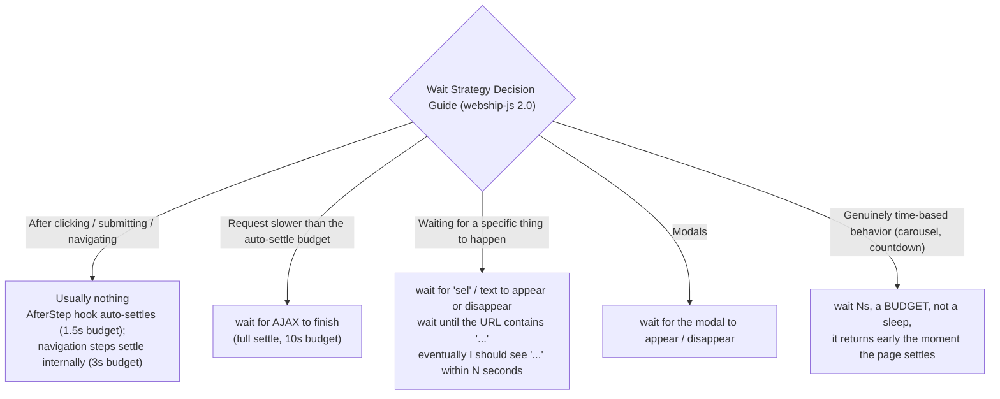

# Chapter 33: The Complete Step Definition Reference with Examples

---

webship-js 2.0 ships 411 built-in step definitions across 36 step files, demonstrated by 49 example feature files and 30 example HTML pages in the repo. This chapter walks through every major step pattern, including the attribute-based variants that many teams miss. Consider this the encyclopedia of webship-js steps -- the chapter you keep open in a second tab while you write features.

Every phrasing in this chapter was checked against the 2.0 step sources. Where 1.x habits no longer match 2.0 behavior -- especially around waits -- the text says so explicitly.

---

## Navigation Steps -- All Variants

### Recipe 280: All Navigation Patterns

**Problem:** You onboard your third project of the quarter and find three different navigation habits in its features: full URLs hardcoded in some scenarios, relative paths in others, and one file that navigates by clicking through menus because nobody trusted the URL steps. The suite passes against staging and fails against the review environment, because half the URLs point at the wrong host. Navigation is the first thing every scenario does -- if it is inconsistent, everything downstream is.

**Solution:**

```gherkin
# Navigate to the base URL
Given I am on the homepage
Given I am on homepage

# Navigate to a specific path (appended to launchUrl)
Given I am on "/about-us"
Given I am on "/products/laptop-pro"

# Navigate during the test
When I go to the homepage
When I go to "/contact"

# Browser history
When I move backward one page
When I move forward one page

# Page reload
When I reload the page
```

**How it works under the hood:**

```javascript
// When I go to "/about-us"
// 1. If the argument starts with http:// or https://, navigate directly
// 2. Otherwise, prepend launchUrl: http://localhost:8080/about-us
// 3. Wait for <body> to attach, then run smartSettle:
//    domcontentloaded -> networkidle -> ajax 0, timers 0, DOM quiet 250ms
await gotoUrl(this.page, this.launchUrl + url);
await this.page.waitForSelector('body', { state: 'attached', timeout: defaultTime });
await waitForPageLoad(this.page, defaultTime);  // alias for smartSettle
```

Three details matter here. First, the base URL comes from `worldParameters.launchUrl`, which reads the `LAUNCH_URL` environment variable and falls back to `http://localhost:8080`. Your features never contain a hostname. Second, navigation does not stop at Playwright's `networkidle` -- after the load events, smartSettle keeps polling until in-flight fetch/XHR requests reach zero, pending timers reach zero, and the DOM has been quiet for at least 250ms. Third, the whole settle is bounded by `minWaitTime.page` (3000ms by default), so a page with a runaway polling script cannot stall the step forever. There is also `Given I am an anonymous user`, which clears all cookies in the browser context before going to the launch URL -- the cleanest way to guarantee a logged-out starting state.

**At scale:** When one team runs suites against 20 sites, `LAUNCH_URL` is the difference between a reusable suite and 20 forked ones. CI sets `LAUNCH_URL=https://staging.project-a.example` per pipeline; developers set it in `.env` for local DDEV instances; nobody ever edits `cucumber.js` per project. The moment you see a hardcoded hostname in a feature file during review, send it back -- that is the seed of an unmaintainable fleet.

---

## Form Steps -- All Variants

### Recipe 281: Filling Fields by Label, Placeholder, and Name

**Problem:** A new hire opens their first PR with twelve scenarios, and every field lookup uses a CSS ID copied from DevTools. Two sprints later the front-end team renames those IDs during a component refactor and all twelve scenarios fail at once -- on a form whose behavior never changed. The fix is to target fields the way a user would: by what they can read on the screen.

**Solution:** The `I fill in` step is the most versatile step in webship-js. It tries multiple strategies to find the field:

```gherkin
# By visible label text
When I fill in "Username" with "john_doe"

# By placeholder text
When I fill in "Enter your email" with "john@example.com"

# By name attribute
When I fill in "password" with "SecurePass123"
```

**How it works:**

```javascript
// The fillField helper resolves the field in strict order:
// 1. page.getByLabel(field, { exact: true })        -> the associated input
// 2. page.getByPlaceholder(field, { exact: true })  -> placeholder match
// 3. page.locator('[name="field"]')                 -> name attribute fallback
//
// The buildSelector helper (used by the "by attr" variants) is broader:
// - starts with #, ., or [ and has no space -> used as-is (raw CSS)
// - bare token  -> candidate list: tag, #id, .class, [name], [data-testid],
//   [data-test-id], [data-test], [data-cy], [aria-label], [value],
//   [placeholder], [title]
// - text with spaces -> [value], [placeholder], [aria-label], [title]
// - explicit attribute -> [attr="value" i]  (the "i" = case-insensitive)
```

The resolution is label-first and exact-match. That is deliberate: an exact `getByLabel` match is the same lookup a screen reader performs, so a passing fill step doubles as a weak accessibility check -- if webship-js can find your field by label, so can assistive technology. When no strategy matches, the step fails with a friendly error that lists exactly what it tried and suggests the `by attr` variant, so the person reading the CI log knows the next move without opening the source.

**At scale:** Label-first targeting is what lets one suite pattern survive across many projects. Markup changes constantly; the words on the form change rarely, and when they do, a product person notices. One caution for multilingual portfolios: labels are translated strings, so suites that run against localized environments should either pin the test language or switch those fields to the attribute variants from Recipe 282.

### Recipe 282: Filling Fields by Attribute

**Problem:** The design system team ships a beautiful new search component -- and its input has no `<label>`, a placeholder that changes with every marketing review, and a generated class name. Label-first lookup has nothing to hold on to. You need a way to target the field that survives both copy edits and CSS refactors.

**Solution:** When labels are missing or ambiguous, use attribute-based selectors:

```gherkin
# By any attribute (auto-detected: ID, class, or name)
When I fill in "user_email" for "#email-input" by attr

# By specific attribute
When I fill in "John Smith" for "uname" by its "id" attribute

# By placeholder attribute
When I fill in "Dr. Smith" for "Your full name" by its "placeholder" attribute
```

**How It Works:** The `by attr` form (no attribute named) runs the value through `buildSelector`, which builds a candidate list covering `#id`, `.class`, `[name]`, and the whole test-attribute family -- `data-testid`, `data-test-id`, `data-test`, and `data-cy` -- plus `aria-label`, `value`, `placeholder`, and `title`. The first match on the page wins. The explicit form (`by its "id" attribute`) is stricter: it builds `[id="value" i]`, with the `i` flag making the match case-insensitive, so `"UName"` and `"uname"` both hit. Note the argument order: the value to type comes first, the target second -- `I fill in "<value>" for "<target>"`.

**At scale:** Pick one test-attribute convention -- `data-test` is a common choice -- and write it into the front-end standards of every project your team owns. webship-js already looks for it, so there is nothing to configure on the testing side. The payoff shows up on the third project you onboard: QA stops negotiating selectors with each front-end team separately, and a step like `fill in "x" for "search-input" by its "data-test" attribute` reads the same in every repo.

### Recipe 283: Filling Multiple Fields with a Table

**Problem:** The registration form has eleven fields. Written as eleven `When I fill in` lines, the scenario is so long that reviewers scroll past it without reading, and the one field with a wrong value hides in the noise. You want the form data to read like a form -- a compact block a product owner can scan in five seconds.

**Solution:**

```gherkin
# Standard table fill (by label/name)
When I fill in the following:
  | Username | john_doe    |
  | Password | SecurePass  |
  | Email    | j@test.com  |

# Table fill by attribute
When I fill in the following: by attr
  | #uname   | John Smith |
  | pwordcss | 1234       |

# Table fill by specific attribute
When I fill in the following: by its "placeholder" attribute
  | Your full name | John Smith |
  | Your Password  | 1234       |
```

**How It Works:** Each table row runs through the same field-resolution pipeline as the single-field step -- label, placeholder, then name for the standard form; `buildSelector` for the `by attr` forms. The whole table is one Cucumber step, which has a quiet performance benefit in 2.0: the auto-settle hook that runs after every state-changing step fires once for the table instead of once per field. On a form whose fields trigger per-keystroke validation requests, that is ten settles you did not pay for. The table also makes the failure message precise -- webship-js tells you which row failed, not just "the step failed."

### Clearing a Field

To clear a field without typing anything, use the `with:` variant with no value:

```gherkin
# Clear a field (empty it)
When I fill in "Search" with:
When I fill in "#email" with: by its "id" attribute
```

The `with:` variant fills the field with an empty string -- Playwright's `fill('')` -- which clears existing content and fires the same input events a user's select-all-and-delete would. Useful before re-typing into a field that a previous step or the application itself pre-populated.

### Recipe 284: Pressing Buttons -- All Variants

**Problem:** It is the Tuesday before release and the checkout suite fails on one machine but not another. The culprit is the step after the button press: the click fired, the request went out, and the next assertion ran before the response landed. Button presses are where state changes -- which makes them the place where timing discipline matters most.

**Solution:**

```gherkin
# By visible text or value
When I press "Submit"
When I press "Login"
When I press "Add to Cart"

# By attribute (auto-detected)
When I press "#btn-submit" by attr
When I press "btn-login" by attr

# By specific attribute
When I press "btn-pressid" by "id" attr

# Slow endpoint? Give the settle a bigger budget after the press
When I press "Submit"
And I wait for AJAX to finish
```

**How It Works:** `I press` matches buttons by visible text or `value` attribute; the `by attr` variants route through `buildSelector` exactly like the fill steps. Here is what changed in 2.0: you no longer need to chase every press with a wait. An `AfterStep` hook runs `smartSettle(page, 1500)` after every state-changing step, which waits for in-flight fetch/XHR requests, pending timers, and DOM mutations to go quiet before the next step starts. The explicit `I wait for AJAX to finish` still exists -- it runs the same settle with a 10-second budget -- so reach for it when the press triggers something slower than 1.5 seconds, like a payment authorization or a report generation. If you need to opt out of auto-settling entirely (say, to assert on a loading spinner), set `WEBSHIP_AUTO_SETTLE=off`.

**At scale:** Audit your older suites for the 1.x habit of `press` + `wait for AJAX to finish` on every interaction. Across 40 nightly suites, those redundant 10-second-budget waits are mostly free (they return early on settle), but the noise hides the few places where the bigger budget is genuinely needed. Keep the explicit wait only where a comment can say why -- "report generation takes 4-6s" -- and let the AfterStep hook handle the rest.

### Recipe 285: Select, Check, Uncheck, Radio

**Problem:** Dropdowns, checkboxes, and radios are where generic click steps betray you. Clicking a `<select>` opens a native widget Playwright cannot see into; clicking a styled checkbox often hits the decorative `<span>` instead of the input. You need steps that speak the form controls' own language.

**Solution:**

```gherkin
# Select from dropdown
When I select "United States" from "Country"
When I select "Premium Plan" from "Subscription"

# Additionally select (multi-select)
When I additionally select "Canada" from "Countries"

# Checkboxes
When I check "I agree to the terms"
When I uncheck "Send me newsletters"

# By attribute
When I check "#newsletter"

# Radio buttons
When I select radio button "Male"
When I select radio button "Express Shipping"

# File upload
When I attach the file "test-document.pdf" to "#file-upload"
```

**How It Works:** `I select ... from ...` uses Playwright's `selectOption`, which works on the real `<option>` elements and fires a proper `change` event. The detail teams miss: `I additionally select` adds to the current selection of a multi-select **without clearing it** -- plain `I select` replaces the selection. Use the pair deliberately: `select` for the first value, `additionally select` for each one after. `check`/`uncheck` and `select radio button` accept a visible label, a value, an id, or a class, so they keep working when the design system hides the native input behind a styled element. `attach the file` resolves the path relative to your test assets and sets it straight on the `<input type="file">` -- no OS file dialog is ever opened, which is why file uploads are not flaky in webship-js.

---

## Click Steps -- All Variants

### Recipe 286: Clicking Links and Buttons

**Problem:** The admin screen lists fifty users, each row with its own "Edit" link. `When I click "Edit"` finds fifty matches and clicks the first one -- which is not the user your scenario created. Sooner or later every team rediscovers this and reaches for `nth-child` selectors, and the test breaks the next time the table is re-sorted. Scoped clicks fix the ambiguity without coordinates.

**Solution:**

```gherkin
# Click by visible text
When I click "About Us"
When I click "Read More"
When I click "Home"

# Click by attribute (auto-detected)
When I click "#aboutUsid" by attr

# Click by specific attribute
When I click "aboutUsid" by its "id" attribute
When I click "aboutUs" by "class" attr

# Click within a table row
When I click "Edit" in the "John Smith" row
When I click "Delete" in the "Expired Product" row
When I click "View" in the "john@example.com" row

# Click within modals
When I click "Confirm" in the modal
When I click "Save" button in the modal
When I close the modal
```

**How It Works:** The row-scoped variant (`click "Edit" in the "John Smith" row`) first finds the `<tr>` whose text contains the identifier, then searches for the clickable text inside that row only. Pick the most unique cell value as the identifier -- an email or an ID column beats a first name. The modal-scoped variants do the same trick with the dialog: webship-js resolves the modal container (a named `modal` selector if you registered one, otherwise ARIA `role="dialog"` and native `<dialog>` elements) and clicks within it, so a "Confirm" button in the page background cannot steal the click. For role-based precision there is also the web-first family -- `When I click the "Save" button`, `When I click the "Pricing" link`, and the other `getByRole` variants -- which targets elements by their accessibility role and polls up to 5 seconds for the element to become actionable.

**At scale:** Row-scoped and modal-scoped clicks are the steps to push hardest in cross-team reviews, because they are the ones that keep table-heavy admin UIs testable without per-project step code. A useful convention for the portfolio: scenario data should always create or reference a uniquely identifiable row (email, reference number), never "the first row" -- ordering is an implementation detail that varies per environment and per dataset.

---

## Wait Steps -- All Variants

### Recipe 287: Every Wait Pattern

**Problem:** Your flakiest suite has fourteen sleeps in it. Each one was added on a bad afternoon to make one failure go away, each one slows every run, and none of them documents what it is actually waiting for. The team is afraid to remove them. Before you can clean that up, you need to know what each wait step in webship-js 2.0 really does -- because most of them no longer sleep at all.

**Solution:**

```gherkin
# Settle on demand: in-flight requests, pending timers, DOM mutations
And I wait for AJAX to finish
And wait for AJAX to finish

# Settle with the page-load probes (body attached -> domcontentloaded
# -> networkidle -> quiet DOM)
And I wait until the page is loaded
And we wait until the page is loaded

# Wait UP TO a time budget -- returns early the moment the page settles
And I wait 1 second
And I wait 2 seconds
And I wait 3s
And wait 1s
And wait 5s

# Same bounded settle, alternate phrasing
And I wait max of 3 seconds

# Minute-scale budgets (long-running operations, imports, batch jobs)
And I wait 1 minute
And I wait 2 minutes
And I wait max of 1 minute

# Wait for modal
And wait for the modal to appear
And wait for the modal to disappear
```

2.0 also ships event waits -- name the condition instead of guessing a duration:

```gherkin
# Wait for an element or text to arrive / leave
When I wait for "#results" to appear
When I wait for ".spinner" to disappear
When I wait for the text "Saved" to appear
When I wait for the text "Processing" to disappear

# Wait for navigation and page state
When I wait until the URL contains "/dashboard"
When I wait until the page title contains "Dashboard"
When I wait until the page is interactive

# Wait for counts, network, timers
When I wait until 5 elements match ".search-result"
When I wait until at least 3 elements match ".card"
When I wait until the network is idle
When I wait until pending timers settle

# Polling assertion with its own deadline
Then eventually I should see "Import complete" within 30 seconds
```

**When to use which:**



Rule of thumb: name the event you are waiting for. A duration in a feature file should be the exception that carries a comment.

**How It Works:** Every wait above funnels into one function: `smartSettle(page, timeout)`. At context startup, webship-js injects instrumentation via `addInitScript`: a fetch/XHR wrapper that maintains `window.__webshipAjaxCount`, a `setTimeout` wrapper that maintains `window.__webshipPendingTimers`, and a `MutationObserver` that stamps `window.__webshipLastMutation`. "Settled" means all three agree: zero in-flight requests, zero pending timers, and no DOM mutation for at least 250ms -- checked every 50ms after the body-attached, `domcontentloaded`, and `networkidle` probes pass. So `I wait 5 seconds` does not sleep for five seconds; it polls that condition with a 5-second deadline and returns the instant the page goes quiet. The repo calls this the Behavior-Based Robotics principle: react to the environment, not the clock. On top of that, an `AfterStep` hook runs `smartSettle(page, 1500)` after every state-changing step (disable with `WEBSHIP_AUTO_SETTLE=off`), which is why most 2.0 scenarios contain no wait steps at all.

**At scale:** Do the math for your CI farm. A suite with fourteen 3-second sleeps wastes up to 42 seconds per run; across 40 suites running nightly on three browsers, that is over an hour of compute a day spent waiting for nothing. Because 2.0 timed waits return early, simply upgrading recovers most of that -- but the better move is a portfolio-wide review rule: any `wait N seconds` line needs a comment naming the time-based behavior it covers, or it gets replaced with an event wait.

---

## Scroll Steps -- All Variants

### Recipe 288: Every Scroll Pattern

**Problem:** The footer links never fail locally, but in CI the page is taller than the viewport and the lazy-loaded testimonials section between the hero and the footer never initializes -- because nothing ever scrolled past it. Lazy loading, infinite scroll, and sticky headers all make scroll position part of your application's behavior, which means your tests sometimes need to control it.

**Solution:**

```gherkin
# Directional scroll
When I scroll down
When I scroll up
When I scroll left
When I scroll right

# Scroll by pixel amount
When I scroll down 500
When I scroll up 200
When I scroll left 300
When I scroll right 300

# Scroll to extremes
When I scroll to the top
When I scroll to the bottom
When I scroll to the start
When I scroll to the end

# Scroll to a specific element
When I scroll to top of "#content-section"
When I scroll to bottom of "#content-container"
```

**How It Works:** Directional scrolls without a number move one viewport-sized step; with a number they move exactly that many pixels. The element-targeted variants scroll until the element's top or bottom edge enters view -- handy when a sticky header would otherwise cover the thing you are about to click. The part that makes scrolling reliable in 2.0: whatever the scroll triggers -- an IntersectionObserver firing a fetch, a lazy image swap, an infinite-scroll page append -- shows up in `__webshipAjaxCount` and the mutation timestamp, so the auto-settle after the scroll step waits for the loaded content before your next assertion runs. You rarely need `scroll down 500` + `wait 2 seconds` pairs anymore; the settle is built in.

---

## Assertion Steps -- All Variants

### Recipe 289: Text Assertions

**Problem:** `Then I should see "Error"` passes -- because the word "Error" appears in a help-center link in the footer, not because your form showed the validation message. Whole-page text assertions are the most-used and most-abused steps in any suite. The fix is scoping: assert the text where it is supposed to appear.

**Solution:**

```gherkin
# Text is visible on page
Then I should see "Welcome to our site"
Then I should see "Login successful"

# Text is NOT visible
Then I should not see "Error"
Then I should not see "Access Denied"

# Text matches a regex pattern
Then I should see text matching "Order #[0-9]+"
Then I should see text matching "\\d{4}-\\d{2}-\\d{2}"

# Text inside a specific element
Then I should see "John Smith" in the "user-name" element
Then I should see "Active" in the "status" element

# Text inside element by attribute
Then I should see "user1" in the "uname" element by its "id" attr
Then I should see "1234" in the "pwordcss" element by attr

# Text inside a table row
Then I should see "Active" in the "John Smith" row
Then I should see "$999.99" in the "Laptop Pro" row

# Text matches pattern inside element
Then I should see text matching "Total: \\$[0-9.]+" in the "cart-total" element
```

**How It Works:** The plain form checks the rendered text of the whole page -- text a user could actually read, not markup. The element-scoped forms narrow the search to one container resolved by `buildSelector`, the row-scoped form narrows it to the matching `<tr>`, and `text matching` compiles your pattern as a JavaScript regex (escape backslashes once for Gherkin, hence `\\d`). Scoping is not just about correctness; it is about failure messages. "Expected 'Active' in the 'status' element" points a reviewer at one element. "Expected 'Active' on the page" points them at the whole DOM. For assertions that should tolerate slow rendering, the web-first family (`Then "sel" should have text "..."` / `should contain text`) polls every 100ms for up to 5 seconds before failing.

**At scale:** Page-level `I should see` is fine for smoke tests; element-scoped assertions are the standard to hold in shared suites. The portfolio failure mode is real: sites share headers, footers, cookie banners, and chat widgets full of words like "Error", "Success", and "Submit". A whole-page assertion that passes for the wrong reason on project A gets copied to project B, where it fails for an even more confusing reason. Scope early.

### Recipe 290: Page and URL Assertions

**Problem:** The login test clicks "Sign in" and asserts "Welcome" -- which also appears on the marketing page the app redirects to when authentication silently fails. Text can lie about where you are. The URL cannot.

**Solution:**

```gherkin
# Current URL matches
Then I should be on "/dashboard"
Then I should be on the homepage

# URL matches a pattern
Then the url should match "/products/.*"

# Response contains text (checks textContent, not HTML attributes)
Then the response should contain "Welcome"

# HTTP status code
Then the response status code should be 200
```

**How It Works:** `I should be on "/path"` compares the current path against your expectation, with the base URL stripped -- so the same assertion holds in every environment. `the url should match` takes a regex, which is what you want for URLs containing generated IDs (`/orders/[0-9]+/confirmation`). Two traps worth naming: `the response should contain` checks rendered text content, not raw HTML -- attribute values like `mailto:` links will not match (see Recipe 292). And `the response status code` refers to the main page response, not API calls made by the page; for those, use the API steps (Recipes 295-297) or network recording.

### Recipe 291: Element Assertions

**Problem:** A deploy goes out and the hero banner simply is not there -- no error, no broken text, just a missing component. Text assertions cannot catch what was never rendered, and a human only notices when a customer does. Element assertions are how a suite notices absence.

**Solution:**

```gherkin
# Element exists on page
Then I should see a "header" element
Then I should see a "nav" element
Then I should see a ".sidebar" element

# Element exists by attribute
Then I should see a "submit-btn" element by "id" attr

# Element does NOT exist
Then I should not see a "error-banner" element
Then I should not see a "modal" element by "class" attr

# Field contains value
Then the "Username" field should contain "john_doe"
Then the "Email" field should not contain "invalid"

# CSS property assertion
Then the "header" element should contain "background-color:rgb(26, 82, 118)"
Then the "error" element should contain "color:red"
Then the "header" element should not contain "display:none"
```

**CSS Color Normalization:** webship-js automatically normalizes colors for comparison. When you write `color:red`, it converts both the expected and actual values to RGB format before comparing. This means you can write colors in any format:

```gherkin
# All of these work -- webship-js normalizes to RGB internally
Then the "title" element should contain "color:rgb(26, 82, 118)"
Then the "title" element should contain "color:#1a5276"
Then the "alert" element should contain "color:red"
```

### Recipe 292: Link Assertions

```gherkin
# Link text has expected href
Then the "About Us" link should contain "/about"
Then the "Home" link should contain "/"

# Link by attribute has expected href
Then the "aboutUsid" link should contain "/about-us" by "href" attr

# IMPORTANT: Use attribute assertions for email/tel links
# BAD (checks text content, not HTML attributes):
# Then the response should contain "mailto:info@example.com"

# GOOD (checks the actual href attribute):
Then the "info@example.com" link should contain "mailto:" by "href" attr
Then the "+1-555-0100" link should contain "tel:" by "href" attr
```

### Recipe 293: Checkbox and Radio Assertions

```gherkin
# Checkbox is checked
Then the "newsletter" checkbox should be checked
Then the "#newsletter" checkbox should be checked

# Checkbox is NOT checked
Then the "marketing" checkbox should not be checked

# Radio button is selected
Then the radio button "Express" should be selected
Then the "shipping-method" radio button is selected
```

---

## Modal Steps -- All Variants

### Recipe 294: Complete Modal Reference

```gherkin
# Modal visibility
Then I should see a modal
Then I should not see a modal

# Modal with specific title
Then I should see a modal with title "Confirm Delete"

# Text inside modal
Then I should see "Are you sure?" in the modal
Then I should see "This action cannot be undone" in the modal

# Click inside modal
When I click "Confirm" in the modal
When I press "Save Changes" in the modal
When I click "Cancel" in the modal content

# Fill fields inside modal
When I fill in "Name" with "New Value" in the modal

# Close modal
When I close the modal

# Wait for modal
And wait for the modal to appear
And wait for the modal to close
```

---

## API Steps -- Complete Reference

### Recipe 295: Setup Steps

```gherkin
# Base URL
Given the API base URL is "https://api.example.com"

# Authentication
Given I am authenticating as "admin" with "password123" password

# Headers - single
Given I set header "Content-Type" with value "application/json"
Given I set the header "Authorization" to "Bearer token123"
Given the header "Accept" is "application/json"

# Headers - multiple
Given I set the following headers:
  | Content-Type  | application/json |
  | Authorization | Bearer token123  |
  | Accept        | application/json |

# Request body - inline JSON
Given I set the request body to '{"name": "John", "email": "john@example.com"}'

# Request body - table
Given I set the request body with:
  | name  | John Doe         |
  | email | john@example.com |
  | age   | 30               |

# Placeholders
Given I set placeholder "{{userId}}" to "123"
Given I set placeholder "{{baseUrl}}" to "https://api.example.com"
```

### Recipe 296: Request Steps

```gherkin
# Basic requests (all HTTP methods)
When I send a GET request to "/users"
When I send a POST request to "/users"
When I send a PUT request to "/users/1"
When I send a PATCH request to "/users/1"
When I send a DELETE request to "/users/1"

# POST with doc string body
When I send a POST request to "/users" with body:
  """
  {
    "name": "John Doe",
    "email": "john@example.com"
  }
  """

# POST with values table
When I send a POST request to "/users" with values:
  | name  | John Doe         |
  | email | john@example.com |
  | age   | 30               |

# POST with form data
When I send a POST request to "/login" with form data:
  """
  username=admin
  password=secret
  remember=true
  """

# Using placeholders in requests
Given I set placeholder "{{postId}}" to "1"
When I send a GET request to "/posts/{{postId}}"
```

### Recipe 297: Response Assertion Steps

```gherkin
# Status code
Then the API response code should be 200
Then the API response code should be 201
Then the API response code should be 404

# Response body contains text
Then the API response should contain "John Doe"
Then the API response should not contain "password"

# Valid JSON
Then the response should be valid JSON

# JSON property exists
Then the JSON response should have property "id"
Then the JSON response should have property "address.city"
Then the JSON response should not have property "password"

# JSON property value
Then the JSON property "userId" should be 1
Then the JSON property "name" should be "John Doe"
Then the JSON property "id" equal to 1

# JSON structure match
Then the API response should contain json:
  """
  {
    "title": "Test Post",
    "userId": 1
  }
  """

# Response header
Then the response header "Content-Type" should be "application/json"

# Debug output
Then print API response
```

---

## Dynamic Content Patterns

### Recipe 298: Testing AJAX-Loaded Content

webship-js ships with detailed examples for dynamic content. These patterns are essential for modern web applications:

```gherkin
Feature: AJAX Content Loading
  Scenario: Wait for search results
    Given I am on "/search"
    When I fill in "laptop" for "#search-input" by attr
    And I press "Search"
    And I wait for AJAX to finish
    Then I should see "Search Results"
    And I should see "Laptop Pro 15"

  Scenario: Wait for form submission response
    Given I am on "/contact"
    When I fill in "John Doe" for "#name-input" by attr
    And I fill in "john@example.com" for "#email-input" by attr
    And I press "Submit"
    And I wait for AJAX to finish
    Then I should see "Form submitted successfully"
    And I should see "Thank you, John Doe"
```

### Recipe 299: Testing Dynamically Rendered Elements

Elements that appear after JavaScript execution:

```gherkin
Feature: Dynamic Elements
  Scenario: Click dynamically loaded button
    Given I am on "/dynamic-page"
    When I wait 2 seconds
    Then I should see "Dynamic Content Loaded"
    When I press "Submit Form"
    Then I should see "Form submitted successfully"

  Scenario: Fill dynamically rendered form
    Given I am on "/dynamic-page"
    When I click "Show Registration Form"
    And I wait 1 second
    When I fill in "john.doe@example.com" for "#email" by attr
    And I fill in "John Doe" for "#fullname" by attr
    And I fill in "SecurePass123" for "#password" by attr
    And I press "Register"
    Then I should see "Registration successful"

  Scenario: Select from dynamically populated dropdown
    Given I am on "/dynamic-page"
    When I scroll down 200
    And I wait 1 second
    When I click "Load Countries"
    And I wait 2 seconds
    When I select "United States" from "country"
    Then I should see "You selected: United States"

  Scenario: Interact with dynamically loaded table
    Given I am on "/dynamic-page"
    When I click "Load Users Table"
    And I wait 2 seconds
    Then I should see "John Smith" in the "john@example.com" row
    When I click "Edit" in the "john@example.com" row
    Then I should see "Editing user: john@example.com"

  Scenario: Check dynamically rendered checkboxes
    Given I am on "/dynamic-page"
    When I click "Show Preferences"
    And I wait 1 second
    When I check "#newsletter"
    And I check "#notifications"
    Then the "#newsletter" checkbox should be checked
    And the "#notifications" checkbox should be checked
```

---

## The Behat Migration: API Steps Origin

The API step definitions in webship-js have an interesting history. They were originally written in PHP for Behat's WebAPIExtension. When that project was archived, every step definition was rebuilt in Node.js for webship-js.

The mapping is direct:

```
┌──────────────────────────────────────────────────────────────────┐
│ Behat WebAPIExtension → webship-js API Steps                     │
│                                                                  │
│  Behat (PHP)                    webship-js (Node.js)             │
│                                                                  │
│  Given I set header "X" to "Y"  Given I set header "X" with     │
│                                      value "Y"                   │
│                                                                  │
│  When I send a GET request      When I send a GET request        │
│  to "/endpoint"                 to "/endpoint"                   │
│                                                                  │
│  Then the response code         Then the API response code       │
│  should be 200                  should be 200                    │
│                                                                  │
│  Then the response should       Then the API response should     │
│  contain "text"                 contain "text"                   │
│                                                                  │
│  Then the response should       Then the response should be      │
│  be JSON                        valid JSON                       │
│                                                                  │
│  Added in webship-js (no Behat equivalent):                      │
│  ├── Placeholder substitution ({{variables}})                    │
│  ├── Form data requests                                          │
│  ├── Values table requests                                       │
│  ├── Nested JSON property access (dot notation)                  │
│  ├── JSON structure matching (contain json:)                     │
│  ├── Response header assertions                                  │
│  └── Print API response (debug)                                  │
│                                                                  │
└──────────────────────────────────────────────────────────────────┘
```

Teams migrating from Behat to webship-js will find the API steps familiar -- the Gherkin is nearly identical.

---

## Screenshot Steps 

### Recipe 331: Manual Screenshot Capture

```gherkin
# Save the current viewport
When I save screenshot
When save screenshot
When we save screenshot

# Save the full scrollable area
Then I save fullscreen screenshot

# Resize then capture
Then I save 1440 x 900 screenshot
Then I save fullscreen 1920 x 1080 screenshot

# Explicit filename (tokens supported)
Then I save screenshot with name "homepage.png"
Then I save screenshot with name "hero-{datetime}.png"
Then I save screenshot with name "{feature_file}_{step_line}"
Then I save fullscreen screenshot with name "about-full.png"
```

Filename tokens:

| Token              | Example value                |
|--------------------|------------------------------|
| `{datetime}`       | `2025-03-14T10-32-05`        |
| `{feature_file}`   | `login`                      |
| `{step_line}`      | `42`                         |
| `{url_path}`       | `about-us`                   |
| `{failed_prefix}`  | `failed_` (on failed steps)  |
| `{ext}`            | `png`                        |

Configure via `worldParameters.screenshot.*` or the `WEBSHIP_SCREENSHOT_*` env vars: `DIR`, `PURGE`, `ON_FAILED` (default true), `ON_EVERY_STEP`, `FULLSCREEN`, `PATTERN`, `PATTERN_FAIL`, `FAILED_PREFIX`, `INFO_TYPES`.

On failure, webship-js auto-saves a `failed_<datetime>.<feature>.feature_<line>.png` next to your normal screenshots. No extra step needed.

---

## Named Selector Steps 

### Recipe 332: Full Selector-System Reference

```gherkin
# Register at runtime
When I add "cta" selector for ".hero .btn-primary" css selector
When I add "admin link" selector for "//a[contains(.,'Admin')]" xpath selector

# Bulk definition via table
Given I define css selectors:
  | header | header.site-header |
  | nav    | nav[role=navigation] |
  | footer | footer.site-footer |

Given I define xpath selectors:
  | first heading | //h1[1] |
  | login link    | //a[contains(.,'Login')] |

# Load from JSON file
When I add selectors from "homepage-selectors.json" file

# Debug
Then I print css selectors
Then I print xpath selectors

# Visibility
Then I see visible header, nav, footer
Then I don't see modal, overlay

# Focus
Then I see cta has focus
When I move focus to "Email" field

# Text selection
When I select all text in "Title" field
When I select from 0 to 5 text in "Body" field
When I select "admin" text in "Username" field

# Click by name
When I click cta
When I click header, nav
When I click on logo
```

Selector JSON structure:

```json
{
  "css":   { "hero": ".hero-banner", "cta": ".hero .btn" },
  "xpath": { "page title": "//h1[contains(@class,'title')]" }
}
```

---

### Recipe 333: Spatial Relation Assertions 

```gherkin
Then I see header above footer
Then I see nav below header
Then I see logo to the left of nav
Then I see nav to the right of logo
Then I see logo inside of header
Then I see page outside of content
Then I see modal over main
Then I see header not over content

# Multi-subject / multi-target (Cartesian dispatch)
Then I see heading, subline above list, footer
```

Uses Playwright's `boundingBox()` plus computed `z-index` (for `over` / `not over`).

---

### Recipe 334: Named Breakpoints 

```gherkin
Given I am viewing the site on a xl screen
Given I am viewing the site on a "xxl" screen
Given I am viewing the site on a md device
```

Built-in names:

| Name | Width x Height | Target                 |
|------|----------------|------------------------|
| xs   | 375 x 667      | phone portrait         |
| sm   | 576 x 800      | large phone / phablet  |
| md   | 768 x 1024     | tablet portrait        |
| lg   | 992 x 768      | laptop                 |
| xl   | 1200 x 900     | desktop (default)      |
| xxl  | 1400 x 900     | wide desktop           |
| xxxl | 1920 x 1080    | Full HD                |

Override via `worldParameters.selectors.breakpoints` or `WEBSHIP_SELECTORS_BREAKPOINTS` (JSON string).

---

## Chapter Summary

- webship-js ~2.0 ships 96+ built-in step definitions across 14 categories: navigation, forms, waits, clicks, visibility, tables, API, screenshots, selectors, spatial, breakpoints, focus, click-by-name, and more.
- The `buildSelector` helper tries multiple strategies to find elements.
- Attribute-based steps (`by attr`, `by its "id" attribute`) handle cases where labels are ambiguous.
- Table-based filling (`I fill in the following:`) reduces repetition in form tests.
- AJAX wait is the most critical step -- use it after every form submission and navigation.
- `response should contain` checks text content; use `by "href" attr` for HTML attributes.
- All API steps were rebuilt from Behat's WebAPIExtension with additional capabilities.
- Screenshot steps support manual capture, resized capture, filename tokens, and auto-capture on failure.
- Named selectors (css + xpath) plus spatial assertions turn tests into layout documentation.
- Named breakpoints (xs -> xxxl) make responsive testing concise.
- The 49 example feature files and 33 HTML pages in the webship-js repo serve as a living reference.

---
