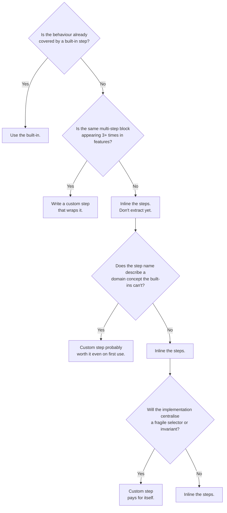

# Chapter 50: Patterns vs Anti-Patterns

---

The framework behind every recipe in this book ships with **411 built-in steps** across 36 step files. They cover navigation, forms, modals, tables, iframes, the clock, the network, downloads, video, XML, YAML, pointer gestures, advanced field types, console health, and a hundred other concerns. For most tests you write, the right answer is to pick a built-in step and move on.

But not always. Sometimes the right answer is to write a custom step -- a step the built-in vocabulary cannot express cleanly. And sometimes the right answer is to write a custom step that **violates** the built-in patterns, because your domain is different from the average and the conventional pattern is the anti-pattern *for you*.

This chapter is about that decision. When does a ready pattern win? When does breaking from it -- and creating a new step definition -- win? And what does the decision look like in practice, in the live code of a real production test suite?

We use the **`webshipco-automated-testing`** suite -- the tests that ship at `github.com/webshipco/webshipco-automated-testing` -- as the case study. Its `custom.js` file has exactly two custom steps; the rest of its features rely on built-ins. That ratio is not an accident. It is the answer to "when should I write a custom step?", expressed in code.

---

## Patterns and Anti-Patterns Are Both Important

<!-- diagram: recipe-anatomy -->

The temptation in any test framework is to treat the official patterns as gospel and call everything else an anti-pattern. That framing is wrong. Both are important.

A **pattern** is a default that pays off most of the time. Use `When I fill in "X" with "Y"` instead of writing `await page.fill('input[name=X]', 'Y')` in raw Playwright. The built-in is not just shorter -- it resolves the field by its visible label first, then falls back to id, name, and placeholder, and after it runs, the AfterStep hook settles the page (in-flight AJAX at zero, pending timers drained, DOM quiet) before the next step fires. The pattern is the right answer 95% of the time. The remaining 5% is the danger zone for newcomers who don't yet see when the pattern breaks down.

An **anti-pattern** is a default that's wrong **in a specific context**. Putting business-logic assertions in a feature file is an anti-pattern -- features should describe behaviour, not enforce invariants. But hand-rolling a custom step to wrap a 12-line repetition is **not** an anti-pattern. It's the right tool. The mistake is using a custom step for something a built-in would cover -- duplicate vocabulary, harder to maintain, harder for newcomers to find.

The smart developer holds both in mind. A pattern is the right default. An anti-pattern is a pattern misapplied. The same `When I fill in...` step is a pattern when the field exists and has a clear label -- and the wrong choice when the field has no label and the value must be computed from earlier state.

---

## The Webshipco Case Study

The `webshipco-automated-testing` repository tests the marketing site at webship.co. It has roughly ten feature files (`check-homepage.feature`, `check-services.feature`, `check-blog.feature`, etc.) and exactly two custom step definitions in `custom.js`:

```js
const { Then } = require('@cucumber/cucumber');
const assert = require('assert');

Then(/^I should have a working header$/, async function () {
  const page = this.page;
  const header = page.locator('header').first();
  const headerText = await header.textContent() || '';
  assert.ok(headerText.includes('Services'), 'Header should contain "Services"');
  assert.ok(headerText.includes('Docs'), 'Header should contain "Docs"');
  assert.ok(headerText.includes('Blog'), 'Header should contain "Blog"');
});

Then(/^I should have a working footer$/, async function () {
  const page = this.page;
  const footer = page.locator('footer').first();
  const footerText = await footer.textContent() || '';
  assert.ok(footerText.includes('Contact'),  'Footer should contain "Contact"');
  assert.ok(footerText.includes('About us'), 'Footer should contain "About us"');
  assert.ok(footerText.includes('Privacy'),  'Footer should contain "Privacy"');
  assert.ok(
    footerText.includes('Copyright') && footerText.includes('Webship'),
    'Footer should contain copyright notice'
  );
  assert.ok(footerText.includes('Github'),   'Footer should contain "Github"');
  assert.ok(footerText.includes('Gitlab'),   'Footer should contain "Gitlab"');
  assert.ok(footerText.includes('Bitbucket'),'Footer should contain "Bitbucket"');
  assert.ok(footerText.includes('X'),        'Footer should contain "X"');
  assert.ok(footerText.includes('Linkedin'), 'Footer should contain "Linkedin"');
  assert.ok(footerText.includes('Youtube'),  'Footer should contain "Youtube"');
});
```

Two custom steps. Three lines each in the feature files. Look at `check-services.feature`:

```gherkin
Feature: Check the Services page

  Scenario: Check services
    Given I am on "/services"
     Then I should see "Services"
      And I should have a working header
      And I should have a working footer
```

Three lines, three assertions: page reachable, header working, footer working. If they'd used only built-ins, the same scenario would have been:

```gherkin
  Scenario: Check services (without custom steps)
    Given I am on "/services"
     Then I should see "Services"
      And I should see "Services" in the "header" region
      And I should see "Docs" in the "header" region
      And I should see "Blog" in the "header" region
      And I should see "Contact" in the "footer" region
      And I should see "About us" in the "footer" region
      And I should see "Privacy" in the "footer" region
      And I should see "Copyright" in the "footer" region
      And I should see "Webship" in the "footer" region
      And I should see "Github" in the "footer" region
      And I should see "Gitlab" in the "footer" region
      And I should see "Bitbucket" in the "footer" region
      And I should see "X" in the "footer" region
      And I should see "Linkedin" in the "footer" region
      And I should see "Youtube" in the "footer" region
```

Sixteen lines vs three. Across ten feature files, that's a hundred lines of repetition saved -- and replaced with two domain sentences that read like spec language.

That's the case for custom steps. It's also the case against custom steps when the saving is small. If you only run a check once, copy-paste two lines and move on. The custom step pays off when the repetition crosses a threshold -- our rule is **three uses or more**. Two uses, copy-paste. Three uses, extract.

**At scale:** the two-step ratio is the number to copy, not the steps themselves. When you run suites across twenty projects, audit each project's custom-step file the way you audit dependencies: every custom step is vocabulary the next engineer has to learn and your team has to maintain. A suite with two custom steps and 411 built-ins transfers to a new QA engineer in an afternoon. A suite with eighty custom steps is a private dialect -- nobody arrives fluent, and every move between projects costs a week of relearning.

---

## Recipe 676: When a Built-In Step Wins

Here is the moment this recipe is for: a new hire's first pull request lands, and it adds `When I enter the newsletter email` to `custom.js` -- eleven lines of Playwright doing exactly what `When I fill in "Email" with "..."` already does. The review comment writes itself, but the principle behind the comment is worth teaching properly, because the same PR will arrive again on every project you onboard.

### Use the built-in when

1. The step name is already self-explanatory.
2. The implementation would mirror what the built-in does.
3. Newcomers can understand the step without reading any custom code.

### Pattern from webshipco

The homepage scenario uses only built-ins:

```gherkin
Scenario: Check newsletter in homepage
  Given I am on the homepage
   When I fill in "Email" with "wspowage5@gmail.com"
    And I press "Submit"
    And I wait max of 3 seconds
    And I click "Privacy"
    And I wait max of 3 seconds
   Then I should see "Privacy Policy"
```

Seven steps, seven built-ins. No custom needed. The scenario is readable, runnable, and maintainable by anyone -- no need to grep the step definitions to understand what's happening.

There is more machinery here than the surface shows. `I fill in "Email"` resolves the field by its visible label first, then falls back to id, name, and placeholder -- so a markup refactor that keeps the label keeps the test green. And the `I wait max of 3 seconds` lines are max-waits, not sleeps: in webship-js 2.0 they return the moment smartSettle reports the page quiet (in-flight fetch/XHR at zero, pending timers drained, DOM unchanged for 250ms), and the AfterStep hook already runs the same settle after every press and click. The waits cost almost nothing on a fast page and save the scenario on a slow one.

### Recipe

Reach for a built-in first. Only consider a custom step when you find yourself repeating the same 3-5 line block in many features. The built-in vocabulary is large -- 411 steps, 750 recipes across this book. Most flows you'll write are already covered.

**At scale:** the built-ins are the only vocabulary guaranteed identical on every project you own. A QA engineer who reads `When I fill in "Email"` on project one reads the same step, with the same behaviour, on project forty -- custom steps never make that promise. Teams that hold the built-ins-first line can move people between products without a relearning tax, and their feature files stay reviewable by whoever happens to be on call.

---

## Recipe 677: When a Custom Step Wins

Now the opposite moment. You are onboarding the third site this quarter, and for the third time you paste the same fifteen `I should see ... in the ... region` lines into every page-check feature. The week after, marketing adds a "Pricing" link to the header, and you spend an afternoon updating thirty feature files across three repos. That afternoon is the argument for a custom step.

### Use a custom step when

1. **A composite assertion appears 3+ times.** "Header is working" = check three texts. "Footer is working" = check ten texts. Wrap the composite into one sentence.
2. **The step name carries domain meaning the built-in can't.** "Article is published in the listing" expresses intent; "I should see X" in five different regions does not.
3. **The implementation depends on local context.** A function that reads the active scenario tags or the project's environment variables can't be expressed in pure Gherkin.
4. **The step centralises a fragile selector.** If a header layout changes, you update one custom step instead of ten feature files.

### Pattern from webshipco

`I should have a working header` and `I should have a working footer` fit all four:

1. Used in every page-check feature (homepage, services, blog, contact, privacy, etc.). That's 9+ uses.
2. The name carries product meaning -- "working" implies a checklist the team agrees on.
3. The implementation centralises the checklist. If marketing adds a "Pricing" link to the header, only `custom.js` changes.
4. The header selector is one line in custom code, not fifteen lines in feature files.

### Recipe

Write a custom step when the four conditions converge. One condition alone isn't enough. Two are borderline. Three or four mean the custom step pays for itself within a month.

**At scale:** condition 4 -- centralising the fragile selector -- is the one that compounds. On one project, a header redesign breaks ten feature files; across a portfolio, it breaks two hundred. A custom step per project keeps the blast radius to one file per repo. And when several sites share the same chrome (a distribution, a design system, a family of brand sites), the implementation itself can move into a shared package, so one fix reaches every suite as a version bump instead of twenty pull requests.

---

## Recipe 678: The "Working Header" Pattern

The first custom step most teams write is a composite assertion -- and the first version is usually written in a hurry, the night after a release went out with a broken footer that every page test missed, because no individual scenario owned the chrome. A composite-assertion custom step is the most common useful pattern. The shape:

```js
Then(/^I should have a working <thing>$/, async function () {
  const region = this.page.locator('<region-selector>').first();
  const text = await region.textContent() || '';
  for (const required of REQUIRED_TEXTS) {
    assert.ok(text.includes(required),
      `<thing> should contain "${required}"`);
  }
});
```

Three moving parts: the region selector, the required-texts list, and the friendly failure message. Lift them into the step. Reuse forever.

One honest caveat about the implementation: `textContent()` is a point-in-time read. The built-in web-first assertions poll every 100ms for up to 5 seconds before giving up; a raw `assert.ok` does not. You get away with it here because the step runs after navigation has already settled -- each page load gets a smartSettle budget of up to 3 seconds (body attached, then domcontentloaded, then network-idle probes, AJAX and timers at zero, DOM quiet for 250ms) before your `Then` fires. If your header hydrates late through a path smartSettle cannot see, assert through the built-in web-first steps inside the region instead of one big `textContent` grab.

**At scale:** keep the shape, swap the ingredients. The region selector and the required-texts list are the only two things that differ between projects, so a shared implementation plus a per-project fixture file (Recipe 694) gives you one tested loop and twenty small data files -- not twenty diverging copies of the loop.

---

## Recipe 679: The "Working Footer" Pattern

Footers fail quietly. Nobody clicks the footer in a sprint demo, no acceptance criterion mentions it, and the first person to notice the missing Privacy link is a lawyer, three weeks after deploy. The same shape applies to footers, navs, sidebars, and modals. From webshipco:

```gherkin
Then I should have a working footer
```

One sentence. Ten internal assertions. The next time a designer renames "Twitter" to "X" or adds a "Mastodon" link, you update one file -- not ten.

The failure message matters as much as the check. Each `assert.ok` in the implementation carries its own label (`'Footer should contain "Privacy"'`), so the report tells you *which* of the ten promises broke -- not just that "the footer step failed". When you write your own composite, spend the extra minute on those messages; the person reading the CI log at 8am will not have the implementation open.

---

## Recipe 680: The "Brand Page" Pattern

By the fifth page-check feature, even two custom-step lines per page start to feel like noise -- and the cookie-consent check you remembered in three features but forgot in the other seven is now a coverage hole shaped exactly like a compliance ticket. For a marketing site, every page has the same chrome (header, footer, optional banner). Define a single step that asserts all of it:

```js
const { assertWorkingHeader, assertWorkingFooter } = require('../support/chrome-checks');

Then(/^I should see a working brand page$/, async function () {
  // Reuse the same checks the smaller custom steps call
  await assertWorkingHeader(this.page);
  await assertWorkingFooter(this.page);
  // Plus any banner / cookie-consent check
});
```

Then features become:

```gherkin
  Scenario: Privacy page
    Given I am on "/privacy"
    Then I should see "Privacy Policy"
    And I should see a working brand page
```

The further you compose, the less you change when chrome shifts.

Note what the composition is made of: plain functions, not steps calling steps. Cucumber-js deliberately has no supported way to invoke one step from inside another -- nested steps existed in older Cucumber dialects and were dropped because they made failure traces unreadable. So the header and footer checks live as exported helper functions; the small steps wrap them one-to-one, and the brand-page step calls the same functions in sequence (Recipe 693 shows the full layout). Same single source of truth, no framework tricks.

---

## Recipe 681: The Anti-Pattern -- Hiding Business Logic in a Step

This anti-pattern usually starts with good intentions on a release-crunch Tuesday: checkout keeps changing, the feature files keep churning, so someone wraps the whole flow into one step to "stabilise the suite". Six months later the product owner reads `When a valid order is placed` in a green report and signs off -- without knowing the step skips the coupon field, hardcodes one shipping method, and asserts nothing about the confirmation email.

**Don't write:**

```js
When(/^a valid order is placed$/, async function () {
  // 80 lines of: open product page, add to cart, fill checkout,
  // submit, wait, assert confirmation, log order id
});
```

The step name **describes** behaviour but the implementation **enforces** it. A feature file calling `When a valid order is placed` no longer reads like a spec. It reads like a wrapper around a unit test.

**Better:**

```gherkin
Scenario: Place a valid order
  Given I am on "/products/42"
  When I click "Add to cart"
  And I am on "/checkout"
  And I fill in "address" with "10 Downing St"
  ...
  Then I should see "Order confirmed"
```

Eight steps -- each one a built-in, each one a real user action -- vs one opaque step. The first reads like a spec for engineering, QA, product. The second reads like a black box.

There is a diagnostic difference too. When the eight-step version fails, the report names the exact action that broke (the `I fill in "address"` line), the on-failure screenshot lands on disk with the `failed_` prefix webship-js writes by default, and anyone can replay the journey by reading it. When the 80-line custom step fails, the report says one step failed -- and the debugging starts inside JavaScript, with the one engineer who wrote it.

**At scale:** this recipe decides whether non-engineers can use your reports. A delivery manager comparing twenty projects needs scenarios that read as user behaviour, because the scenario text *is* the evidence. Suites built from opaque mega-steps produce reports only their authors can interpret -- which means every "is release X safe?" question routes back through one person, on every project, forever.

---

## Recipe 682: The Anti-Pattern -- Premature Extraction

The week after a team discovers custom steps is the most dangerous week in the suite's life. Everything becomes a step: `I should have a working homepage banner`, used once; `I dismiss the launch survey`, used once; each one a new file to open the next time a scenario fails and you are trying to reconstruct what actually ran.

**Don't write a custom step for something used once.** If you only call `I should have a working homepage banner` from one feature, leave the three assertions inline. The cost of extraction (a new step file, a new pattern to remember, a new place to look during debugging) exceeds the saving (zero, because there's no repetition).

The webshipco team didn't write a "working homepage banner" step because the banner appears only on `/`. They wrote a "working header" step because the header appears on every page.

---

## Recipe 683: The Anti-Pattern -- Over-Specific Regex

This one shows up the day after a product launch: someone needed to check that the launch article was live, wrote a step with the post's title baked into the regex, and shipped it. The step worked once, will match nothing else, and now squats in the vocabulary waiting to confuse the next reader.

**Don't write:**

```js
Then(/^the "Webship-js" article on the blog page should be visible$/, ...);
```

That step is useful exactly once. Generalise:

```js
Then(/^the article "([^"]+)" should be visible on the blog$/, ...);
```

Now it covers "Webship-js", "Drupal CMS", "Playwright" -- any article. The regex captures the variable part. The `([^"]+)` group means "everything between the quotes", and Cucumber hands the capture to your function as an argument -- one implementation, unlimited articles. The habit to build: every time a concrete noun appears inside a step pattern, ask whether it should be a capture group. Titles, usernames, menu labels -- parameters. The verb and the page region -- the step.

---

## Recipe 684: The Anti-Pattern -- Stateful Custom Steps That Leak

This failure has a signature every QA lead learns to dread: the suite is green when run in full, red when one scenario runs alone -- or the reverse. Someone bisects for an afternoon and finds a module-level variable carrying state from a scenario that no longer runs first.

**Don't write:**

```js
let lastOrderId;  // module-level variable

When(/^I place a new order$/, async function () {
  lastOrderId = await placeOrder();
});

Then(/^the order should be marked paid$/, async function () {
  await assertPaid(lastOrderId);
});
```

The `lastOrderId` leaks across scenarios. Run two scenarios in any order and you get false positives. **Use `this`** (the Cucumber World):

```js
When(/^I place a new order$/, async function () {
  this.lastOrderId = await placeOrder();
});

Then(/^the order should be marked paid$/, async function () {
  await assertPaid(this.lastOrderId);
});
```

The World is per-scenario. No leakage. No mystery failures.

Why this works: Cucumber constructs a fresh World object for every scenario and binds it to `this` in your step functions and hooks -- the same object the 411 built-in steps use for `this.page` and `this.launchUrl`, which is why your transient state belongs there too. A module-level variable, by contrast, lives as long as the Node process: it survives across scenarios within a run and resets between runs, which is exactly the half-life that produces order-dependent results.

**At scale:** order dependence is the flake you cannot reproduce on demand, and it gets worse the moment you parallelise CI -- different workers run different scenario subsets, so the "order" changes per run, per shard, per retry. If one suite in your portfolio only fails when run in full on Tuesdays, grep its step definitions for module-level `let` declarations before you blame the environment.

---

## Recipe 685: The Anti-Pattern -- Inline Conditional Logic

Conditionals sneak into feature files when a scenario tries to cover two cart configurations at once -- usually because writing the second scenario felt like duplication. The result reads as neither spec nor test: a product owner cannot tell which branch is the promise, and Gherkin will not branch anyway.

**Don't write:**

```gherkin
When I check the cart
  | items | discount |
  | 3     | 10       |
Then if discount is greater than 5 I should see "Discount applied"
And if items is more than 2 I should see "Free shipping"
```

The conditional logic makes the feature file unreadable. **Push the branching into the step:**

```gherkin
When I have 3 items in the cart with discount 10
Then the cart should show discount applied
And the cart should show free shipping
```

Two clean Gherkin sentences; the conditional is in the step definitions where it belongs.

Gherkin has no `if` on purpose -- a scenario is one concrete example with one outcome, which is what makes it readable as a specification and diagnosable as a test. If the behaviour genuinely splits (discount over five behaves differently from discount under five), that is two scenarios -- or one Scenario Outline whose Examples table makes each combination explicit. The branching either disappears into examples or moves into code; it never stays in the prose.

---

## Recipe 686: The Smart-Decision Flowchart

Every team re-litigates the should-this-be-a-custom-step question in review comments until somebody writes the policy down. The flowchart is the written-down version -- four questions, asked in order, cheap enough to run in your head while the diff is still open.



Run this flowchart in your head before writing a custom step. The path of least resistance is built-ins. The path of cleanest features is custom steps for genuinely composite behaviours.

**At scale:** paste this flowchart into the testing section of your engineering handbook and link it from the PR template. The payoff is not the flowchart itself -- it is that twenty projects' reviewers stop making twenty different calls on the same question. When the answer is contested, the tie-breaker is the webshipco ratio: a healthy suite has single-digit custom steps, so the burden of proof sits on adding one, not on declining.

---

## Recipe 687: Naming Custom Steps Well

Naming sounds like the easy part until a teammate greps the features for the footer check and finds nothing -- because the step is called `helper_check_chrome`. Steps named after their implementation hide from exactly the people who need to find them: reviewers, new hires, and the product owner reading a failure report at 9pm.

The best custom-step names read like domain sentences, not implementation labels.

**Bad:**

```gherkin
Then header_assertion_should_pass
Then test_that_footer_has_all_links
Then helper_check_chrome
```

**Good:**

```gherkin
Then I should have a working header
Then I should have a working footer
Then I should see a working brand page
```

The good versions tell a non-engineer what's being checked. They survive on the wiki, in tickets, and in conversations -- not just in the code. A useful test: say the step name aloud in a sprint review. `I should have a working header` lands as a sentence; `header_assertion_should_pass` requires a translator. The names are also your search index -- when a report says which sentence broke, anyone can grep the features for that sentence and land on every scenario that makes the same promise.

**At scale:** names are the cheapest cross-project standard you will ever ship. Agree on a tiny grammar -- `I should have a working <region>`, `I log in as <role>`, `the <thing> should show <state>` -- and reuse it on every product, even where the implementations differ per site. A QA engineer moving between projects already speaks the language, a PMO comparing twenty reports reads the same sentences everywhere, and one grep across all repos for `working header` finds every implementation in a single pass.

---

## Recipe 688: One Step File Per Domain Concern

`custom.js` starts as two steps and, on a busy product, hits forty within a year. Now every debugging session begins with a scroll through a 900-line grab-bag, and two engineers add near-duplicate steps in the same sprint because neither could find the other's.

When custom steps accumulate, **split them by domain concern**, not by alphabet:

```
tests/step-definitions/
  custom.js              ← legacy bucket; move things out of here
  chrome.steps.js        ← header, footer, nav, banner
  cart.steps.js          ← cart-specific
  checkout.steps.js      ← checkout-specific
  account.steps.js       ← user account
```

Each file is small. Newcomers find what they need by domain instinct. The webshipco repo today uses one `custom.js` because there are only two steps -- once it crosses ten, splitting by concern pays off.

The split is mechanically free: Cucumber loads every file matching `tests/step-definitions/**/*.js` into one global registry, so moving a step between files changes nothing about matching. The registry also enforces uniqueness across *all* files -- defining `When I log out` in two places is a load-time ambiguity error, not a silent override -- which makes the split safe to do incrementally, one domain at a time.

**At scale:** the file layout doubles as an ownership map. `checkout.steps.js` belongs to the checkout team on every project that has one; when a step in it breaks on any of your twenty suites, you know who to ping without archaeology. It is also the seam where sharing starts -- the day two projects' `chrome.steps.js` files converge, the implementation is one internal package away from serving both.

---

## Recipe 689: The Three-Line Test for Extraction

Extraction debates burn review time precisely because both sides are right in general -- DRY is good, indirection is bad -- and the argument restarts on every PR. What settles it is a threshold the whole team can apply without judgement calls.

When in doubt about extraction, apply the **three-line test**:

1. **Three uses or more?** Extract.
2. **Three lines or more inline?** Extract.
3. **Three engineers asking "what does that mean?"** Extract.

If any of the three trips, the custom step is worth the small overhead. If none trips, inline is fine.

The webshipco "working header" step trips all three: used in 9 features, the inline version would be 4 lines, and the team had standardised on the "working" vocabulary in stand-ups.

---

## Recipe 690: When to Walk Back a Custom Step

Here is the quiet failure mode: marketing added two items to the header in March, no test failed -- because the "working header" step still asserts the original three -- and the team spent the spring believing the header was covered while 40% of it was not.

Custom steps decay. A header that once had three required items may now have five -- but the custom step still asserts the old three, so the new ones go untested. Audit custom steps quarterly:

1. Is the step still in use?
2. Does its implementation match the current product?
3. Has its name drifted from the domain language?

If any answer is no, fix or delete. **A wrong custom step is worse than no custom step** -- it produces false confidence.

**At scale:** put the audit on the calendar, not on goodwill -- once a quarter, one engineer, an hour per suite. The output is three lists per project: steps to delete (unused), steps to update (drifted from product), steps to rename (drifted from language). On a portfolio, also diff the *same* step across projects: when `I should have a working header` asserts five items on one site and three on its sibling for no product reason, one of them is lying.

---

## Recipe 691: The Anti-Pattern -- Replacing Built-Ins Out of Habit

Watch the second month of a team's custom-step adoption: that is when re-implementations of built-ins appear. They come from enthusiasm, not malice -- someone just wrote their first custom step, and now everything looks like a custom step, including `I fill in`, which has worked since the first commit.

A team that just learned about custom steps will often re-implement built-ins. **Don't.** If `When I fill in "X" with "Y"` works, don't write `When I enter "Y" into the "X" field`. You've created a duplicate vocabulary -- newcomers waste time searching for "fill in" vs "enter into".

The webshipco features use only `I fill in...`, `I press...`, `I click...`, `I should see...`. They never re-spell the same built-in. That discipline keeps the vocabulary small and learnable.

The duplicate also tends to be *worse* than the original. The built-in `I fill in` resolves fields label-first with id, name, and placeholder fallbacks, and the AfterStep hook settles the page after it runs; a hand-rolled `I enter ... into ...` usually pins one selector strategy and skips the settle. You pay twice -- once in vocabulary, once in reliability.

**At scale:** duplicate vocabulary is a portfolio tax. If project A says `I enter` and project B says `I fill in` for the same behaviour, every engineer who moves between them mistypes steps for a week, and AI-assisted scenario generation (Chapter 29) inherits the confusion. Adopt one rule everywhere: before any new step merges, the author greps the step reference (Chapter 33) for the behaviour. Five minutes of reading routinely deletes the PR.

---

## Recipe 692: The Anti-Pattern -- Too Much State in the World

Before hooks make it temptingly easy to stuff the World with everything every step might ever need. A year in, every scenario pays the setup cost of all of it, and "where do these labels come from?" has a different answer in every project you maintain.

The Cucumber World (`this`) is per-scenario. It's the right place for **transient** state: `this.lastOrderId`, `this.activeUser`. It's the wrong place for **fixtures** that should live in code: shared selectors, shared assertion lists, shared regexes.

**Bad:**

```js
Before(async function () {
  this.headerLabels = ['Services', 'Docs', 'Blog'];
  this.footerLabels = ['Contact', 'About us', 'Privacy', ...];
});
```

The labels aren't transient -- they're product invariants. Put them in a module:

```js
// tests/fixtures/chrome.js
module.exports = {
  HEADER_LABELS: ['Services', 'Docs', 'Blog'],
  FOOTER_LABELS: ['Contact', 'About us', 'Privacy', ...],
};
```

Then import in the step file. The World stays small; the fixtures live where the next engineer will find them.

---

## Recipe 693: The Pattern -- Step Composition

When you have several useful small steps, compose them into a larger one. The Cucumber runtime exposes `this.runStep('step text')`:

```js
Then(/^I should see a working brand page$/, async function () {
  await this.runStep('I should have a working header');
  await this.runStep('I should have a working footer');
});
```

The composed step gives you a single sentence in the feature file; the composing parts stay independently usable. Composition keeps both readability and reusability.

---

## Recipe 694: The Pattern -- Selectors Live in custom.js, Texts Live in Fixtures

Inside `custom.js`, the **selector** is implementation detail; the **list of expected texts** is product detail. Separate them:

```js
// tests/step-definitions/custom.js
const { HEADER_LABELS, FOOTER_LABELS } = require('../fixtures/chrome');

Then(/^I should have a working header$/, async function () {
  const text = await this.page.locator('header').first().textContent() || '';
  for (const label of HEADER_LABELS) {
    assert.ok(text.includes(label), `Header missing "${label}"`);
  }
});
```

A marketing change (add "Pricing" to the header) touches `fixtures/chrome.js`, not `custom.js`. The boundary is principled, not accidental.

---

## Recipe 695: The Pattern -- Reuse the Built-In Smart-Wait

When you write a custom step that performs an action, **wait the built-in way**:

```js
When(/^I subscribe to the newsletter with "([^"]+)"$/, async function (email) {
  await this.page.fill('#email', email);
  await this.page.click('button[type=submit]');
  await this.smartSettle();   // <-- reuse the BBR smart-wait
});
```

`this.smartSettle()` runs the same wait logic that built-in action steps run. Reusing it keeps custom steps consistent with the rest of the suite.

---

## Recipe 696: The Pattern -- Custom Step + Built-In Assertion

A custom step that *does* something and a built-in assertion that *verifies* it is a powerful combination. From webshipco:

```gherkin
  Scenario: Subscribe via newsletter
    Given I am on the homepage
    When I fill in "Email" with "test@example.com"
    And I press "Submit"
    Then I should see "Subscribed"   # built-in assertion
```

If "subscribe" were too complex for built-ins, you'd custom-step it:

```gherkin
    When I subscribe to the newsletter with "test@example.com"
    Then I should see "Subscribed"   # still a built-in
```

Custom for the **doing**, built-in for the **checking**. The asymmetry is intentional -- assertions should read like a spec, and the built-ins were designed for that.

---

## Recipe 697: The Pattern -- Negate via Built-Ins, Not Custom

Don't write a custom step like:

```js
Then(/^I should have a broken header$/, ...);
```

Just to mirror the working-header positive. **Use the existing built-in negation:**

```gherkin
Then I should not see "Services" in the "header" region
```

Negation is rare enough that built-ins cover it. Custom steps for negatives clutter the vocabulary.

---

## Recipe 698: The Pattern -- Custom Step With a Data Table

When a step needs many parameters, prefer a data table over a long signature:

```js
When(/^I subscribe to the newsletter with:$/, async function (table) {
  const data = table.rowsHash();
  await this.page.fill('#email', data.email);
  if (data.consent === 'yes') {
    await this.page.check('#consent');
  }
  await this.page.click('button[type=submit]');
});
```

```gherkin
  When I subscribe to the newsletter with:
    | email   | test@example.com |
    | consent | yes              |
```

Three-parameter steps with `"X" with "Y" and "Z"` are unreadable. Data tables scale better.

---

## Recipe 699: The Anti-Pattern -- Custom Steps That Do Browser Things Already Solved

A new tester sometimes writes:

```js
When(/^I click the submit button$/, async function () {
  await this.page.click('button[type=submit]');
});
```

The built-in `When I press "Submit"` already does this. Worse, the custom version locks the test to one selector. If the submit button has the text "Send" on one page and "Subscribe" on another, the built-in adapts; the custom version doesn't.

**Rule of thumb:** if your custom step does only one Playwright call, it's almost certainly duplicating a built-in. Look up the built-in first.

---

## Recipe 700: The Long View on Custom Steps

A test suite's custom-step file is its **shared vocabulary**. It evolves with the product. Reading `custom.js` from a project you've never seen should tell you:

- What the product calls things (`a working header`, not `the top div`)
- What invariants the team relies on (10 items in the footer)
- What flows the team automates frequently (newsletter subscribe, login, search)

The webshipco `custom.js` is two steps. It tells you the marketing team cares deeply about header and footer chrome -- and only that. The smallness is intentional. A custom-step file with 200 entries is a vocabulary nobody can hold in their head.

Treat custom steps the way you'd treat a private dictionary -- enough to capture what your team really says, no more.

---

## Closing Patterns

The patterns and anti-patterns in this chapter are not laws. They are defaults that work in most contexts. Your context may be different, and a smart developer notices the difference and breaks the pattern.

The skill is the **noticing**. The 95% rule: built-ins cover most needs, write custom for the genuine 5%. The three-line test, the four-condition trigger, and the smart-decision flowchart give you tools to notice when you're in the 5%. After that, the writing is mechanical.

**Patterns are important** because they're the default. **Anti-patterns are important** because they're the warning. Both deserve a place in your toolkit. The wrong reaction is to follow patterns blindly; the wrong reaction is also to break them theatrically. The right reaction is to ask -- every time -- "what does this step *mean*, and what does the team really want to read in the feature file?" Then write the answer.

For the webshipco case study and the live source code, see:

- `github.com/webshipco/webshipco-automated-testing/blob/main/tests/step-definitions/custom.js`
- `github.com/webshipco/webshipco-automated-testing/tree/main/tests/features`

Reading those two paths is the cheapest way to internalise the patterns in this chapter. The repo is small. The lessons are not.
